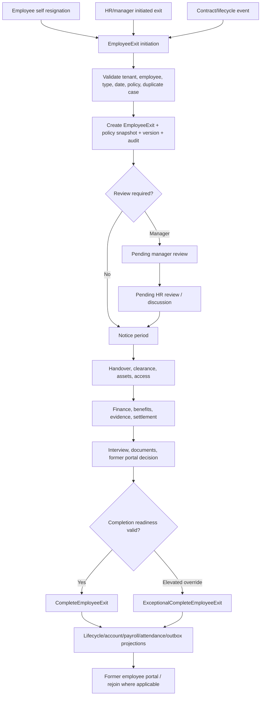
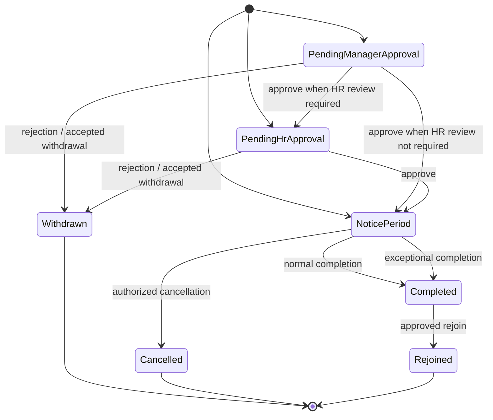
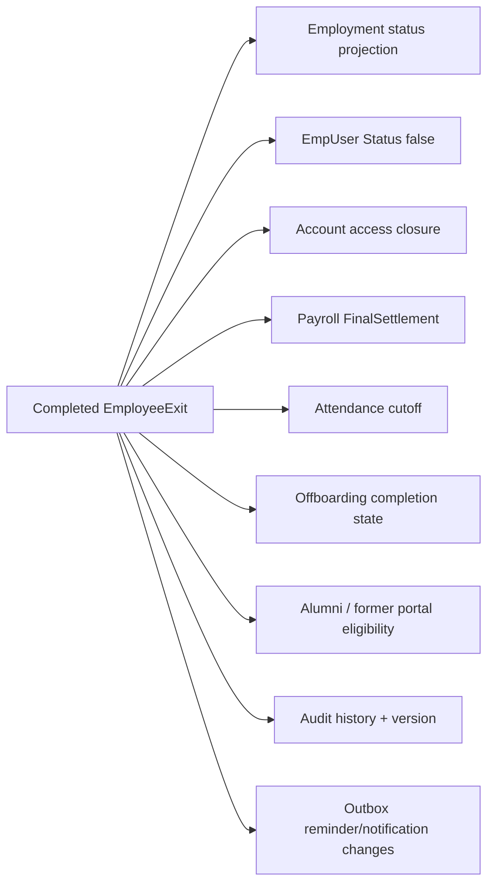

# Employee Offboarding Module — Complete Functional and Technical Documentation

> Source-aligned implementation reference for the EmployeeExit-based separation workflow. Resignation is one entry path; offboarding is the broader controlled exit process.

## 1. Purpose and authoritative record

`EmployeeExit` is the authoritative offboarding aggregate.

Legacy employee status/date fields are compatibility projections.

`EmpUser.Lifecycle` is an additive lifecycle projection.

An exit case retains policy snapshot, workflow state, operation records, audit history, version, and completion data.

Employee records are not treated as deleted merely because an exit completes.

Historical payroll, attendance, evidence, documents, and audit data must remain available according to permissions and retention policy.

## 2. End-to-end flow diagram

## 3. Entry paths

Employee self-service uses `SubmitOwnResignation`.

Self-service is server-restricted to the authenticated employee.

Self-service is server-restricted to resignation type.

HR/manager initiation uses `InitiateEmployeeExit`.

HR/manager initiation identifies a same-company employee.

The frontend employee action component is `EmployeeOffboardingAction.tsx`.

The frontend resignation action component is `ResignationAction.tsx`.

Management uses `EmployeeExitManagementCard.tsx` and `EmployeeExitOperationsPanel.tsx`.

Queue/reminder interaction uses `EmployeeExitQueueAction.tsx`.

Policy configuration uses `EmployeeExitPolicySettings.tsx`.

Employee lifecycle controls use a separate lifecycle dialog and must not be confused with final employment-status transitions.

## 4. Exit types and review model

Implemented exit categories include resignation, termination, retirement, and deceased cases.

The exit type is normalized server-side.

The policy snapshot determines required workflow features.

Resignation can enter pending manager approval.

Resignation can enter pending HR approval.

Resignation can enter notice period.

Termination can use the managed HR initiation path.

Retirement currently uses the generic exit workflow.

Deceased currently uses the generic exit workflow.

No specialized pension/benefits, death-evidence, nominee/legal-heir, or immediate-death workflow was verified in the implemented generic flow.

## 5. Status and transition diagram

Workflow state is authoritative on the exit case.

Clients send case version for review and completion mutations.

Version mismatch protects against stale updates.

Terminal/nonactionable states include Withdrawn, Cancelled, Completed, and Rejoined.

## 6. Initiation request and validation

`InitiateEmployeeExitRequest.EmployeeUserId` identifies target employee.

`InitiateEmployeeExitRequest.ExitType` identifies requested separation type.

`InitiateEmployeeExitRequest.LastWorkingDate` is required as a date value.

`Reason` is optional in DTO but may become required by policy/feature configuration.

`Notes` is optional.

`AttachmentUrl` is optional.

The server derives current tenant and actor from authentication.

The target employee must belong to current tenant.

The exit type must be supported after normalization.

Dates are validated against lifecycle/notice rules.

Active duplicate exit cases are rejected.

Policy is resolved for the employee/company context.

The resolved policy is snapshot into the case.

Case history/audit is initialized.

Case version is initialized.

Manager and department context are server-derived/snapshotted.

## 7. Policy snapshot and resolver

`EmployeeExitPolicy` is the reusable company policy record.

`EmployeeExit` stores an immutable `PolicySnapshot` for active case behavior.

Policy edits do not rewrite existing active-case obligations.

Policies can be company scoped.

Policies can be department scoped.

Policies can be role scoped.

Resolver chooses active exact department policy before exact role policy.

Resolver falls back to company default.

Duplicate candidates are deterministically broken by `EmployeeExitPolicyId`.

The resolver is a pure selection seam over already tenant-scoped policy data.

The resolver itself does not authorize callers or load tenant data.

## 8. Feature configuration

Feature configuration can enable workflow capabilities.

Feature configuration can require workflow capabilities.

Feature configuration can make capabilities completion-blocking.

Feature configuration can assign feature owner permission.

Feature configuration can permit waiver.

Feature configuration can require reason.

Known feature keys include `SelfResignation`.

Known feature keys include `HrInitiatedExit`.

Known feature keys include `ManagerApproval`.

Known feature keys include `HrApproval`.

Known feature keys include `Discussion`.

Known feature keys include `NoticePeriod`.

Known feature keys include `NoticeAdjustments`.

Known feature keys include `Withdrawal`.

Known feature keys include `Handover`.

Known feature keys include `Clearance`.

Known feature keys include `Assets`.

Known feature keys include `ItAccess`.

Known feature keys include `Finance`.

Known feature keys include `Benefits`.

Known feature keys include `Evidence`.

Known feature keys include `FinalSettlement`.

Known feature keys include `ExitInterview`.

Known feature keys include `Documents`.

Known feature keys include `FormerEmployeePortal`.

## 9. Review and discussion workflow

`ReviewEmployeeExitRequest` contains `EmployeeExitId`.

Review request contains case `Version`.

Review request contains `Action`.

Review request supports optional notes.

Review request supports optional recommended last working date.

Review request supports discussion participant IDs.

Known review actions include Approve.

Known review actions include Reject.

Known review actions include Discuss.

Known review actions include JointDiscussion.

Known review actions include RequestDiscussion.

Discussion response is a separate versioned request.

Joint-discussion response is a separate versioned request.

Review order follows policy snapshot requirements.

Manager/HR reviewer context is computed for current caller.

Case DTO exposes `IsAssignedManagerReviewer`.

Case DTO exposes `IsHrReviewer`.

Case DTO exposes permitted actions for current caller.

## 10. Notice period and date control

Notice period is a policy-controlled workstream.

Last working date is stored on the case.

Date changes are explicit operations, not incidental field edits.

Notice adjustment requests are versioned.

Notice adjustment decisions are versioned.

Employee notice offers are distinct from HR decisions.

Employee withdrawal is distinct from HR cancellation.

Withdrawal can require an authorized decision.

Cancellation requires authorized action and reason.

Notice date changes affect downstream completion/attendance behavior.

Reminder scheduling must be recalculated or invalidated after relevant date change.

## 11. Operational workstreams

### 11.1 Handover

Handover task DTO includes task ID.

Handover task DTO includes title.

Handover task DTO includes details.

Handover task DTO includes assignee user ID.

Handover task DTO includes due date.

Handover task DTO includes status.

Tasks are added/updated through versioned request.

Handover task review is separate from task authoring.

Required incomplete handover can block completion.

Responsibility reassignment is separately recorded.

### 11.2 Clearance

Clearance template records can seed exit-case items.

Clearance DTO includes clearance ID.

Clearance DTO includes template key.

Clearance DTO includes description.

Clearance DTO includes category.

Clearance DTO includes status.

Clearance DTO includes mandatory flag.

Clearance DTO includes due date.

Clearance updates carry case ID, clearance ID, version, status, evidence URL, and notes.

Required unresolved clearance can block completion.

### 11.3 Assets

Asset DTO includes asset-exit ID.

Asset DTO includes asset type.

Asset DTO includes asset identifier.

Asset DTO includes status.

Asset DTO includes tracking reference.

Asset DTO includes recovery amount.

Asset DTO includes notes.

Asset return/recovery is a dedicated operational workstream.

Pending asset count is exposed in case DTO.

### 11.4 IT access

Access DTO includes access-item ID.

Access DTO includes system.

Access DTO includes mode.

Access DTO includes status.

Access DTO includes scheduled time.

Access DTO includes external reference.

Access DTO includes notes.

Access revocation is tracked separately from employee record status.

Pending access count is exposed in case DTO.

### 11.5 Finance and benefits

Finance DTO includes finance-item ID.

Finance DTO includes category.

Finance DTO includes direction.

Finance DTO includes amount.

Finance DTO includes status.

Finance DTO includes reference.

Finance DTO includes notes.

Benefit DTO includes benefit-item ID.

Benefit DTO includes category.

Benefit DTO includes status.

Benefit DTO includes effective end date.

Benefit DTO includes reference.

Benefit DTO includes notes.

Pending finance count is exposed in case DTO.

Pending benefit count is exposed in case DTO.

### 11.6 Evidence

Evidence is stored through private evidence storage.

Evidence metadata includes evidence ID.

Evidence metadata includes category.

Evidence metadata includes type.

Evidence metadata includes status.

Evidence metadata includes visibility.

Evidence metadata includes file name.

Evidence metadata includes content type.

Evidence metadata includes uploaded UTC time.

Evidence can be verified explicitly.

Evidence can be rejected explicitly.

Evidence can be superseded rather than silently overwritten.

Evidence download must pass tenant/case/permission checks.

### 11.7 Settlement, documents, and interview

Final settlement is separate from general finance items.

Final settlement supports calculation.

Final settlement supports approval.

Final settlement supports marking paid.

Settlement tracks salary payable.

Settlement tracks deductions.

Settlement tracks notice recovery.

Settlement tracks net payable.

Settlement links source payroll ID/month where applicable.

Generated documents include relieving letter.

Generated documents include experience letter.

Generated documents include final-settlement statement.

Exit interview can retain employee feedback.

Exit interview can retain manager feedback.

Exit interview can retain HR notes.

Exit interview can retain rehire eligibility.

## 12. Completion flow

Normal completion route is `CompleteEmployeeExit`.

Exceptional completion route is `ExceptionalCompleteEmployeeExit`.

Completion request carries `EmployeeExitId` for concurrency-safe completion.

Completion request retains `EmployeeUserId` for older clients.

Completion request carries required `Version`.

Completion request accepts optional notes.

Normal completion validates required uncompleted workstreams.

Exceptional completion is an elevated override.

Exceptional completion requires reason/audit evidence.

Successful completion marks case inactive.

Successful completion sets completion timestamp.

Successful completion normalizes final employment status based on exit type.

Successful completion sets legacy employee status false.

Successful completion calls lifecycle transition service.

Successful completion closes account access.

Successful completion sets payroll status to FinalSettlement.

Successful completion writes attendance cutoff after last working date.

Successful completion updates alumni/former-employee eligibility conservatively.

Successful completion preserves history.

Successful completion cancels relevant reminders.

Successful completion records audit/history.

Successful completion emits durable notification/outbox work.

## 13. Completion projection diagram

## 14. Former employee portal and rejoin

Company former-portal enablement is separate from employee access grant.

Completing an exit does not automatically grant former portal access.

Former-employee access uses dedicated token/portal services.

Portal access should be authorized per employee/case.

Former employee requests are exposed in exit case DTO.

Generated evidence/documents can be issued to former employee subject to access rules.

Rejoin does not delete exit history.

Rejoin restores approved lifecycle dimensions.

Rejoin is a terminal lifecycle outcome for the prior case.

Rejoin requires the server-side workflow/permission checks in its dedicated route.

## 15. Reminder and durable outbox flow

`EmployeeExitOutbox` persists notification work.

`EmployeeExitOutboxWorker` invokes processor logic.

Due reminders are atomically claimed.

Dedupe keys prevent duplicate recipient events.

Policy determines employee reminder eligibility.

Policy determines manager reminder eligibility.

Policy determines HR reminder eligibility.

Policy determines administrator reminder eligibility.

Policy determines in-app versus email delivery.

Delivery channels record timestamps independently.

Failures retain attempt count.

Failures retain last error.

Failures retain next-attempt time for retry/backoff.

Dead-letter behavior provides a terminal observable state after retry exhaustion.

HR digest recipients are same-company users with Offboarding CaseManage capability.

Global reminder rendering is separate from manual Offboarding cases UI button placement.

## 16. Case DTO field map

`EmployeeExitId` identifies the authoritative case.

`EmployeeUserId` identifies the target employee.

`ExitType` identifies the separation type.

`Status` identifies current workflow state.

`LastWorkingDate` identifies projected final work date.

`Reason` stores requested/approved separation reason.

`Notes` stores case notes.

`InitiatedAtUtc` records initiation time.

`CompletedAtUtc` records completion time.

`Version` provides optimistic concurrency.

`PresetLevel` identifies policy/preset presentation.

`Features` contains snapshotted feature configuration.

`PostExitContact` exposes post-exit contact information when available.

`Clearances` exposes clearance workstream.

`HandoverTasks` exposes handover workstream.

`Assets` exposes asset workstream.

`AccessItems` exposes IT/access workstream.

`FinanceItems` exposes finance workstream.

`BenefitItems` exposes benefits workstream.

`Evidence` exposes evidence metadata.

`FormerEmployeeRequests` exposes former portal/document requests.

`ResponsibilityReassignments` exposes reassignment records.

`ExitInterview` exposes interview data.

`FinalSettlement` exposes settlement state.

`Documents` exposes generated documents.

`Withdrawal` exposes withdrawal state.

`NoticeAdjustments` exposes notice adjustment history.

`AuditHistory` exposes versioned audit trail.

`DiscussionRequest` exposes active discussion request.

`DiscussionResponse` exposes discussion response.

`DiscussionMode` exposes discussion mode.

`DiscussionParticipantUserIds` exposes participants.

`DiscussionMessages` exposes message history.

`PermittedActions` is caller-contextual UI/action guidance.

## 17. Permissions and tenancy

Employee self-service actions are limited to authenticated employee’s own case.

HR/manager operations require configured module/feature permissions.

Case management is distinct from simple employee edit permission.

Override capability is required for elevated/exceptional actions.

Evidence download requires dedicated download permission and tenant/case ownership checks.

Company-wide former portal control requires administrator authority.

All case, employee, policy, template, evidence, and recipient lookup must remain tenant-scoped.

UI visibility is not an authorization boundary.

Backend permissions and service predicates remain authoritative.

## 18. Validation matrix

| ID | Scenario | Expected implemented control |
|---|---|---|
| OFF-01 | Employee submits resignation for another employee | Server rejects self-service impersonation |
| OFF-02 | HR initiates exit for another tenant | Tenant ownership check rejects |
| OFF-03 | Unsupported exit type | Normalization/validation rejects |
| OFF-04 | Duplicate active exit case | Initiation rejects |
| OFF-05 | Invalid last working date | Lifecycle/notice validation rejects |
| OFF-06 | Review with stale version | Optimistic concurrency rejects |
| OFF-07 | Completion with stale version | Optimistic concurrency rejects |
| OFF-08 | Required manager review skipped | Completion/progression blocked by snapshot rules |
| OFF-09 | Required clearance unresolved | Normal completion blocked |
| OFF-10 | Required handover unresolved | Normal completion blocked |
| OFF-11 | Required asset/access/finance/benefit unresolved | Normal completion blocked where snapshot requires |
| OFF-12 | Exceptional completion without elevated authority | Server rejects |
| OFF-13 | Exceptional completion without reason | Server rejects/audits according to operation rules |
| OFF-14 | Evidence cross-tenant access | Private storage/service rejects |
| OFF-15 | Former portal request without authorized access | Portal service rejects |
| OFF-16 | Rejoin attempt for ineligible case | Dedicated workflow rejects |
| OFF-17 | Duplicate reminder processing | Dedupe/atomic claim prevents duplicate delivery |
| OFF-18 | Email delivery failure | Outbox retains retry/error state |

## 19. Frontend map

`EmployeeOffboardingAction.tsx` initiates HR-managed exits.

`ResignationAction.tsx` initiates employee self-resignation.

`EmployeeExitCaseCard.tsx` presents case summary/status.

`EmployeeExitManagementCard.tsx` presents management workflow state.

`EmployeeExitOperationsPanel.tsx` presents workstream operations.

`EmployeeExitQueueAction.tsx` presents queue/reminder controls.

`EmployeeExitPolicySettings.tsx` manages offboarding policies.

`EmployeeLifecycleManagement.tsx` and lifecycle dialog manage additive employment dimensions.

`FormerEmployeePortalPage.tsx` and services provide post-employment portal UX.

The UI uses backend case DTO permitted actions and version values for safe mutations.

## 20. Backend map

Primary controller route family is `api/User`.

Key initiation endpoints are `InitiateEmployeeExit` and `SubmitOwnResignation`.

Key read endpoints include employee exit, history, management, and queue routes.

Key review endpoints include review and discussion response routes.

Key notice endpoints include date update, adjustment request/decision, and own offer decision routes.

Key operation endpoints cover clearance, handover, reassignment, assets, access, finance, benefits, evidence, settlement, interview, and documents.

Key terminal endpoints include normal completion, exceptional completion, rejoin, and former-portal access routes.

Main service implementation is `EmployeeService.cs`.

Lifecycle projection implementation is `EmployeeLifecycleTransitionService.cs`.

Policy selection implementation is `OffboardingPolicyResolver.cs`.

Reminder processing is `EmployeeExitOutboxProcessor.cs` and `EmployeeExitOutboxWorker.cs`.

Evidence storage is `PrivateEmployeeExitEvidenceStorage.cs`.

Former portal service is `FormerEmployeePortalService.cs`.

## 21. Known implementation boundaries

Offboarding spans multiple repository writes.

Versioning and outbox improve consistency but do not make all writes one MongoDB transaction.

External email/SignalR delivery requires runtime configuration and recipient availability.

Retirement/deceased cases currently share generic workflow unless specialized behavior is separately implemented.

Policy resolver precedence is implemented, but policy resolution/inheritance/version behavior should be tested whenever policy schema changes.

Completion effects must be validated in a dedicated test tenant because they affect account, payroll, attendance, and employee lifecycle projections.

## 22. Production UAT checklist

Initiate resignation as employee and verify self-only restriction.

Initiate termination, retirement, and deceased cases as authorized HR in a test tenant.

Verify policy snapshot remains stable after policy edit.

Verify manager/HR review ordering and discussion variants.

Verify withdrawal versus cancellation behavior and audit entries.

Verify notice-date and notice-adjustment version conflict behavior.

Verify every workstream permission and tenant restriction.

Verify normal completion blockers one at a time.

Verify exceptional completion permission/reason/audit behavior.

Verify employee status/account/payroll/attendance cutoff projections after completion.

Verify former portal remains disabled until explicitly granted.

Verify rejoin preserves historical case and restores intended dimensions.

Verify reminder dedupe, retry, dead-letter, email, and in-app behavior with controlled recipients.
