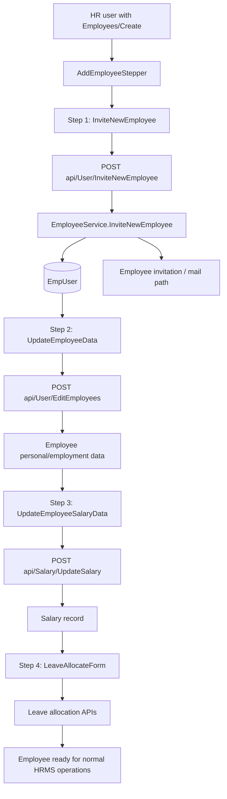
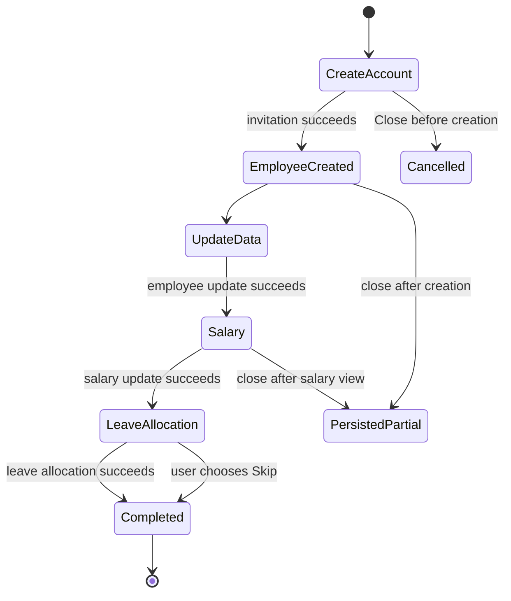

# Employee Onboarding Module — Complete Functional and Technical Documentation

> Source-aligned implementation reference for the current employee onboarding flow. This is distinct from company registration/configuration onboarding and distinct from the employee lifecycle/offboarding workflow.

## 1. Purpose and scope

Employee onboarding is the internal HR workflow that creates an employee account and progressively records employment data.

The current frontend implementation is a four-step dialog:

1. Create account / invite employee.
2. Update employee data.
3. Update salary.
4. Allocate leave.

The fourth step is optional in the UI.

The employee is created at step one.

The later steps enrich already-persisted employee data.

Closing the dialog after a completed earlier step does not roll back the employee account.

## 2. Logical flow

## 3. Frontend stepper behavior

`AddEmployeeStepper.tsx` owns local step state.

The initial step is `CREATE_ACCOUNT`.

The step enum order is fixed by numeric order.

`CREATE_ACCOUNT` is step 0.

`UPDATE_DATA` is step 1.

`UPDATE_SALARY` is step 2.

`ALLOCATE_LEAVE` is step 3.

The stepper dialog is full width with an `md` maximum width.

The stepper cannot be closed through dialog backdrop/close behavior after it progresses beyond step zero.

The dedicated Close button remains available at create-account and salary steps.

Leave allocation has a Skip button.

The final completion screen closes and refreshes the employee list.

Each child form is controlled through a Formik ref.

The parent calls `submitForm()` for the active child form.

The parent sets button loading only when active Formik form is both valid and dirty.

The child component signals successful completion before parent increments the step.

The new employee response is retained in `newEmployeeData` after invitation.

The user ID and employee ID from that response connect the later data and salary steps.

## 4. Step 1 — Create account / invite employee

### 4.1 UI fields

`employeeId` is present.

`firstName` is present.

`lastName` is present.

`email` is present.

`reportingManager` is an optional autocomplete.

`scheduleId` is an optional office-schedule autocomplete.

The UI asks the backend for the next employee ID.

When next ID is returned, the employee-ID input is disabled.

The UI loads up to 1,000 employees as manager candidates.

The UI loads active office schedules from `api/CompanyMaster/OfficeSchedules`.

The UI labels default schedules as `(Default)`.

The UI tells the user that leaving shift blank uses company default shift.

### 4.2 UI validation

`employeeId` is required.

`firstName` is required.

`firstName` is trimmed and runs of whitespace become one space.

`firstName` must match shared `Regex.Name`.

`lastName` is required.

`lastName` is trimmed and runs of whitespace become one space.

`lastName` must match shared `Regex.Name`.

`email` is required.

`email` must match shared `Regex.Email`.

`reportingManager` is nullable.

`scheduleId` is optional.

The client normalizes names again before posting.

Client validation improves UX but is not the authorization/security boundary.

### 4.3 API contract

Route: `POST api/User/InviteNewEmployee`.

Controller requires authenticated user.

Controller requires Employees/Create module permission.

Controller validates `ModelState` before calling service.

The service receives the authenticated actor user ID separately.

The request DTO contains `UserId` as optional output/compatibility data.

The request DTO requires `FirstName`.

The request DTO requires `LastName`.

The request DTO requires `Email`.

The request DTO applies `[EmailAddress]` to email.

The request DTO requires `EmployeeId`.

The request DTO optionally accepts role, department, job role, gender, reporting manager, and schedule ID.

### 4.4 Server-side create-account flow

The service resolves the current user through middleware.

The service requires that current user has a company ID.

The company ID is server-derived from current user.

The request body does not control onboarding tenant.

If a schedule ID is supplied, it must be active.

If a schedule ID is supplied, it must be nondeleted.

If a schedule ID is supplied, it must belong to current company.

First name is normalized/validated by `TryNormalizeEmployeeName`.

Last name is normalized/validated by `TryNormalizeEmployeeName`.

The service trims email.

Email uniqueness is checked globally in the current employee identity model.

An existing email returns `EmployeeAlreadyExist` custom status.

If role ID is supplied, it must be same-company and nondeleted.

If department ID is supplied, it must be same-company and nondeleted.

If job role ID is supplied, it must be same-company, active, and nondeleted.

If job role ID is supplied, a department ID is required.

If job role ID is supplied, job role department must equal selected department.

The service loads the company record.

When company auto-generation is enabled, the service reserves the next employee ID.

When auto-generation is disabled, blank employee ID is rejected.

Employee-ID uniqueness is checked inside current company.

Duplicate employee ID returns `EmployeeIdAlreadyExist` custom status.

A new GUID user ID is created before employee persistence.

Reporting manager cannot equal that new user ID.

Supplied reporting manager must be active.

Supplied reporting manager must be nondeleted.

Supplied reporting manager must belong to current company.

The service persists `EmpUser` with active status.

The service persists `IsEmailVerified=false` on creation.

The service rechecks email/employee ID after an unsuccessful insert to report race conflicts accurately.

## 5. Step 1 fields persisted on EmpUser

`UserId` is a server-generated GUID.

`FirstName` is server-normalized request data.

`LastName` is server-normalized request data.

`Email` is trimmed request data.

`EmployeeId` is reserved/generated or validated request data.

`CompanyId` is derived from authenticated current user.

`RoleId` becomes empty string when no role is supplied.

`Department` becomes empty string when no department is supplied.

`JobRole` becomes empty string when no job role is supplied.

`Gender` becomes empty string when no gender is supplied.

`ReportingManager` becomes empty string when no manager is supplied.

`IsEmailVerified` begins false.

`Status` begins true.

`ScheduleId` is validated as part of invite flow and is used by schedule-assignment integration.

## 6. Step 2 — Update employee data

The second step only renders after invitation succeeds.

It receives the persisted employee response.

It uses `UpdateEmployeeData` and `EditEmployeePayloadModel`.

It submits through the employee update API rather than recreating employee identity.

The employee update controller route is `POST api/User/EditEmployees` with a `userId` parameter.

The controller requires Employees/Edit permission.

The controller has special self-edit handling.

When the target user equals authenticated current user, privileged fields are discarded and restricted self-edit mapping is used.

When an HR user edits another employee, employee existence is checked before update.

The employee update operation is the onboarding step that fills personal and employment details not captured at invitation.

Examples in current frontend schema include address, job role, gender, department, role, reporting manager, employment type, contact details, date fields, bank account number, and PAN number.

### 6.1 Employee-data frontend validation

First name is required.

Last name is required.

Email is required.

Employee ID is required.

Role ID is required for the full employee schema.

Address is optional.

Job role is nullable.

Gender is nullable.

Department is nullable.

Reporting manager is nullable.

Team lead is nullable.

Employment type is nullable.

Phone number is nullable but must match shared phone regex when provided.

Blood group is nullable.

Date of joining cannot be future-dated in the current UI schema.

Date of birth cannot be future-dated in the current UI schema.

Personal email must match shared email regex when provided.

Emergency contact must match shared phone regex when provided.

Bank account number is optional.

Bank account number must match shared bank-account regex when supplied.

PAN number is optional.

PAN number must match shared PAN-card regex when supplied.

## 7. Step 3 — Update salary

The third step only renders after employee-data step succeeds.

It receives new employee user ID and employee ID.

It uses `UpdateEmployeeSalaryData`.

The salary form has its own Formik ref.

The parent stepper calls form submit when Assign is clicked.

The step only advances when child reports successful user update.

The integration endpoint is `api/Salary/UpdateSalary` according to frontend service constants.

Salary ownership must remain server-derived from the target employee and authenticated company context.

Salary creation/update is deliberately separate from identity creation.

This separation avoids combining account creation and financial data mutation into one client request.

The onboarding dialog allows Close at salary step.

Therefore an employee can be persisted without completing salary step.

Downstream payroll eligibility must be established by salary service/business rules, not assumed merely from employee existence.

## 8. Step 4 — Allocate leave

The fourth step only renders after salary step succeeds.

It receives the new employee user ID as `employeeId` prop.

It uses `LeaveAllocateForm`.

The form tracks selected leave policies.

The form is invoked through a Formik ref.

The UI allows Skip at this step.

Skip advances to completion without a leave allocation request.

Leave allocation is therefore optional in current onboarding UI.

Leave allocation is separate from employee identity and salary persistence.

Any server leave-policy validation remains authoritative.

## 9. Onboarding state diagram

`PersistedPartial` is not a backend workflow status.

It documents UI behavior: close does not roll back completed prior API calls.

## 10. Validation matrix

| ID | Scenario | Enforced behavior |
|---|---|---|
| ONB-01 | Blank first name | UI schema blocks; service normalization/validation also runs |
| ONB-02 | Blank last name | UI schema blocks; service normalization/validation also runs |
| ONB-03 | Invalid email | UI schema and DTO ModelState reject |
| ONB-04 | Existing global email | Service returns EmployeeAlreadyExist |
| ONB-05 | Auto-ID disabled and blank ID | Service rejects |
| ONB-06 | Duplicate company employee ID | Service returns EmployeeIdAlreadyExist |
| ONB-07 | Schedule from another tenant | Service rejects |
| ONB-08 | Inactive/deleted schedule | Service rejects |
| ONB-09 | Role from another tenant | Service rejects |
| ONB-10 | Department from another tenant | Service rejects |
| ONB-11 | Job role inactive/deleted/other tenant | Service rejects |
| ONB-12 | Job role department mismatch | Service rejects |
| ONB-13 | Manager from another tenant | Service rejects |
| ONB-14 | Inactive/deleted manager | Service rejects |
| ONB-15 | Future joining date in UI | UI schema blocks |
| ONB-16 | Future DOB in UI | UI schema blocks |
| ONB-17 | Invalid PAN / bank / phone supplied in data step | UI schema blocks |
| ONB-18 | Missing Employees/Create | Controller module permission denies invite |
| ONB-19 | Missing Employees/Edit | Controller module permission denies data update |
| ONB-20 | Skip leave allocation | UI completes without leave allocation |

## 11. Permission and tenant model

Invite requires Employees/Create.

Employee data update requires Employees/Edit.

Next employee ID read requires Employees/View.

Company ID is derived from authenticated inviter.

Schedule ownership is checked against that company ID.

Role ownership is checked against that company ID.

Department ownership is checked against that company ID.

Job role ownership is checked against that company ID.

Reporting-manager ownership is checked against that company ID.

Employee ID uniqueness is company-scoped.

Email uniqueness is global in the current identity model.

Frontend permissions only govern screen/control availability.

Backend attributes and service predicates remain authoritative.

## 12. Failure and recovery behavior

Failure before invitation success leaves no created employee from this flow.

Failure after invitation success leaves an employee record already persisted.

Failure in employee-data step does not delete employee identity.

Failure in salary step does not delete employee identity or data update.

Failure in leave allocation does not delete employee, data, or salary changes.

HR can reopen/update the relevant employee data using normal employee management surfaces.

The onboarding dialog itself is not a durable server-side stage/resume workflow in the inspected current source.

Do not claim Save & Exit/resume behavior unless a persisted onboarding-state implementation is introduced and verified.

## 13. Cross-module connections

Company settings control automatic employee-ID generation.

Company schedules control selectable shift assignment.

Roles control employee access assignment.

Departments and job titles control organizational placement.

Employee reporting manager controls reporting hierarchy.

Salary module receives employee identity for compensation setup.

Leave module receives employee identity for policy allocation.

Authentication/invitation flow begins with unverified employee email.

Payroll depends on employee and salary setup.

Attendance/work schedule behavior depends on schedule assignment.

Offboarding later operates against this same employee identity and employment record.

## 14. Source map

Backend entry points include `Codeji.CMS.API/Controllers/UserController.cs` and `Codeji.CMS.Services/Employees/EmployeeService.cs`.

Invite DTO is `Codeji.CMS.DTO/Employee/InviteEmployeeDto.cs`.

Frontend stepper is `CMS-React/src/app/modules/employees/components/AddEmployeeStepper.tsx`.

Invite form is `CMS-React/src/app/modules/employees/components/InviteNewEmployee.tsx`.

Later onboarding components are `UpdateEmployeeData.tsx`, `UpdateEmployeeSalaryData.tsx`, and `LeaveAllocateForm.tsx`.

Frontend employee API client is `CMS-React/src/app/modules/employees/employeeServices.ts`.

Frontend schema is `CMS-React/src/utils/Schema/employeeSchema.ts`.

## 15. Production UAT checklist

Create a new employee with automatic ID enabled.

Create a new employee with automatic ID disabled and valid manual ID.

Attempt duplicate email and verify no employee-ID reservation side effect.

Attempt duplicate employee ID in same company.

Attempt cross-company role, department, job role, manager, and schedule values.

Verify manager dropdown does not offer invalid employee in rendered UI.

Verify current company default schedule behavior when schedule is left blank.

Complete each step and verify all persisted records against APIs/database in test tenant.

Close after each completed step and verify the documented partial-persistence behavior.

Verify the invited employee’s first login/email-verification path.

Verify payroll cannot process employee without required salary configuration.

Verify leave/attendance behavior for skipped leave allocation or default schedule.
