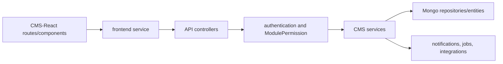

# Project Documentation

Last verified against code: 2026-09-07.

This is the current, module-oriented entry point for the Codeji CMS API and its sibling React client. It intentionally points to source and focused references instead of copying implementation. The API is ASP.NET Core (`Codeji.CMS.API`), services and DTOs live in sibling projects, and persistence is MongoDB through `Codeji.CMS.Repository`. The React application is `../CMS-React`.

| Module | Overview | UI | API | Flow / data |
|---|---|---|---|---|
| Authentication and authorization | [authentication](authentication/README.md) | [UI](authentication/UI.md) | [API](authentication/API.md) | [current flow](authentication/CURRENT_FLOW.md) |
| Employee and offboarding | [employee](employee/README.md) | [offboarding UI](offboarding/UI.md) | [offboarding API](offboarding/API.md) | [offboarding flow](offboarding/FLOW.md) |
| Attendance and WFH | [attendance](attendance/README.md) | [UI](attendance/UI.md) | [API](attendance/API.md) | [current flow](attendance/CURRENT_FLOW.md) |
| Leave management | [leave-management](leave-management/README.md) | [UI](leave-management/UI.md) | [API](leave-management/API.md) | [current flow](leave-management/CURRENT_FLOW.md) |
| Company, calendar and schedules | [company](company/README.md) | [UI](company/UI.md) | [API](company/API.md) | [current flow](company/CURRENT_FLOW.md) |
| Payroll and salary | [payroll](payroll/README.md) | [UI](payroll/UI.md) | [API](payroll/API.md) | [current flow](payroll/CURRENT_FLOW.md) |
| Recruitment and careers | [recruitment](recruitment/README.md) | [UI](recruitment/UI.md) | [API](recruitment/API.md) | [current flow](recruitment/CURRENT_FLOW.md) |
| Dashboard and notices | [dashboard-notices](dashboard-notices/README.md) | [UI](dashboard-notices/UI.md) | [API](dashboard-notices/API.md) | [current flow](dashboard-notices/CURRENT_FLOW.md) |
| Platform/cross-cutting | [platform](platform/README.md) | [UI integration](platform/UI.md) | [API boundary](platform/API.md) | [current flow](platform/CURRENT_FLOW.md) |

The older focused references remain available because they contain checked, useful detail. They are not changelogs: `offboarding-module-current-flow.md`, `attendance-module-current-flow-and-audit.md`, `leave-management-current-flow.md`, `payroll-module-current-flow.md`, and `recruitment-current-flow-and-working-context.md`.

## Employee lifecycle reference

The current additive lifecycle implementation is documented in [the status model](employee-lifecycle-status-model.md), [the transition matrix](employee-lifecycle-transition-matrix.md), [the production TODO](employee-lifecycle-production-todo.md), and [the deployment runbook](employee-lifecycle-deployment-runbook.md). Module-specific updates are mirrored in the ignored-but-distributed module folders: `employee`, `offboarding`, `attendance`, `leave-management`, and `payroll`.
