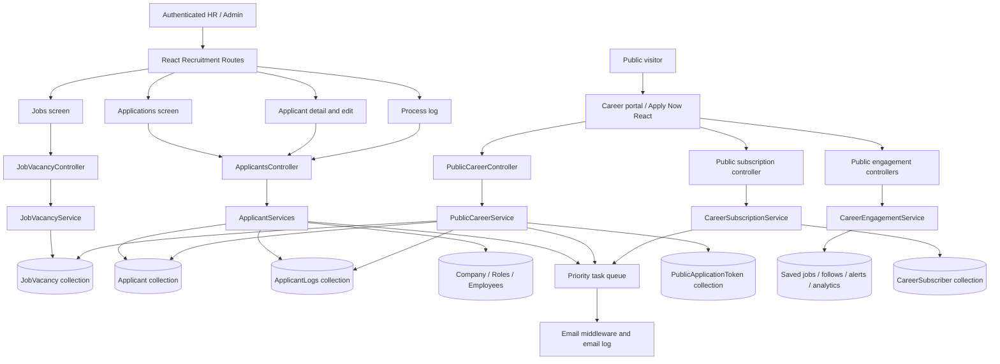
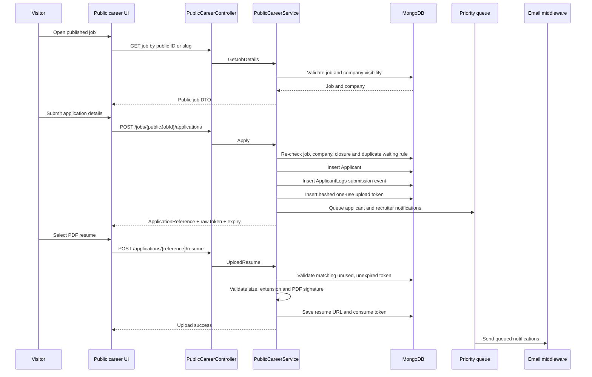
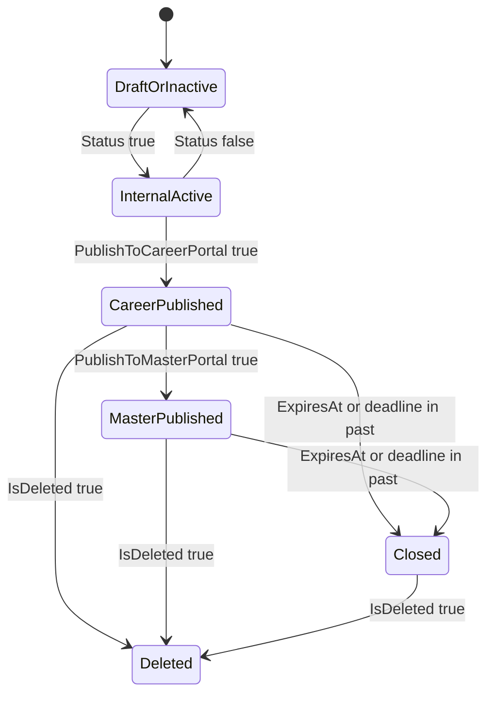
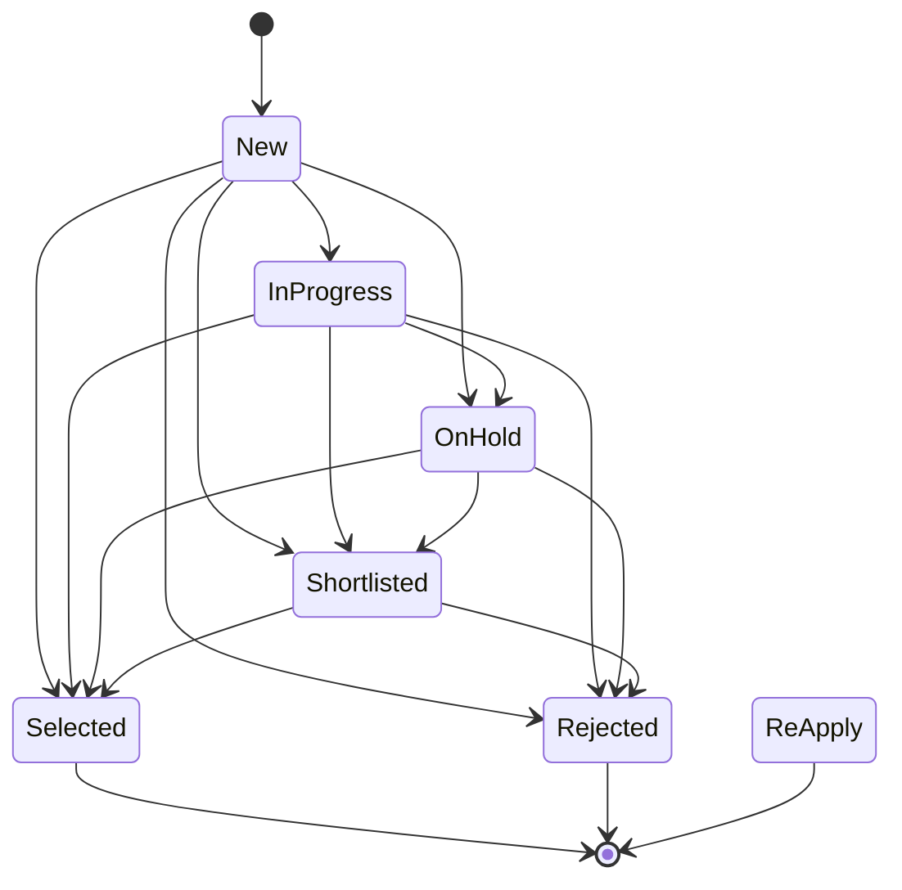
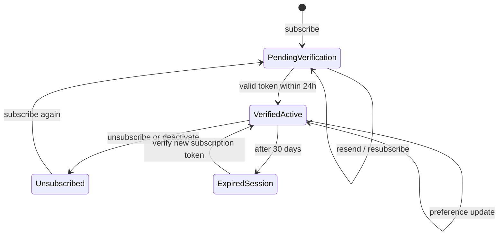

# Recruitment Module — Complete Functional and Technical Documentation

> Source reviewed: `CMS-Backend-Core` and `CMS-React` in the current workspace on 17 September 2026. This document describes the implemented source flow. “UI validation” and “server validation” are intentionally separated.

## 1. Module scope

Recruitment has two related surfaces:

1. **Internal recruitment operations**: job vacancies, manually added/applicant-submitted applications, applicant status processing, comments, resumes, and process logs.
2. **Public Career Portal**: public company/job pages, public application submission, secure resume upload, company career profile, subscriber verification/preferences, saved jobs, follows, alerts, visitor preferences, and analytics.

The shared business link is `JobVacancy.JobId`/`PublicJobId` → `Applicant.VacancyId`. A company/tenant is identified by `CompanyId`; public company URLs use a normalized `PublicCompanyCode`.

## 2. Logical end-to-end flow

```text
Company enables Career Portal and configures Career Profile
        ↓
HR creates JobVacancy (internal or external application mode)
        ↓
Job is active, published, within expiry/deadline, and company is eligible
        ↓
Public portal lists job by PublicJobId/slug/company code
        ↓
Candidate submits application → Applicant + initial ApplicantLogs record
        ↓
Candidate receives reference/token instructions and uploads PDF resume
        ↓
Recruitment recipients receive alert; applicant receives status email
        ↓
Recruiter reviews application, changes ActivityType, adds comments
        ↓
Every status change is logged and selected/rejected/status notifications queue
        ↓
Internal Applications and Process Log screens report the hiring activity
```

An external job does not create a local application through the normal public apply flow; it exposes a validated HTTPS external URL. Internal mode uses the CMS application flow.

## 3. Backend architecture and persistence

### 3.1 Main entities

| Entity | Purpose | Important relationships |
|---|---|---|
| `JobVacancy` | Job/requisition and publication data | `CompanyId`; referenced by applicants through `VacancyId` |
| `Applicant` | Candidate/application record | `CompanyId`, `VacancyId`; resume URL; current status |
| `ApplicantLogs` | Immutable-ish process/comment history | `CompanyId`, `ApplicantId`, `UserId`, job role/category |
| `Resume` | Resume metadata entity | Applicant/company/file name and URL; current upload path is also reflected in Applicant.ResumeUrl |
| `PublicApplicationToken` | One-purpose, expiring resume-upload token | Applicant/job/application reference; hashed token; used flag |
| `MailTemplate` | Configurable recruitment email template source | Used by queued applicant/HR notifications |
| `PublicCompanyProfile` | Public career branding/content | Company-owned; published flag |
| Career portal entities | Subscribers, saves, followers, alerts, analytics, visitor preferences | Public job/company identifiers and hashed visitor/session identities |

All tenant-owned entities inherit the repository base metadata where applicable, including `CompanyId`, deletion/status/audit fields. Repository queries must remain company-scoped for authenticated operations.

### 3.2 JobVacancy fields

| Field | Type | Meaning / connection |
|---|---|---|
| `JobId` | string | Internal primary identifier |
| `PublicJobId` | string | Public stable identifier, generated as `JOB-{guid}` when absent |
| `Slug` | string | SEO/public route slug; generated uniquely from title |
| `ReferenceCode` | string? | Business/reference code |
| `Title` | string | Job title; used in search, emails, logs |
| `Vacancies` | int | Number of openings |
| `JobType` | int | Existing job-type enum/value used by filters/UI |
| `Status` | bool | Internal active/inactive state |
| `Description` | string | Rich job description |
| `PublishToCareerPortal` | bool | Makes eligible for company career portal |
| `PublishToMasterPortal` | bool | Makes eligible for master marketplace |
| `ApplicationMode` | string | Normalized to `Internal` or `External` |
| `ExternalApplicationUrl` | string? | Kept only for valid HTTPS, non-loopback external mode |
| `Location` | string? | Job location |
| `WorkplaceType` | string? | Remote/hybrid/on-site style value |
| `EmploymentType` | string? | Full-time/contract/etc. |
| `ExperienceMin`, `ExperienceMax` | decimal? | Public search/display experience range |
| `SalaryMin`, `SalaryMax` | decimal? | Salary range |
| `Currency` | string? | Salary currency |
| `Skills` | list<string> | Legacy/general skills |
| `PublishedAt` | DateTime? | Publication timestamp |
| `ExpiresAt` | DateTime? | Job visibility expiry |
| `ApplicationDeadline` | DateTime? | Application cutoff |
| `Summary` | string? | Short public summary |
| `Department`, `FunctionalArea`, `Industry`, `RoleCategory` | string? | Classification/search/display fields |
| `EducationRequirement` | string? | Education requirement |
| `Responsibilities` | list<string> | Responsibilities; comma-separated in current admin UI |
| `RequiredSkills`, `PreferredSkills` | list<string> | Skills; comma-separated in current admin UI |
| `Benefits` | list<string> | Benefits; comma-separated in current admin UI |
| `Keywords` | list<string> | Search keywords; comma-separated in current admin UI |
| `ShiftType`, `WorkingDays`, `TravelRequirement` | string? | Work arrangement details |
| `IsFeatured`, `IsUrgentHiring`, `IsWalkIn` | bool? | Public presentation flags |
| `WalkInStartAt`, `WalkInEndAt`, `WalkInAddress` | DateTime?/string? | Walk-in details |
| `RecruiterContactEmail` | string? | Alert/contact recipient fallback |
| `NoticePeriodMaxDays` | int? | Candidate/job notice-period constraint/display |
| `ShowSalary` | bool? | Public salary visibility |

### 3.3 Applicant fields

| Field | Type | Meaning |
|---|---|---|
| `ApplicantId` | string | Primary identifier |
| `FirstName`, `LastName` | string | Candidate identity |
| `Email` | string | Candidate identity/deduplication key within tenant for internal registration |
| `Phone` | string | Candidate phone |
| `CompanyId` | string | Tenant owner; never trust a request company ID |
| `VacancyId` | string | Job link |
| `ActivityType` | enum | Pipeline state: `New(0)`, `InProgress(1)`, `OnHold(2)`, `Shortlisted(3)`, `Selected(4)`, `Rejected(5)`, `ReApply(6)` |
| `Status` | enum | Record state: `InActive(0)` or `Active(1)` |
| `State` | string | Candidate state/location selection |
| `Experience` | decimal | Stored experience; UI edit converts years/months to months |
| `CurrentCompany`, `CurrentJobTitle` | string? | Entity-supported profile fields; not exposed in the basic current DTO forms |
| `NoticePeriodDays` | int? | Entity-supported candidate notice period |
| `LinkedInUrl`, `PortfolioUrl`, `CoverLetter` | string? | Entity-supported candidate profile/application fields |
| `ResumeUrl` | string | Stored resume location |

## 4. Backend API contract

### Internal authenticated APIs

Controller: `api/JobVacancy` and `api/Applicants`. Controllers use `[Authorize]`; module permissions are checked with `ModulePermission`.

| Endpoint | Permission | Behavior |
|---|---|---|
| `POST api/JobVacancy/AddJobVacancy` | Jobs/Create | Creates vacancy, public ID, unique slug, normalized mode/URL |
| `POST api/JobVacancy/EditJobVacancy?jobId=` | Jobs/Edit | Updates vacancy while retaining generated public ID/slug and existing optional values |
| `POST api/JobVacancy/GetAllVacancy` | AllowAnonymous at controller/action | Paged job listing, job-type/status/title search, application count |
| `POST api/JobVacancy/GetVacancyById` | No explicit permission | Returns title for an ID |
| `DELETE api/JobVacancy/DeleteJobVacancy?vacancyId=` | Jobs/Delete | Marks deleted and calls repository delete |
| `POST api/Applicants/GetApplicantList` | Applications/View | Tenant-scoped filtered/paged application list and vacancy names |
| `GET api/Applicants/ApplicantById?id=` | Applications/View | Tenant-scoped applicant detail |
| `POST api/Applicants/AddApplicant` | Applications/Create | ModelState validation, tenant assignment, duplicate email check, log and notifications |
| `POST api/Applicants/EditApplicant` | Applications/Edit | Authenticated actor/company check, transition validation, history and notification |
| `POST api/Applicants/UploadResume?email=` | Anonymous + `career-sensitive` rate limit | PDF and 5 MB check, then stores resume for matching applicant |
| `POST api/Applicants/AddComment` | Applications/Edit | Adds applicant process/comment log |
| `GET api/Applicants/GetAllComment/{applicantId}` | Applications/View | Tenant-scoped applicant history with employee display names |
| `POST api/Applicants/GetProcessLogData` | ProcessLog/View | Tenant-scoped, date/job-role/category/name filtered logs |

### Public career APIs

`PublicCareerController` is anonymous. A job is eligible only when it is active, not deleted, published to the career portal, not expired, not past its application deadline, and its company is active, not deleted, and has `CareerPortalEnabled`.

| Endpoint family | Purpose |
|---|---|
| `GET api/public/career/jobs`, `/jobs/{publicJobId}`, `/jobs/by-slug/{jobSlug}` | Marketplace/job detail |
| `GET api/public/career/companies/{companyCode}/jobs` | Company-specific jobs |
| `GET api/public/career/job-locations` | Public location search |
| `POST api/public/career/jobs/{publicJobId}/applications` | Public application creation |
| `POST api/public/career/applications/{applicationReference}/resume` | Token-protected resume upload |
| `POST/DELETE/GET api/public/career/.../save` | Save/unsave/list saved jobs |
| `POST .../merge-anonymous-saves` | Merge visitor saves into verified subscriber |
| `POST/DELETE/GET .../companies/{companyCode}/follow` | Follow company and notification preferences |
| `POST/GET/PUT/DELETE .../job-alerts` | Verified subscriber job alerts |
| `POST .../analytics` | Allowlisted visitor/job/company analytics events |
| `GET/PUT api/CareerProfile` | Authenticated career profile administration |
| `PUT api/CareerProfile/theme` | Authenticated company theme update |
| `POST api/public/career/subscribers`, `/verify`, `/resend-verification`, `/unsubscribe` | Subscription lifecycle |

Career-sensitive mutation endpoints use the fixed-window rate limiter configured as `career-sensitive`; the current source history records this as 12 requests per IP per minute.

## 5. Application and notification flow

### Internal/manual applicant creation

`RegisterApplicants` obtains `CompanyId` from the authenticated request context, rejects an existing same-company email, creates the applicant, writes “New application submitted” to `ApplicantLogs`, queues an HR/recruitment alert, and queues an applicant email.

### Public Apply Now

The public job is resolved by public ID and eligibility rules. The service creates or re-application-updates an applicant, sets the active/new state as appropriate, generates an application reference/token workflow, and returns the result used by the public apply modal. Resume upload is a separate step so the application can provide a secure upload token/reference.

### Resume upload

The legacy authenticated-controller route accepts an email and checks `.pdf` and 5 MB. The public route accepts application reference, token, and multipart resume; token records store only a hash, have an expiry, are single-purpose and single-use, and bind to applicant/job/reference. The implementation writes under `Uploads/Resume` and replaces the prior file where applicable. The public frontend uses the application reference/token flow; the internal form uses the email route.

### Status transitions

The backend checks the previous `ActivityType` before editing. `Selected`, `Rejected`, and `ReApply` are terminal/current states from which ordinary transitions are blocked. Rejection is allowed from active processing states. `New`/`ReApply` are restricted according to the service transition method. A successful change writes a status-history log and queues the corresponding applicant email. This server rule is authoritative even if a client sends a manually crafted value.

### Recruitment recipients

The HR alert resolves the vacancy/company, uses `RecruiterContactEmail` where configured, and otherwise finds eligible tenant users through role/employee data. Email work is placed on `IPriorityTaskQueue`; it is not required to complete synchronously with the database write.

## 6. Frontend structure and user flow

### Routes and access

`RecruitmentRoutes.tsx` defines:

- `/recruitment/jobs` → `Jobs`, protected by Jobs module.
- `/recruitment/applications` → `Applications`, protected by Applications module.
- `/recruitment/applicant/:applicantid` → details, Applications/View.
- `/recruitment/applicant/edit/:applicantid` → edit, Applications/Edit.
- `/recruitment/processlog` → process log, ProcessLog/View.
- `/recruitment/career-profile` → admin career profile, CareerProfile/View.

The UI also checks Redux `modulePermission` before rendering create/edit/delete controls. Backend permission attributes remain the real authorization boundary.

### Jobs screen

`Jobs.tsx` provides paged/searchable/filterable job listing, add/edit modal, view details, delete confirmation, active/inactive display, job type display, and application counts. `AddEditJob.tsx` loads departments, uses a rich text editor for description, serializes list fields as comma-separated input, and supports career/master publication flags and extended public fields.

### Applications screen

`Applications.tsx` provides search, date/status/activity/vacancy/experience filters, paging, responsive columns, applicant navigation, add modal, and resume preview. Experience filters are converted from years to stored months before the API call. The table displays candidate name, vacancy, record status, pipeline status, experience, applied date, and resume action.

### Applicant detail/edit

Applicant detail shows candidate/job information, resume preview and comments/history. Edit uses separate years/months fields and converts them to the backend decimal/month representation. It permits pipeline state selection subject to the backend transition rule.

### Process log

`ProcessLog.tsx` supports applicant-name search, job-role/date/activity-category filters, paging, and log display. Logs combine candidate-submission events, status history, comments, and actor display names where an employee can be resolved.

### Public portal frontend

The `careerPortal` and `applynow` modules render marketplace/company jobs, job details, search, saved jobs, company follow, subscriptions, career preferences, public profile/theme, and `ApplyJobForm`/resume flow. `careerPortalService.ts` and `publicCareerService.ts` call the anonymous public endpoints and use visitor tokens or `X-Career-Session` for public engagement.

## 7. Validation and normalization matrix

### Server-enforced

- Authenticated internal routes require authorization; module permissions protect create/edit/delete/view operations.
- Tenant/company is taken from authenticated context for internal applicant operations and used in applicant/log lookups.
- Internal applicant duplicate check is same-company email.
- Applicant name rejects `= ~ < > ; \` %`; email uses `[EmailAddress]`; phone uses Indian 10-digit pattern `[6-9]\d{9}`.
- Public eligible-job checks enforce active/not-deleted/published/expiry/deadline/company-portal conditions.
- Application mode is normalized to `Internal` or `External`.
- External URL is retained only if absolute HTTPS and non-loopback; otherwise it becomes null.
- Job slug is lower-case, non-alphanumeric runs become hyphens, empty values become `job`, and collisions receive numeric suffixes.
- Resume extension must be `.pdf` and size must not exceed 5 MB on the legacy upload endpoint; public upload additionally uses hashed, expiring, bound, one-use tokens.
- Applicant status transition rules are enforced in `ApplicantServices`.
- Public subscriber sessions, verification tokens and unsubscribe tokens are stored as hashes; sessions expire and require verified active subscribers.
- Career alerts normalize/validate frequency and clean bounded list values; analytics events are allowlisted and cross-company job/company references are rejected.
- Career profile URLs reject unsafe schemes, loopback/user-info URLs; text/HTML/list content is cleaned/sanitized and field lengths are checked.

### Frontend-only or primarily frontend

`jobSchema.ts` requires title, vacancies, description, job type, and status; vacancies must be at least 1. It does not currently validate the many optional public job fields or numeric range ordering.

`applicantValidationSchema.ts` requires names, email, state, phone, non-negative experience, vacancy, and a PDF resume up to 5 MB for add. Edit requires years/months, vacancy, activity type in 0–5, and optional PDF resume. The add schema does not restrict activity type to the full enum including `ReApply(6)`, while edit explicitly allows only 0–5; backend behavior is authoritative.

The frontend PDF extension check is case-sensitive (`pdf`), while the controller compares the extracted extension to `.pdf`; uppercase extensions may therefore be rejected inconsistently. Frontend validation does not replace server validation.

## 8. Cross-module connections

- **Company/tenant**: company status, `CareerPortalEnabled`, public company code, logo/theme, and profile determine public visibility.
- **Roles and permissions**: HR/administrator/recruitment recipients and module permissions control operations and notifications.
- **Departments/company master**: department list is loaded into the job editor; job title/department classification supports search and reporting.
- **Email/background tasks**: application/status events queue email work through the priority task queue and mail middleware/templates.
- **Storage**: resumes are filesystem-backed under the application upload directory; database fields retain URL/name metadata.
- **Audit/process history**: applicant logs connect candidates, jobs, staff actors, status changes, comments, and timestamps.
- **Public marketplace**: `PublishToMasterPortal`, public IDs/slugs, career profile and company eligibility connect internal jobs to external discovery.
- **Employee data**: log rendering resolves `UserId` to same-company employee records; status edits require an active same-company authenticated employee.

## 9. Important implementation observations

1. The entity contains richer applicant fields (`CurrentCompany`, `CurrentJobTitle`, `NoticePeriodDays`, social URLs, cover letter) than the current internal add/edit/view DTOs and UI expose.
2. Job entity and DTO support more fields than the simplified frontend `JobModal` currently models, including salary/currency, walk-in fields, external application URL, `ShowSalary`, `IsWalkIn`, and some publication metadata.
3. The public portal has stronger eligibility and token controls than the older `ApplicantsController.UploadResume` email-based anonymous endpoint. Treat the public reference/token endpoint as the preferred production flow.
4. `GetVacancyById` on the controller returns only a title and lacks an explicit module-permission attribute; this is different from the tenant-scoped internal listing/detail methods and should be considered when tightening API exposure.
5. Public listing is anonymous by design. Internal mutation and applicant-management authorization must not be inferred from frontend route protection.
6. Deletion uses a soft-delete update followed by repository deletion behavior; confirm repository semantics before relying on recovery expectations.

## 10. Acceptance checklist for a complete recruitment release

- Create/edit/delete job with permission-denied tests.
- Verify generated public ID and unique slug; verify internal/external URL normalization.
- Verify inactive, expired, deadline-passed, unpublished, deleted, and career-disabled jobs are absent from public results.
- Submit valid public application; verify applicant, reference/token, log, HR alert, and applicant email queue.
- Reject duplicate same-company internal email; verify cross-tenant isolation.
- Upload valid/invalid/oversized/expired/reused/unbound resume tokens.
- Exercise every applicant pipeline transition, including terminal and re-apply cases.
- Verify status email, process log, comments, actor resolution, filters, paging, and application counts.
- Verify public profile sanitization, URL checks, company-code routing, theme persistence, subscriptions, saved jobs, follows, alerts, analytics limits, and rate limiting.
- Run backend tests/build and frontend typecheck/lint/build, then perform browser checks against the running application; source presence alone is not runtime proof.

## 11. Source map

Backend: `Codeji.CMS.Repository/Entities/Recruitments`, `Codeji.CMS.DTO/Recruitments`, `Codeji.CMS.Services/Recruitments`, `Codeji.CMS.Services/CareerPortal`, and the recruitment/public career controllers.

Frontend: `src/app/modules/recruitment`, `src/app/modules/applynow`, `src/app/modules/careerPortal`, `src/app/routing/RecruitmentRoutes.tsx`, `src/utils/Schema/jobSchema.ts`, `src/utils/Schema/applicantValidationSchema.ts`, `src/utils/enums.ts`, and `src/utils/constant/data.ts`.

---

# Part II — Detailed implementation reference

## 12. Reading guide and evidence boundary

### 12.1 What this document is

This is a source-aligned functional reference.

It describes the code currently present in the backend and frontend repositories.

It does not assert that every path was exercised in a browser during this documentation update.

It does not replace API contract tests, security tests, or production UAT.

Where a check is explicitly implemented in a service/controller, it is described as server-enforced.

Where a check only exists in Yup/Formik/React UI code, it is described as client-side.

Where a field exists in persistence but does not appear in the current UI DTO, it is marked entity-only.

### 12.2 Terms used consistently below

`CompanyId` means the tenant identifier used in internal data ownership and queries.

`JobId` means the internal vacancy primary key.

`PublicJobId` means the public vacancy identifier generated for public routes.

`Slug` means the normalized readable public job route key.

`ApplicantId` means the candidate/application identifier.

`ApplicationReference` is currently the public applicant ID returned after public application creation.

`ActivityType` means the hiring pipeline stage.

`Status` means the active/inactive record status, not the pipeline stage.

`Career session` means the verified public-subscriber session passed through `X-Career-Session`.

`Visitor token` means a client-created opaque token whose SHA-256 hash is stored for anonymous engagement/preferences.

`Eligible job` means a public job which satisfies the service visibility conditions.

### 12.3 Canonical ownership rules

The authenticated request owns internal company context.

The authenticated request owns the internal actor user ID.

The request body does not control the internal tenant used by applicant operations.

The public job determines the tenant for a public application.

The public job determines the internal vacancy ID for a public application.

The company record owns the canonical company name.

The company record owns the public company code.

The company record owns the public career theme.

The company record owns the canonical company logo.

The public career profile cannot persist an alternate display name.

The public career profile cannot persist a logo override.

The applicant owns the resume URL stored against that application.

The resume upload token is bound to one applicant, one job, one company, and one reference.

## 13. Architecture diagram

### 13.1 Component and data-flow diagram



### 13.2 Internal recruitment navigation diagram

```mermaid
flowchart LR
    A[/recruitment] --> B[/jobs]
    A --> C[/applications]
    A --> D[/processlog]
    A --> E[/career-profile]
    C --> F[/applicant/:applicantid]
    F --> G[/applicant/edit/:applicantid]
    B --> H[Add/Edit job dialog]
    C --> I[Add applicant dialog]
    C --> J[Applicant filters]
    D --> K[Process-log filters]
```

### 13.3 Public application sequence



## 14. Internal job vacancy lifecycle in depth

### 14.1 Create job request lifecycle

The React `Jobs` page opens `AddEditJob`.

The form receives `initialValues` for a new job or a job selected for edit.

Formik owns the editable UI state.

Yup `jobSchema` validates the required basic form inputs.

The rich-text editor calls `handleJobDescriptionChange`.

The handler removes the editor’s empty `<p><br></p>` representation before setting Formik description.

The department list is loaded when the dialog opens.

The current UI resolves localized department names using current language, default language, then first available localized title.

Comma-separated UI fields are split, trimmed, blank items removed, and passed as lists.

The page calls `POST api/JobVacancy/AddJobVacancy`.

The controller requires an authenticated user with Jobs/Create permission.

`JobVacancyService.AddJobVacancy` creates a new internal GUID job ID.

The service creates `PublicJobId` in the `JOB-{GuidWithoutSeparators}` format.

The service calls `BuildUniqueSlug` for a new slug.

The service normalizes application mode.

The service only retains an external application URL for a valid external job.

The service persists the vacancy through the repository.

On a successful save, the Career Notification service is called with no old job and the saved job.

The service returns the request model as the method result.

### 14.2 Edit job request lifecycle

The React page loads the selected job into the edit dialog.

The UI uses the same basic Yup job schema for edit.

The UI calls `POST api/JobVacancy/EditJobVacancy?jobId={jobId}`.

The controller requires Jobs/Edit permission.

The service loads the existing job including deleted objects.

If `PublicJobId` is blank on the existing record, the service generates one.

If `Slug` is blank on the existing record, the service generates one.

An existing nonblank public ID remains stable.

An existing nonblank slug remains stable even if title changes.

For most nullable fields, null from the request means retain the existing value.

For list fields, a nonempty submitted list replaces the existing list.

For list fields, an empty submitted list retains the existing list in this implementation.

This means the current edit contract cannot clear an existing list simply by sending `[]`.

For booleans represented as nullable fields, null retains existing value.

The updated object replaces the job through the repository update operation.

On success, the Career Notification service receives old and new job versions.

### 14.3 Delete job request lifecycle

The UI opens a confirmation dialog before deletion.

The client calls `DELETE api/JobVacancy/DeleteJobVacancy?vacancyId={id}`.

The controller requires Jobs/Delete permission.

The service first issues an update that sets `IsDeleted` to true.

The service then calls repository delete with the same vacancy predicate.

The controller converts a null service result into HTTP-style failure data.

The controller otherwise returns a success result with status 200.

Repository delete behavior determines whether the second operation is a physical deletion, a repository-level soft delete, or both.

Any recovery policy must therefore verify repository implementation and MongoDB state.

### 14.4 Job visibility state model



`Status=true` alone does not make a job public.

`PublishToCareerPortal=true` alone does not make a job public if it is inactive.

The company must also be active, not deleted, and career-portal enabled.

Master marketplace listing additionally requires company `PublishJobsToMasterPortal=true`.

Master marketplace listing additionally requires job `PublishToMasterPortal=true`.

Expiry and application deadline are checked during public search.

The detail lookup checks status/deletion/publication/company eligibility but returns `CanApply=false` with a closure reason for an expired/deadline-passed job rather than filtering it at that method’s first predicate.

The Apply operation performs an explicit closure check and rejects closed jobs.

### 14.5 Slug algorithm

Input title is trimmed.

Input title is converted to lower invariant case.

Each run of characters outside `a-z` and `0-9` becomes a hyphen.

Leading hyphens are removed.

Trailing hyphens are removed.

An empty normalized value becomes `job`.

The first candidate is the base slug.

The repository checks for another job with the same slug.

When editing, the current job ID is excluded from the collision query.

On collision, the next candidate is `{baseSlug}-2`.

Additional collisions increment the numeric suffix.

The loop continues until a free slug is found.

Example input: `Senior .NET Developer`.

Example normalized slug: `senior-net-developer`.

Example collision fallback: `senior-net-developer-2`.

### 14.6 Application mode normalization

Input `External`, in any casing, normalizes to `External`.

Every other null/blank/unrecognized input normalizes to `Internal`.

When mode resolves to `Internal`, external URL is set to null.

When mode resolves to `External`, URL must be absolute.

When mode resolves to `External`, URL scheme must be HTTPS.

When mode resolves to `External`, loopback URL is rejected.

An invalid external URL is normalized to null rather than returning a job-service validation error.

Public DTO mapping independently filters unsafe external URLs before returning them.

### 14.7 Internal list/search behavior

The internal jobs list receives `PageNo`, `Records`, `Search`, `JobTypes`, and `Status`.

Job type filtering is skipped when the job type list is empty.

Status filtering is skipped when status is null.

Search filtering is skipped when search is empty.

Title search uses case-insensitive lower-case containment logic.

Jobs are ordered by `CreatedDate` descending.

The service counts total matching jobs separately.

The service collects page job IDs.

The service groups applicants by `VacancyId` for those page job IDs.

The grouped count is returned as `TotalApplication` per job.

Application counts are calculated from applicant records associated with the page jobs.

### 14.8 Job field reference: identity and core data

`JobId` is generated server-side for new jobs.

`JobId` is the value stored in applicant `VacancyId`.

`PublicJobId` is generated server-side when missing.

`PublicJobId` is used by public detail and application APIs.

`Slug` is generated server-side when missing.

`Slug` is used by the public by-slug detail API.

`ReferenceCode` is a nullable business reference.

`Title` is mandatory in the current frontend schema.

`Vacancies` is mandatory in the current frontend schema.

`Vacancies` must be at least one in the current frontend schema.

`JobType` is mandatory in the current frontend schema.

`Status` is mandatory in the current frontend schema.

`Description` is mandatory in the current frontend schema.

`Description` can contain rich text from the current job editor.

`Summary` is a nullable shorter public description.

### 14.9 Job field reference: publication and application

`PublishToCareerPortal` defaults to true in the entity.

`PublishToMasterPortal` defaults to false in the entity.

`ApplicationMode` defaults to `Internal` in the entity.

`ExternalApplicationUrl` is only meaningful in external mode.

`PublishedAt` can be used by public sorting and date-posted filtering.

`ExpiresAt` controls public posting expiry.

`ApplicationDeadline` controls public application cutoff.

`IsFeatured` can be filtered in public search.

`IsUrgentHiring` can be filtered in public search.

`IsWalkIn` can be filtered in public search.

`ShowSalary` maps to true unless explicitly false in public summary output.

### 14.10 Job field reference: classification and experience

`Location` supports public location filtering.

`WorkplaceType` supports public equality filtering.

`EmploymentType` supports public equality filtering.

`ExperienceMin` supports overlap-style public experience filtering.

`ExperienceMax` supports overlap-style public experience filtering.

`SalaryMin` supports public salary filtering.

`SalaryMax` supports public salary filtering.

`Currency` is compared after public request upper-casing.

`Department` supports public equality filtering.

`FunctionalArea` is returned in public detail.

`Industry` supports public equality filtering.

`RoleCategory` supports public equality filtering.

`EducationRequirement` supports case-insensitive public text search.

`ShiftType` is returned in public detail.

`WorkingDays` is returned in public detail.

`TravelRequirement` is returned in public detail.

`NoticePeriodMaxDays` is returned in public detail.

### 14.11 Job field reference: lists and walk-in details

`Skills` is returned in public summary and detail.

`Skills` participates in general public search.

`Skills` participates in skills-filter matching.

`Responsibilities` is returned in public detail.

`RequiredSkills` is returned in public detail.

`RequiredSkills` participates in general public search.

`RequiredSkills` participates in skills-filter matching.

`PreferredSkills` is returned in public detail.

`PreferredSkills` participates in skills-filter matching.

`Benefits` is returned in public detail.

`Keywords` participates in general public search.

`WalkInStartAt` is returned in public detail.

`WalkInEndAt` is returned in public detail.

`WalkInAddress` is returned in public detail.

`RecruiterContactEmail` is used as an additional HR notification recipient.

## 15. Applicant lifecycle in depth

### 15.1 Applicant state model



The diagram shows allowed ordinary forward direction, not every code-level call route.

Same-state updates are allowed.

Forward skipping is allowed by the current backend implementation.

For example, New can move directly to Selected.

Rejection is allowed from every nonterminal stage.

Backward movement is rejected.

Movement to New is rejected when current state differs.

Movement to ReApply is rejected through internal edit.

ReApply is reserved for the public reapplication flow.

Selected is terminal for ordinary internal edit.

Rejected is terminal for ordinary internal edit.

ReApply is terminal for ordinary internal edit.

### 15.2 Pipeline state definitions

`New (0)` means a newly received application.

`InProgress (1)` means recruiter/hiring review is underway.

`OnHold (2)` means processing is paused.

`Shortlisted (3)` means candidate has progressed to a shortlisted state.

`Selected (4)` means candidate is selected and becomes terminal for this workflow.

`Rejected (5)` means candidate is rejected and becomes terminal for this workflow.

`ReApply (6)` means a public candidate reapplication after waiting period and becomes terminal for ordinary edit.

`Active (1)` record status means the applicant record is active.

`InActive (0)` record status means the applicant record is inactive.

Pipeline state and record status are separate properties.

### 15.3 Internal add applicant flow

The internal add UI posts `ApplicantAddEditModel`.

The controller validates model state.

The controller requires Applications/Create permission.

The service obtains company ID from `CurrentContext`.

The request company ID is not used for tenancy.

The service checks same-company existing applicant email.

If existing, service returns `ApplicantAlreadyExist` custom status.

If no existing applicant, a GUID applicant ID is created.

The new record receives company ID from context.

The new record receives name from request.

The new record receives experience from request.

The new record receives vacancy ID from request.

The new record receives phone from request.

The new record receives email from request.

The new record receives status from request.

The new record receives state from request.

The current internal creation method does not explicitly assign `ActivityType` from the add model.

The stored/default enum value is therefore relevant for internal create behavior.

On repository add success, initial log creation runs.

On repository add success, recruitment alert queueing runs.

On repository add success, applicant email queueing runs.

### 15.4 Initial application log semantics

The log is created after a successful internal applicant insert.

The log company equals applicant company.

The log applicant ID equals applicant ID.

The log user ID equals applicant ID.

The log creator equals applicant ID.

The log category is `0`, Process.

The log description is `New application submitted`.

The log job role is resolved from the vacancy title when available.

The log candidate name is concatenated first and last name.

The log timestamp is UTC.

When history is rendered, a log whose user ID equals applicant ID falls back to applicant name.

This preserves a candidate-submission actor label without making staff edits appear as candidate actions.

### 15.5 Internal edit applicant flow

The UI navigates to `/recruitment/applicant/edit/:applicantid`.

The route requires Applications/Edit in the React protected route.

The API requires Applications/Edit module permission.

The controller validates model state.

The controller obtains actor user ID from authenticated context.

The service rejects blank actor user ID.

The service loads the actor as same-company, not-deleted employee.

The service rejects an actor not available in the current company.

The service loads applicant by company, applicant ID, and email.

An applicant not found returns an otherwise empty result.

The current activity type is remembered before modification.

The transition method is called before any write.

The record is updated with submitted experience.

The record is updated with submitted vacancy ID.

The record is updated with submitted first name.

The record is updated with submitted last name.

The record is updated with submitted phone.

The record is updated with submitted activity type.

The record is updated with submitted active/inactive status.

The record is updated with submitted state.

The actor ID is written to `UpdatedBy`.

UTC is written to `UpdatedDate`.

The write predicate includes the old activity type.

The write predicate therefore implements optimistic concurrency for pipeline state.

If another recruiter has changed the status, the update is rejected.

The returned message instructs the user to refresh and retry.

Only a successful stage change creates a status-history log.

Only a successful stage change queues a candidate email.

Ordinary field edits do not send duplicate status email.

### 15.6 Activity-transition truth table

| Current state | Target state | Current implementation outcome |
|---|---|---|
| New | New | Allowed; no history/email because stage unchanged |
| New | InProgress | Allowed |
| New | OnHold | Allowed as forward skipping |
| New | Shortlisted | Allowed as forward skipping |
| New | Selected | Allowed as forward skipping |
| New | Rejected | Allowed as terminal side path |
| New | ReApply | Rejected |
| InProgress | New | Rejected as backward |
| InProgress | InProgress | Allowed; no history/email |
| InProgress | OnHold | Allowed |
| InProgress | Shortlisted | Allowed |
| InProgress | Selected | Allowed |
| InProgress | Rejected | Allowed |
| InProgress | ReApply | Rejected |
| OnHold | New | Rejected as backward |
| OnHold | InProgress | Rejected as backward |
| OnHold | OnHold | Allowed; no history/email |
| OnHold | Shortlisted | Allowed |
| OnHold | Selected | Allowed |
| OnHold | Rejected | Allowed |
| OnHold | ReApply | Rejected |
| Shortlisted | New | Rejected as backward |
| Shortlisted | InProgress | Rejected as backward |
| Shortlisted | OnHold | Rejected as backward |
| Shortlisted | Shortlisted | Allowed; no history/email |
| Shortlisted | Selected | Allowed |
| Shortlisted | Rejected | Allowed |
| Shortlisted | ReApply | Rejected |
| Selected | Any different state | Rejected as terminal |
| Rejected | Any different state | Rejected as terminal |
| ReApply | Any different state | Rejected as terminal |

### 15.7 Status-history log semantics

Status history is created only after a successful optimistic update.

Status history loads a same-company vacancy to resolve job title.

Status history user ID is the authenticated actor user ID.

Status history creator is the authenticated actor user ID.

Status history timestamp is UTC.

Status history category is `0` in the current implementation.

Status history description contains candidate name, old state, and new state.

Status history stores the candidate name separately.

Status history falls back to an empty job role if the vacancy cannot be found.

### 15.8 Applicant field reference

`ApplicantId` is generated server-side.

`CompanyId` identifies the tenant owner.

`FirstName` is validated by DTO and UI schema in internal flow.

`LastName` is required by DTO and UI schema in internal flow.

`Email` is required by DTO and UI schema in internal flow.

`Phone` is required by DTO and UI schema in internal flow.

`VacancyId` is required by UI schema in internal flow.

`Experience` is required and nonnegative in current UI schema.

`State` is required in current UI schema.

`Status` is supplied by internal add/edit UI.

`ActivityType` is supplied by edit UI.

`ResumeUrl` is populated by a separate upload operation.

`CurrentCompany` is supported by public application persistence.

`CurrentJobTitle` is supported by public application persistence.

`NoticePeriodDays` is supported by public application persistence.

`LinkedInUrl` is supported by public application persistence.

`PortfolioUrl` is supported by public application persistence.

`CoverLetter` is supported by public application persistence.

### 15.9 Applicant read/list behavior

Authenticated application listing gets company ID from context.

Without filters, all same-company applicants are fetched.

With filters, a tenant predicate is always present.

Date lower bound includes applicants at or after `FilterFrom`.

Date upper bound includes applicants at or before `FilterTo`.

Activity filter is skipped for an empty activity list.

Status filter is skipped for an empty status list.

Vacancy filter is skipped for an empty vacancy list.

Name filtering matches first name case-insensitively.

Name filtering matches last name case-insensitively.

Name filtering matches concatenated first and last name case-insensitively.

Filtered results are ordered by created date descending.

Vacancy IDs from the current page are collected.

Vacancies are loaded and joined to provide vacancy names.

Returned resume path uses `Common.GetApplicantResumeFullPath`.

Applicant detail is also filtered by company and applicant ID.

Applicant detail resolves vacancy only within the same company.

### 15.10 Experience filter caveat

The frontend converts filter values in years to months before sending them.

The backend compares stored applicant experience to `MinExperience` and `MaxExperience`.

The predicate checks `x.Experience >= filters.MinExperience`.

The predicate also checks `x.Experience <= filters.MaxExperience` inside the minimum branch.

Therefore a minimum experience supplied without a maximum may yield a nullable-comparison edge case.

This should be covered by an API test before changing filter behavior.

### 15.11 Applicant comments

Add-comment endpoint requires Applications/Edit.

The service resolves current company from context.

The service verifies that the applicant belongs to current company.

Missing applicant returns `Applicant was not found.`.

The log user ID is controller-derived authenticated user ID.

The request-supplied comment `userId` is not used as the actor in controller flow.

The log stores the request activity category.

The log stores the request description.

The log stores the request job title.

The log stores candidate full name from persisted applicant.

The log stores UTC creation time.

The method returns success and status 200 after log add call.

### 15.12 Applicant history read behavior

Get-all-comment endpoint requires Applications/View.

The service first verifies same-company applicant existence.

Missing applicant returns failure and explanatory message.

The service counts same-company log records for pagination total.

The service fetches only same-company records for that applicant.

The service loads same-company employees for distinct log user IDs.

The response uses employee first/last name when employee match exists.

The response uses applicant name when log user equals applicant ID.

The response uses `System` for unresolved non-applicant actor.

The response sorts log entries descending by creation date.

### 15.13 Process log read behavior

Process-log endpoint requires ProcessLog/View.

The service always scopes log query to current company.

`FilterFrom` filters log creation at or after supplied value.

`FilterTo` filters log creation at or before supplied value.

Empty activity category array skips activity filtering.

Nonempty activity category array uses inclusion filter.

Blank job role skips job-role filtering.

Nonblank job role uses case-insensitive containment filter.

Blank applicant name skips applicant-name filtering.

Nonblank applicant name uses case-insensitive containment filter.

The service fetches employees only within current company.

The response uses the same employee/applicant/System name fallback as comment history.

The response sorts newest first.

## 16. Public career job discovery and application flow

### 16.1 Public master marketplace flow

The visitor opens the marketplace UI.

The UI calls `GET api/public/career/jobs` with query parameters.

`GetMasterJobs` loads companies which are active.

`GetMasterJobs` excludes deleted companies.

`GetMasterJobs` requires company career portal enabled.

`GetMasterJobs` requires company master marketplace publication enabled.

The service passes those companies into `SearchJobs` with `masterOnly=true`.

`SearchJobs` filters public jobs by those company IDs.

`SearchJobs` requires active job status.

`SearchJobs` excludes deleted jobs.

`SearchJobs` requires `PublishToCareerPortal`.

`SearchJobs` requires nonexpired job or no expiry.

`SearchJobs` requires deadline not passed or no deadline.

`SearchJobs` additionally requires `PublishToMasterPortal` for master mode.

The service maps jobs to public summary DTOs.

### 16.2 Company career portal flow

The visitor opens a company career route using a company code.

The API normalizes digits from the supplied company code.

The company query requires active company status.

The company query excludes deleted company records.

The company query accepts exact normalized code.

The company query also tries exact original input.

The company query also applies a regex based on normalized code.

If no matching company exists, the API returns 404 Career portal not found.

If public code is not exactly six digits, the service creates a unique six-digit code.

If portal is not enabled, the service enables it during this company-job retrieval flow.

The service persists the code/portal setting changes.

The service then runs public job search only for that company.

Company-specific listing does not require master marketplace publication flags.

### 16.3 Public job detail flow

Public detail may be requested by `PublicJobId`.

Public detail may be requested by normalized slug.

Slug lookup normalizes lower-case and hyphen formatting.

The job must exist.

The job must not be deleted.

The job must be active.

The job must be published to career portal.

The owning company must exist.

The company must be active.

The company must not be deleted.

The company must have career portal enabled.

If those checks fail, public endpoint returns 404.

The detail DTO includes closure state.

The detail DTO can represent an expired/deadline-passed job with `CanApply=false`.

The closure reason states whether expiry or application deadline caused closure.

### 16.4 Public application flow, exact steps

The request route is `/api/public/career/jobs/{publicJobId}/applications`.

The route is protected by the `career-sensitive` rate limiting policy.

The service resolves job by public job ID.

The first job predicate requires not deleted.

The first job predicate requires active status.

The first job predicate requires career portal publication.

Missing job returns 404 `Job not found.`.

The service resolves active, nondeleted, career-enabled company by job company ID.

Missing company returns 404 `Career portal not found.`.

The service calls `IsClosed`.

Expiry date before current UTC time causes a bad request.

Deadline before current UTC time causes a bad request.

External application mode causes a bad request instructing use of external link.

Email is trimmed and lower-cased before duplicate lookup and persistence.

Duplicate lookup is limited to the job’s company.

Duplicate lookup excludes deleted applicants.

Duplicate lookup uses case-insensitive exact email regex.

Duplicate lookup chooses most recently created matching applicant.

An application less than six months old triggers waiting-period status.

The new applicant receives a new GUID applicant ID.

The new applicant receives company ID from job.

The new applicant creator is `public-career`.

The new applicant creation time is UTC.

The new applicant vacancy ID is internal job ID.

The new applicant status is Active.

The new applicant pipeline is New when no historical matching applicant exists.

The new applicant pipeline is ReApply when a historical matching applicant exists after waiting period.

The resume URL initially becomes an empty string.

The service writes a public-submission applicant log.

The service creates a 48-random-byte raw resume token.

The raw token is Base64 encoded.

Only SHA-256 token hash is persisted.

The token expiry is two hours from UTC creation.

The token links reference, applicant, job, and company.

The raw token is returned only in the application response.

Applicant/recruiter notifications are queued after persistence.

### 16.5 Public application request field handling

`FirstName` is required by C# DTO declaration.

`FirstName` is trimmed before persistence.

`LastName` is required by C# DTO declaration.

`LastName` is trimmed before persistence.

`Email` is required by C# DTO declaration.

`Email` is trimmed and lower-cased before persistence.

`Phone` is required by C# DTO declaration.

`Phone` is trimmed before persistence.

`State` is optional and becomes empty string when null.

`Experience` is persisted directly from request.

`CurrentCompany` is optional and trimmed when supplied.

`CurrentJobTitle` is optional and trimmed when supplied.

`NoticePeriodDays` is optional and persisted when supplied.

`LinkedInUrl` is optional and trimmed when supplied.

`PortfolioUrl` is optional and trimmed when supplied.

`CoverLetter` is optional and trimmed when supplied.

The public DTO has no data-annotation email/phone/name/range validation.

The service currently has no explicit field-length, email-format, phone-format, URL-format, or experience-range check for this public request.

The public application rate limiter and eligibility checks still apply.

### 16.6 Public resume upload flow, exact checks

The upload route is `/api/public/career/applications/{applicationReference}/resume`.

The upload route uses the `career-sensitive` rate limiting policy.

The upload receives token and `IFormFile` in multipart form data.

Null file is rejected.

Zero-length file is rejected.

File larger than 5 × 1024 × 1024 bytes is rejected.

File extension must equal `.pdf` case-insensitively.

The service hashes supplied token using SHA-256.

The lookup requires matching application reference.

The lookup requires matching token hash.

The lookup requires `IsUsed=false`.

Missing lookup result is rejected as invalid or expired token.

An expiry earlier than current UTC time is rejected.

The service reads full file content into memory.

The content must contain at least four bytes.

The first four bytes must be ASCII `%PDF`.

The service creates `Uploads/Resume` if absent.

The stored filename is a new GUID plus `.pdf`.

The service writes the bytes to disk.

The service updates applicant only where applicant ID and company ID match token binding.

The service sets applicant resume URL.

The service sets applicant update time UTC.

The service sets applicant update actor `public-career`.

The service marks the matching token used.

The service sets token used timestamp UTC.

The token cannot be reused after successful update.

### 16.7 Legacy anonymous resume upload flow

The older route is `POST api/Applicants/UploadResume?email={email}`.

This route is anonymous.

This route is rate limited with `career-sensitive`.

The controller permits only `.pdf` file extension.

The extension comparison is case-sensitive on this legacy route.

The controller calculates megabytes with integer division.

The controller rejects file size greater than five megabytes by that calculation.

The service resolves applicant only by email.

The service does not scope that lookup to company in this legacy method.

The service stores resume under `Uploads/Resume`.

The service deletes old resume file when one exists at the expected path.

The service updates resume URL by applicant ID.

This legacy route has weaker binding than the public reference/token flow.

New public UI should prefer the reference/token endpoint.

## 17. Public job search and sort behavior

### 17.1 Search request fields

`PageNo` defaults to 1.

`PageSize` defaults to 10.

`Search` is free-text public search.

`Company` filters the preloaded company list by company name.

`Location` filters job location with case-insensitive regex.

`EmploymentType` filters exact stored value.

`WorkplaceType` filters exact stored value.

`JobType` filters exact integer value.

`ExperienceMin` filters overlap with job maximum.

`ExperienceMax` filters overlap with job minimum.

`SalaryMin` filters against job salary maximum.

`SalaryMax` filters against job salary minimum.

`Currency` filters exact upper-cased currency.

`Department` filters exact stored department.

`Industry` filters exact stored industry.

`RoleCategory` filters exact stored role category.

`Education` filters education requirement using case-insensitive regex.

`Skills` is comma-separated public skills input.

`DatePostedDays` filters published date within clamped day range.

`CompanySize` filters via published public company profile size.

`Featured` filters exact featured flag.

`UrgentHiring` filters exact urgent flag.

`WalkIn` filters exact walk-in flag.

`ApplicationMode` filters exact stored application mode.

`Sort` defaults to newest.

### 17.2 Public free-text search behavior

Blank search creates no text filter.

Nonblank search is trimmed.

Search is truncated to 200 characters.

Search value is regex escaped before job field matching.

Company-name matching occurs in in-memory company prefiltering.

The filter includes company IDs whose names match search.

The filter includes job title regex match.

The filter includes job summary regex match.

The filter includes job description regex match.

The filter includes job department regex match.

The filter includes job industry regex match.

The filter includes an exact list membership check in `Skills` using the safe search value.

The filter includes an exact list membership check in `RequiredSkills` using the safe search value.

The filter includes an exact list membership check in `Keywords` using the safe search value.

### 17.3 Public skills filter behavior

Blank skills input creates no skills filter.

Skills input is split by comma.

Each skill item is trimmed.

Empty items are removed.

At most 30 requested skills are used.

The filter matches job general skills.

The filter matches job required skills.

The filter matches job preferred skills.

The three list filters are joined by OR.

### 17.4 Public range filter behavior

Minimum experience asks whether job maximum is null or at least requested minimum.

Maximum experience asks whether job minimum is null or at most requested maximum.

Both experience inputs therefore represent interval overlap intent.

Minimum salary uses `SalaryMax >= request.SalaryMin`.

Maximum salary uses `SalaryMin <= request.SalaryMax`.

Salary filtering does not include explicit null-allowance branches in current code.

Date-posted days is clamped between one and 365 days.

Date-posted query uses `PublishedAt >= now minus days`.

### 17.5 Pagination behavior

Public page number becomes at least one.

Public page size is clamped between one and 50.

Total count is queried before page projection.

The response `TotalRecords` is capped at `int.MaxValue`.

The query skips `(pageNo - 1) * pageSize` documents.

The query limits result count to page size.

### 17.6 Sort behavior

`newest` sorts published date descending then created date descending.

`oldest` sorts published date ascending.

`deadline` sorts application deadline ascending.

`salary-high` sorts salary maximum descending.

`salary-low` sorts salary minimum ascending.

Unrecognized sort string falls back to newest.

`most-saved` uses active saved-job aggregate counts.

`most-viewed` uses `JobViewed` analytics aggregate counts.

Engagement sorted pages use published date descending as a tie-breaker.

Engagement-sorted job IDs are re-ordered after MongoDB fetch to preserve calculated ranking.

### 17.7 Location discovery behavior

Without company code, locations are drawn from active/nondeleted master-published companies.

With company code, locations are drawn from matching active/nondeleted company.

Jobs must be active.

Jobs must not be deleted.

Jobs must be career-published.

Jobs must have non-null nonempty location.

Without company code, jobs must be master-published too.

Optional location search is trimmed.

Optional location search is truncated to 80 characters.

Location search text is regex escaped.

Locations are split by comma.

Split values are trimmed.

Blank split values are removed.

Locations are distinct case-insensitively.

Locations are sorted ascending.

At most 30 locations are returned.

## 18. Career profile flow and field-level validation

### 18.1 Career profile authorization flow

The internal controller route is `api/CareerProfile`.

Controller requires authenticated user.

GET requires CareerProfile/View.

PUT requires CareerProfile/Edit.

PUT theme requires CareerProfile/Edit.

Company ID comes from authenticated request context.

User ID comes from authenticated request context.

The request body does not select company ownership.

### 18.2 Career profile read flow

The service resolves nondeleted company by current company ID.

Missing company returns standard career-profile not-found result.

The service loads nondeleted profile for company when present.

The response maps company-owned public code.

The response maps company-owned canonical company name.

The response maps company-owned logo URL.

The response maps company-owned app theme.

The response uses profile data for public content fields.

An absent profile is mapped with defaults/empty nullable values rather than an automatic failure.

### 18.3 Career profile save flow

The service resolves a nondeleted company first.

Missing company returns not found.

The service performs lengths validation before URL validation.

If lengths validation fails, save stops with status 400.

If URL validation fails, save stops with status 400.

The service finds existing nondeleted profile by company.

If none exists, service constructs a profile with company code and audit creator/date.

The profile public company code is refreshed from company record.

The profile display name is always set from company name.

The incoming display-name field is not used as alternate public name.

The profile logo URL is always set to null on save.

The incoming logo URL field is not persisted as an override.

All text/list/html fields are cleaned before persistence.

Social links are normalized after basic field assignments and before database save.

Career theme is persisted on company when it is explicitly included in request.

New profile uses insert.

Existing profile uses replace by profile ID.

Published profile returns message `Career profile published.`.

Unpublished profile returns message `Career profile saved as draft.`.

### 18.4 Career profile fields: canonical versus request data

`PublicCompanyCode` is derived from Company.

`DisplayName` is derived from Company.CompanyName.

`LogoUrl` is derived from Company.CompanyLogo through resolver.

`CareerTheme` is derived from Company.AppTheme.

`ShortDescription` is persisted on public profile.

`AboutCompanyHtml` is persisted on public profile.

`CoverImageUrl` is persisted on public profile.

`WebsiteUrl` is persisted on public profile.

`Industry` is persisted on public profile.

`CompanyType` is persisted on public profile.

`CompanySize` is persisted on public profile.

`FoundedYear` is persisted on public profile.

`Headquarters` is persisted on public profile.

`OfficeLocations` is persisted on public profile.

`Mission` is persisted on public profile.

`Vision` is persisted on public profile.

`Values` is persisted on public profile.

`Benefits` is persisted on public profile.

`Technologies` is persisted on public profile.

`SocialLinks` is persisted on public profile.

`WorkCultureHtml` is persisted on public profile.

`HiringProcessHtml` is persisted on public profile.

`DiversityStatementHtml` is persisted on public profile.

`IsPublished` is persisted on public profile.

### 18.5 Career profile length validation catalog

The following short values have a maximum of 500 characters.

`DisplayName` is included in length validation even though company name is canonical on save.

`Industry` has maximum 500 characters.

`CompanyType` has maximum 500 characters.

`CompanySize` has maximum 500 characters.

`Headquarters` has maximum 500 characters.

`WebsiteUrl` has maximum 500 characters.

`LogoUrl` has maximum 500 characters.

`CoverImageUrl` has maximum 500 characters.

The following rich values have a maximum of 50,000 characters.

`ShortDescription` has maximum 50,000 characters.

`AboutCompanyHtml` has maximum 50,000 characters.

`Mission` has maximum 50,000 characters.

`Vision` has maximum 50,000 characters.

`WorkCultureHtml` has maximum 50,000 characters.

`HiringProcessHtml` has maximum 50,000 characters.

`DiversityStatementHtml` has maximum 50,000 characters.

`OfficeLocations` supports at most 100 supplied items.

`Values` supports at most 100 supplied items.

`Benefits` supports at most 100 supplied items.

`Technologies` supports at most 100 supplied items.

`SocialLinks` supports at most 30 supplied entries.

### 18.6 Career profile URL validation catalog

URL validation examines cover image URL.

URL validation examines website URL.

URL validation examines every social-link value.

Blank URL values do not fail URL validation.

Relative values are allowed by this validation method.

An absolute HTTP URL is allowed.

An absolute HTTPS URL is allowed.

An absolute FTP URL is rejected.

An absolute file URL is rejected.

An absolute JavaScript URL is rejected.

An absolute loopback URL is rejected.

An absolute URL with user information is rejected.

The error is `External profile URLs must be valid HTTP or HTTPS absolute URLs.`.

### 18.7 Career profile text/list cleaning

Blank text becomes null.

Nonblank text is trimmed.

Text is passed through `Sanitizer.EncodingHtmlText`.

Blank HTML becomes null.

Nonblank HTML is trimmed.

HTML is passed through `Sanitizer.EncodingHtmlText` in current helper implementation.

List items are individually cleaned as text.

Blank cleaned list items are dropped.

Remaining list items are distinct.

List distinctness uses default string equality in current helper.

### 18.8 Career profile social-link normalization

Null social-links input returns success with empty dictionary.

Each social-link key is cleaned as text.

Each social-link value is cleaned as text.

Blank cleaned key is rejected.

Duplicate cleaned key is rejected case-insensitively.

Valid values may be blank because blank value becomes empty string.

The normalization dictionary is case-insensitive.

The failure message is `Social links contain invalid or duplicate keys.`.

### 18.9 Career theme normalization

Theme input is trimmed.

Theme input is lower-cased invariantly.

`glass` is accepted.

`slate` is accepted.

`dawn` is accepted.

`blush` is accepted.

Null theme falls back to `glass` in direct theme normalization.

Unrecognized theme falls back to `glass`.

Theme update checks company is not deleted.

Theme update records authenticated user ID as updater.

Theme update records UTC update timestamp.

## 19. Career subscription flow and validation

### 19.1 Subscription lifecycle diagram



### 19.2 Subscribe request behavior

The subscribe endpoint is anonymous.

The subscribe endpoint is rate limited with `career-sensitive`.

The endpoint returns an accepted/generic response even for invalid input.

This generic response reduces account-enumeration disclosure.

Email length above 320 returns generic accepted response.

Preferred language length above 10 returns generic accepted response.

Consent-source length above 100 returns generic accepted response.

Privacy policy version length above 50 returns generic accepted response.

Email is parsed with `MailAddress` and lower-cased.

Invalid email returns generic accepted response.

Notification frequency must be in configured allowed frequencies.

Invalid frequency returns generic accepted response.

New subscribers are active before verification but cannot authorize a session until verified.

New subscriber verification token expires in 24 hours.

New subscriber unsubscribe token is hashed and retained.

New subscriber language is cleaned/lower-cased/truncated to ten characters.

New subscriber frequency is canonicalized to configured casing.

New subscriber consent timestamp is UTC.

Existing verified active subscriber receives generic response without a new email.

Existing inactive/unverified subscriber is reactivated for verification.

Reactivated subscriber session hash is cleared.

Reactivated subscriber session expiry is cleared.

Reactivated subscriber verification expiry becomes 24 hours from now.

Verification email is queued in background.

SubscriptionStarted analytics event is attempted without breaking subscription on analytics failure.

### 19.3 Verification behavior

Blank verification token is rejected.

Verification token longer than 500 is rejected.

Verification lookup compares SHA-256 hash.

Verification lookup requires expiry after current UTC time.

Invalid/missing/expired token returns status 400.

Valid token sets email verified true.

Valid token sets subscriber active true.

First verification timestamp is retained by null-coalescing assignment.

Verification token hash is cleared after verification.

Verification expiry is cleared after verification.

A new random career session token is generated.

Only session token hash is stored.

Session expires 30 days from verification.

Raw session token is returned once in verification response.

SubscriptionVerified analytics event is attempted without breaking verification.

### 19.4 Unsubscribe behavior

Blank unsubscribe token returns generic success message.

Unsubscribe token longer than 1000 returns generic success message.

The service first attempts protected unsubscribe-token decoding.

If no protected subscriber ID is decoded, service uses token hash lookup.

Missing subscriber still returns generic success message.

Found subscriber becomes inactive.

Found subscriber notification frequency becomes `None`.

Found subscriber unsubscribe time is UTC.

Found subscriber session hash is cleared.

Found subscriber session expiry is cleared.

Confirmation email is queued.

### 19.5 Career session authorization

Blank session token returns null subscriber.

Session lookup compares session token hash.

Session must expire after current UTC time.

Subscriber must have verified email.

Subscriber must be active.

Only an authorized subscriber may read preferences.

Only an authorized subscriber may update preferences.

Only an authorized subscriber may manage follows.

Only an authorized subscriber may manage job alerts.

### 19.6 Preference behavior

Preferences read returns 401 for missing or expired session.

Preference update returns 401 for missing or expired session.

Preference update rejects unrecognized notification frequency with status 400.

Preference update canonicalizes valid frequency.

Preference update cleans preferred language.

Preference update can set subscriber active false.

Deactivation through preferences sets unsubscribe timestamp UTC.

Preference update queues a confirmation email.

## 20. Public engagement features and validation

### 20.1 Saved job behavior

Save endpoint is `POST api/public/career/engagement/jobs/{publicJobId}/save`.

Save endpoint is rate limited with `career-sensitive`.

Save calls `EligibleJob` before persistence.

Eligible job must be active.

Eligible job must not be deleted.

Eligible job must be career-published.

Eligible job must not be expired.

Eligible job must not be past deadline.

Eligible job company must be active.

Eligible job company must not be deleted.

Eligible job company must have career portal enabled.

Save authorizes subscriber session when supplied.

Anonymous save requires valid visitor token.

Visitor token must have length at least 16.

Visitor token must have length at most 200.

Visitor token is SHA-256 hashed before persistence.

Subscriber saves use subscriber ID ownership.

Anonymous saves use visitor hash ownership.

Save uses upsert semantics.

Save records job ID, public job ID, company ID, saved date, and active state.

Unsave sets the matching saved job inactive.

Saved-job listing resolves ownership from subscriber session or visitor token.

Saved-job listing excludes jobs/companies missing from current maps.

### 20.2 Anonymous-save merge behavior

Merge requires authorized subscriber session.

Merge requires valid visitor token.

Visitor-owned active saves are found by visitor hash.

Each save is upserted under subscriber ownership.

Existing subscriber save receives active state and original saved time.

Anonymous save records are marked inactive after merge.

This preserves save intent while avoiding duplicate active ownership.

### 20.3 Company follow behavior

Follow endpoint is rate limited with `career-sensitive`.

Follow requires authorized subscriber session.

Follow resolves an eligible company by normalized public code.

Eligible company must be active.

Eligible company must not be deleted.

Eligible company must have career portal enabled.

Follow uses subscriber ID and company ID as ownership relation.

Follow stores normalized public company code.

Follow stores new-jobs notification preference.

Follow stores job-update notification preference.

Follow activates existing record through upsert behavior.

Unfollow requires authorized subscriber session.

Unfollow marks matching subscriber/company follower record inactive.

Follow-status returns 401 for unauthorized session.

Follow-status returns booleans based on active stored follower record.

### 20.4 Job-alert validation

Create alert requires authorized subscriber session.

Update alert requires authorized subscriber session.

Delete alert requires authorized subscriber session.

Alert name must not be blank.

Alert notification frequency must be allowed.

Blank name returns `Alert name is required.`.

Invalid frequency returns `Invalid notification frequency.`.

Alert name is trimmed.

Alert name is truncated to 100 characters.

Search text is trimmed when supplied.

Text-list filters drop blank values.

Text-list filters trim values.

Text-list filters become distinct case-insensitively.

Text-list filters are capped at 30 items each.

Job type list becomes distinct.

Currency is trimmed and upper-cased.

Allowed frequency is stored in canonical configured casing.

Delete alert marks `IsActive=false` instead of physical deletion.

Update only succeeds when alert belongs to authorized subscriber and is active.

### 20.5 Analytics validation

Analytics request uses data annotations for event type required and max 40 characters.

Analytics request limits visitor token to 256 characters.

Analytics request limits public job ID to 64 characters.

Analytics request limits public company code to 64 characters.

Service repeats null/blank/length validation.

Event type must be in the service allowlist.

Unsupported event type returns status 400.

Job-related event requires public job ID.

Company-related event requires public company code.

Provided public job ID must resolve to eligible job.

Provided company code must resolve to eligible company.

When both resolve, job company ID must equal referenced company ID.

Cross-company job/company pairing returns status 400.

Visitor identity is stored only as hash.

### 20.6 Visitor-preference validation

Visitor preference update requires a valid visitor token.

Visitor token uses same 16 to 200 length rule.

Invalid token returns `A valid visitor token is required.`.

Valid token is SHA-256 hashed.

Preference writes use upsert by visitor hash.

Last visited company code is normalized to digits or null.

Dismiss-popup false does not create suppression date in current update branch.

Dismiss-popup true records popup dismissed time.

Dismiss-popup true increments popup display count.

Suppress days defaults to seven when omitted.

Suppress days is clamped from one to 180.

Read preference returns suppression true only when `DoNotShowUntil` is later than current UTC time.

## 21. Email and notification mechanics

### 21.1 Internal applicant email mapping

New maps to `ApplyNowMailToApplicant` template type.

Selected maps to `SelectedMail` template type.

Rejected maps to `RejectedMail` template type.

InProgress has no explicit repository template mapping in the switch.

OnHold has no explicit repository template mapping in the switch.

Shortlisted has no explicit repository template mapping in the switch.

ReApply has no explicit repository template mapping in the switch.

All statuses have fallback body text in the switch.

The fallback subject uses `Update on your application for {job title}` when no template subject exists.

Template rendering receives candidate name and job title.

Email work is queued with priority 1.

Applicant email recipient user ID is applicant ID.

Applicant email recipient address is applicant email.

Current authenticated user is used as sender when resolvable.

### 21.2 Recruitment-team notification recipients

Vacancy recruiter contact email is included when nonblank.

Recruiter contact recipient uses synthetic user ID `recruiter-contact`.

Role lookup is restricted to same company and nondeleted roles.

Administrator role type is eligible.

HR role type is eligible.

HR Executive role type is eligible.

Employee recipient must belong to company.

Employee recipient must be active.

Employee recipient must have verified email.

Employee recipient role ID must match one of eligible roles.

Employee recipient email must be nonblank.

Recipient map deduplicates by email case-insensitively.

No recipient means no HR notification queue work.

### 21.3 Public application notification flow

Public application prepares applicant confirmation subject/body.

Public application uses applicant mail template when available.

Public application uses safe default confirmation body when template absent.

Public application prepares HR alert subject/body.

Public application uses HR mail template when available.

Public application resolves same recipient rule as internal flow.

Public application queues one background work item.

That work item sends applicant confirmation.

That work item then sends HR alerts to each recipient.

Public applicant sender is `public-career`.

Public applicant mail log company ID is job company ID.

### 21.4 Career subscription notifications

Verification email is queued at priority 1.

Verification email includes URL with escaped raw token.

Verification URL points to `/careers/preferences?verify=...` under configured app URL.

Verification message states that link expires in 24 hours.

Preference confirmation email is queued at priority 0.

Unsubscribe confirmation email is queued at priority 0.

Career subscriber mail entries use `MailType.CareerPortal`.

## 22. Full validation catalog by layer

### 22.1 DTO/data-annotation validations

Internal applicant first name rejects `=`.

Internal applicant first name rejects `~`.

Internal applicant first name rejects `<`.

Internal applicant first name rejects `>`.

Internal applicant first name rejects `;`.

Internal applicant first name rejects backtick.

Internal applicant first name rejects `%`.

Internal applicant last name rejects the same invalid-character set.

Internal applicant email uses `[EmailAddress]`.

Internal applicant phone uses Indian `^[6-9]\d{9}$` pattern.

Internal applicant last name is C# `required`.

Internal applicant email is C# `required`.

Internal applicant phone is C# `required`.

Public job application first name is C# `required`.

Public job application last name is C# `required`.

Public job application email is C# `required`.

Public job application phone is C# `required`.

Public job application has no explicit data annotations for email/phone formatting.

Career analytics event type is `[Required]`.

Career analytics event type is `[StringLength(40)]`.

Career analytics visitor token is `[StringLength(256)]`.

Career analytics job ID is `[StringLength(64)]`.

Career analytics company code is `[StringLength(64)]`.

### 22.2 Frontend job Yup validation

Job title is required.

Vacancies is required.

Vacancies must be at least one.

Description is required.

Job type is required.

Status is required.

The frontend schema uses `Yup.string()` for job type despite model number type.

The frontend schema does not check title length.

The frontend schema does not check description length.

The frontend schema does not validate published/expiry date order.

The frontend schema does not validate experience-minimum versus maximum order.

The frontend schema does not validate salary-minimum versus maximum order.

The frontend schema does not validate external URL.

The frontend schema does not validate recruiter email.

The frontend schema does not validate walk-in date order.

### 22.3 Frontend add-applicant Yup validation

First name is required.

First name must match shared name regex.

Last name is required.

Last name must match shared name regex.

Email is required.

Email must match shared email regex.

State is required.

Phone is required.

Phone must match shared phone regex.

Experience is required.

Experience must be zero or greater.

Vacancy ID is required.

Resume is required.

Resume file extension must equal lower-case `pdf` in client-side check.

Resume must be at most 5 MiB.

### 22.4 Frontend edit-applicant Yup validation

First name is required.

First name must match shared name regex.

Last name is required.

Last name must match shared name regex.

Email is required.

Email must match shared email regex.

Phone is required.

Phone must match shared phone regex.

State is required.

Experience years is required.

Experience years must be zero or greater.

Experience months is required.

Experience months must be zero or greater.

Experience months must be at most 12 in current UI schema.

Vacancy ID is required.

Activity type must be one of zero through five in current UI schema.

Activity type is required.

Resume is nullable in edit.

Provided edit resume must pass client-side lower-case PDF extension check.

Provided edit resume must be at most 5 MiB.

### 22.5 Controller-level validation

Add applicant returns immediately when model state invalid.

Edit applicant returns immediately when model state invalid.

Legacy resume controller checks extension.

Legacy resume controller checks size.

Public resume service checks null file.

Public resume service checks zero-length file.

Public resume service checks exact byte size limit.

Public resume service checks case-insensitive PDF extension.

Public resume service checks file signature.

Career-sensitive routes use configured rate limiting.

### 22.6 Service-level validation

Internal applicant registration checks same-company duplicate email.

Internal applicant update checks authenticated actor exists in same company.

Internal applicant update checks applicant company/applicant ID/email match.

Internal applicant update checks legal activity transition.

Internal applicant update checks stale-status optimistic concurrency.

Public application checks job availability.

Public application checks company availability.

Public application checks expiry/deadline closure.

Public application checks application mode.

Public application checks company-local six-month waiting period.

Public token upload checks token reference/hash/unused/expiry binding.

Public profile checks field lengths.

Public profile checks unsafe absolute URLs.

Public profile checks social link keys.

Public subscription checks email parse and allowed frequency.

Public session checks token hash, expiry, verified and active state.

Public engagement checks visitor token size before hashing.

Public engagement checks eligible job/company before mutation.

Public analytics checks allowlisted event and ownership pairing.

## 23. Security, tenancy, and consistency controls

### 23.1 Tenant isolation controls

Internal applicant list includes company predicate.

Internal applicant detail includes company predicate.

Internal applicant update includes company predicate.

Internal comment add resolves applicant by company predicate.

Internal comment history verifies applicant by company predicate.

Internal comment history retrieves logs by company predicate.

Internal process log retrieves logs by company predicate.

Internal employee lookup for history is company-scoped.

Internal status actor lookup is company-scoped.

Internal vacancy lookup for history is company-scoped.

Public applicant company is derived from public job.

Public duplicate application lookup is company-scoped.

Public resume update is constrained by token applicant and company IDs.

Public job visibility confirms company eligibility.

### 23.2 Authorization controls

Jobs create uses Jobs/Create.

Jobs edit uses Jobs/Edit.

Jobs delete uses Jobs/Delete.

Applications list uses Applications/View.

Applicant detail uses Applications/View.

Applicant add uses Applications/Create.

Applicant edit uses Applications/Edit.

Applicant comment add uses Applications/Edit.

Applicant comment list uses Applications/View.

Process log uses ProcessLog/View.

Career profile read uses CareerProfile/View.

Career profile save uses CareerProfile/Edit.

Career theme update uses CareerProfile/Edit.

Public career read routes are intentionally anonymous.

Public subscriber engagement requires public verified session rather than CMS user JWT.

### 23.3 Token and secret controls

Public resume raw token is generated from 48 random bytes.

Public resume persisted token is SHA-256 hash only.

Public subscriber verification raw token is generated from 32 random bytes.

Public subscriber verification persisted token is SHA-256 hash only.

Public subscriber session persisted token is SHA-256 hash only.

Public subscriber unsubscribe persisted token is SHA-256 hash only unless protected token format yields subscriber ID.

Anonymous visitor identities are SHA-256 hashed.

No raw public session/token should be logged by application diagnostics.

### 23.4 Concurrency controls

Applicant stage update includes old activity type in write predicate.

Concurrent stage change causes update failure rather than last-write-wins overwrite.

User receives refresh-and-retry message on stale stage.

Public resume token update marks token used after applicant update.

Public token one-use behavior should be tested under parallel upload attempts.

Current upload flow has no explicit Mongo transaction around applicant update and token consumption.

Current job slug generation checks collision before insert/update and should be tested for concurrent create collision behavior.

### 23.5 Rate limiting controls

Public application endpoint has `career-sensitive` limiter.

Public resume endpoint has `career-sensitive` limiter.

Legacy anonymous resume endpoint has `career-sensitive` limiter.

Public subscribe endpoint has `career-sensitive` limiter.

Public verify endpoint has `career-sensitive` limiter.

Public resend endpoint has `career-sensitive` limiter.

Public saved-job endpoint has `career-sensitive` limiter.

Public follow-company endpoint has `career-sensitive` limiter.

Configured history records the current policy as fixed-window 12 requests per IP per minute.

Confirm the live `Program.cs` policy before relying on this number in deployment documentation.

## 24. Frontend component-by-component map

### 24.1 Recruitment service client

`addJobVacancy` posts a `JobModal` to add-job endpoint.

`editJobVacancy` posts a `JobModal` with query-string job ID.

`getAllJobVacancies` posts filter payload to vacancy-list endpoint.

`deleteJobVacancy` issues delete with vacancy ID query parameter.

`getAllApplicantList` posts application filter payload.

`addApplicant` posts applicant model.

`editApplicant` posts applicant model.

`getApplicantById` issues GET with `id` query parameter.

`uploadResume` posts FormData with email query parameter.

`getProcessLogData` posts process log payload.

`addComment` posts comment model.

`getApplicantComments` gets paged comments by applicant ID.

### 24.2 Recruitment model alignment

Frontend `ApplicantModel.applicantId` maps to backend `ApplicantId`.

Frontend `ApplicantModel.firstName` maps to backend `FirstName`.

Frontend `ApplicantModel.lastName` maps to backend `LastName`.

Frontend `ApplicantModel.state` maps to backend `State`.

Frontend `ApplicantModel.email` maps to backend `Email`.

Frontend `ApplicantModel.phone` maps to backend `Phone`.

Frontend `ApplicantModel.vacancyId` maps to backend `VacancyId`.

Frontend `ApplicantModel.experience` maps to backend `Experience`.

Frontend `ApplicantModel.status` maps to backend `Status`.

Frontend `ApplicantModel.activityType` maps to backend `ActivityType`.

Frontend `ApplicantModel.resume` is a browser File and is not JSON persisted.

Frontend `Applicant.resumeUrl` is returned URL/null for preview.

Frontend `EditApplicantModel` represents experience as years and months.

Frontend converts edit experience to backend stored unit before API submission.

### 24.3 Jobs page behavior

Jobs page initializes a default active job.

Jobs page default vacancy count is one.

Jobs page default job type is one.

Jobs page default description is blank.

Jobs page default career publication is true.

Jobs page default master publication is false.

Jobs page default featured flag is false.

Jobs page default urgent flag is false.

Jobs page supports search.

Jobs page supports job filter popover.

Jobs page supports server paging.

Jobs page shows total applications returned per job.

Jobs page checks Redux module permissions before exposing create/edit operations.

Jobs page displays responsive reduced columns under 600px.

Jobs page opens a separate view-details dialog.

Jobs page uses confirmation dialog for deletion.

### 24.4 Add/Edit Job dialog behavior

The dialog is a maximizable custom modal.

The dialog has an accessible field-guidance icon button.

The dialog uses MUI grid layout.

The dialog loads departments when open.

The dialog catches department-load failure and uses an empty department list.

The dialog renders description through custom text editor.

The dialog stores extended lists as comma-separated draft text.

The dialog converts comma draft values to trimmed list data.

The dialog excludes blank comma items.

The dialog supports career and master publication controls.

The dialog supports extended public metadata available in `JobModal`.

### 24.5 Applications page behavior

Applications page loads data when search, pagination, or filters change.

Applications page resets page to zero when search changes from later page.

Applications page maps year filters to months before request.

Applications page supports application filter popover.

Applications page supports application add modal.

Applications page navigates row click to applicant details.

Applications page shows resume preview action.

Applications page displays active/inactive status pill.

Applications page displays pipeline activity status pill.

Applications page formats applied date.

Applications page formats stored experience in years for table display.

Applications page hides several columns under 600px.

### 24.6 Applicant status UI mapping

ApplicationStatus New maps to index 0.

ApplicationStatus InProgress maps to index 1.

ApplicationStatus OnHold maps to index 2.

ApplicationStatus Shortlisted maps to index 3.

ApplicationStatus Selected maps to index 4.

ApplicationStatus Rejected maps to index 5.

ApplicationStatus ReApply maps to index 6.

The current edit Yup schema accepts 0 through 5.

The backend defines and may persist ReApply as 6.

The edit UI should keep server terminal behavior in mind when rendering ReApply records.

### 24.7 Process log page behavior

Process log page sets page title on mount.

Process log page keeps search text in local state.

Process log page keeps pagination in local state.

Process log page gets filters from Redux.

Process log page passes page number as one-based API value.

Process log page passes applicant search as `applicantName`.

Process log page passes filter dates/activity/job role from Redux.

Process log page displays server total records.

Process log page shows pagination only when total exceeds zero.

## 25. Field-to-surface traceability

### 25.1 Job fields exposed in current internal JobModal

`jobId` is present.

`companyId` is optional.

`title` is present.

`vacancies` is present.

`jobType` is present.

`status` is present.

`description` is present.

`totalApplication` is display-only response field.

`summary` is present.

`location` is present.

`workplaceType` is present.

`employmentType` is present.

`experienceMin` is present.

`experienceMax` is present.

`department` is present.

`functionalArea` is present.

`industry` is present.

`roleCategory` is present.

`educationRequirement` is present.

`responsibilities` is present.

`requiredSkills` is present.

`preferredSkills` is present.

`benefits` is present.

`keywords` is present.

`shiftType` is present.

`workingDays` is present.

`recruiterContactEmail` is present.

`applicationDeadline` is present.

`publishToCareerPortal` is present.

`publishToMasterPortal` is present.

`isFeatured` is present.

`isUrgentHiring` is present.

### 25.2 Job entity fields not represented in current JobModal interface

`publicJobId` is returned by backend but absent from current JobModal interface.

`slug` is returned by backend but absent from current JobModal interface.

`referenceCode` is entity/DTO supported but absent from current JobModal interface.

`applicationMode` is entity/DTO supported but absent from current JobModal interface.

`externalApplicationUrl` is entity/DTO supported but absent from current JobModal interface.

`salaryMin` is entity/DTO supported but absent from current JobModal interface.

`salaryMax` is entity/DTO supported but absent from current JobModal interface.

`currency` is entity/DTO supported but absent from current JobModal interface.

`skills` is entity/DTO supported but absent from current JobModal interface.

`publishedAt` is entity/DTO supported but absent from current JobModal interface.

`expiresAt` is entity/DTO supported but absent from current JobModal interface.

`travelRequirement` is entity/DTO supported but absent from current JobModal interface.

`isWalkIn` is entity/DTO supported but absent from current JobModal interface.

`walkInStartAt` is entity/DTO supported but absent from current JobModal interface.

`walkInEndAt` is entity/DTO supported but absent from current JobModal interface.

`walkInAddress` is entity/DTO supported but absent from current JobModal interface.

`noticePeriodMaxDays` is entity/DTO supported but absent from current JobModal interface.

`showSalary` is entity/DTO supported but absent from current JobModal interface.

### 25.3 Applicant entity fields not represented in current ApplicantViewModel

`CurrentCompany` exists in entity but is not returned by `ApplicantViewModel`.

`CurrentJobTitle` exists in entity but is not returned by `ApplicantViewModel`.

`NoticePeriodDays` exists in entity but is not returned by `ApplicantViewModel`.

`LinkedInUrl` exists in entity but is not returned by `ApplicantViewModel`.

`PortfolioUrl` exists in entity but is not returned by `ApplicantViewModel`.

`CoverLetter` exists in entity but is not returned by `ApplicantViewModel`.

Public applications persist these fields.

Current internal recruitment detail UI/API view model does not surface them.

## 26. Validation test matrix

### 26.1 Job creation tests

| ID | Input/action | Expected source behavior |
|---|---|---|
| JOB-01 | Blank title in UI | Client schema blocks submit |
| JOB-02 | Vacancies 0 in UI | Client schema blocks submit |
| JOB-03 | Blank description in UI | Client schema blocks submit |
| JOB-04 | Missing job type in UI | Client schema blocks submit |
| JOB-05 | Missing status in UI | Client schema blocks submit |
| JOB-06 | Title with punctuation | Slug removes/replaces unsupported characters when generated |
| JOB-07 | Two equal normalized titles | Later generated slug gets numeric suffix |
| JOB-08 | Internal mode plus external URL | Service persists null external URL |
| JOB-09 | External mode plus HTTP URL | Service persists null external URL |
| JOB-10 | External mode plus HTTPS loopback URL | Service persists null external URL |
| JOB-11 | External mode plus HTTPS public URL | Service retains external URL |
| JOB-12 | No Jobs/Create permission | Controller denies via module permission |
| JOB-13 | Inactive job public search | Public search excludes it |
| JOB-14 | Career-unpublished job public search | Public search excludes it |
| JOB-15 | Master-unpublished job master search | Master search excludes it |

### 26.2 Public job visibility tests

| ID | Input/action | Expected source behavior |
|---|---|---|
| PUBJOB-01 | Active published job, active portal company | Appears in company search |
| PUBJOB-02 | Job `ExpiresAt` in past | Excluded from search |
| PUBJOB-03 | Job deadline in past | Excluded from search |
| PUBJOB-04 | Deleted job | Excluded from search/detail |
| PUBJOB-05 | Inactive company | Excluded from search/detail |
| PUBJOB-06 | Deleted company | Excluded from search/detail |
| PUBJOB-07 | Portal-disabled company | Excluded from normal public eligibility |
| PUBJOB-08 | Master company flag false | Excluded from master marketplace |
| PUBJOB-09 | Master job flag false | Excluded from master marketplace |
| PUBJOB-10 | Public detail for expired job | Detail can return with `CanApply=false` |
| PUBJOB-11 | Apply to expired job | Returns bad request closure message |
| PUBJOB-12 | Apply to deadline-passed job | Returns bad request closure message |
| PUBJOB-13 | Apply to external-mode job | Returns bad request external-link message |
| PUBJOB-14 | Location search longer than 80 chars | Search text is truncated |
| PUBJOB-15 | Page size 100 | Service clamps page size to 50 |

### 26.3 Internal applicant tests

| ID | Input/action | Expected source behavior |
|---|---|---|
| APP-01 | Duplicate email in same company | Returns ApplicantAlreadyExist |
| APP-02 | Same email different company | Internal duplicate check does not match other company |
| APP-03 | Missing authenticated actor on edit | Returns actor-required message |
| APP-04 | Actor belongs to other company | Returns actor-unavailable message |
| APP-05 | Applicant ID not in current company | No applicant update |
| APP-06 | Edit status New to InProgress | Allowed and log/email queued |
| APP-07 | Edit status New to Selected | Allowed forward skipping |
| APP-08 | Edit status InProgress to New | Rejected backward transition |
| APP-09 | Edit status Selected to Rejected | Rejected terminal transition |
| APP-10 | Edit status Rejected to New | Rejected terminal transition |
| APP-11 | Edit same status only | Allowed, no status history/email |
| APP-12 | Two recruiters update same stage | Second stale write returns refresh message |
| APP-13 | Add comment to other-company applicant | Returns applicant-not-found message |
| APP-14 | Read comments for other-company applicant | Returns failure applicant-not-found |
| APP-15 | Missing Applications/Edit permission | Controller denies comment/edit |

### 26.4 Public application tests

| ID | Input/action | Expected source behavior |
|---|---|---|
| APPLY-01 | Valid internal job and new email | Creates New applicant and upload token |
| APPLY-02 | Same-company applicant less than 6 months old | Waiting-period response |
| APPLY-03 | Same-company applicant older than 6 months | New applicant with ReApply activity type |
| APPLY-04 | Existing applicant in other company | Does not trigger company-local waiting rule |
| APPLY-05 | External application mode | Bad request, no applicant insert |
| APPLY-06 | Inactive job | Not found, no applicant insert |
| APPLY-07 | Deleted job | Not found, no applicant insert |
| APPLY-08 | Unpublished job | Not found, no applicant insert |
| APPLY-09 | Company portal disabled | Career portal not found |
| APPLY-10 | Expired job | Bad request closed message |
| APPLY-11 | Deadline-passed job | Bad request closed message |
| APPLY-12 | Valid apply | Creates initial ApplicantLogs record |
| APPLY-13 | Valid apply | Queues applicant and HR notifications |
| APPLY-14 | Rate-limit burst | Limiter behavior according to live configuration |
| APPLY-15 | Public request malformed email | Current service lacks explicit email-format validation; test actual model binding/service result |

### 26.5 Public resume tests

| ID | Input/action | Expected source behavior |
|---|---|---|
| RES-01 | Null file | 400 Resume file is required |
| RES-02 | Empty file | 400 Resume file is required |
| RES-03 | File > 5 MiB | 400 size error |
| RES-04 | `.docx` extension | 400 only PDF allowed |
| RES-05 | `.PDF` extension with real PDF bytes | Extension check passes |
| RES-06 | PDF extension but non-PDF bytes | 400 valid-PDF signature error |
| RES-07 | Valid token/reference/file | Resume URL updated and token used |
| RES-08 | Reused token | 400 invalid or expired token |
| RES-09 | Expired token | 400 invalid or expired token |
| RES-10 | Token from another reference | 400 invalid or expired token |
| RES-11 | Token from another company/applicant | Binding prevents applicant update |
| RES-12 | Parallel valid upload attempts | Verify exactly one consumable outcome |
| RES-13 | Legacy route uppercase `.PDF` | Current controller may reject due to case-sensitive check |
| RES-14 | Legacy route same email in multiple tenants | Verify/avoid ambiguous first-match behavior |
| RES-15 | Legacy route 5 MB boundary | Verify integer-MB calculation behavior |

### 26.6 Career profile tests

| ID | Input/action | Expected source behavior |
|---|---|---|
| PROFILE-01 | No CareerProfile/View | Controller denies read |
| PROFILE-02 | No CareerProfile/Edit | Controller denies save/theme update |
| PROFILE-03 | Short field 501 chars | 400 short-field limit message |
| PROFILE-04 | Rich field 50,001 chars | 400 rich-content limit message |
| PROFILE-05 | 101 benefits | 400 too-many-list-items message |
| PROFILE-06 | 31 social links | 400 too-many-list-items message |
| PROFILE-07 | FTP website URL | 400 external URL message |
| PROFILE-08 | Loopback HTTPS URL | 400 external URL message |
| PROFILE-09 | URL with user info | 400 external URL message |
| PROFILE-10 | Duplicate social keys with case variation | 400 duplicate-key message |
| PROFILE-11 | Blank social key | 400 invalid-key message |
| PROFILE-12 | Custom display name in request | Persisted display name remains Company.CompanyName |
| PROFILE-13 | Custom logo URL in request | Persisted profile logo remains null; output uses company logo |
| PROFILE-14 | Invalid theme value | Company app theme becomes glass |
| PROFILE-15 | Publish profile | Success message says published |

### 26.7 Subscription and engagement tests

| ID | Input/action | Expected source behavior |
|---|---|---|
| SUB-01 | Invalid email | Generic accepted response |
| SUB-02 | Invalid frequency | Generic accepted response |
| SUB-03 | Valid new email | Queues verification and creates hash record |
| SUB-04 | Verify valid token before 24 hours | Verified session returned |
| SUB-05 | Verify expired token | 400 invalid/expired response |
| SUB-06 | Verify used token | 400 invalid/expired response |
| SUB-07 | Read preferences with expired session | 401 |
| SUB-08 | Unsubscribe invalid token | Generic success response |
| SUB-09 | Save anonymous job with short visitor token | 401/invalid token response path |
| SUB-10 | Save anonymous job with 16-char token | Hash-backed save succeeds when job eligible |
| SUB-11 | Follow company with expired session | 401 |
| SUB-12 | Create alert with blank name | 400 alert-name error |
| SUB-13 | Create alert with invalid frequency | 400 frequency error |
| SUB-14 | Track unsupported event | 400 unsupported-event error |
| SUB-15 | Track job/company from different tenants | 400 mismatch error |

## 27. Implementation limitations and review points

### 27.1 Server-validation gaps to assess before hardening

Job create/edit service does not visibly enforce title requiredness.

Job create/edit service does not visibly enforce vacancy count minimum.

Job create/edit service does not visibly enforce description requiredness.

Job create/edit service does not visibly validate recruiter email format.

Job create/edit service does not visibly validate date ordering.

Job create/edit service does not visibly validate experience range ordering.

Job create/edit service does not visibly validate salary range ordering.

Public application service does not visibly validate candidate email syntax.

Public application service does not visibly validate candidate phone syntax.

Public application service does not visibly validate first/last-name characters.

Public application service does not visibly validate profile URL values.

Public application service does not visibly enforce nonnegative experience.

Public application service does not visibly enforce nonnegative notice period.

These are source observations, not proof of exploitability without endpoint/runtime testing.

### 27.2 Contract-alignment gaps to assess

Internal `JobModal` does not currently include all backend job DTO fields.

Public job entity supports salary while current internal UI model omits salary fields.

Public job entity supports application mode while current internal UI model omits it.

Public job entity supports walk-in fields while current internal UI model omits them.

Public applicant flow captures profile fields not exposed by internal applicant view model.

Edit Yup schema excludes ReApply even though backend enum includes it.

Internal applicant create method does not explicitly assign request activity type.

List-update semantics retain existing lists when the submitted list is empty.

Clearing list fields may require a deliberate API contract enhancement.

### 27.3 Legacy-flow risks to assess

Legacy anonymous email resume upload has weaker ownership binding than token upload.

Legacy upload relies on email lookup without same-company predicate in service.

Legacy upload extension comparison is case-sensitive.

Legacy upload checks integer megabytes rather than exact byte threshold.

Legacy upload does not inspect PDF file signature.

Legacy upload path should be deprecated or hardened only after identifying all active callers.

### 27.4 Operational risks to assess

Resume filesystem storage requires backup, retention, malware scanning, and access-control policy outside this service code.

Background email queuing means database success can precede email delivery success.

Notification delivery should be monitored through mail logs and queue health.

Slug uniqueness should be protected by an appropriate database index if concurrent creation is important.

Public token consumption should be concurrency-tested.

Rate-limiter behavior should be verified in the deployed environment behind proxies.

Public free-text regex search should be load-tested with production-scale data and indexes.

## 28. Recommended source-aware UAT script

### 28.1 HR job setup UAT

1. Sign in as a role with Jobs/Create and CareerProfile/Edit.

2. Configure a published career profile and verify company branding appears on public career page.

3. Create an internal application job with title, vacancy count, location, department, skills, career publication, and future deadline.

4. Verify job appears in internal Jobs list with correct active state.

5. Verify job appears on company public career page.

6. If master publication is enabled at company and job level, verify job appears in marketplace.

7. Open job by public ID and by slug.

8. Verify job detail fields match configured data.

9. Edit title and verify stable public slug behavior according to current source.

10. Deactivate job and verify it no longer appears in public search.

### 28.2 Candidate application UAT

1. Open an active internal-mode public job in a fresh browser profile.

2. Submit valid candidate details.

3. Capture returned application reference and do not log raw resume token.

4. Upload a valid PDF smaller than 5 MiB.

5. Verify applicant appears in correct tenant Applications list.

6. Verify applicant has correct vacancy name and New stage.

7. Verify initial process log identifies candidate submission.

8. Verify resume preview points to expected stored resume.

9. Verify HR notification record/recipient behavior in controlled test mailbox.

10. Verify applicant confirmation record/recipient behavior in controlled test mailbox.

### 28.3 Recruiter processing UAT

1. Sign in as a role with Applications/Edit.

2. Open the newly created candidate.

3. Add a comment and verify it appears with staff actor name.

4. Move New to InProgress and verify history/email behavior.

5. Move InProgress to Shortlisted and verify history/email behavior.

6. Attempt to move Shortlisted back to InProgress and verify backend rejection.

7. Move Shortlisted to Selected and verify history/email behavior.

8. Attempt any later status change and verify terminal rejection.

9. Use two sessions to test stale status update response.

10. Verify Process Log filters can locate the event by applicant, role, category, and date.

### 28.4 Public engagement UAT

1. Subscribe with a dedicated test email.

2. Verify email within 24 hours.

3. Store session only in intended browser storage/header mechanism.

4. Create/update/delete an alert.

5. Follow a company and toggle notification preferences.

6. Save a job anonymously using a valid visitor token.

7. Merge anonymous saves into verified subscriber.

8. Verify saved jobs list only eligible current jobs.

9. Send allowed analytics event with matching job/company.

10. Confirm cross-company job/company analytic pair is rejected.

## 29. Relevant source-file map for this expansion

### 29.1 Recruitment backend

`Codeji.CMS.Services/Recruitments/ApplicantServices.cs`.

`Codeji.CMS.Services/Recruitments/JobVacancyService.cs`.

`Codeji.CMS.Services/Recruitments/PublicCareerService.cs`.

`Codeji.CMS.Services/Recruitments/Interface/IApplicantsService.cs`.

`Codeji.CMS.Services/Recruitments/Interface/IJobVacancy.cs`.

`Codeji.CMS.Services/Recruitments/Interface/IPublicCareerService.cs`.

`Codeji.CMS.API/Controllers/ApplicantsController.cs`.

`Codeji.CMS.API/Controllers/JobVacancyController.cs`.

`Codeji.CMS.API/Controllers/PublicCareerController.cs`.

### 29.2 Career portal backend

`Codeji.CMS.Services/CareerPortal/PublicCompanyProfileService.cs`.

`Codeji.CMS.Services/CareerPortal/CareerEngagementService.cs`.

`Codeji.CMS.Services/CareerPortal/CareerSubscriptionService.cs`.

`Codeji.CMS.Services/CareerPortal/CareerNotificationService.cs`.

`Codeji.CMS.Services/CareerPortal/CareerNotificationWorker.cs`.

`Codeji.CMS.Services/CareerPortal/CareerTokenProtector.cs`.

`Codeji.CMS.API/Controllers/CareerProfileController.cs`.

`Codeji.CMS.API/Controllers/PublicCareerEngagementController.cs`.

`Codeji.CMS.API/Controllers/PublicCareerSubscriptionController.cs`.

### 29.3 Recruitment persistence and DTOs

`Codeji.CMS.Repository/Entities/Recruitments/Applicant.cs`.

`Codeji.CMS.Repository/Entities/Recruitments/ApplicantLogs.cs`.

`Codeji.CMS.Repository/Entities/Recruitments/JobVacancy.cs`.

`Codeji.CMS.Repository/Entities/Recruitments/Resume.cs`.

`Codeji.CMS.Repository/Entities/Recruitments/PublicApplicationToken.cs`.

`Codeji.CMS.Repository/Entities/CareerPortal/CareerPortalEntities.cs`.

`Codeji.CMS.DTO/Recruitments/ApplicantAddEditModel.cs`.

`Codeji.CMS.DTO/Recruitments/ApplicantRegisterModel.cs`.

`Codeji.CMS.DTO/Recruitments/ApplicantViewModel.cs`.

`Codeji.CMS.DTO/Recruitments/ApplicantResultFilters.cs`.

`Codeji.CMS.DTO/Recruitments/ApplicantLogFilterModel.cs`.

`Codeji.CMS.DTO/Recruitments/ResumeApplicantModel.cs`.

`Codeji.CMS.DTO/RequestModels/JobVacancyModel.cs`.

`Codeji.CMS.DTO/RequestModels/JobSearchModel.cs`.

`Codeji.CMS.DTO/RequestModels/GetJobVacancyModel.cs`.

`Codeji.CMS.DTO/PublicCareers/PublicCareerDtos.cs`.

`Codeji.CMS.DTO/CareerPortal/CareerPortalDtos.cs`.

### 29.4 Recruitment frontend

`CMS-React/src/app/routing/RecruitmentRoutes.tsx`.

`CMS-React/src/app/modules/recruitment/services.ts`.

`CMS-React/src/app/modules/recruitment/models.ts`.

`CMS-React/src/app/modules/recruitment/jobs/Jobs.tsx`.

`CMS-React/src/app/modules/recruitment/jobs/components/AddEditJob.tsx`.

`CMS-React/src/app/modules/recruitment/jobs/components/JobFilter.tsx`.

`CMS-React/src/app/modules/recruitment/jobs/components/ViewJobDetails.tsx`.

`CMS-React/src/app/modules/recruitment/applications/Applications.tsx`.

`CMS-React/src/app/modules/recruitment/applications/components/AddApplicant.tsx`.

`CMS-React/src/app/modules/recruitment/applications/components/EditApplicant.tsx`.

`CMS-React/src/app/modules/recruitment/applications/components/ApplicantDetails.tsx`.

`CMS-React/src/app/modules/recruitment/applications/components/AddComment.tsx`.

`CMS-React/src/app/modules/recruitment/applications/components/ApplicationFilter.tsx`.

`CMS-React/src/app/modules/recruitment/applications/components/ApplicationPreview.tsx`.

`CMS-React/src/app/modules/recruitment/processlog/ProcessLog.tsx`.

`CMS-React/src/app/modules/recruitment/processlog/components/ProcessLogFilter.tsx`.

`CMS-React/src/app/modules/applynow` public career components and services.

`CMS-React/src/app/modules/careerPortal` public portal components, pages, hooks, context, types, and services.

`CMS-React/src/utils/Schema/jobSchema.ts`.

`CMS-React/src/utils/Schema/applicantValidationSchema.ts`.

`CMS-React/src/utils/enums.ts`.

`CMS-React/src/utils/constant/data.ts`.

## 30. Documentation maintenance rules

Update this document whenever a DTO field is added or removed.

Update this document whenever public eligibility behavior changes.

Update this document whenever activity-transition rules change.

Update this document whenever a module permission changes.

Update this document whenever resume storage/provider behavior changes.

Update this document whenever raw token lifetime changes.

Update this document whenever rate-limit policy changes.

Update this document whenever company profile ownership rules change.

Update this document whenever public search filters change.

Update this document whenever email template/event mapping changes.

Update this document whenever a field moves from entity-only to UI/API surface.

Update this document after validating behavior in the actual deployed environment.

Keep source facts and recommendations visibly separate.

Do not describe frontend validation as a security boundary.

Do not describe browser route guards as the authorization boundary.

Do not expose raw application, session, verification, or unsubscribe tokens in logs or screenshots.
