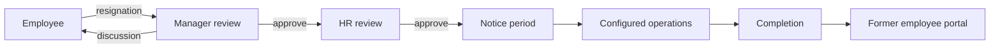
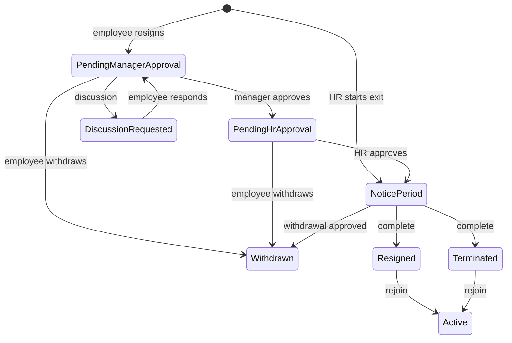

# Production offboarding module — implemented flow and operating reference

**System:** Codeji CMS / HRMS
**Status:** implemented current flow
**Last updated:** 2 September 2026

This is an implementation reference, not a proposal. It documents the current backend and React application: data records, migrations, policy, roles, APIs, privacy, former-employee access, lifecycle, and production operating rules.

## 1. Purpose and architecture

An exit never deletes an employee. `EmployeeExit` is the authoritative, tenant-owned workflow aggregate; `EmpUser.EmploymentStatus`, `Status`, `ExitDate` and `LastWorkingDate` are compatibility read-model fields for existing login and directory consumers.



The module covers self-service resignation, HR-initiated exit, discussion, notice/LWD changes, withdrawal, handover, clearance, assets, IT access, finance/F&F, benefits, evidence, documents, reminders, portal requests, audit, completion and rejoin.

## 2. Company configuration

### Modular configuration builder (3 September 2026)

The company policy now also carries an optional `PresetLevel` (`Disabled`, `Basic`, `Structured`, `Operational`, `Advanced`, `Enterprise`, or `Custom`) and a validated `Features` collection. Presets seed a recommended starting configuration only; they are never capability restrictions. Each feature independently records `Enabled`, `Required`, and `BlocksCompletion`, plus optional owner, waiver, waiver-reason, and due-date metadata. `Enabled=false` removes the module from new-case initialization; `BlocksCompletion=false` allows an enabled module to remain informational/non-blocking.

When a policy is saved with a named preset and no explicit feature list, the server expands the preset into editable feature records. Explicit feature records always win. Unknown keys, duplicate keys, invalid preset names, and negative due-date offsets are rejected server-side. Existing policies with an empty feature list continue using their legacy boolean fields. New cases copy both the preset label and feature records into `EmployeeExit.PolicySnapshot`; active and historical cases are therefore immutable with respect to later policy edits.

The policy API remains the existing tenant-scoped, permission-protected endpoint with optimistic `Version` checks. The case DTO exposes the captured feature metadata so clients can hide disabled operational surfaces, while all state-changing authorization remains server-side.

Validation note (3 September 2026): the solution build completed successfully using an isolated output directory. Frontend `npm run typecheck` completed successfully and the production build reached Vite transformation with exit code 0. The service test suite ran 170 tests: 166 passed and 4 failed in pre-existing `RolePermissionTests` administrator-role cases; those failures are unrelated to offboarding configuration and were not changed.

Companies may maintain default, department-scoped or role-scoped policies. A department policy may cover one or many departments when their configuration is identical. Resolution is **department → role → company default**. A policy cannot combine department and role.

When creating or editing a shared department policy, the UI sends one policy record with its selected department IDs rather than duplicating the same settings per department. The service validates every department belongs to the company. It consolidates existing department records only when all settings match; if any selected department has different notice-pay, workflow, portal, or completion-gate settings, the save is rejected and that department must remain in, or receive, its own policy. Existing single-department records remain compatible and resolve normally.

| Setting | Current behavior |
| --- | --- |
| `EnableOffboarding` | False rejects a new exit with `OFFBOARDING_DISABLED_FOR_COMPANY`. If no policy exists, existing enabled behavior is retained. |
| `MinimumNoticeDays` | Self-service LWD must be on/after today plus the configured days. |
| Review/discussion/evidence/acknowledgement | Captured for each new case. Evidence and acknowledgement become normal-completion gates when required. |
| Former portal | Makes the new case eligible for controlled portal use. |
| Handover/assets/access/finance/benefits/F&F | Independent completion gates. When disabled, that area does not block normal completion. |

Policy values are copied into `EmployeeExit.PolicySnapshot`. Later policy changes affect only future cases. This allows companies to operate no offboarding, a minimal flow, or a full workflow without changing a case already in progress.

### Admin examples

- **No workflow:** applicable policy with `EnableOffboarding=false`.
- **Minimal:** enable offboarding, review, optional evidence.
- **Standard:** additionally require handover, clearance template and F&F.
- **Full:** require each operational gate and portal/acknowledgement.

The responsive **Offboarding policy settings** screen configures these toggles plus company clearance templates.

## 3. Roles, permissions and privacy

Authorization is permission-driven and tenant-scoped. The server derives company and actor from authentication; no exit API accepts a client-supplied company ID. Administrator retains platform administrator access. Legacy `Offboarding.Edit` and `Offboarding.Override` continue as compatibility access while companies transition to finer grants.

| Permission | Scope |
| --- | --- |
| `Offboarding.PolicyManage` | Policies and clearance templates |
| `Offboarding.CaseManage` | Case review, dates, completion and general HR operation |
| `Offboarding.AssetManage` | Asset return/recovery |
| `Offboarding.AccessManage` | IT system deactivation |
| `Offboarding.FinanceManage` | Finance/F&F items |
| `Offboarding.BenefitsManage` | Benefits closure |
| `Offboarding.EvidenceManage` | Evidence verification/superseding |
| `Offboarding.PortalManage` | Former-employee portal administration |
| `Offboarding.Download` | Evidence download when visibility permits |

| Actor | Step-by-step authority |
| --- | --- |
| Employee | Submit only own resignation; read only own active case; withdraw pending cases; request notice-period withdrawal; respond to discussion; submit permitted evidence/contact/acknowledgement/handover/request data. |
| Reporting manager | Review only assigned case, request discussion, approve/reject, work handover, and decide a pending withdrawal. |
| HR case operator | Review, dates, notice adjustments, clearance, settlement, interview, employee document requests, completion, exception completion and rejoin according to grants. |
| IT / assets / finance / benefits | Can receive only their matching operation permission; no unrelated case ownership is implied. |
| Former employee | Has a short-lived restricted portal session for only the invited exit case. |

The UI receives permitted actions and hides controls it cannot use; endpoints always repeat authorization, company, relationship, workflow-state and version checks.

### 3.1 Authentication rules

Every authenticated offboarding request derives the actor and company from the access token/context. The browser never supplies a company ID or a trusted role name. A request must pass all applicable checks:

1. valid HRMS session (or a separate redeemed former-employee portal session);
2. current-company ownership of employee, case, policy, document and evidence;
3. workflow state and optimistic `Version` match for writes;
4. the relevant permission; and
5. for reporting managers, the employee-to-manager relationship.

An Administrator is not a cross-company bypass: an administrator acts only inside the company present in the authenticated context. Former-employee tokens never grant HRMS employee permissions.

### 3.2 Role-by-role permission chart

`Allow` below means the server can permit the action when the case state and company match. `—` means the action is not available. A company may grant the named granular permission to a custom role instead of using the conventional team name.

| Capability | Employee | Reporting manager | HR case operator | Admin | IT / Asset operator | Finance operator | Benefits operator | Former employee |
| --- | --- | --- | --- | --- | --- | --- | --- | --- |
| Submit resignation | Own account only | — | HR-initiated exit where granted | Yes | — | — | — | — |
| View active case | Own case | Assigned employee | Company-scoped cases | Company-scoped cases | Only permitted operational case | Only permitted operational case | Only permitted operational case | Invited case only |
| View withdrawn history | Own history | Assigned employee history | Company-scoped history | Company-scoped history | — | — | — | Own permitted portal history |
| Manager review / discussion | — | Assigned employee | `CaseManage` | `CaseManage` / legacy Edit or Override | — | — | — | — |
| HR review, LWD, notice decision, completion, rejoin | — | — | `CaseManage` | `CaseManage` / legacy Edit or Override | — | — | — | — |
| Handover | Submit assigned task | Create/review assigned employee | `CaseManage` | `CaseManage` | — | — | — | — |
| Unowned clearance | — | Assigned employee, only where no owner role/user is configured | `CaseManage` | `CaseManage` | — | — | — | — |
| Asset return/recovery | Provide requested information | — | Case oversight | Case oversight | `AssetManage` | — | — | — |
| IT access revocation | — | — | Case oversight | Case oversight | `AccessManage` | — | — | — |
| Finance items / F&F | View only where permitted | — | Case oversight / final approval | Case oversight / final approval | — | `FinanceManage` | — | — |
| Benefits closure | — | — | Case oversight | Case oversight | — | — | `BenefitsManage` | — |
| Evidence verify/supersede | Upload own permitted evidence | View allowed evidence | `EvidenceManage` | `EvidenceManage` | — | — | — | View only permitted portal documents |
| Policy read/create/update | — | — | `PolicyManage` | `PolicyManage` | — | — | — | — |
| Former portal invite/revoke/request resolution | Request documents | — | `PortalManage` | `PortalManage` | — | — | — | Redeem invite / submit own request |
| Evidence download | Own visible evidence | Only with visibility + `Download` | Visibility + `Download` | Visibility + `Download` | Visibility + `Download` | Visibility + `Download` | Visibility + `Download` | Portal-allowed documents only |

### 3.3 Clearance fallback for small companies

Clearance templates may have a specific owner role/user, such as IT or Finance. If no owner role and no owner user is configured, an authorized HR case operator can complete it, or the assigned reporting manager can complete it for that employee. This lets a small company run all clearances through HR/manager without creating artificial IT or Finance roles. An unrelated manager cannot complete the task.

### 3.4 Permission assignment guidance

| Team / custom role | Minimum offboarding grant | Add only when needed |
| --- | --- | --- |
| HR case operator | `Offboarding.CaseManage` | `PolicyManage`, `EvidenceManage`, `PortalManage`, `Download` |
| Reporting manager | No broad module grant is required for assigned-case review | Add `Download` only if evidence policy permits it |
| IT / Asset | `Offboarding.AssetManage` and/or `Offboarding.AccessManage` | `Download` only for permitted evidence visibility |
| Finance | `Offboarding.FinanceManage` | `Download` only for HR-and-Finance evidence |
| Benefits | `Offboarding.BenefitsManage` | `Download` only for permitted records |
| Policy administrator | `Offboarding.PolicyManage` | No `CaseManage` is necessary just to configure policy |
| Portal administrator | `Offboarding.PortalManage` | `Download` only if documents must be inspected |

Policy endpoints are authenticated for all users but authorize through the server-side `PolicyManage`/legacy Edit/Override check. They do not require the user to hold the broad HR/Admin role merely because they configure policies.

## 4. Data model and database collections

All durable workflow records are tenant-owned through `CompanyId`, creation/update metadata and soft-delete/active fields where applicable.

| Entity | Purpose |
| --- | --- |
| `EmployeeExit` | Case status, LWD, policy snapshot, embedded operations and audit history. |
| `EmployeeExitPolicy` | Company, one-or-many department, or role policy and stage requirements. |
| `EmployeeExitClearanceTemplate` | Category, owner role, mandatory flag and due offset. |
| `EmployeeFinalSettlement` | F&F calculation/approval/payment data. |
| `EmployeeExitOutbox` | Notification and email work queue. |
| `EmployeeExitAttendanceCutoff` | Attendance lock from LWD. |
| `FormerEmployeeAccessToken` | Secure, expiring/revocable portal token/session data. |
| `EmpUser` | Compatibility active/notice/exited read-model. |

Embedded in `EmployeeExit`: policy snapshot, withdrawal, notice adjustments, clearances, handover tasks, assets, access items, finance items, benefits, evidence, reminders, post-exit contact/acknowledgement, former requests, responsibility reassignments, interview, documents and audit events.

### Migration classes

| Migration | Creates/changes |
| --- | --- |
| `AddOffboardingModuleAndPermissions` | Offboarding module and baseline permission links. |
| `AddOffboardingDownloadPermission` | Protected evidence download permission. |
| `RepairOffboardingPermissionSeed` | Safe repair for prior permission seeds. |
| `AddOffboardingOperationPermissions` | Granular policy/case/asset/access/finance/benefits/evidence/portal permissions. |

Migration IDs are recorded by the migration runner, so deployment is idempotent. MongoDB entity field additions are additive. New operational stage flags default to false, preserving existing companies until configured.

## 5. Lifecycle and role-by-role working



### 5.1 Employee resignation

1. Employee opens own profile and selects **Resign**.
2. UI checks only for an active exit; historical withdrawn/completed cases never block another resignation.
3. API verifies authenticated user equals request user, employee exists in current company, exit type is `Resigned`, LWD is valid, no active exit exists, policy is enabled and notice rule is met.
4. It stores an active `PendingManagerApproval` case with reporting manager, policy snapshot and `ResignationSubmitted` audit event.
5. Employee stays Active until notice status is reached. A company-scoped manager outbox notification is queued.

### 5.2 Manager and HR review

1. Assigned reporting manager approves, rejects or requests discussion. Discussion requires notes.
2. Employee can respond to `DiscussionRequested`, returning it to manager review.
3. Manager approval moves to `PendingHrApproval`.
4. HR approval moves to `NoticePeriod`, stores approver data and copies active company clearance templates into the case once.
5. Rejection/cancellation preserves history but deactivates the current case.

When a policy disables manager review, self-service resignation begins at HR review (or directly at notice period if HR review is also disabled). When manager review is enabled but HR review is disabled, manager approval enters notice period directly. Discussion actions are rejected when the policy disables joint discussion.

### 5.3 Notice changes and withdrawal

- HR may update LWD. A notice-policy override requires a reason and audit event.
- Employee may request early release, waiver, buyout, recovery, extension or another permitted notice adjustment; HR decides it using the case version.
- Employee can withdraw directly while pending manager review, pending HR review or a requested discussion. The current exit closes as `Withdrawn` immediately.
- During notice period, employee submits a withdrawal request rather than closing the case immediately. The modal shows an explicit pending-review state and prevents duplicate requests.
- A durable tenant-scoped `EmployeeExitWithdrawalRequested` notification is sent to the reporting manager and all users with Offboarding case-management authority. Reporting manager or authorized case operator approves/declines it.
- **Approved notice-period withdrawal:** case becomes `Withdrawn` and inactive; employee read-model is restored to `Active`, `Status=true`, `ExitDate=null`, `LastWorkingDate=null`. Former-employee portal invitation/session tokens are explicitly revoked, and the portal independently denies any non-`Resigned`/`Terminated` case. This is why former/post-exit contact controls disappear and Resign becomes available again.
- **Withdrawal history:** the employee receives their latest withdrawn case as read-only history, including requested LWD, withdrawal reason and audit events. HR can view company-scoped withdrawn history; the assigned reporting manager can view their employee's history. A withdrawn record is historical only and never blocks a new resignation.

### 5.4 Operations during notice

Every write carries `EmployeeExitId` and expected `Version`. A stale write receives `EXIT_CASE_CHANGED_OR_NOT_FOUND`.

- **Handover:** manager/authorized operator creates tasks; employee submits; manager/HR approves or requests changes.
- **Clearance:** company template is copied with category, owner and due date; mandatory entries complete or waive when required.
- **Assets:** return, verification, loss/damage, waiver and recovery tracking.
- **IT access:** system/mode/schedule/reference and revocation/waiver status.
- **Finance/F&F:** calculate, approve and record payment result; approved settlement is required only if policy says so.
- **Benefits:** closure date/reference/status.
- **Evidence:** category/type/visibility, storage key/hash, verification and superseding.
- **Interview/reassignment/documents:** structured interview, responsibility handoff and relieving/experience/F&F document metadata.

### 5.4.1 Operational task initialization and automatic F&F

- An enabled handover, asset, access, finance or benefit gate now always creates a minimum actionable item. Company clearance templates take precedence and add the company-specific tasks. If no matching template is configured, the case receives a clearly labelled confirmation task, which the responsible operator must complete or explicitly waive when it does not apply. Existing active notice-period cases are repaired once when an authorized HR operator opens them.
- This prevents an enabled gate from rendering as an unexplained `0` count and then failing only at final completion because no work item was initialized.
- **F&F is payroll-backed.** “Calculate from payroll” reads the processed payroll record for the employee's last-working-month and stores the payroll ID/month with the settlement. Salary components, normal deductions and approved notice recovery are calculated server-side; browser-entered pay figures are not used. A same-month exit is completed on its last working day rather than being blocked by an impossible in-progress-month payroll requirement. The former employee remains eligible for that normal month-end payroll run through their last working day; after that payroll is processed, HR calculates, approves and pays the F&F settlement. `FINAL_PAYROLL_PENDING` therefore means the month-end payroll is not yet published, not that exit completion must be retried.
- The UI displays the saved exit-interview note and date after refresh. Work ownership is assigned by choosing an active company employee, rather than typing an opaque user ID. Each successful update refreshes the case version before the next action.

### 5.5 Completion, exception and rejoin

Normal completion requires active `NoticePeriod`, current date on/after LWD, mandatory clearances and all policy-enabled gates. The orchestrator:

1. sets `Resigned` or `Terminated`, deactivates the case and audits it;
2. disables employment access and revokes refresh tokens;
3. writes attendance cutoff and completion outbox record;
4. withdraws future pending/accepted leave and cancels future WFH;
5. retains all history.

Mongo transactions are used where supported. Standalone Mongo falls back to sequential writes and requires operational reconciliation if infrastructure fails mid-sequence. Exceptional completion requires a reason. Rejoin restores active employee status and clears exit dates.

## 6. Tenant security and evidence privacy

`CurrentContext` supplies `CompanyId` and actor ID. Every case, employee, policy, template, settlement, outbox, token and evidence operation filters by that company. Changing an ID in a Company A browser request cannot read/write Company B data.

- Employee-only evidence is visible only to that employee.
- HR-only / HR-and-Finance / HR-and-IT evidence needs authorized access.
- Cross-user download requires visibility approval plus `Offboarding.Download`.
- Upload/download storage access occurs only after case authorization.
- Audit stores actor, action, time and applicable notes/reasons.
- Client code cannot self-approve, supply company ID or bypass state/version checks.

## 7. Former-employee portal

Employment login and former portal are separate.

1. HR/operator completes the resignation or termination, then opens that completed case from the employee management profile.
2. An operator with `Offboarding.PortalManage` (or transitional `Edit`/`Override`) creates an invitation for an eligible completed case. The policy snapshot must have former-employee portal enabled and the employee must have provided a personal email before completion.
3. Service creates a secure expiring/revocable one-time token and sends it through configured mail integration. Creating a replacement invitation revokes prior unused links and sessions.
4. Former employee redeems the invite for a restricted 30-minute session after the exit is `Resigned` or `Terminated`.
5. Portal exposes only allowed case status/documents and lets the person submit document/correction requests.
6. HR resolves requests as `InProgress`, `Issued` or `Closed`. Portal access can be revoked at any time; expired/revoked/mismatched sessions fail server-side.

Portal access never restores HRMS employee access. Post-exit email/mobile are case data and appear only while relevant to an active case.

## 8. APIs, notifications and integrations

Authenticated `api/User` endpoints cover initiation/submission, own/management case reads, review/discussion, withdrawal, LWD/notice adjustment, policies/templates, settlement, operations, evidence upload/download/verification, post-exit contact/acknowledgement, former portal invitation/revocation/request resolution, exceptional completion and rejoin. Public former-employee endpoints require redeemed portal session credentials.

The outbox isolates workflow success from delivery failure. Submission, reminder, completion and document-request events are tenant-scoped and processed by background workers. Email, storage and identity behavior depends on the deployment’s configured providers; real delivery must be verified in the target environment and is never fabricated by the workflow.

### 8.1 Employee document requests and HR notification

An employee with an active exit case can submit any number of document or support requests: `RelievingLetter`, `ExperienceLetter`, `FnFStatement`, `TaxDocument`, `Correction` or `Other`. Each request has its own ID, details, time and lifecycle status (`Pending`, `InProgress`, `Issued`, `Closed`). Requests are never overwritten by a later request.

1. The employee selects a request type, adds clear supporting details and selects **Send to HR**.
2. The case update is protected by its expected version and is written into `EmployeeExit.FormerEmployeeRequests` with an audit event named `EmployeeExitDocumentRequested`.
3. After the case write succeeds, the service resolves all active users in the same company who hold Offboarding case-management authority. This is permission-based; it does not rely on a role called “HR”.
4. Each authorized recipient receives a durable in-app notification through `EmployeeExitOutbox`: **Document request: [type]** with a clear message naming the employee and requested details. The unread notification remains available even when the recipient was offline; live SignalR delivery is an enhancement.
5. Only a user who receives the granular `ManageDocumentRequests` permitted action can mark the request **In progress** or **Issued**. Reporting managers do not receive HR request-resolution controls.
6. The employee sees a dated request queue in their own offboarding centre, including the status and original details for every submitted request.

This behavior applies to active employee exits and is separate from the former-employee portal’s restricted post-exit request route. The data is currently retained under the legacy aggregate name `FormerEmployeeRequests` for compatibility, but the employee and management UI labels it accurately as **Employee document requests**.

### 8.2 Discussion response delivery

When a manager or HR requests a discussion, the employee’s **Send response** action calls `RespondToEmployeeExitDiscussion`, stores the response against the versioned case, writes the audit event and returns the case to `PendingManagerApproval`. A durable `ExitDiscussionResponded` outbox event notifies the reporting manager. The UI refreshes the case after a successful send, clears the text box and confirms success to the employee.

## 9. UI map

| Location | Behavior |
| --- | --- |
| My Profile | A responsive animated **Start resignation** button sits below the calendar. It opens the shared blurred-background modal. It is available only to an active employee without an active exit. The modern **Offboarding centre** prioritizes the current workflow action, discussion response and multi-request document queue; withdrawn resignation history remains visible to the employee. |
| Employee management profile | Permission-aware manager/HR actions, employee document-request resolution, operational panel, F&F, interview, work-ownership transfer, documents and former-portal controls. The **Offboard employee** action is shown only when no active exit case exists. Once an employee submits a resignation, the action is hidden and reviewers use **Manage offboarding** for the single existing case. Empty operational sections are hidden before the notice period so a discussion/approval case shows only relevant actions. |
| Policy settings | Responsive scoped-policy and clearance-template configuration. |
| Former employee route | Invite redemption, restricted case/document view and request submission. |

## 10. Production checklist and validation

1. Run migrations and verify Offboarding links/role grants.
2. Configure a default policy for every company using the module.
3. Grant granular IT/finance/benefits permissions; retain legacy Edit/Override only while transitioning.
4. Test no-workflow, minimal and full-policy companies.
5. Test Company A attempting Company B case/policy/evidence access; all must be denied.
6. Test employee → manager → HR → notice → configured operations → completion.
7. Test direct withdrawal and approved notice-period withdrawal; verify Active status and a new resignation can be submitted.
8. Test expired/revoked former-portal invite and denied evidence download.
9. Test two concurrent screens; stale update must fail.
10. Test mail/storage/identity with real non-production provider settings.

Current validation: backend services build passes with **0 errors** (the repository has existing compiler warnings); frontend typecheck passes. Earlier recorded API/service/build results remain subject to re-validation in the target environment.

## 11. Latest implementation changes — 27 August 2026

- Corrected the employee discussion **Send response** button so it invokes the submission handler rather than only referencing it.
- Added durable, permission-resolved HR notifications for every new employee document request.
- Made document requests truly multi-request in the employee UI: submission refreshes the case and displays each request separately.
- Restricted request-resolution controls to HR/case-management authority through `ManageDocumentRequests`; server-side authorization remains enforced independently.
- Simplified the responsive offboarding modal and management view: state-specific workflow controls appear first, while operational work and work-ownership transfer appear only during `NoticePeriod`.
- Reframed “Responsibility reassignment” in the UI as **Transfer work ownership**. It is used for handing over a specific business responsibility to a named user before departure.
- Corrected former-employee portal timing: invitations and revocation now operate on completed `Resigned`/`Terminated` cases, matching the restricted portal’s post-employment access rule. Completed cases are available to authorized portal operators in the management view.
- Corrected withdrawal lifecycle gaps: discussion-stage withdrawal is permitted, notice-stage withdrawal is a visible approval request with durable reviewer notifications, and all portal tokens are revoked when an exit is withdrawn or cancelled.

## 12. Latest hardening changes — 31 August 2026

- **No-manager fallback:** when a policy requires a manager review but the employee has no active reporting manager, a self-submitted resignation now moves directly to HR review rather than becoming permanently stuck. The routing decision is audited.
- **Discussion integrity:** a discussion stores the originating review state and requester. An employee response returns the case to the correct pending reviewer and notifies that requester. A discussion can propose a new LWD, but it cannot change the confirmed LWD directly.
- **Joint discussions:** the management screen allows an authorized reviewer to select active colleagues. Their user IDs are submitted to the existing participant list, and the server sends durable in-app invitations after validating every participant belongs to the same company.
- **Notice adjustments:** approval rejects invalid dates (an extension cannot shorten the LWD and an early-release request cannot extend it), reschedules reminders and updates the employee read model after the versioned exit case is saved.
- **Policy-gated clearances:** every clearance template now declares the gate that creates it: `General`, `Handover`, `AssetClearance`, `AccessRevocation`, `FinanceClearance` or `BenefitClearance`. Only templates whose gate is enabled in the captured policy snapshot are created for a new case. This prevents a company with a light workflow from being blocked by an unrelated template.
- **Granular policy administration:** policy and clearance-template reads/writes are now guarded in the service by `Offboarding.PolicyManage` (with transitional Edit/Override compatibility), rather than being pre-blocked by the broad HR controller policy. A custom policy administrator therefore works without granting unrelated HR powers.
- **Former portal readiness:** an invitation requires a completed eligible case, a policy snapshot that enabled the portal, and a verified personal post-exit email. Token creation and request updates target completed cases even though those cases are no longer active.
- **Evidence privacy:** evidence download now evaluates the item’s declared visibility first. `HRAndFinance` accepts HR or `FinanceManage`; `HRAndIT` accepts HR or `AccessManage`; `EmployeeManagerHR` accepts only the employee, assigned manager or HR; `HROnly` remains HR-only. Visibility does not become broader merely because someone has a generic download permission.
- **Reassignment safety:** the new work owner must be an active employee in the same company and cannot be the departing employee.

Validation after these changes: the backend services project builds with **0 errors** (repository-wide existing warnings remain). The frontend typecheck and production build passed in this work session. Target-environment mail delivery, storage provider configuration and full role-account UAT remain deployment checks.

### 12.1 Notice period, early release and settlement decision

For an employee resignation, the system now follows this decision sequence:

1. The employee submits a requested LWD and reason.
2. The applicable company/department/role policy supplies the normal LWD: submission date plus the configured minimum notice days.
3. If the requested LWD is on or after the normal LWD, it becomes the case LWD and proceeds through review.
4. If it is earlier, the normal policy LWD remains the confirmed case LWD. The requested date becomes a pending `EmployeeEarlyRelease` notice-adjustment record with served days and shortfall days calculated and audited.
5. The reviewer/HR may discuss the request. Discussion can recommend a date but cannot directly alter the confirmed LWD.
6. HR decides the adjustment using one of: company early release, full waiver, partial waiver, recovery through final settlement, separate buyout or notice extension. A declined request retains the normal policy LWD.
7. An approved early release sets the final LWD, reschedules reminders and updates the employee read model. Approved `Recovery` and `Buyout` decisions create a receivable finance item linked to the adjustment so finance can settle it through F&F or separately.
8. The normal offboarding gates—handover, assets, IT, finance/benefits, required documents/evidence and final settlement—then determine whether exit completion is allowed.

### 12.2 Notice-pay daily-rate policy and storage

The policy does **not** store one fixed currency rate for a department. A fixed rate would be inaccurate because every employee can have different payroll. Instead, each company, department or access-role policy stores the calculation rule used for new exit cases:

| Policy field | Allowed value | Purpose |
| --- | --- | --- |
| `NoticePaySalaryBasis` | `GrossMonthly` (default) or `BasicMonthly` | Selects the monthly payroll amount used for a notice shortfall. Gross monthly is Basic Pay + HRA + LTA + Other Allowance. Basic monthly uses Basic Pay only. |
| `NoticePayDailyRateDivisor` | 1–31, default `30` | Defines the number of days used to convert the selected monthly salary into a daily rate. |

When a resignation starts, the selected policy is resolved using the existing priority order—**department, then access role, then company default**—and both notice-pay fields are copied to `EmployeeExit.PolicySnapshot`. That snapshot makes the decision stable: later policy changes do not alter an exit case already in progress.

For an approved `Recovery` or `Buyout`, the server loads the employee’s latest processed payroll, applies the captured salary basis and divisor, and calculates:

```text
daily rate       = selected monthly payroll amount / policy divisor
notice amount    = daily rate × confirmed shortfall days
```

The computed daily rate, salary basis and divisor are stored on the approved `EmployeeExitNoticeAdjustment`, alongside the final amount. The UI may show an estimate, but the server owns the final calculation and does not accept a client-supplied recovery amount for `Recovery` or `Buyout`.

If no processed payroll exists, or the selected monthly amount is zero, the decision is rejected with `EXIT_NOTICE_PAYROLL_BASIS_NOT_FOUND`. HR must correct/process payroll first; the system never invents a financial amount. This is deliberately safer than silently using a default rate.

MongoDB stores the two new fields on each `EmployeeExitPolicy` document and the captured values on the exit/pending-adjustment documents. This is an additive, backward-compatible schema change: existing policy records use `GrossMonthly` and a divisor of `30` until an administrator saves a different value. No destructive data migration is required.

### 12.3 Scoped clearance templates and task snapshots

Clearance templates are reusable company configuration, while generated clearances are immutable employee-case tasks. Each template now stores a normalized `TemplateKey`, a `Scope` (`Global` or `Department`), optional `DepartmentId`, description, required completion gate, owner role, effective dates and version.

When an exit enters the notice period, the system resolves templates independently for every key:

1. It uses the employee department captured when the exit was initiated (with a current-department fallback only for legacy exits) and selects the effective Global template for a key.
2. If an effective Department template with the same key exists for that captured department, that one replaces only that key.
3. It keeps all unrelated Global keys.
4. It filters the resolved templates using the captured policy’s enabled completion gates.
5. It creates one employee-specific clearance task per key, recording source template ID/version/key/scope, department, description, gate, due-day offset and LWD-derived due date.

For example, an Engineering `LAPTOP_RETURN` template replaces the Global `LAPTOP_RETURN` task for Engineering employees, but Global `ID_CARD_RETURN` and `FINANCE_CLEARANCE` tasks still generate when their policy gates are enabled.

Saving validates company ownership of a Department scope, rejects invalid scope/key/effective-date ranges and rejects another active template with the same company, scope, department and normalized key. Legacy templates without scope/key remain readable as Global templates using a normalized category as their compatibility key.

Generated clearance tasks are not silently changed when templates are edited. Mandatory pending tasks block normal exit completion; waivers require an authorized actor, reason, actor identity and audit record. An explicit approved LWD change recalculates only open tasks that carry a due-day snapshot and audits that recalculation; legacy task due dates remain unchanged.

### 12.4 Integrity and delivery safeguards added in this release

- The active case, not the compatibility employee status, is now the primary duplicate-submission guard. It is enforced in service code and by the tenant-scoped active-case unique index, so two concurrent resignation submissions cannot create two live cases.
- Completion, exceptional completion, policies and templates use expected versions. Normal completion requires initialized required work and completed mandatory gates; exceptional completion now follows the same protected completion path instead of bypassing security, payroll, access revocation or audit work.
- A policy/template scope has a stable `ScopeKey`, and the migration `HardenOffboardingPolicyTemplateIndexes` backfills this key, deactivates only older duplicate active records, then adds partial unique indexes for each company and active scope. This makes department, role and company-default selection deterministic.
- Clearance ownership can now be an offboarding operation permission (`CaseManage`, `AssetManage`, `AccessManage`, `FinanceManage` or `BenefitsManage`) rather than a literal role. If no owner is configured, the reporting manager may complete the task; users with the configured permission or case-management authority remain valid fallbacks.
- If there is no active reporting manager, the resignation is routed to all active users who hold the company’s offboarding case-management permission. This creates a durable outbox notification rather than a silent audit-only route.
- Joint-discussion invitations are tenant-validated. The employee’s response is now written through the versioned case and sends a durable reply notification to the original reviewer and every selected participant.
- Evidence is private storage. If its case metadata update loses an optimistic-concurrency race, the newly written blob is deleted, preventing an unreferenced private file from accumulating.
- Former-employee invitation links are never returned to an administrator browser. They are delivered only to the verified personal email. If delivery fails, the newly generated token is revoked and the case-level portal flag is disabled so that a corrected address can be retried safely.

### 12.5 Operational verification checklist

1. Run the migration once before enabling new policy/template editing in a production database.
2. Verify each company has at most one active policy per company, department or role scope, then open a new resignation to confirm the captured policy snapshot.
3. Test a manager-assigned and a managerless resignation. The latter must produce a case-manager inbox notification.
4. Test a partial waiver and confirm the unreleased shortfall becomes a finance receivable; completion must remain blocked until it is settled or waived through an authorized process.
5. Test a portal invitation with a verified personal email. Confirm no bearer link is exposed in the HR UI; use the emailed one-time link to redeem the session.
6. Test an evidence upload while another user changes the case. The upload should fail cleanly with no leftover private file.

## 13. Former-employee portal administration and OTP access — 2 September 2026

The former-employee portal remains a restricted post-employment surface. It does not create an `EmpUser`, issue an HRMS JWT, or permit access to more than the one completed `EmployeeExit` case selected by the verified personal email.

### 13.1 Company and individual controls

- **Company administrator:** `POST /api/User/CompanyFormerEmployeePortalAccess` is protected by `AdminOnly`. It is the tenant-wide master switch. Disabling it revokes every non-revoked former-employee session in that company immediately; it never changes employee history, documents or requests. The Company Information screen exposes this switch.
- **Portal operator:** `POST /api/User/EmployeeExitFormerEmployeePortalAccess` requires the server-side `Offboarding.PortalManage` capability. It enables or disables one completed former employee only after the personal email has been verified. Disabling the individual revokes their sessions immediately.
- **Effective access:** the company switch, individual switch, completed `Resigned`/`Terminated` case state, verified personal email, and valid OTP session must all be true. A rejoin, withdrawal, cancellation, company disable, individual disable or session revocation denies subsequent document/request access.

### 13.2 OTP login and session lifecycle

1. Former employee enters their verified personal email at `/former-employee`.
2. `POST /api/public/former-employee/otp/request` returns the same success response whether or not an account exists, preventing email enumeration. For an eligible company/case it emails a six-digit OTP that is stored only as a hash and expires in ten minutes.
3. Resend invalidates prior unused OTP records for that case. The public endpoints use the account-sensitive rate limiter.
4. `POST /api/public/former-employee/otp/verify` accepts only a current hashed OTP, creates a cryptographically random session token, stores only its hash, and expires it after seven days.
5. Each portal request resolves the session token and again checks the case, company master switch, individual switch and tenant ownership. The browser cannot choose a company, employee or case ID.
6. The successful OTP response returns the company-owned `AppTheme`; the React portal applies the same supported company theme family as public Careers (`glass`, `slate`, `dawn`, or `blush`) rather than visitor storage preferences.

### 13.3 Document and contact flow

1. Before normal exit completion, employee saves a personal email; a hashed 48-hour verification link is emailed. Completion is rejected until it is verified.
2. HR uploads a private evidence file, verifies it, selects it for the specific former-employee request, and issues it. Only issued, verified `EmployeeOnly` files appear in the portal.
3. Issuance queues an email. The first portal download records `SeenByFormerEmployeeAtUtc`, writes an audit event and queues an HR notification.
4. Former-employee document/correction requests create a tenant-scoped case request and notify permitted HR portal operators. They cannot browse another former employee or generic evidence.

### 13.4 Flow integrity fixes included

- Normal completion now resolves `EmpUser` from the server-resolved `EmployeeExit.EmployeeUserId`. A client completing by `EmployeeExitId` no longer fails because the legacy `EmployeeUserId` field was omitted.
- Personal emails are normalized to lower-case when saved and when OTP values are derived, avoiding casing-only login failures for newly saved contacts.
- Company-level portal disable is enforced both when an OTP is requested/verified and on every existing-session resolution. It is not merely a UI switch.

### 13.5 Manager data boundary and current UI behavior

- A reporting manager receives only the information needed to review work transfer: case context, assigned handover task title/details/status, and the approval action after the employee submits it.
- The manager view does **not** expose HR-owned clearance, assets, IT access, finance/benefits, final settlement, evidence, exit interview, last-working-day override, or exit-completion controls. Those remain HR-only server-side operations and are hidden from the manager UI.
- The employee submits their own assigned handover task; reporting manager/HR can approve a submitted task. The management UI no longer presents an employee-only Submit action.
- OTP requests now wait for the configured email provider result. A provider failure invalidates the created OTP and returns `FORMER_PORTAL_OTP_EMAIL_DELIVERY_FAILED`; the UI must not claim that a code was sent when delivery failed.
- Handover approval is persisted as `Approved` (not the request verb `Approve`). Completion and pending counts also recognize the earlier `Approve` value as approved, so already-approved legacy tasks cannot remain a blocker after refresh.
- Employee evidence follows an explicit lifecycle: choose file, review its category/file name, confirm submission, then see the submitted file and its `Pending`/`Verified` status. Both the employee and permitted HR users have separate **Open** and **Download** actions. They use the authenticated, tenant-scoped `GET api/User/EmployeeExitEvidence/{employeeExitId}/{evidenceId}/download` endpoint; the UI never opens an unauthenticated frontend URL. Upload alone does not satisfy a required resignation-evidence gate; HR must open/download the tenant-scoped evidence and verify it. Once verified, the server refreshes the completion gate against that verified `Resignation` record.
