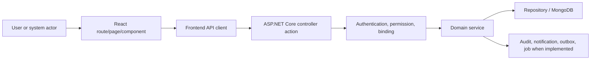

# Offboarding Functional and Current Flow

**Last verified against code:** 2026-09-02

This is a source-trace document. Each flow begins at an extracted controller action and names the direct service call when the controller exposes one. Persistence, side effects and failure behavior are not guessed when the delegated source must still be inspected.

## 1. End-to-End Architecture

## 2. Major Action Flows

### FLOW-001 - Redeem

#### Trigger

An HTTP client calls `POST api/public/former-employee/redeem`.

#### Actor and preconditions

Authorization evidence: `[ApiController] [AllowAnonymous] [Route("api/public/former-employee")] [HttpPost("redeem")] [EnableRateLimiting("account-sensitive")]`.
The actor must also satisfy any company, ownership, relationship, state and concurrency checks in the delegated service.

#### Step-by-step flow

1. Routing selects `PublicFormerEmployeePortalController.Redeem()`.
2. ASP.NET Core applies authentication/authorization filters and binds the request.
3. Parameters are bound from `[FromBody] FormerEmployeePortalTokenRequest request`.
4. The controller executes/delegates to `portal.RedeemInvite()`.
5. The service validates domain rules and resolves company-owned records.
6. Repository operations read or mutate the applicable Mongo records.
7. Audit, notification, outbox or background effects occur only where the inspected implementation performs them.
8. The result flows through the shared API response/error pipeline.

#### Frontend flow

React route/page -> component handler -> frontend service/client -> this endpoint. The exact caller must be confirmed from the frontend source inventory.

#### Permission flow

Authenticated principal -> controller/module guard -> service company/ownership/relationship rule -> allowed mutation/read. UI visibility is not an authorization boundary.

#### Database changes

> WARNING: Follow the direct service call into repository/entity code. The HTTP verb does not prove insert/update/delete semantics.

#### Final state and failure paths

- Success state: the state returned/persisted by the service.
- Binding/validation failure: determined by DTO/model validation and service checks.
- Unauthorized/forbidden: determined by authentication, permission and relationship guards.
- Not found/company mismatch: must not reveal another company record.
- Conflict/stale state: verify version and transition rules where applicable.
- Partial side-effect failure: inspect transaction/outbox/retry implementation before asserting recovery.

#### Service evidence found

- `Codeji.CMS.Services/Employees/FormerEmployeePortalService.cs:110`; signals: company/tenant context reference, version/concurrency or update-result reference, repository/data-access reference, notification/email/outbox reference, audit/history metadata reference; errors: FORMER_PORTAL_TOKEN_INVALID, FORMER_PORTAL_TOKEN_INVALID_OR_EXPIRED, FORMER_PORTAL_OTP_CREATE_FAILED, FORMER_PORTAL_OTP_EMAIL_DELIVERY_FAILED, FORMER_PORTAL_OTP_INVALID, FORMER_PORTAL_OTP_INVALID_OR_EXPIRED, FORMER_PORTAL_ACCESS_DISABLED, FORMER_PORTAL_ACCESS_FORBIDDEN, FORMER_PORTAL_ACCESS_NOT_READY, FORMER_PORTAL_COMPANY_ACCESS_FORBIDDEN, COMPANY_NOT_FOUND, POST_EXIT_CONTACT_TOKEN_INVALID; statuses: Resigned, Terminated, Verified.
- `Codeji.CMS.Services/Employees/Interface/IFormerEmployeePortalService.cs:10`; signals: ; errors: ; statuses: .

### FLOW-002 - RequestOtp

#### Trigger

An HTTP client calls `POST api/public/former-employee/otp/request`.

#### Actor and preconditions

Authorization evidence: `[ApiController] [AllowAnonymous] [Route("api/public/former-employee")] [HttpPost("otp/request")] [EnableRateLimiting("account-sensitive")]`.
The actor must also satisfy any company, ownership, relationship, state and concurrency checks in the delegated service.

#### Step-by-step flow

1. Routing selects `PublicFormerEmployeePortalController.RequestOtp()`.
2. ASP.NET Core applies authentication/authorization filters and binds the request.
3. Parameters are bound from `[FromBody] FormerEmployeePortalOtpRequest request`.
4. The controller executes/delegates to `portal.RequestOtp()`.
5. The service validates domain rules and resolves company-owned records.
6. Repository operations read or mutate the applicable Mongo records.
7. Audit, notification, outbox or background effects occur only where the inspected implementation performs them.
8. The result flows through the shared API response/error pipeline.

#### Frontend flow

React route/page -> component handler -> frontend service/client -> this endpoint. The exact caller must be confirmed from the frontend source inventory.

#### Permission flow

Authenticated principal -> controller/module guard -> service company/ownership/relationship rule -> allowed mutation/read. UI visibility is not an authorization boundary.

#### Database changes

> WARNING: Follow the direct service call into repository/entity code. The HTTP verb does not prove insert/update/delete semantics.

#### Final state and failure paths

- Success state: the state returned/persisted by the service.
- Binding/validation failure: determined by DTO/model validation and service checks.
- Unauthorized/forbidden: determined by authentication, permission and relationship guards.
- Not found/company mismatch: must not reveal another company record.
- Conflict/stale state: verify version and transition rules where applicable.
- Partial side-effect failure: inspect transaction/outbox/retry implementation before asserting recovery.

#### Service evidence found

- `Codeji.CMS.Services/Employees/FormerEmployeePortalService.cs:128`; signals: company/tenant context reference, version/concurrency or update-result reference, repository/data-access reference, notification/email/outbox reference, audit/history metadata reference; errors: FORMER_PORTAL_OTP_CREATE_FAILED, FORMER_PORTAL_OTP_EMAIL_DELIVERY_FAILED, FORMER_PORTAL_OTP_INVALID, FORMER_PORTAL_OTP_INVALID_OR_EXPIRED, FORMER_PORTAL_ACCESS_DISABLED, FORMER_PORTAL_ACCESS_FORBIDDEN, FORMER_PORTAL_ACCESS_NOT_READY, FORMER_PORTAL_COMPANY_ACCESS_FORBIDDEN, COMPANY_NOT_FOUND, POST_EXIT_CONTACT_TOKEN_INVALID, POST_EXIT_CONTACT_TOKEN_INVALID_OR_EXPIRED, FORMER_PORTAL_REVOKE_FORBIDDEN; statuses: Resigned, Terminated, Verified.
- `Codeji.CMS.Services/Employees/Interface/IFormerEmployeePortalService.cs:11`; signals: ; errors: ; statuses: .

### FLOW-003 - VerifyOtp

#### Trigger

An HTTP client calls `POST api/public/former-employee/otp/verify`.

#### Actor and preconditions

Authorization evidence: `[ApiController] [AllowAnonymous] [Route("api/public/former-employee")] [HttpPost("otp/verify")] [EnableRateLimiting("account-sensitive")]`.
The actor must also satisfy any company, ownership, relationship, state and concurrency checks in the delegated service.

#### Step-by-step flow

1. Routing selects `PublicFormerEmployeePortalController.VerifyOtp()`.
2. ASP.NET Core applies authentication/authorization filters and binds the request.
3. Parameters are bound from `[FromBody] FormerEmployeePortalOtpVerifyRequest request`.
4. The controller executes/delegates to `portal.VerifyOtp()`.
5. The service validates domain rules and resolves company-owned records.
6. Repository operations read or mutate the applicable Mongo records.
7. Audit, notification, outbox or background effects occur only where the inspected implementation performs them.
8. The result flows through the shared API response/error pipeline.

#### Frontend flow

React route/page -> component handler -> frontend service/client -> this endpoint. The exact caller must be confirmed from the frontend source inventory.

#### Permission flow

Authenticated principal -> controller/module guard -> service company/ownership/relationship rule -> allowed mutation/read. UI visibility is not an authorization boundary.

#### Database changes

> WARNING: Follow the direct service call into repository/entity code. The HTTP verb does not prove insert/update/delete semantics.

#### Final state and failure paths

- Success state: the state returned/persisted by the service.
- Binding/validation failure: determined by DTO/model validation and service checks.
- Unauthorized/forbidden: determined by authentication, permission and relationship guards.
- Not found/company mismatch: must not reveal another company record.
- Conflict/stale state: verify version and transition rules where applicable.
- Partial side-effect failure: inspect transaction/outbox/retry implementation before asserting recovery.

#### Service evidence found

- `Codeji.CMS.Services/Employees/FormerEmployeePortalService.cs:175`; signals: company/tenant context reference, version/concurrency or update-result reference, permission reference, repository/data-access reference, notification/email/outbox reference, audit/history metadata reference; errors: FORMER_PORTAL_OTP_INVALID, FORMER_PORTAL_OTP_INVALID_OR_EXPIRED, FORMER_PORTAL_ACCESS_DISABLED, FORMER_PORTAL_ACCESS_FORBIDDEN, FORMER_PORTAL_ACCESS_NOT_READY, FORMER_PORTAL_COMPANY_ACCESS_FORBIDDEN, COMPANY_NOT_FOUND, POST_EXIT_CONTACT_TOKEN_INVALID, POST_EXIT_CONTACT_TOKEN_INVALID_OR_EXPIRED, FORMER_PORTAL_REVOKE_FORBIDDEN, FORMER_PORTAL_REVOKE_NOT_FOUND, FORMER_PORTAL_SESSION_INVALID; statuses: Resigned, Terminated, Verified.
- `Codeji.CMS.Services/Employees/Interface/IFormerEmployeePortalService.cs:12`; signals: ; errors: ; statuses: .

### FLOW-004 - Logout

#### Trigger

An HTTP client calls `POST api/public/former-employee/logout`.

#### Actor and preconditions

Authorization evidence: `[ApiController] [AllowAnonymous] [Route("api/public/former-employee")] [HttpPost("logout")]`.
The actor must also satisfy any company, ownership, relationship, state and concurrency checks in the delegated service.

#### Step-by-step flow

1. Routing selects `PublicFormerEmployeePortalController.Logout()`.
2. ASP.NET Core applies authentication/authorization filters and binds the request.
3. Parameters are bound from ``.
4. The controller executes/delegates to `portal.Logout()`.
5. The service validates domain rules and resolves company-owned records.
6. Repository operations read or mutate the applicable Mongo records.
7. Audit, notification, outbox or background effects occur only where the inspected implementation performs them.
8. The result flows through the shared API response/error pipeline.

#### Frontend flow

React route/page -> component handler -> frontend service/client -> this endpoint. The exact caller must be confirmed from the frontend source inventory.

#### Permission flow

Authenticated principal -> controller/module guard -> service company/ownership/relationship rule -> allowed mutation/read. UI visibility is not an authorization boundary.

#### Database changes

> WARNING: Follow the direct service call into repository/entity code. The HTTP verb does not prove insert/update/delete semantics.

#### Final state and failure paths

- Success state: the state returned/persisted by the service.
- Binding/validation failure: determined by DTO/model validation and service checks.
- Unauthorized/forbidden: determined by authentication, permission and relationship guards.
- Not found/company mismatch: must not reveal another company record.
- Conflict/stale state: verify version and transition rules where applicable.
- Partial side-effect failure: inspect transaction/outbox/retry implementation before asserting recovery.

#### Service evidence found

- `Codeji.CMS.Services/Employees/FormerEmployeePortalService.cs:189`; signals: company/tenant context reference, version/concurrency or update-result reference, permission reference, repository/data-access reference, notification/email/outbox reference, audit/history metadata reference; errors: FORMER_PORTAL_ACCESS_FORBIDDEN, FORMER_PORTAL_ACCESS_NOT_READY, FORMER_PORTAL_COMPANY_ACCESS_FORBIDDEN, COMPANY_NOT_FOUND, POST_EXIT_CONTACT_TOKEN_INVALID, POST_EXIT_CONTACT_TOKEN_INVALID_OR_EXPIRED, FORMER_PORTAL_REVOKE_FORBIDDEN, FORMER_PORTAL_REVOKE_NOT_FOUND, FORMER_PORTAL_SESSION_INVALID, FORMER_PORTAL_REQUEST_INVALID, FORMER_PORTAL_DOCUMENT_FORBIDDEN; statuses: Resigned, Terminated, Verified.
- `Codeji.CMS.Services/Employees/Interface/IFormerEmployeePortalService.cs:13`; signals: ; errors: ; statuses: .

### FLOW-005 - VerifyContact

#### Trigger

An HTTP client calls `POST api/public/former-employee/verify-contact`.

#### Actor and preconditions

Authorization evidence: `[ApiController] [AllowAnonymous] [Route("api/public/former-employee")] [HttpPost("verify-contact")] [EnableRateLimiting("account-sensitive")]`.
The actor must also satisfy any company, ownership, relationship, state and concurrency checks in the delegated service.

#### Step-by-step flow

1. Routing selects `PublicFormerEmployeePortalController.VerifyContact()`.
2. ASP.NET Core applies authentication/authorization filters and binds the request.
3. Parameters are bound from `[FromBody] FormerEmployeePortalTokenRequest request`.
4. The controller executes/delegates to `portal.VerifyPostExitContact()`.
5. The service validates domain rules and resolves company-owned records.
6. Repository operations read or mutate the applicable Mongo records.
7. Audit, notification, outbox or background effects occur only where the inspected implementation performs them.
8. The result flows through the shared API response/error pipeline.

#### Frontend flow

React route/page -> component handler -> frontend service/client -> this endpoint. The exact caller must be confirmed from the frontend source inventory.

#### Permission flow

Authenticated principal -> controller/module guard -> service company/ownership/relationship rule -> allowed mutation/read. UI visibility is not an authorization boundary.

#### Database changes

> WARNING: Follow the direct service call into repository/entity code. The HTTP verb does not prove insert/update/delete semantics.

#### Final state and failure paths

- Success state: the state returned/persisted by the service.
- Binding/validation failure: determined by DTO/model validation and service checks.
- Unauthorized/forbidden: determined by authentication, permission and relationship guards.
- Not found/company mismatch: must not reveal another company record.
- Conflict/stale state: verify version and transition rules where applicable.
- Partial side-effect failure: inspect transaction/outbox/retry implementation before asserting recovery.

#### Service evidence found

- `Codeji.CMS.Services/Employees/FormerEmployeePortalService.cs:227`; signals: company/tenant context reference, version/concurrency or update-result reference, permission reference, repository/data-access reference, notification/email/outbox reference, audit/history metadata reference; errors: POST_EXIT_CONTACT_TOKEN_INVALID, POST_EXIT_CONTACT_TOKEN_INVALID_OR_EXPIRED, FORMER_PORTAL_REVOKE_FORBIDDEN, FORMER_PORTAL_REVOKE_NOT_FOUND, FORMER_PORTAL_SESSION_INVALID, FORMER_PORTAL_REQUEST_INVALID, FORMER_PORTAL_DOCUMENT_FORBIDDEN; statuses: Resigned, Terminated, Verified.
- `Codeji.CMS.Services/Employees/Interface/IFormerEmployeePortalService.cs:16`; signals: ; errors: ; statuses: .

### FLOW-006 - GetCase

#### Trigger

An HTTP client calls `GET api/public/former-employee/case`.

#### Actor and preconditions

Authorization evidence: `[ApiController] [AllowAnonymous] [Route("api/public/former-employee")] [HttpGet("case")]`.
The actor must also satisfy any company, ownership, relationship, state and concurrency checks in the delegated service.

#### Step-by-step flow

1. Routing selects `PublicFormerEmployeePortalController.GetCase()`.
2. ASP.NET Core applies authentication/authorization filters and binds the request.
3. Parameters are bound from ``.
4. The controller executes/delegates to `portal.GetCase()`.
5. The service validates domain rules and resolves company-owned records.
6. Repository operations read or mutate the applicable Mongo records.
7. Audit, notification, outbox or background effects occur only where the inspected implementation performs them.
8. The result flows through the shared API response/error pipeline.

#### Frontend flow

React route/page -> component handler -> frontend service/client -> this endpoint. The exact caller must be confirmed from the frontend source inventory.

#### Permission flow

Authenticated principal -> controller/module guard -> service company/ownership/relationship rule -> allowed mutation/read. UI visibility is not an authorization boundary.

#### Database changes

> WARNING: Follow the direct service call into repository/entity code. The HTTP verb does not prove insert/update/delete semantics.

#### Final state and failure paths

- Success state: the state returned/persisted by the service.
- Binding/validation failure: determined by DTO/model validation and service checks.
- Unauthorized/forbidden: determined by authentication, permission and relationship guards.
- Not found/company mismatch: must not reveal another company record.
- Conflict/stale state: verify version and transition rules where applicable.
- Partial side-effect failure: inspect transaction/outbox/retry implementation before asserting recovery.

#### Service evidence found

- `Codeji.CMS.Services/Employees/FormerEmployeePortalService.cs:259`; signals: company/tenant context reference, version/concurrency or update-result reference, permission reference, repository/data-access reference, notification/email/outbox reference, audit/history metadata reference; errors: FORMER_PORTAL_SESSION_INVALID, FORMER_PORTAL_REQUEST_INVALID, FORMER_PORTAL_DOCUMENT_FORBIDDEN; statuses: Verified, Resigned, Terminated.
- `Codeji.CMS.Services/Employees/Interface/IFormerEmployeePortalService.cs:17`; signals: ; errors: ; statuses: .

### FLOW-007 - CreateRequest

#### Trigger

An HTTP client calls `POST api/public/former-employee/requests`.

#### Actor and preconditions

Authorization evidence: `[ApiController] [AllowAnonymous] [Route("api/public/former-employee")] [HttpPost("requests")] [EnableRateLimiting("account-sensitive")]`.
The actor must also satisfy any company, ownership, relationship, state and concurrency checks in the delegated service.

#### Step-by-step flow

1. Routing selects `PublicFormerEmployeePortalController.CreateRequest()`.
2. ASP.NET Core applies authentication/authorization filters and binds the request.
3. Parameters are bound from `[FromBody] FormerEmployeePortalRequest request`.
4. The controller executes/delegates to `portal.CreateRequest()`.
5. The service validates domain rules and resolves company-owned records.
6. Repository operations read or mutate the applicable Mongo records.
7. Audit, notification, outbox or background effects occur only where the inspected implementation performs them.
8. The result flows through the shared API response/error pipeline.

#### Frontend flow

React route/page -> component handler -> frontend service/client -> this endpoint. The exact caller must be confirmed from the frontend source inventory.

#### Permission flow

Authenticated principal -> controller/module guard -> service company/ownership/relationship rule -> allowed mutation/read. UI visibility is not an authorization boundary.

#### Database changes

> WARNING: Follow the direct service call into repository/entity code. The HTTP verb does not prove insert/update/delete semantics.

#### Final state and failure paths

- Success state: the state returned/persisted by the service.
- Binding/validation failure: determined by DTO/model validation and service checks.
- Unauthorized/forbidden: determined by authentication, permission and relationship guards.
- Not found/company mismatch: must not reveal another company record.
- Conflict/stale state: verify version and transition rules where applicable.
- Partial side-effect failure: inspect transaction/outbox/retry implementation before asserting recovery.

#### Service evidence found

- `Codeji.CMS.Services/Employees/FormerEmployeePortalService.cs:285`; signals: company/tenant context reference, version/concurrency or update-result reference, permission reference, repository/data-access reference, notification/email/outbox reference, audit/history metadata reference; errors: FORMER_PORTAL_REQUEST_INVALID, FORMER_PORTAL_DOCUMENT_FORBIDDEN; statuses: Resigned, Terminated, Verified.
- `Codeji.CMS.Services/Employees/Interface/IFormerEmployeePortalService.cs:18`; signals: ; errors: ; statuses: .

### FLOW-008 - DownloadDocument

#### Trigger

An HTTP client calls `GET api/public/former-employee/documents/{evidenceId}`.

#### Actor and preconditions

Authorization evidence: `[ApiController] [AllowAnonymous] [Route("api/public/former-employee")] [HttpGet("documents/{evidenceId}")]`.
The actor must also satisfy any company, ownership, relationship, state and concurrency checks in the delegated service.

#### Step-by-step flow

1. Routing selects `PublicFormerEmployeePortalController.DownloadDocument()`.
2. ASP.NET Core applies authentication/authorization filters and binds the request.
3. Parameters are bound from `string evidenceId`.
4. The controller executes/delegates to `portal.GetDocument()`.
5. The service validates domain rules and resolves company-owned records.
6. Repository operations read or mutate the applicable Mongo records.
7. Audit, notification, outbox or background effects occur only where the inspected implementation performs them.
8. The result flows through the shared API response/error pipeline.

#### Frontend flow

React route/page -> component handler -> frontend service/client -> this endpoint. The exact caller must be confirmed from the frontend source inventory.

#### Permission flow

Authenticated principal -> controller/module guard -> service company/ownership/relationship rule -> allowed mutation/read. UI visibility is not an authorization boundary.

#### Database changes

> WARNING: Follow the direct service call into repository/entity code. The HTTP verb does not prove insert/update/delete semantics.

#### Final state and failure paths

- Success state: the state returned/persisted by the service.
- Binding/validation failure: determined by DTO/model validation and service checks.
- Unauthorized/forbidden: determined by authentication, permission and relationship guards.
- Not found/company mismatch: must not reveal another company record.
- Conflict/stale state: verify version and transition rules where applicable.
- Partial side-effect failure: inspect transaction/outbox/retry implementation before asserting recovery.

#### Service evidence found

- `Codeji.CMS.Services/Employees/FormerEmployeePortalService.cs:300`; signals: company/tenant context reference, version/concurrency or update-result reference, permission reference, repository/data-access reference, notification/email/outbox reference, audit/history metadata reference; errors: FORMER_PORTAL_DOCUMENT_FORBIDDEN; statuses: Verified, Resigned, Terminated.
- `Codeji.CMS.Services/Employees/Interface/IFormerEmployeePortalService.cs:19`; signals: ; errors: ; statuses: .

### FLOW-009 - PreviewDocument

#### Trigger

An HTTP client calls `GET api/public/former-employee/documents/{evidenceId}/preview`.

#### Actor and preconditions

Authorization evidence: `[ApiController] [AllowAnonymous] [Route("api/public/former-employee")] [HttpGet("documents/{evidenceId}/preview")]`.
The actor must also satisfy any company, ownership, relationship, state and concurrency checks in the delegated service.

#### Step-by-step flow

1. Routing selects `PublicFormerEmployeePortalController.PreviewDocument()`.
2. ASP.NET Core applies authentication/authorization filters and binds the request.
3. Parameters are bound from `string evidenceId`.
4. The controller executes/delegates to `portal.GetDocument()`.
5. The service validates domain rules and resolves company-owned records.
6. Repository operations read or mutate the applicable Mongo records.
7. Audit, notification, outbox or background effects occur only where the inspected implementation performs them.
8. The result flows through the shared API response/error pipeline.

#### Frontend flow

React route/page -> component handler -> frontend service/client -> this endpoint. The exact caller must be confirmed from the frontend source inventory.

#### Permission flow

Authenticated principal -> controller/module guard -> service company/ownership/relationship rule -> allowed mutation/read. UI visibility is not an authorization boundary.

#### Database changes

> WARNING: Follow the direct service call into repository/entity code. The HTTP verb does not prove insert/update/delete semantics.

#### Final state and failure paths

- Success state: the state returned/persisted by the service.
- Binding/validation failure: determined by DTO/model validation and service checks.
- Unauthorized/forbidden: determined by authentication, permission and relationship guards.
- Not found/company mismatch: must not reveal another company record.
- Conflict/stale state: verify version and transition rules where applicable.
- Partial side-effect failure: inspect transaction/outbox/retry implementation before asserting recovery.

#### Service evidence found

- `Codeji.CMS.Services/Employees/FormerEmployeePortalService.cs:300`; signals: company/tenant context reference, version/concurrency or update-result reference, permission reference, repository/data-access reference, notification/email/outbox reference, audit/history metadata reference; errors: FORMER_PORTAL_DOCUMENT_FORBIDDEN; statuses: Verified, Resigned, Terminated.
- `Codeji.CMS.Services/Employees/Interface/IFormerEmployeePortalService.cs:19`; signals: ; errors: ; statuses: .

### FLOW-010 - InitiateEmployeeExit

#### Trigger

An HTTP client calls `POST api/User/InitiateEmployeeExit`.

#### Actor and preconditions

Authorization evidence: `[ApiController] [Route("api/[controller]")] [Authorize] [Route("InitiateEmployeeExit")] [HttpPost] [ModulePermission(AppModule.Employees, Permission.Edit)]`.
The actor must also satisfy any company, ownership, relationship, state and concurrency checks in the delegated service.

#### Step-by-step flow

1. Routing selects `UserController.InitiateEmployeeExit()`.
2. ASP.NET Core applies authentication/authorization filters and binds the request.
3. Parameters are bound from `[FromBody] InitiateEmployeeExitRequest request`.
4. The controller executes/delegates to `_employeeService.InitiateEmployeeExit()`.
5. The service validates domain rules and resolves company-owned records.
6. Repository operations read or mutate the applicable Mongo records.
7. Audit, notification, outbox or background effects occur only where the inspected implementation performs them.
8. The result flows through the shared API response/error pipeline.

#### Frontend flow

React route/page -> component handler -> frontend service/client -> this endpoint. The exact caller must be confirmed from the frontend source inventory.

#### Permission flow

Authenticated principal -> controller/module guard -> service company/ownership/relationship rule -> allowed mutation/read. UI visibility is not an authorization boundary.

#### Database changes

> WARNING: Follow the direct service call into repository/entity code. The HTTP verb does not prove insert/update/delete semantics.

#### Final state and failure paths

- Success state: the state returned/persisted by the service.
- Binding/validation failure: determined by DTO/model validation and service checks.
- Unauthorized/forbidden: determined by authentication, permission and relationship guards.
- Not found/company mismatch: must not reveal another company record.
- Conflict/stale state: verify version and transition rules where applicable.
- Partial side-effect failure: inspect transaction/outbox/retry implementation before asserting recovery.

#### Service evidence found

- `Codeji.CMS.Services/Employees/EmployeeService.cs:950`; signals: company/tenant context reference, version/concurrency or update-result reference, repository/data-access reference, notification/email/outbox reference, audit/history metadata reference; errors: EXIT_REQUEST_INVALID, SELF_EXIT_ONLY, SELF_EXIT_NOT_ALLOWED, SELF_SUBMISSION_MUST_BE_RESIGNATION, EMPLOYEE_NOT_FOUND, EXIT_ALREADY_OPEN_OR_COMPLETED, EXIT_LAST_WORKING_DATE_IN_PAST, EXIT_BEFORE_JOINING, OFFBOARDING_DISABLED_FOR_COMPANY, EXIT_REVIEW_INVALID, EXIT_CASE_CHANGED_OR_NOT_FOUND; statuses: Resigned, Terminated, NoticePeriod, Active, Pending.
- `Codeji.CMS.Services/Employees/Interface/IEmployeeService.cs:25`; signals: company/tenant context reference, repository/data-access reference, notification/email/outbox reference, audit/history metadata reference; errors: ; statuses: .

### FLOW-011 - SubmitOwnResignation

#### Trigger

An HTTP client calls `POST api/User/SubmitOwnResignation`.

#### Actor and preconditions

Authorization evidence: `[ApiController] [Route("api/[controller]")] [Authorize] [Route("SubmitOwnResignation")] [HttpPost]`.
The actor must also satisfy any company, ownership, relationship, state and concurrency checks in the delegated service.

#### Step-by-step flow

1. Routing selects `UserController.SubmitOwnResignation()`.
2. ASP.NET Core applies authentication/authorization filters and binds the request.
3. Parameters are bound from `[FromBody] InitiateEmployeeExitRequest request`.
4. The controller executes/delegates to `_employeeService.SubmitOwnResignation()`.
5. The service validates domain rules and resolves company-owned records.
6. Repository operations read or mutate the applicable Mongo records.
7. Audit, notification, outbox or background effects occur only where the inspected implementation performs them.
8. The result flows through the shared API response/error pipeline.

#### Frontend flow

React route/page -> component handler -> frontend service/client -> this endpoint. The exact caller must be confirmed from the frontend source inventory.

#### Permission flow

Authenticated principal -> controller/module guard -> service company/ownership/relationship rule -> allowed mutation/read. UI visibility is not an authorization boundary.

#### Database changes

> WARNING: Follow the direct service call into repository/entity code. The HTTP verb does not prove insert/update/delete semantics.

#### Final state and failure paths

- Success state: the state returned/persisted by the service.
- Binding/validation failure: determined by DTO/model validation and service checks.
- Unauthorized/forbidden: determined by authentication, permission and relationship guards.
- Not found/company mismatch: must not reveal another company record.
- Conflict/stale state: verify version and transition rules where applicable.
- Partial side-effect failure: inspect transaction/outbox/retry implementation before asserting recovery.

#### Service evidence found

- `Codeji.CMS.Services/Employees/EmployeeService.cs:953`; signals: company/tenant context reference, version/concurrency or update-result reference, repository/data-access reference, notification/email/outbox reference, audit/history metadata reference; errors: EXIT_REQUEST_INVALID, SELF_EXIT_ONLY, SELF_EXIT_NOT_ALLOWED, SELF_SUBMISSION_MUST_BE_RESIGNATION, EMPLOYEE_NOT_FOUND, EXIT_ALREADY_OPEN_OR_COMPLETED, EXIT_LAST_WORKING_DATE_IN_PAST, EXIT_BEFORE_JOINING, OFFBOARDING_DISABLED_FOR_COMPANY, EXIT_REVIEW_INVALID, EXIT_CASE_CHANGED_OR_NOT_FOUND; statuses: Resigned, Terminated, NoticePeriod, Active, Pending, Rejected.
- `Codeji.CMS.Services/Employees/Interface/IEmployeeService.cs:26`; signals: company/tenant context reference, repository/data-access reference, notification/email/outbox reference, audit/history metadata reference; errors: ; statuses: .

### FLOW-012 - GetEmployeeExitCase

#### Trigger

An HTTP client calls `GET api/User/EmployeeExit/{employeeUserId}`.

#### Actor and preconditions

Authorization evidence: `[ApiController] [Route("api/[controller]")] [Authorize] [Route("EmployeeExit/{employeeUserId}")] [HttpGet]`.
The actor must also satisfy any company, ownership, relationship, state and concurrency checks in the delegated service.

#### Step-by-step flow

1. Routing selects `UserController.GetEmployeeExitCase()`.
2. ASP.NET Core applies authentication/authorization filters and binds the request.
3. Parameters are bound from `string employeeUserId`.
4. The controller executes/delegates to `_employeeService.GetEmployeeExitCase()`.
5. The service validates domain rules and resolves company-owned records.
6. Repository operations read or mutate the applicable Mongo records.
7. Audit, notification, outbox or background effects occur only where the inspected implementation performs them.
8. The result flows through the shared API response/error pipeline.

#### Frontend flow

React route/page -> component handler -> frontend service/client -> this endpoint. The exact caller must be confirmed from the frontend source inventory.

#### Permission flow

Authenticated principal -> controller/module guard -> service company/ownership/relationship rule -> allowed mutation/read. UI visibility is not an authorization boundary.

#### Database changes

> WARNING: Follow the direct service call into repository/entity code. The HTTP verb does not prove insert/update/delete semantics.

#### Final state and failure paths

- Success state: the state returned/persisted by the service.
- Binding/validation failure: determined by DTO/model validation and service checks.
- Unauthorized/forbidden: determined by authentication, permission and relationship guards.
- Not found/company mismatch: must not reveal another company record.
- Conflict/stale state: verify version and transition rules where applicable.
- Partial side-effect failure: inspect transaction/outbox/retry implementation before asserting recovery.

#### Service evidence found

- `Codeji.CMS.Services/Employees/EmployeeService.cs:2336`; signals: company/tenant context reference, version/concurrency or update-result reference, permission reference, repository/data-access reference, notification/email/outbox reference, audit/history metadata reference; errors: EXIT_REQUEST_INVALID, EXIT_CASE_FORBIDDEN, EXIT_CASE_NOT_FOUND, EXIT_CASE_CHANGED_OR_NOT_FOUND, EXIT_EVIDENCE_NOT_FOUND, EXIT_EVIDENCE_FORBIDDEN, EXIT_EVIDENCE_DOWNLOAD_FORBIDDEN; statuses: Withdrawn, Approved, NoticePeriod, Verified, Completed, Submitted.
- `Codeji.CMS.Services/Employees/Interface/IEmployeeService.cs:72`; signals: company/tenant context reference, repository/data-access reference, notification/email/outbox reference, audit/history metadata reference; errors: ; statuses: .

### FLOW-013 - GetOwnEmployeeExitHistory

#### Trigger

An HTTP client calls `GET api/User/EmployeeExitHistory/{employeeUserId}`.

#### Actor and preconditions

Authorization evidence: `[ApiController] [Route("api/[controller]")] [Authorize] [Route("EmployeeExitHistory/{employeeUserId}")] [HttpGet]`.
The actor must also satisfy any company, ownership, relationship, state and concurrency checks in the delegated service.

#### Step-by-step flow

1. Routing selects `UserController.GetOwnEmployeeExitHistory()`.
2. ASP.NET Core applies authentication/authorization filters and binds the request.
3. Parameters are bound from `string employeeUserId`.
4. The controller executes/delegates to `_employeeService.GetOwnEmployeeExitHistory()`.
5. The service validates domain rules and resolves company-owned records.
6. Repository operations read or mutate the applicable Mongo records.
7. Audit, notification, outbox or background effects occur only where the inspected implementation performs them.
8. The result flows through the shared API response/error pipeline.

#### Frontend flow

React route/page -> component handler -> frontend service/client -> this endpoint. The exact caller must be confirmed from the frontend source inventory.

#### Permission flow

Authenticated principal -> controller/module guard -> service company/ownership/relationship rule -> allowed mutation/read. UI visibility is not an authorization boundary.

#### Database changes

> WARNING: Follow the direct service call into repository/entity code. The HTTP verb does not prove insert/update/delete semantics.

#### Final state and failure paths

- Success state: the state returned/persisted by the service.
- Binding/validation failure: determined by DTO/model validation and service checks.
- Unauthorized/forbidden: determined by authentication, permission and relationship guards.
- Not found/company mismatch: must not reveal another company record.
- Conflict/stale state: verify version and transition rules where applicable.
- Partial side-effect failure: inspect transaction/outbox/retry implementation before asserting recovery.

#### Service evidence found

- `Codeji.CMS.Services/Employees/EmployeeService.cs:2398`; signals: company/tenant context reference, version/concurrency or update-result reference, permission reference, repository/data-access reference, notification/email/outbox reference, audit/history metadata reference; errors: EXIT_REQUEST_INVALID, EXIT_CASE_FORBIDDEN, EXIT_CASE_NOT_FOUND, EXIT_EVIDENCE_NOT_FOUND, EXIT_EVIDENCE_FORBIDDEN, EXIT_EVIDENCE_DOWNLOAD_FORBIDDEN, EXIT_CASE_CHANGED_OR_NOT_FOUND; statuses: Withdrawn, Resigned, Terminated, Approved, NoticePeriod, Pending.
- `Codeji.CMS.Services/Employees/Interface/IEmployeeService.cs:73`; signals: company/tenant context reference, repository/data-access reference, notification/email/outbox reference, audit/history metadata reference; errors: ; statuses: .

### FLOW-014 - GetEmployeeExitCaseForManagement

#### Trigger

An HTTP client calls `GET api/User/EmployeeExitManagement/{employeeUserId}`.

#### Actor and preconditions

Authorization evidence: `[ApiController] [Route("api/[controller]")] [Authorize] [Route("EmployeeExitManagement/{employeeUserId}")] [HttpGet]`.
The actor must also satisfy any company, ownership, relationship, state and concurrency checks in the delegated service.

#### Step-by-step flow

1. Routing selects `UserController.GetEmployeeExitCaseForManagement()`.
2. ASP.NET Core applies authentication/authorization filters and binds the request.
3. Parameters are bound from `string employeeUserId`.
4. The controller executes/delegates to `_employeeService.GetEmployeeExitCaseForManagement()`.
5. The service validates domain rules and resolves company-owned records.
6. Repository operations read or mutate the applicable Mongo records.
7. Audit, notification, outbox or background effects occur only where the inspected implementation performs them.
8. The result flows through the shared API response/error pipeline.

#### Frontend flow

React route/page -> component handler -> frontend service/client -> this endpoint. The exact caller must be confirmed from the frontend source inventory.

#### Permission flow

Authenticated principal -> controller/module guard -> service company/ownership/relationship rule -> allowed mutation/read. UI visibility is not an authorization boundary.

#### Database changes

> WARNING: Follow the direct service call into repository/entity code. The HTTP verb does not prove insert/update/delete semantics.

#### Final state and failure paths

- Success state: the state returned/persisted by the service.
- Binding/validation failure: determined by DTO/model validation and service checks.
- Unauthorized/forbidden: determined by authentication, permission and relationship guards.
- Not found/company mismatch: must not reveal another company record.
- Conflict/stale state: verify version and transition rules where applicable.
- Partial side-effect failure: inspect transaction/outbox/retry implementation before asserting recovery.

#### Service evidence found

- `Codeji.CMS.Services/Employees/EmployeeService.cs:2425`; signals: company/tenant context reference, version/concurrency or update-result reference, permission reference, repository/data-access reference, notification/email/outbox reference, audit/history metadata reference; errors: EXIT_EVIDENCE_NOT_FOUND, EXIT_EVIDENCE_FORBIDDEN, EXIT_EVIDENCE_DOWNLOAD_FORBIDDEN, EXIT_CASE_NOT_FOUND, EXIT_CASE_FORBIDDEN, EXIT_CASE_CHANGED_OR_NOT_FOUND, EXIT_COMPLETION_FORBIDDEN, EXIT_REQUEST_INVALID, OPEN_EXIT_NOT_FOUND, LAST_WORKING_DATE_NOT_REACHED; statuses: Resigned, Terminated, Withdrawn, Approved, NoticePeriod, Pending.
- `Codeji.CMS.Services/Employees/Interface/IEmployeeService.cs:74`; signals: company/tenant context reference, repository/data-access reference, notification/email/outbox reference, audit/history metadata reference; errors: ; statuses: .

### FLOW-015 - CompleteEmployeeExit

#### Trigger

An HTTP client calls `POST api/User/CompleteEmployeeExit`.

#### Actor and preconditions

Authorization evidence: `[ApiController] [Route("api/[controller]")] [Authorize] [Route("CompleteEmployeeExit")] [HttpPost]`.
The actor must also satisfy any company, ownership, relationship, state and concurrency checks in the delegated service.

#### Step-by-step flow

1. Routing selects `UserController.CompleteEmployeeExit()`.
2. ASP.NET Core applies authentication/authorization filters and binds the request.
3. Parameters are bound from `[FromBody] CompleteEmployeeExitRequest request`.
4. The controller executes/delegates to `_employeeService.CompleteEmployeeExit()`.
5. The service validates domain rules and resolves company-owned records.
6. Repository operations read or mutate the applicable Mongo records.
7. Audit, notification, outbox or background effects occur only where the inspected implementation performs them.
8. The result flows through the shared API response/error pipeline.

#### Frontend flow

React route/page -> component handler -> frontend service/client -> this endpoint. The exact caller must be confirmed from the frontend source inventory.

#### Permission flow

Authenticated principal -> controller/module guard -> service company/ownership/relationship rule -> allowed mutation/read. UI visibility is not an authorization boundary.

#### Database changes

> WARNING: Follow the direct service call into repository/entity code. The HTTP verb does not prove insert/update/delete semantics.

#### Final state and failure paths

- Success state: the state returned/persisted by the service.
- Binding/validation failure: determined by DTO/model validation and service checks.
- Unauthorized/forbidden: determined by authentication, permission and relationship guards.
- Not found/company mismatch: must not reveal another company record.
- Conflict/stale state: verify version and transition rules where applicable.
- Partial side-effect failure: inspect transaction/outbox/retry implementation before asserting recovery.

#### Service evidence found

- `Codeji.CMS.Services/Employees/EmployeeService.cs:2328`; signals: company/tenant context reference, version/concurrency or update-result reference, permission reference, repository/data-access reference, notification/email/outbox reference, audit/history metadata reference; errors: EXIT_REQUEST_INVALID, EXIT_CASE_FORBIDDEN, EXIT_CASE_NOT_FOUND, EXIT_CASE_CHANGED_OR_NOT_FOUND, EXIT_EVIDENCE_NOT_FOUND, EXIT_EVIDENCE_FORBIDDEN, EXIT_EVIDENCE_DOWNLOAD_FORBIDDEN; statuses: Withdrawn, Approved, NoticePeriod, Verified, Completed, Submitted.
- `Codeji.CMS.Services/Employees/Interface/IEmployeeService.cs:27`; signals: company/tenant context reference, repository/data-access reference, notification/email/outbox reference, audit/history metadata reference; errors: ; statuses: .

### FLOW-016 - ReviewEmployeeExit

#### Trigger

An HTTP client calls `POST api/User/ReviewEmployeeExit`.

#### Actor and preconditions

Authorization evidence: `[ApiController] [Route("api/[controller]")] [Authorize] [Route("ReviewEmployeeExit")] [HttpPost]`.
The actor must also satisfy any company, ownership, relationship, state and concurrency checks in the delegated service.

#### Step-by-step flow

1. Routing selects `UserController.ReviewEmployeeExit()`.
2. ASP.NET Core applies authentication/authorization filters and binds the request.
3. Parameters are bound from `[FromBody] ReviewEmployeeExitRequest request`.
4. The controller executes/delegates to `_employeeService.ReviewEmployeeExit()`.
5. The service validates domain rules and resolves company-owned records.
6. Repository operations read or mutate the applicable Mongo records.
7. Audit, notification, outbox or background effects occur only where the inspected implementation performs them.
8. The result flows through the shared API response/error pipeline.

#### Frontend flow

React route/page -> component handler -> frontend service/client -> this endpoint. The exact caller must be confirmed from the frontend source inventory.

#### Permission flow

Authenticated principal -> controller/module guard -> service company/ownership/relationship rule -> allowed mutation/read. UI visibility is not an authorization boundary.

#### Database changes

> WARNING: Follow the direct service call into repository/entity code. The HTTP verb does not prove insert/update/delete semantics.

#### Final state and failure paths

- Success state: the state returned/persisted by the service.
- Binding/validation failure: determined by DTO/model validation and service checks.
- Unauthorized/forbidden: determined by authentication, permission and relationship guards.
- Not found/company mismatch: must not reveal another company record.
- Conflict/stale state: verify version and transition rules where applicable.
- Partial side-effect failure: inspect transaction/outbox/retry implementation before asserting recovery.

#### Service evidence found

- `Codeji.CMS.Services/Employees/EmployeeService.cs:1099`; signals: company/tenant context reference, version/concurrency or update-result reference, repository/data-access reference, notification/email/outbox reference, audit/history metadata reference; errors: EXIT_REVIEW_INVALID, EXIT_CASE_CHANGED_OR_NOT_FOUND, SELF_EXIT_REVIEW_FORBIDDEN, EXIT_MANAGER_REVIEW_FORBIDDEN, EXIT_HR_REVIEW_FORBIDDEN, EXIT_DISCUSSION_DECISION_FORBIDDEN, EXIT_REVIEW_NOT_ALLOWED_IN_STATE, EXIT_NOTICE_ADJUSTMENT_DECISION_PENDING, EXIT_DISCUSSION_DISABLED_BY_POLICY, EXIT_DISCUSSION_NOTE_REQUIRED, EXIT_JOINT_DISCUSSION_PARTICIPANT_REQUIRED, EXIT_JOINT_DISCUSSION_PARTICIPANT_INVALID; statuses: Pending, Rejected, NoticePeriod, Withdrawn, Cancelled, Active.
- `Codeji.CMS.Services/Employees/Interface/IEmployeeService.cs:28`; signals: company/tenant context reference, repository/data-access reference, notification/email/outbox reference, audit/history metadata reference; errors: ; statuses: .

### FLOW-017 - RespondToEmployeeExitDiscussion

#### Trigger

An HTTP client calls `POST api/User/RespondToEmployeeExitDiscussion`.

#### Actor and preconditions

Authorization evidence: `[ApiController] [Route("api/[controller]")] [Authorize] [Route("RespondToEmployeeExitDiscussion")] [HttpPost]`.
The actor must also satisfy any company, ownership, relationship, state and concurrency checks in the delegated service.

#### Step-by-step flow

1. Routing selects `UserController.RespondToEmployeeExitDiscussion()`.
2. ASP.NET Core applies authentication/authorization filters and binds the request.
3. Parameters are bound from `[FromBody] RespondToEmployeeExitDiscussionRequest request`.
4. The controller executes/delegates to `_employeeService.RespondToEmployeeExitDiscussion()`.
5. The service validates domain rules and resolves company-owned records.
6. Repository operations read or mutate the applicable Mongo records.
7. Audit, notification, outbox or background effects occur only where the inspected implementation performs them.
8. The result flows through the shared API response/error pipeline.

#### Frontend flow

React route/page -> component handler -> frontend service/client -> this endpoint. The exact caller must be confirmed from the frontend source inventory.

#### Permission flow

Authenticated principal -> controller/module guard -> service company/ownership/relationship rule -> allowed mutation/read. UI visibility is not an authorization boundary.

#### Database changes

> WARNING: Follow the direct service call into repository/entity code. The HTTP verb does not prove insert/update/delete semantics.

#### Final state and failure paths

- Success state: the state returned/persisted by the service.
- Binding/validation failure: determined by DTO/model validation and service checks.
- Unauthorized/forbidden: determined by authentication, permission and relationship guards.
- Not found/company mismatch: must not reveal another company record.
- Conflict/stale state: verify version and transition rules where applicable.
- Partial side-effect failure: inspect transaction/outbox/retry implementation before asserting recovery.

#### Service evidence found

- `Codeji.CMS.Services/Employees/EmployeeService.cs:1175`; signals: company/tenant context reference, version/concurrency or update-result reference, permission reference, repository/data-access reference, notification/email/outbox reference, audit/history metadata reference; errors: EXIT_DISCUSSION_INVALID, EXIT_CASE_CHANGED_OR_NOT_FOUND, EXIT_DISCUSSION_RESPONSE_FORBIDDEN, EXIT_DISCUSSION_RESPONSE_NOTE_REQUIRED, EXIT_JOINT_DISCUSSION_INVALID, EXIT_JOINT_DISCUSSION_FORBIDDEN, EXIT_CANCEL_INVALID, EXIT_WITHDRAW_FORBIDDEN, EXIT_CANCEL_FORBIDDEN, EXIT_WITHDRAWAL_ALREADY_PENDING; statuses: Withdrawn, Cancelled, NoticePeriod, Pending, Active, Approved.
- `Codeji.CMS.Services/Employees/Interface/IEmployeeService.cs:29`; signals: company/tenant context reference, repository/data-access reference, notification/email/outbox reference, audit/history metadata reference; errors: ; statuses: .

### FLOW-018 - RespondToEmployeeExitJointDiscussion

#### Trigger

An HTTP client calls `POST api/User/RespondToEmployeeExitJointDiscussion`.

#### Actor and preconditions

Authorization evidence: `[ApiController] [Route("api/[controller]")] [Authorize] [Route("RespondToEmployeeExitJointDiscussion")] [HttpPost]`.
The actor must also satisfy any company, ownership, relationship, state and concurrency checks in the delegated service.

#### Step-by-step flow

1. Routing selects `UserController.RespondToEmployeeExitJointDiscussion()`.
2. ASP.NET Core applies authentication/authorization filters and binds the request.
3. Parameters are bound from `[FromBody] RespondToEmployeeExitJointDiscussionRequest request`.
4. The controller executes/delegates to `_employeeService.RespondToEmployeeExitJointDiscussion()`.
5. The service validates domain rules and resolves company-owned records.
6. Repository operations read or mutate the applicable Mongo records.
7. Audit, notification, outbox or background effects occur only where the inspected implementation performs them.
8. The result flows through the shared API response/error pipeline.

#### Frontend flow

React route/page -> component handler -> frontend service/client -> this endpoint. The exact caller must be confirmed from the frontend source inventory.

#### Permission flow

Authenticated principal -> controller/module guard -> service company/ownership/relationship rule -> allowed mutation/read. UI visibility is not an authorization boundary.

#### Database changes

> WARNING: Follow the direct service call into repository/entity code. The HTTP verb does not prove insert/update/delete semantics.

#### Final state and failure paths

- Success state: the state returned/persisted by the service.
- Binding/validation failure: determined by DTO/model validation and service checks.
- Unauthorized/forbidden: determined by authentication, permission and relationship guards.
- Not found/company mismatch: must not reveal another company record.
- Conflict/stale state: verify version and transition rules where applicable.
- Partial side-effect failure: inspect transaction/outbox/retry implementation before asserting recovery.

#### Service evidence found

- `Codeji.CMS.Services/Employees/EmployeeService.cs:1209`; signals: company/tenant context reference, version/concurrency or update-result reference, permission reference, repository/data-access reference, notification/email/outbox reference, audit/history metadata reference; errors: EXIT_JOINT_DISCUSSION_INVALID, EXIT_CASE_CHANGED_OR_NOT_FOUND, EXIT_JOINT_DISCUSSION_FORBIDDEN, EXIT_CANCEL_INVALID, EXIT_WITHDRAW_FORBIDDEN, EXIT_CANCEL_FORBIDDEN, EXIT_WITHDRAWAL_ALREADY_PENDING, EXIT_WITHDRAW_NOT_ALLOWED_IN_STATE, EXIT_WITHDRAWAL_INVALID, EXIT_WITHDRAWAL_REVIEW_FORBIDDEN; statuses: Withdrawn, Cancelled, NoticePeriod, Pending, Active, Approved.
- `Codeji.CMS.Services/Employees/Interface/IEmployeeService.cs:30`; signals: company/tenant context reference, repository/data-access reference, notification/email/outbox reference, audit/history metadata reference; errors: ; statuses: .

### FLOW-019 - WithdrawOwnEmployeeExit

#### Trigger

An HTTP client calls `POST api/User/WithdrawOwnEmployeeExit`.

#### Actor and preconditions

Authorization evidence: `[ApiController] [Route("api/[controller]")] [Authorize] [Route("WithdrawOwnEmployeeExit")] [HttpPost]`.
The actor must also satisfy any company, ownership, relationship, state and concurrency checks in the delegated service.

#### Step-by-step flow

1. Routing selects `UserController.WithdrawOwnEmployeeExit()`.
2. ASP.NET Core applies authentication/authorization filters and binds the request.
3. Parameters are bound from `[FromBody] CancelEmployeeExitRequest request`.
4. The controller executes/delegates to `_employeeService.WithdrawOwnEmployeeExit()`.
5. The service validates domain rules and resolves company-owned records.
6. Repository operations read or mutate the applicable Mongo records.
7. Audit, notification, outbox or background effects occur only where the inspected implementation performs them.
8. The result flows through the shared API response/error pipeline.

#### Frontend flow

React route/page -> component handler -> frontend service/client -> this endpoint. The exact caller must be confirmed from the frontend source inventory.

#### Permission flow

Authenticated principal -> controller/module guard -> service company/ownership/relationship rule -> allowed mutation/read. UI visibility is not an authorization boundary.

#### Database changes

> WARNING: Follow the direct service call into repository/entity code. The HTTP verb does not prove insert/update/delete semantics.

#### Final state and failure paths

- Success state: the state returned/persisted by the service.
- Binding/validation failure: determined by DTO/model validation and service checks.
- Unauthorized/forbidden: determined by authentication, permission and relationship guards.
- Not found/company mismatch: must not reveal another company record.
- Conflict/stale state: verify version and transition rules where applicable.
- Partial side-effect failure: inspect transaction/outbox/retry implementation before asserting recovery.

#### Service evidence found

- `Codeji.CMS.Services/Employees/EmployeeService.cs:1237`; signals: company/tenant context reference, version/concurrency or update-result reference, permission reference, repository/data-access reference, notification/email/outbox reference, audit/history metadata reference; errors: EXIT_CANCEL_INVALID, EXIT_CASE_CHANGED_OR_NOT_FOUND, EXIT_WITHDRAW_FORBIDDEN, EXIT_CANCEL_FORBIDDEN, EXIT_WITHDRAWAL_ALREADY_PENDING, EXIT_WITHDRAW_NOT_ALLOWED_IN_STATE, EXIT_WITHDRAWAL_INVALID, EXIT_WITHDRAWAL_REVIEW_FORBIDDEN, EMPLOYEE_NOT_FOUND_AFTER_WITHDRAWAL; statuses: Withdrawn, Cancelled, NoticePeriod, Pending, Active, Approved.
- `Codeji.CMS.Services/Employees/Interface/IEmployeeService.cs:34`; signals: company/tenant context reference, repository/data-access reference, notification/email/outbox reference, audit/history metadata reference; errors: ; statuses: .

### FLOW-020 - DecideEmployeeExitWithdrawal

#### Trigger

An HTTP client calls `POST api/User/DecideEmployeeExitWithdrawal`.

#### Actor and preconditions

Authorization evidence: `[ApiController] [Route("api/[controller]")] [Authorize] [Route("DecideEmployeeExitWithdrawal")] [HttpPost]`.
The actor must also satisfy any company, ownership, relationship, state and concurrency checks in the delegated service.

#### Step-by-step flow

1. Routing selects `UserController.DecideEmployeeExitWithdrawal()`.
2. ASP.NET Core applies authentication/authorization filters and binds the request.
3. Parameters are bound from `[FromBody] DecideEmployeeExitWithdrawalRequest request`.
4. The controller executes/delegates to `_employeeService.DecideEmployeeExitWithdrawal()`.
5. The service validates domain rules and resolves company-owned records.
6. Repository operations read or mutate the applicable Mongo records.
7. Audit, notification, outbox or background effects occur only where the inspected implementation performs them.
8. The result flows through the shared API response/error pipeline.

#### Frontend flow

React route/page -> component handler -> frontend service/client -> this endpoint. The exact caller must be confirmed from the frontend source inventory.

#### Permission flow

Authenticated principal -> controller/module guard -> service company/ownership/relationship rule -> allowed mutation/read. UI visibility is not an authorization boundary.

#### Database changes

> WARNING: Follow the direct service call into repository/entity code. The HTTP verb does not prove insert/update/delete semantics.

#### Final state and failure paths

- Success state: the state returned/persisted by the service.
- Binding/validation failure: determined by DTO/model validation and service checks.
- Unauthorized/forbidden: determined by authentication, permission and relationship guards.
- Not found/company mismatch: must not reveal another company record.
- Conflict/stale state: verify version and transition rules where applicable.
- Partial side-effect failure: inspect transaction/outbox/retry implementation before asserting recovery.

#### Service evidence found

- `Codeji.CMS.Services/Employees/EmployeeService.cs:1291`; signals: company/tenant context reference, version/concurrency or update-result reference, permission reference, repository/data-access reference, notification/email/outbox reference, audit/history metadata reference; errors: EXIT_WITHDRAWAL_INVALID, EXIT_CASE_CHANGED_OR_NOT_FOUND, EXIT_WITHDRAWAL_REVIEW_FORBIDDEN, EMPLOYEE_NOT_FOUND_AFTER_WITHDRAWAL, EXIT_OVERRIDE_FORBIDDEN, EXIT_DATE_INVALID, EXIT_DATE_CHANGE_NOT_ALLOWED, EXIT_BEFORE_JOINING, EXIT_NOTICE_PERIOD_NOT_MET, EXIT_NOTICE_OVERRIDE_REASON_REQUIRED; statuses: Pending, Approved, Withdrawn, Active, NoticePeriod.
- `Codeji.CMS.Services/Employees/Interface/IEmployeeService.cs:35`; signals: company/tenant context reference, repository/data-access reference, notification/email/outbox reference, audit/history metadata reference; errors: ; statuses: .

### FLOW-021 - CancelEmployeeExit

#### Trigger

An HTTP client calls `POST api/User/CancelEmployeeExit`.

#### Actor and preconditions

Authorization evidence: `[ApiController] [Route("api/[controller]")] [Authorize] [Route("CancelEmployeeExit")] [HttpPost]`.
The actor must also satisfy any company, ownership, relationship, state and concurrency checks in the delegated service.

#### Step-by-step flow

1. Routing selects `UserController.CancelEmployeeExit()`.
2. ASP.NET Core applies authentication/authorization filters and binds the request.
3. Parameters are bound from `[FromBody] CancelEmployeeExitRequest request`.
4. The controller executes/delegates to `_employeeService.CancelEmployeeExit()`.
5. The service validates domain rules and resolves company-owned records.
6. Repository operations read or mutate the applicable Mongo records.
7. Audit, notification, outbox or background effects occur only where the inspected implementation performs them.
8. The result flows through the shared API response/error pipeline.

#### Frontend flow

React route/page -> component handler -> frontend service/client -> this endpoint. The exact caller must be confirmed from the frontend source inventory.

#### Permission flow

Authenticated principal -> controller/module guard -> service company/ownership/relationship rule -> allowed mutation/read. UI visibility is not an authorization boundary.

#### Database changes

> WARNING: Follow the direct service call into repository/entity code. The HTTP verb does not prove insert/update/delete semantics.

#### Final state and failure paths

- Success state: the state returned/persisted by the service.
- Binding/validation failure: determined by DTO/model validation and service checks.
- Unauthorized/forbidden: determined by authentication, permission and relationship guards.
- Not found/company mismatch: must not reveal another company record.
- Conflict/stale state: verify version and transition rules where applicable.
- Partial side-effect failure: inspect transaction/outbox/retry implementation before asserting recovery.

#### Service evidence found

- `Codeji.CMS.Services/Employees/EmployeeService.cs:1240`; signals: company/tenant context reference, version/concurrency or update-result reference, permission reference, repository/data-access reference, notification/email/outbox reference, audit/history metadata reference; errors: EXIT_CANCEL_INVALID, EXIT_CASE_CHANGED_OR_NOT_FOUND, EXIT_WITHDRAW_FORBIDDEN, EXIT_CANCEL_FORBIDDEN, EXIT_WITHDRAWAL_ALREADY_PENDING, EXIT_WITHDRAW_NOT_ALLOWED_IN_STATE, EXIT_WITHDRAWAL_INVALID, EXIT_WITHDRAWAL_REVIEW_FORBIDDEN, EMPLOYEE_NOT_FOUND_AFTER_WITHDRAWAL; statuses: Cancelled, NoticePeriod, Pending, Withdrawn, Active, Approved.
- `Codeji.CMS.Services/Employees/Interface/IEmployeeService.cs:36`; signals: company/tenant context reference, repository/data-access reference, notification/email/outbox reference, audit/history metadata reference; errors: ; statuses: .

### FLOW-022 - UpdateEmployeeExitDate

#### Trigger

An HTTP client calls `POST api/User/UpdateEmployeeExitDate`.

#### Actor and preconditions

Authorization evidence: `[ApiController] [Route("api/[controller]")] [Authorize] [Route("UpdateEmployeeExitDate")] [HttpPost]`.
The actor must also satisfy any company, ownership, relationship, state and concurrency checks in the delegated service.

#### Step-by-step flow

1. Routing selects `UserController.UpdateEmployeeExitDate()`.
2. ASP.NET Core applies authentication/authorization filters and binds the request.
3. Parameters are bound from `[FromBody] UpdateEmployeeExitDateRequest request`.
4. The controller executes/delegates to `_employeeService.UpdateEmployeeExitDate()`.
5. The service validates domain rules and resolves company-owned records.
6. Repository operations read or mutate the applicable Mongo records.
7. Audit, notification, outbox or background effects occur only where the inspected implementation performs them.
8. The result flows through the shared API response/error pipeline.

#### Frontend flow

React route/page -> component handler -> frontend service/client -> this endpoint. The exact caller must be confirmed from the frontend source inventory.

#### Permission flow

Authenticated principal -> controller/module guard -> service company/ownership/relationship rule -> allowed mutation/read. UI visibility is not an authorization boundary.

#### Database changes

> WARNING: Follow the direct service call into repository/entity code. The HTTP verb does not prove insert/update/delete semantics.

#### Final state and failure paths

- Success state: the state returned/persisted by the service.
- Binding/validation failure: determined by DTO/model validation and service checks.
- Unauthorized/forbidden: determined by authentication, permission and relationship guards.
- Not found/company mismatch: must not reveal another company record.
- Conflict/stale state: verify version and transition rules where applicable.
- Partial side-effect failure: inspect transaction/outbox/retry implementation before asserting recovery.

#### Service evidence found

- `Codeji.CMS.Services/Employees/EmployeeService.cs:1451`; signals: company/tenant context reference, version/concurrency or update-result reference, repository/data-access reference, notification/email/outbox reference, audit/history metadata reference; errors: EXIT_OVERRIDE_FORBIDDEN, EXIT_DATE_INVALID, EXIT_DATE_CHANGE_NOT_ALLOWED, EXIT_BEFORE_JOINING, EXIT_NOTICE_PERIOD_NOT_MET, EXIT_NOTICE_OVERRIDE_REASON_REQUIRED, EXIT_NOTICE_ADJUSTMENT_INVALID, EXIT_CASE_CHANGED_OR_NOT_FOUND, EXIT_NOTICE_ADJUSTMENT_FORBIDDEN, EXIT_NOTICE_ADJUSTMENT_DATE_INVALID, EXIT_NOTICE_ADJUSTMENT_ALREADY_PENDING, EXIT_EMPLOYEE_REQUEST_ALREADY_PENDING; statuses: NoticePeriod, Pending, Approved.
- `Codeji.CMS.Services/Employees/Interface/IEmployeeService.cs:37`; signals: company/tenant context reference, repository/data-access reference, notification/email/outbox reference, audit/history metadata reference; errors: ; statuses: .

### FLOW-023 - RequestEmployeeExitNoticeAdjustment

#### Trigger

An HTTP client calls `POST api/User/RequestEmployeeExitNoticeAdjustment`.

#### Actor and preconditions

Authorization evidence: `[ApiController] [Route("api/[controller]")] [Authorize] [Route("RequestEmployeeExitNoticeAdjustment")] [HttpPost]`.
The actor must also satisfy any company, ownership, relationship, state and concurrency checks in the delegated service.

#### Step-by-step flow

1. Routing selects `UserController.RequestEmployeeExitNoticeAdjustment()`.
2. ASP.NET Core applies authentication/authorization filters and binds the request.
3. Parameters are bound from `[FromBody] RequestEmployeeExitNoticeAdjustmentRequest request`.
4. The controller executes/delegates to `_employeeService.RequestEmployeeExitNoticeAdjustment()`.
5. The service validates domain rules and resolves company-owned records.
6. Repository operations read or mutate the applicable Mongo records.
7. Audit, notification, outbox or background effects occur only where the inspected implementation performs them.
8. The result flows through the shared API response/error pipeline.

#### Frontend flow

React route/page -> component handler -> frontend service/client -> this endpoint. The exact caller must be confirmed from the frontend source inventory.

#### Permission flow

Authenticated principal -> controller/module guard -> service company/ownership/relationship rule -> allowed mutation/read. UI visibility is not an authorization boundary.

#### Database changes

> WARNING: Follow the direct service call into repository/entity code. The HTTP verb does not prove insert/update/delete semantics.

#### Final state and failure paths

- Success state: the state returned/persisted by the service.
- Binding/validation failure: determined by DTO/model validation and service checks.
- Unauthorized/forbidden: determined by authentication, permission and relationship guards.
- Not found/company mismatch: must not reveal another company record.
- Conflict/stale state: verify version and transition rules where applicable.
- Partial side-effect failure: inspect transaction/outbox/retry implementation before asserting recovery.

#### Service evidence found

- `Codeji.CMS.Services/Employees/EmployeeService.cs:1494`; signals: company/tenant context reference, version/concurrency or update-result reference, repository/data-access reference, audit/history metadata reference; errors: EXIT_NOTICE_ADJUSTMENT_INVALID, EXIT_CASE_CHANGED_OR_NOT_FOUND, EXIT_NOTICE_ADJUSTMENT_FORBIDDEN, EXIT_NOTICE_ADJUSTMENT_DATE_INVALID, EXIT_NOTICE_ADJUSTMENT_ALREADY_PENDING, EXIT_EMPLOYEE_REQUEST_ALREADY_PENDING, EXIT_NOTICE_ADJUSTMENT_DECISION_RESERVED_FOR_HR, EXIT_NOTICE_ADJUSTMENT_TERMS_INVALID, EXIT_NOTICE_EXTENSION_DATE_INVALID; statuses: NoticePeriod, Pending, Approved.
- `Codeji.CMS.Services/Employees/Interface/IEmployeeService.cs:38`; signals: company/tenant context reference, repository/data-access reference, notification/email/outbox reference, audit/history metadata reference; errors: ; statuses: .

### FLOW-024 - DecideEmployeeExitNoticeAdjustment

#### Trigger

An HTTP client calls `POST api/User/DecideEmployeeExitNoticeAdjustment`.

#### Actor and preconditions

Authorization evidence: `[ApiController] [Route("api/[controller]")] [Authorize] [Route("DecideEmployeeExitNoticeAdjustment")] [HttpPost]`.
The actor must also satisfy any company, ownership, relationship, state and concurrency checks in the delegated service.

#### Step-by-step flow

1. Routing selects `UserController.DecideEmployeeExitNoticeAdjustment()`.
2. ASP.NET Core applies authentication/authorization filters and binds the request.
3. Parameters are bound from `[FromBody] DecideEmployeeExitNoticeAdjustmentRequest request`.
4. The controller executes/delegates to `_employeeService.DecideEmployeeExitNoticeAdjustment()`.
5. The service validates domain rules and resolves company-owned records.
6. Repository operations read or mutate the applicable Mongo records.
7. Audit, notification, outbox or background effects occur only where the inspected implementation performs them.
8. The result flows through the shared API response/error pipeline.

#### Frontend flow

React route/page -> component handler -> frontend service/client -> this endpoint. The exact caller must be confirmed from the frontend source inventory.

#### Permission flow

Authenticated principal -> controller/module guard -> service company/ownership/relationship rule -> allowed mutation/read. UI visibility is not an authorization boundary.

#### Database changes

> WARNING: Follow the direct service call into repository/entity code. The HTTP verb does not prove insert/update/delete semantics.

#### Final state and failure paths

- Success state: the state returned/persisted by the service.
- Binding/validation failure: determined by DTO/model validation and service checks.
- Unauthorized/forbidden: determined by authentication, permission and relationship guards.
- Not found/company mismatch: must not reveal another company record.
- Conflict/stale state: verify version and transition rules where applicable.
- Partial side-effect failure: inspect transaction/outbox/retry implementation before asserting recovery.

#### Service evidence found

- `Codeji.CMS.Services/Employees/EmployeeService.cs:1525`; signals: company/tenant context reference, version/concurrency or update-result reference, repository/data-access reference, audit/history metadata reference; errors: EXIT_NOTICE_ADJUSTMENT_FORBIDDEN, EXIT_CASE_CHANGED_OR_NOT_FOUND, EXIT_NOTICE_ADJUSTMENT_TERMS_INVALID, EXIT_NOTICE_EXTENSION_DATE_INVALID, EXIT_EARLY_RELEASE_DATE_INVALID, NOTICE_ADJUSTMENT_DATE_IN_PAST, NOTICE_EXTENSION_EXCEEDS_MAXIMUM, EXIT_NOTICE_PARTIAL_WAIVER_DAYS_INVALID, EXIT_NOTICE_PAYROLL_BASIS_NOT_FOUND, EMPLOYEE_NOT_FOUND_AFTER_NOTICE_ADJUSTMENT, EXIT_NOTICE_OFFER_INVALID; statuses: Pending, Approved, NoticePeriod, Cancelled.
- `Codeji.CMS.Services/Employees/Interface/IEmployeeService.cs:39`; signals: company/tenant context reference, repository/data-access reference, notification/email/outbox reference, audit/history metadata reference; errors: ; statuses: .

### FLOW-025 - DecideOwnEmployeeExitNoticeOffer

#### Trigger

An HTTP client calls `POST api/User/DecideOwnEmployeeExitNoticeOffer`.

#### Actor and preconditions

Authorization evidence: `[ApiController] [Route("api/[controller]")] [Authorize] [Route("DecideOwnEmployeeExitNoticeOffer")] [HttpPost]`.
The actor must also satisfy any company, ownership, relationship, state and concurrency checks in the delegated service.

#### Step-by-step flow

1. Routing selects `UserController.DecideOwnEmployeeExitNoticeOffer()`.
2. ASP.NET Core applies authentication/authorization filters and binds the request.
3. Parameters are bound from `[FromBody] DecideOwnEmployeeExitNoticeOfferRequest request`.
4. The controller executes/delegates to `_employeeService.DecideOwnEmployeeExitNoticeOffer()`.
5. The service validates domain rules and resolves company-owned records.
6. Repository operations read or mutate the applicable Mongo records.
7. Audit, notification, outbox or background effects occur only where the inspected implementation performs them.
8. The result flows through the shared API response/error pipeline.

#### Frontend flow

React route/page -> component handler -> frontend service/client -> this endpoint. The exact caller must be confirmed from the frontend source inventory.

#### Permission flow

Authenticated principal -> controller/module guard -> service company/ownership/relationship rule -> allowed mutation/read. UI visibility is not an authorization boundary.

#### Database changes

> WARNING: Follow the direct service call into repository/entity code. The HTTP verb does not prove insert/update/delete semantics.

#### Final state and failure paths

- Success state: the state returned/persisted by the service.
- Binding/validation failure: determined by DTO/model validation and service checks.
- Unauthorized/forbidden: determined by authentication, permission and relationship guards.
- Not found/company mismatch: must not reveal another company record.
- Conflict/stale state: verify version and transition rules where applicable.
- Partial side-effect failure: inspect transaction/outbox/retry implementation before asserting recovery.

#### Service evidence found

- `Codeji.CMS.Services/Employees/EmployeeService.cs:1624`; signals: company/tenant context reference, version/concurrency or update-result reference, permission reference, repository/data-access reference, audit/history metadata reference; errors: EXIT_NOTICE_OFFER_INVALID, EXIT_CASE_CHANGED_OR_NOT_FOUND, EMPLOYEE_NOT_FOUND_AFTER_NOTICE_ADJUSTMENT, EXIT_NOTICE_ADJUSTMENT_INVALID, NOTICE_ADJUSTMENT_NOT_FOUND, NOTICE_ADJUSTMENT_CANNOT_CANCEL_IN_STATE, EXIT_NOTICE_ADJUSTMENT_CANCEL_FORBIDDEN, EXIT_POLICY_INVALID, EXIT_POLICY_FORBIDDEN, EXIT_POLICY_SCOPE_MUST_BE_COMPANY_DEPARTMENT_OR_ROLE; statuses: Approved, NoticePeriod, Pending, Cancelled.
- `Codeji.CMS.Services/Employees/Interface/IEmployeeService.cs:40`; signals: company/tenant context reference, repository/data-access reference, notification/email/outbox reference, audit/history metadata reference; errors: ; statuses: .

### FLOW-026 - UpsertEmployeeExitPolicy

#### Trigger

An HTTP client calls `POST api/User/EmployeeExitPolicy`.

#### Actor and preconditions

Authorization evidence: `[ApiController] [Route("api/[controller]")] [Authorize] [Route("EmployeeExitPolicy")] [HttpPost]`.
The actor must also satisfy any company, ownership, relationship, state and concurrency checks in the delegated service.

#### Step-by-step flow

1. Routing selects `UserController.UpsertEmployeeExitPolicy()`.
2. ASP.NET Core applies authentication/authorization filters and binds the request.
3. Parameters are bound from `[FromBody] UpsertEmployeeExitPolicyRequest request`.
4. The controller executes/delegates to `_employeeService.UpsertEmployeeExitPolicy()`.
5. The service validates domain rules and resolves company-owned records.
6. Repository operations read or mutate the applicable Mongo records.
7. Audit, notification, outbox or background effects occur only where the inspected implementation performs them.
8. The result flows through the shared API response/error pipeline.

#### Frontend flow

React route/page -> component handler -> frontend service/client -> this endpoint. The exact caller must be confirmed from the frontend source inventory.

#### Permission flow

Authenticated principal -> controller/module guard -> service company/ownership/relationship rule -> allowed mutation/read. UI visibility is not an authorization boundary.

#### Database changes

> WARNING: Follow the direct service call into repository/entity code. The HTTP verb does not prove insert/update/delete semantics.

#### Final state and failure paths

- Success state: the state returned/persisted by the service.
- Binding/validation failure: determined by DTO/model validation and service checks.
- Unauthorized/forbidden: determined by authentication, permission and relationship guards.
- Not found/company mismatch: must not reveal another company record.
- Conflict/stale state: verify version and transition rules where applicable.
- Partial side-effect failure: inspect transaction/outbox/retry implementation before asserting recovery.

#### Service evidence found

- `Codeji.CMS.Services/Employees/EmployeeService.cs:1705`; signals: company/tenant context reference, version/concurrency or update-result reference, permission reference, repository/data-access reference, audit/history metadata reference; errors: EXIT_POLICY_INVALID, EXIT_POLICY_FORBIDDEN, EXIT_POLICY_SCOPE_MUST_BE_COMPANY_DEPARTMENT_OR_ROLE, EXIT_POLICY_DEPARTMENT_NOT_FOUND, EXIT_POLICY_ROLE_NOT_FOUND, EXIT_POLICY_VERSION_CONFLICT, EXIT_POLICY_DEPARTMENT_ALREADY_CONFIGURED, EXIT_POLICY_DEPARTMENT_GROUP_CONFLICT, EXIT_POLICY_DEPARTMENT_CONFIGURATION_DIFFERS, EXIT_POLICY_CONSOLIDATION_PARTIAL, EXIT_POLICY_NOT_FOUND; statuses: NoticePeriod, Resigned, Terminated, Approved.
- `Codeji.CMS.Services/Employees/Interface/IEmployeeService.cs:41`; signals: company/tenant context reference, repository/data-access reference, notification/email/outbox reference, audit/history metadata reference; errors: ; statuses: .

### FLOW-027 - GetEmployeeExitPolicy

#### Trigger

An HTTP client calls `GET api/User/EmployeeExitPolicy/{policyId}`.

#### Actor and preconditions

Authorization evidence: `[ApiController] [Route("api/[controller]")] [Authorize] [Route("EmployeeExitPolicy/{policyId}")] [HttpGet]`.
The actor must also satisfy any company, ownership, relationship, state and concurrency checks in the delegated service.

#### Step-by-step flow

1. Routing selects `UserController.GetEmployeeExitPolicy()`.
2. ASP.NET Core applies authentication/authorization filters and binds the request.
3. Parameters are bound from `string policyId`.
4. The controller executes/delegates to `_employeeService.GetEmployeeExitPolicy()`.
5. The service validates domain rules and resolves company-owned records.
6. Repository operations read or mutate the applicable Mongo records.
7. Audit, notification, outbox or background effects occur only where the inspected implementation performs them.
8. The result flows through the shared API response/error pipeline.

#### Frontend flow

React route/page -> component handler -> frontend service/client -> this endpoint. The exact caller must be confirmed from the frontend source inventory.

#### Permission flow

Authenticated principal -> controller/module guard -> service company/ownership/relationship rule -> allowed mutation/read. UI visibility is not an authorization boundary.

#### Database changes

> WARNING: Follow the direct service call into repository/entity code. The HTTP verb does not prove insert/update/delete semantics.

#### Final state and failure paths

- Success state: the state returned/persisted by the service.
- Binding/validation failure: determined by DTO/model validation and service checks.
- Unauthorized/forbidden: determined by authentication, permission and relationship guards.
- Not found/company mismatch: must not reveal another company record.
- Conflict/stale state: verify version and transition rules where applicable.
- Partial side-effect failure: inspect transaction/outbox/retry implementation before asserting recovery.

#### Service evidence found

- `Codeji.CMS.Services/Employees/EmployeeService.cs:1768`; signals: company/tenant context reference, version/concurrency or update-result reference, permission reference, repository/data-access reference, audit/history metadata reference; errors: EXIT_POLICY_NOT_FOUND, EXIT_POLICY_FORBIDDEN, EXIT_CLEARANCE_TEMPLATE_NOT_FOUND, EXIT_CLEARANCE_TEMPLATE_INVALID, EXIT_CLEARANCE_TEMPLATE_GATE_INVALID, EXIT_CLEARANCE_TEMPLATE_SCOPE_INVALID; statuses: NoticePeriod, Resigned, Terminated, Approved, Paid.
- `Codeji.CMS.Services/Employees/Interface/IEmployeeService.cs:44`; signals: company/tenant context reference, repository/data-access reference, notification/email/outbox reference, audit/history metadata reference; errors: ; statuses: .

### FLOW-028 - GetEmployeeExitClearanceTemplate

#### Trigger

An HTTP client calls `GET api/User/EmployeeExitClearanceTemplate/{templateId}`.

#### Actor and preconditions

Authorization evidence: `[ApiController] [Route("api/[controller]")] [Authorize] [Route("EmployeeExitClearanceTemplate/{templateId}")] [HttpGet]`.
The actor must also satisfy any company, ownership, relationship, state and concurrency checks in the delegated service.

#### Step-by-step flow

1. Routing selects `UserController.GetEmployeeExitClearanceTemplate()`.
2. ASP.NET Core applies authentication/authorization filters and binds the request.
3. Parameters are bound from `string templateId`.
4. The controller executes/delegates to `_employeeService.GetEmployeeExitClearanceTemplate()`.
5. The service validates domain rules and resolves company-owned records.
6. Repository operations read or mutate the applicable Mongo records.
7. Audit, notification, outbox or background effects occur only where the inspected implementation performs them.
8. The result flows through the shared API response/error pipeline.

#### Frontend flow

React route/page -> component handler -> frontend service/client -> this endpoint. The exact caller must be confirmed from the frontend source inventory.

#### Permission flow

Authenticated principal -> controller/module guard -> service company/ownership/relationship rule -> allowed mutation/read. UI visibility is not an authorization boundary.

#### Database changes

> WARNING: Follow the direct service call into repository/entity code. The HTTP verb does not prove insert/update/delete semantics.

#### Final state and failure paths

- Success state: the state returned/persisted by the service.
- Binding/validation failure: determined by DTO/model validation and service checks.
- Unauthorized/forbidden: determined by authentication, permission and relationship guards.
- Not found/company mismatch: must not reveal another company record.
- Conflict/stale state: verify version and transition rules where applicable.
- Partial side-effect failure: inspect transaction/outbox/retry implementation before asserting recovery.

#### Service evidence found

- `Codeji.CMS.Services/Employees/EmployeeService.cs:1778`; signals: company/tenant context reference, version/concurrency or update-result reference, permission reference, repository/data-access reference, audit/history metadata reference; errors: EXIT_CLEARANCE_TEMPLATE_NOT_FOUND, EXIT_POLICY_FORBIDDEN, EXIT_CLEARANCE_TEMPLATE_INVALID, EXIT_CLEARANCE_TEMPLATE_GATE_INVALID, EXIT_CLEARANCE_TEMPLATE_SCOPE_INVALID, EXIT_CLEARANCE_TEMPLATE_EFFECTIVE_RANGE_INVALID, EXIT_CLEARANCE_TEMPLATE_DEPARTMENT_INVALID, EXIT_CLEARANCE_TEMPLATE_KEY_INVALID; statuses: NoticePeriod, Resigned, Terminated, Approved, Paid.
- `Codeji.CMS.Services/Employees/Interface/IEmployeeService.cs:45`; signals: company/tenant context reference, repository/data-access reference, notification/email/outbox reference, audit/history metadata reference; errors: ; statuses: .

### FLOW-029 - GetEmployeeExitPolicies

#### Trigger

An HTTP client calls `GET api/User/EmployeeExitPolicies`.

#### Actor and preconditions

Authorization evidence: `[ApiController] [Route("api/[controller]")] [Authorize] [Route("EmployeeExitPolicies")] [HttpGet]`.
The actor must also satisfy any company, ownership, relationship, state and concurrency checks in the delegated service.

#### Step-by-step flow

1. Routing selects `UserController.GetEmployeeExitPolicies()`.
2. ASP.NET Core applies authentication/authorization filters and binds the request.
3. Parameters are bound from ``.
4. The controller executes/delegates to `_employeeService.GetEmployeeExitPolicies()`.
5. The service validates domain rules and resolves company-owned records.
6. Repository operations read or mutate the applicable Mongo records.
7. Audit, notification, outbox or background effects occur only where the inspected implementation performs them.
8. The result flows through the shared API response/error pipeline.

#### Frontend flow

React route/page -> component handler -> frontend service/client -> this endpoint. The exact caller must be confirmed from the frontend source inventory.

#### Permission flow

Authenticated principal -> controller/module guard -> service company/ownership/relationship rule -> allowed mutation/read. UI visibility is not an authorization boundary.

#### Database changes

> WARNING: Follow the direct service call into repository/entity code. The HTTP verb does not prove insert/update/delete semantics.

#### Final state and failure paths

- Success state: the state returned/persisted by the service.
- Binding/validation failure: determined by DTO/model validation and service checks.
- Unauthorized/forbidden: determined by authentication, permission and relationship guards.
- Not found/company mismatch: must not reveal another company record.
- Conflict/stale state: verify version and transition rules where applicable.
- Partial side-effect failure: inspect transaction/outbox/retry implementation before asserting recovery.

#### Service evidence found

- `Codeji.CMS.Services/Employees/EmployeeService.cs:1788`; signals: company/tenant context reference, version/concurrency or update-result reference, permission reference, repository/data-access reference, audit/history metadata reference; errors: EXIT_POLICY_FORBIDDEN, EXIT_CLEARANCE_TEMPLATE_INVALID, EXIT_CLEARANCE_TEMPLATE_GATE_INVALID, EXIT_CLEARANCE_TEMPLATE_SCOPE_INVALID, EXIT_CLEARANCE_TEMPLATE_EFFECTIVE_RANGE_INVALID, EXIT_CLEARANCE_TEMPLATE_DEPARTMENT_INVALID, EXIT_CLEARANCE_TEMPLATE_KEY_INVALID, EXIT_CLEARANCE_TEMPLATE_KEY_ALREADY_EXISTS, EXIT_CLEARANCE_TEMPLATE_VERSION_CONFLICT, EXIT_CLEARANCE_TEMPLATE_NOT_FOUND; statuses: NoticePeriod, Resigned, Terminated, Approved, Paid.
- `Codeji.CMS.Services/Employees/Interface/IEmployeeService.cs:46`; signals: company/tenant context reference, repository/data-access reference, notification/email/outbox reference, audit/history metadata reference; errors: ; statuses: .

### FLOW-030 - GetEmployeeExitClearanceTemplates

#### Trigger

An HTTP client calls `GET api/User/EmployeeExitClearanceTemplates`.

#### Actor and preconditions

Authorization evidence: `[ApiController] [Route("api/[controller]")] [Authorize] [Route("EmployeeExitClearanceTemplates")] [HttpGet]`.
The actor must also satisfy any company, ownership, relationship, state and concurrency checks in the delegated service.

#### Step-by-step flow

1. Routing selects `UserController.GetEmployeeExitClearanceTemplates()`.
2. ASP.NET Core applies authentication/authorization filters and binds the request.
3. Parameters are bound from ``.
4. The controller executes/delegates to `_employeeService.GetEmployeeExitClearanceTemplates()`.
5. The service validates domain rules and resolves company-owned records.
6. Repository operations read or mutate the applicable Mongo records.
7. Audit, notification, outbox or background effects occur only where the inspected implementation performs them.
8. The result flows through the shared API response/error pipeline.

#### Frontend flow

React route/page -> component handler -> frontend service/client -> this endpoint. The exact caller must be confirmed from the frontend source inventory.

#### Permission flow

Authenticated principal -> controller/module guard -> service company/ownership/relationship rule -> allowed mutation/read. UI visibility is not an authorization boundary.

#### Database changes

> WARNING: Follow the direct service call into repository/entity code. The HTTP verb does not prove insert/update/delete semantics.

#### Final state and failure paths

- Success state: the state returned/persisted by the service.
- Binding/validation failure: determined by DTO/model validation and service checks.
- Unauthorized/forbidden: determined by authentication, permission and relationship guards.
- Not found/company mismatch: must not reveal another company record.
- Conflict/stale state: verify version and transition rules where applicable.
- Partial side-effect failure: inspect transaction/outbox/retry implementation before asserting recovery.

#### Service evidence found

- `Codeji.CMS.Services/Employees/EmployeeService.cs:1797`; signals: company/tenant context reference, version/concurrency or update-result reference, permission reference, repository/data-access reference, notification/email/outbox reference, audit/history metadata reference; errors: EXIT_POLICY_FORBIDDEN, EXIT_CLEARANCE_TEMPLATE_INVALID, EXIT_CLEARANCE_TEMPLATE_GATE_INVALID, EXIT_CLEARANCE_TEMPLATE_SCOPE_INVALID, EXIT_CLEARANCE_TEMPLATE_EFFECTIVE_RANGE_INVALID, EXIT_CLEARANCE_TEMPLATE_DEPARTMENT_INVALID, EXIT_CLEARANCE_TEMPLATE_KEY_INVALID, EXIT_CLEARANCE_TEMPLATE_KEY_ALREADY_EXISTS, EXIT_CLEARANCE_TEMPLATE_VERSION_CONFLICT, EXIT_CLEARANCE_TEMPLATE_NOT_FOUND; statuses: NoticePeriod, Resigned, Terminated, Approved, Paid.
- `Codeji.CMS.Services/Employees/Interface/IEmployeeService.cs:47`; signals: company/tenant context reference, repository/data-access reference, notification/email/outbox reference, audit/history metadata reference; errors: ; statuses: .

### FLOW-031 - UpsertEmployeeExitClearanceTemplate

#### Trigger

An HTTP client calls `POST api/User/EmployeeExitClearanceTemplate`.

#### Actor and preconditions

Authorization evidence: `[ApiController] [Route("api/[controller]")] [Authorize] [Route("EmployeeExitClearanceTemplate")] [HttpPost]`.
The actor must also satisfy any company, ownership, relationship, state and concurrency checks in the delegated service.

#### Step-by-step flow

1. Routing selects `UserController.UpsertEmployeeExitClearanceTemplate()`.
2. ASP.NET Core applies authentication/authorization filters and binds the request.
3. Parameters are bound from `[FromBody] UpsertEmployeeExitClearanceTemplateRequest request`.
4. The controller executes/delegates to `_employeeService.UpsertEmployeeExitClearanceTemplate()`.
5. The service validates domain rules and resolves company-owned records.
6. Repository operations read or mutate the applicable Mongo records.
7. Audit, notification, outbox or background effects occur only where the inspected implementation performs them.
8. The result flows through the shared API response/error pipeline.

#### Frontend flow

React route/page -> component handler -> frontend service/client -> this endpoint. The exact caller must be confirmed from the frontend source inventory.

#### Permission flow

Authenticated principal -> controller/module guard -> service company/ownership/relationship rule -> allowed mutation/read. UI visibility is not an authorization boundary.

#### Database changes

> WARNING: Follow the direct service call into repository/entity code. The HTTP verb does not prove insert/update/delete semantics.

#### Final state and failure paths

- Success state: the state returned/persisted by the service.
- Binding/validation failure: determined by DTO/model validation and service checks.
- Unauthorized/forbidden: determined by authentication, permission and relationship guards.
- Not found/company mismatch: must not reveal another company record.
- Conflict/stale state: verify version and transition rules where applicable.
- Partial side-effect failure: inspect transaction/outbox/retry implementation before asserting recovery.

#### Service evidence found

- `Codeji.CMS.Services/Employees/EmployeeService.cs:1806`; signals: company/tenant context reference, version/concurrency or update-result reference, permission reference, repository/data-access reference, notification/email/outbox reference, audit/history metadata reference; errors: EXIT_CLEARANCE_TEMPLATE_INVALID, EXIT_POLICY_FORBIDDEN, EXIT_CLEARANCE_TEMPLATE_GATE_INVALID, EXIT_CLEARANCE_TEMPLATE_SCOPE_INVALID, EXIT_CLEARANCE_TEMPLATE_EFFECTIVE_RANGE_INVALID, EXIT_CLEARANCE_TEMPLATE_DEPARTMENT_INVALID, EXIT_CLEARANCE_TEMPLATE_KEY_INVALID, EXIT_CLEARANCE_TEMPLATE_KEY_ALREADY_EXISTS, EXIT_CLEARANCE_TEMPLATE_VERSION_CONFLICT, EXIT_CLEARANCE_TEMPLATE_NOT_FOUND; statuses: NoticePeriod, Resigned, Terminated, Approved, Paid.
- `Codeji.CMS.Services/Employees/Interface/IEmployeeService.cs:42`; signals: company/tenant context reference, repository/data-access reference, notification/email/outbox reference, audit/history metadata reference; errors: ; statuses: .

### FLOW-032 - DeleteEmployeeExitClearanceTemplate

#### Trigger

An HTTP client calls `DELETE api/User/EmployeeExitClearanceTemplate/{templateId}`.

#### Actor and preconditions

Authorization evidence: `[ApiController] [Route("api/[controller]")] [Authorize] [Route("EmployeeExitClearanceTemplate/{templateId}")] [HttpDelete]`.
The actor must also satisfy any company, ownership, relationship, state and concurrency checks in the delegated service.

#### Step-by-step flow

1. Routing selects `UserController.DeleteEmployeeExitClearanceTemplate()`.
2. ASP.NET Core applies authentication/authorization filters and binds the request.
3. Parameters are bound from `string templateId`.
4. The controller executes/delegates to `_employeeService.DeleteEmployeeExitClearanceTemplate()`.
5. The service validates domain rules and resolves company-owned records.
6. Repository operations read or mutate the applicable Mongo records.
7. Audit, notification, outbox or background effects occur only where the inspected implementation performs them.
8. The result flows through the shared API response/error pipeline.

#### Frontend flow

React route/page -> component handler -> frontend service/client -> this endpoint. The exact caller must be confirmed from the frontend source inventory.

#### Permission flow

Authenticated principal -> controller/module guard -> service company/ownership/relationship rule -> allowed mutation/read. UI visibility is not an authorization boundary.

#### Database changes

> WARNING: Follow the direct service call into repository/entity code. The HTTP verb does not prove insert/update/delete semantics.

#### Final state and failure paths

- Success state: the state returned/persisted by the service.
- Binding/validation failure: determined by DTO/model validation and service checks.
- Unauthorized/forbidden: determined by authentication, permission and relationship guards.
- Not found/company mismatch: must not reveal another company record.
- Conflict/stale state: verify version and transition rules where applicable.
- Partial side-effect failure: inspect transaction/outbox/retry implementation before asserting recovery.

#### Service evidence found

- `Codeji.CMS.Services/Employees/EmployeeService.cs:1839`; signals: company/tenant context reference, version/concurrency or update-result reference, permission reference, repository/data-access reference, notification/email/outbox reference, audit/history metadata reference; errors: EXIT_CLEARANCE_TEMPLATE_NOT_FOUND, EXIT_POLICY_FORBIDDEN, FINAL_SETTLEMENT_INVALID, FINAL_SETTLEMENT_FORBIDDEN, EXIT_CASE_CHANGED_OR_NOT_FOUND, LAST_WORKING_DATE_NOT_REACHED, FINAL_SETTLEMENT_NOT_CALCULATED, FINAL_SETTLEMENT_PAYMENT_FORBIDDEN, FINAL_SETTLEMENT_NOT_APPROVED; statuses: NoticePeriod, Resigned, Terminated, Approved, Paid.
- `Codeji.CMS.Services/Employees/Interface/IEmployeeService.cs:43`; signals: company/tenant context reference, repository/data-access reference, notification/email/outbox reference, audit/history metadata reference; errors: ; statuses: .

### FLOW-033 - ApproveEmployeeFinalSettlement

#### Trigger

An HTTP client calls `POST api/User/ApproveEmployeeFinalSettlement`.

#### Actor and preconditions

Authorization evidence: `[ApiController] [Route("api/[controller]")] [Authorize] [Route("ApproveEmployeeFinalSettlement")] [HttpPost]`.
The actor must also satisfy any company, ownership, relationship, state and concurrency checks in the delegated service.

#### Step-by-step flow

1. Routing selects `UserController.ApproveEmployeeFinalSettlement()`.
2. ASP.NET Core applies authentication/authorization filters and binds the request.
3. Parameters are bound from `[FromBody] ApproveEmployeeFinalSettlementRequest request`.
4. The controller executes/delegates to `_employeeService.ApproveEmployeeFinalSettlement()`.
5. The service validates domain rules and resolves company-owned records.
6. Repository operations read or mutate the applicable Mongo records.
7. Audit, notification, outbox or background effects occur only where the inspected implementation performs them.
8. The result flows through the shared API response/error pipeline.

#### Frontend flow

React route/page -> component handler -> frontend service/client -> this endpoint. The exact caller must be confirmed from the frontend source inventory.

#### Permission flow

Authenticated principal -> controller/module guard -> service company/ownership/relationship rule -> allowed mutation/read. UI visibility is not an authorization boundary.

#### Database changes

> WARNING: Follow the direct service call into repository/entity code. The HTTP verb does not prove insert/update/delete semantics.

#### Final state and failure paths

- Success state: the state returned/persisted by the service.
- Binding/validation failure: determined by DTO/model validation and service checks.
- Unauthorized/forbidden: determined by authentication, permission and relationship guards.
- Not found/company mismatch: must not reveal another company record.
- Conflict/stale state: verify version and transition rules where applicable.
- Partial side-effect failure: inspect transaction/outbox/retry implementation before asserting recovery.

#### Service evidence found

- `Codeji.CMS.Services/Employees/EmployeeService.cs:1865`; signals: company/tenant context reference, version/concurrency or update-result reference, repository/data-access reference, notification/email/outbox reference, audit/history metadata reference; errors: FINAL_SETTLEMENT_INVALID, FINAL_SETTLEMENT_FORBIDDEN, EXIT_CASE_CHANGED_OR_NOT_FOUND, LAST_WORKING_DATE_NOT_REACHED, FINAL_SETTLEMENT_NOT_CALCULATED, FINAL_SETTLEMENT_PAYMENT_FORBIDDEN, FINAL_SETTLEMENT_NOT_APPROVED, FINAL_PAYROLL_NOT_CONFIGURED, EMPLOYEE_NOT_FOUND; statuses: NoticePeriod, Resigned, Terminated, Approved, Paid.
- `Codeji.CMS.Services/Employees/Interface/IEmployeeService.cs:48`; signals: company/tenant context reference, repository/data-access reference, notification/email/outbox reference, audit/history metadata reference; errors: ; statuses: .

### FLOW-034 - UpdateEmployeeFinalSettlementPayment

#### Trigger

An HTTP client calls `POST api/User/UpdateEmployeeFinalSettlementPayment`.

#### Actor and preconditions

Authorization evidence: `[ApiController] [Route("api/[controller]")] [Authorize] [Route("UpdateEmployeeFinalSettlementPayment")] [HttpPost]`.
The actor must also satisfy any company, ownership, relationship, state and concurrency checks in the delegated service.

#### Step-by-step flow

1. Routing selects `UserController.UpdateEmployeeFinalSettlementPayment()`.
2. ASP.NET Core applies authentication/authorization filters and binds the request.
3. Parameters are bound from `[FromBody] UpdateEmployeeFinalSettlementPaymentRequest request`.
4. The controller executes/delegates to `_employeeService.UpdateEmployeeFinalSettlementPayment()`.
5. The service validates domain rules and resolves company-owned records.
6. Repository operations read or mutate the applicable Mongo records.
7. Audit, notification, outbox or background effects occur only where the inspected implementation performs them.
8. The result flows through the shared API response/error pipeline.

#### Frontend flow

React route/page -> component handler -> frontend service/client -> this endpoint. The exact caller must be confirmed from the frontend source inventory.

#### Permission flow

Authenticated principal -> controller/module guard -> service company/ownership/relationship rule -> allowed mutation/read. UI visibility is not an authorization boundary.

#### Database changes

> WARNING: Follow the direct service call into repository/entity code. The HTTP verb does not prove insert/update/delete semantics.

#### Final state and failure paths

- Success state: the state returned/persisted by the service.
- Binding/validation failure: determined by DTO/model validation and service checks.
- Unauthorized/forbidden: determined by authentication, permission and relationship guards.
- Not found/company mismatch: must not reveal another company record.
- Conflict/stale state: verify version and transition rules where applicable.
- Partial side-effect failure: inspect transaction/outbox/retry implementation before asserting recovery.

#### Service evidence found

- `Codeji.CMS.Services/Employees/EmployeeService.cs:1884`; signals: company/tenant context reference, version/concurrency or update-result reference, repository/data-access reference, notification/email/outbox reference, audit/history metadata reference; errors: FINAL_SETTLEMENT_PAYMENT_FORBIDDEN, FINAL_SETTLEMENT_NOT_APPROVED, FINAL_SETTLEMENT_FORBIDDEN, EXIT_CASE_CHANGED_OR_NOT_FOUND, LAST_WORKING_DATE_NOT_REACHED, FINAL_PAYROLL_NOT_CONFIGURED, EMPLOYEE_NOT_FOUND, FINAL_MONTH_PAYROLL_NOT_AVAILABLE, EXIT_DOCUMENT_INVALID_OR_FORBIDDEN; statuses: Paid, Approved, NoticePeriod, Resigned, Terminated.
- `Codeji.CMS.Services/Employees/Interface/IEmployeeService.cs:49`; signals: company/tenant context reference, repository/data-access reference, notification/email/outbox reference, audit/history metadata reference; errors: ; statuses: .

### FLOW-035 - CalculateEmployeeFinalSettlement

#### Trigger

An HTTP client calls `POST api/User/CalculateEmployeeFinalSettlement`.

#### Actor and preconditions

Authorization evidence: `[ApiController] [Route("api/[controller]")] [Authorize] [Route("CalculateEmployeeFinalSettlement")] [HttpPost]`.
The actor must also satisfy any company, ownership, relationship, state and concurrency checks in the delegated service.

#### Step-by-step flow

1. Routing selects `UserController.CalculateEmployeeFinalSettlement()`.
2. ASP.NET Core applies authentication/authorization filters and binds the request.
3. Parameters are bound from `[FromBody] CalculateEmployeeFinalSettlementRequest request`.
4. The controller executes/delegates to `_employeeService.CalculateEmployeeFinalSettlement()`.
5. The service validates domain rules and resolves company-owned records.
6. Repository operations read or mutate the applicable Mongo records.
7. Audit, notification, outbox or background effects occur only where the inspected implementation performs them.
8. The result flows through the shared API response/error pipeline.

#### Frontend flow

React route/page -> component handler -> frontend service/client -> this endpoint. The exact caller must be confirmed from the frontend source inventory.

#### Permission flow

Authenticated principal -> controller/module guard -> service company/ownership/relationship rule -> allowed mutation/read. UI visibility is not an authorization boundary.

#### Database changes

> WARNING: Follow the direct service call into repository/entity code. The HTTP verb does not prove insert/update/delete semantics.

#### Final state and failure paths

- Success state: the state returned/persisted by the service.
- Binding/validation failure: determined by DTO/model validation and service checks.
- Unauthorized/forbidden: determined by authentication, permission and relationship guards.
- Not found/company mismatch: must not reveal another company record.
- Conflict/stale state: verify version and transition rules where applicable.
- Partial side-effect failure: inspect transaction/outbox/retry implementation before asserting recovery.

#### Service evidence found

- `Codeji.CMS.Services/Employees/EmployeeService.cs:1898`; signals: company/tenant context reference, version/concurrency or update-result reference, permission reference, repository/data-access reference, notification/email/outbox reference, audit/history metadata reference; errors: FINAL_SETTLEMENT_FORBIDDEN, EXIT_CASE_CHANGED_OR_NOT_FOUND, LAST_WORKING_DATE_NOT_REACHED, FINAL_PAYROLL_NOT_CONFIGURED, EMPLOYEE_NOT_FOUND, FINAL_MONTH_PAYROLL_NOT_AVAILABLE, FINAL_SETTLEMENT_NOT_APPROVED, EXIT_DOCUMENT_INVALID_OR_FORBIDDEN, EXIT_DOCUMENT_NOT_AVAILABLE, FORMER_DOCUMENT_ISSUE_FORBIDDEN; statuses: NoticePeriod, Resigned, Terminated, Approved, Paid.
- `Codeji.CMS.Services/Employees/Interface/IEmployeeService.cs:50`; signals: company/tenant context reference, repository/data-access reference, notification/email/outbox reference, audit/history metadata reference; errors: ; statuses: .

### FLOW-036 - MarkEmployeeFinalSettlementPaid

#### Trigger

An HTTP client calls `POST api/User/MarkEmployeeFinalSettlementPaid`.

#### Actor and preconditions

Authorization evidence: `[ApiController] [Route("api/[controller]")] [Authorize] [Route("MarkEmployeeFinalSettlementPaid")] [HttpPost]`.
The actor must also satisfy any company, ownership, relationship, state and concurrency checks in the delegated service.

#### Step-by-step flow

1. Routing selects `UserController.MarkEmployeeFinalSettlementPaid()`.
2. ASP.NET Core applies authentication/authorization filters and binds the request.
3. Parameters are bound from `[FromBody] MarkEmployeeFinalSettlementPaidRequest request`.
4. The controller executes/delegates to `_employeeService.MarkEmployeeFinalSettlementPaid()`.
5. The service validates domain rules and resolves company-owned records.
6. Repository operations read or mutate the applicable Mongo records.
7. Audit, notification, outbox or background effects occur only where the inspected implementation performs them.
8. The result flows through the shared API response/error pipeline.

#### Frontend flow

React route/page -> component handler -> frontend service/client -> this endpoint. The exact caller must be confirmed from the frontend source inventory.

#### Permission flow

Authenticated principal -> controller/module guard -> service company/ownership/relationship rule -> allowed mutation/read. UI visibility is not an authorization boundary.

#### Database changes

> WARNING: Follow the direct service call into repository/entity code. The HTTP verb does not prove insert/update/delete semantics.

#### Final state and failure paths

- Success state: the state returned/persisted by the service.
- Binding/validation failure: determined by DTO/model validation and service checks.
- Unauthorized/forbidden: determined by authentication, permission and relationship guards.
- Not found/company mismatch: must not reveal another company record.
- Conflict/stale state: verify version and transition rules where applicable.
- Partial side-effect failure: inspect transaction/outbox/retry implementation before asserting recovery.

#### Service evidence found

- `Codeji.CMS.Services/Employees/EmployeeService.cs:1938`; signals: company/tenant context reference, version/concurrency or update-result reference, permission reference, repository/data-access reference, notification/email/outbox reference, audit/history metadata reference; errors: FINAL_SETTLEMENT_FORBIDDEN, EXIT_CASE_CHANGED_OR_NOT_FOUND, FINAL_SETTLEMENT_NOT_APPROVED, EXIT_DOCUMENT_INVALID_OR_FORBIDDEN, EXIT_DOCUMENT_NOT_AVAILABLE, FORMER_DOCUMENT_ISSUE_FORBIDDEN, FORMER_DOCUMENT_NOT_READY, POST_EXIT_CONTACT_VERIFICATION_REQUIRED, FORMER_DOCUMENT_ALREADY_ISSUED, EXIT_CLEARANCE_INVALID, EXIT_CLEARANCE_NOT_ACTIONABLE; statuses: NoticePeriod, Resigned, Terminated, Approved, Paid, Verified, Issued, Pending.
- `Codeji.CMS.Services/Employees/Interface/IEmployeeService.cs:51`; signals: company/tenant context reference, repository/data-access reference, notification/email/outbox reference, audit/history metadata reference; errors: ; statuses: .

### FLOW-037 - RecordEmployeeExitInterview

#### Trigger

An HTTP client calls `POST api/User/RecordEmployeeExitInterview`.

#### Actor and preconditions

Authorization evidence: `[ApiController] [Route("api/[controller]")] [Authorize] [Route("RecordEmployeeExitInterview")] [HttpPost]`.
The actor must also satisfy any company, ownership, relationship, state and concurrency checks in the delegated service.

#### Step-by-step flow

1. Routing selects `UserController.RecordEmployeeExitInterview()`.
2. ASP.NET Core applies authentication/authorization filters and binds the request.
3. Parameters are bound from `[FromBody] RecordEmployeeExitInterviewRequest request`.
4. The controller executes/delegates to `_employeeService.RecordEmployeeExitInterview()`.
5. The service validates domain rules and resolves company-owned records.
6. Repository operations read or mutate the applicable Mongo records.
7. Audit, notification, outbox or background effects occur only where the inspected implementation performs them.
8. The result flows through the shared API response/error pipeline.

#### Frontend flow

React route/page -> component handler -> frontend service/client -> this endpoint. The exact caller must be confirmed from the frontend source inventory.

#### Permission flow

Authenticated principal -> controller/module guard -> service company/ownership/relationship rule -> allowed mutation/read. UI visibility is not an authorization boundary.

#### Database changes

> WARNING: Follow the direct service call into repository/entity code. The HTTP verb does not prove insert/update/delete semantics.

#### Final state and failure paths

- Success state: the state returned/persisted by the service.
- Binding/validation failure: determined by DTO/model validation and service checks.
- Unauthorized/forbidden: determined by authentication, permission and relationship guards.
- Not found/company mismatch: must not reveal another company record.
- Conflict/stale state: verify version and transition rules where applicable.
- Partial side-effect failure: inspect transaction/outbox/retry implementation before asserting recovery.

#### Service evidence found

- `Codeji.CMS.Services/Employees/EmployeeService.cs:2276`; signals: company/tenant context reference, version/concurrency or update-result reference, permission reference, repository/data-access reference, notification/email/outbox reference, audit/history metadata reference; errors: EXIT_INTERVIEW_FORBIDDEN, EXIT_CASE_CHANGED_OR_NOT_FOUND, EXIT_REASSIGNMENT_INVALID_OR_FORBIDDEN, EXIT_REASSIGNMENT_OWNER_INVALID, REJOIN_FORBIDDEN, REJOIN_REASON_REQUIRED, REJOIN_NOT_ALLOWED, EMPLOYEE_NOT_FOUND, EXIT_EXCEPTION_FORBIDDEN, EXIT_EXCEPTION_REASON_REQUIRED, EXIT_REQUEST_INVALID; statuses: Resigned, Terminated, Active, Withdrawn, Approved, NoticePeriod, Verified, Completed.
- `Codeji.CMS.Services/Employees/Interface/IEmployeeService.cs:32`; signals: company/tenant context reference, repository/data-access reference, notification/email/outbox reference, audit/history metadata reference; errors: ; statuses: .

### FLOW-038 - UpsertEmployeeExitReassignment

#### Trigger

An HTTP client calls `POST api/User/EmployeeExitReassignment`.

#### Actor and preconditions

Authorization evidence: `[ApiController] [Route("api/[controller]")] [Authorize] [Route("EmployeeExitReassignment")] [HttpPost]`.
The actor must also satisfy any company, ownership, relationship, state and concurrency checks in the delegated service.

#### Step-by-step flow

1. Routing selects `UserController.UpsertEmployeeExitReassignment()`.
2. ASP.NET Core applies authentication/authorization filters and binds the request.
3. Parameters are bound from `[FromBody] UpsertEmployeeExitReassignmentRequest request`.
4. The controller executes/delegates to `_employeeService.UpsertEmployeeExitReassignment()`.
5. The service validates domain rules and resolves company-owned records.
6. Repository operations read or mutate the applicable Mongo records.
7. Audit, notification, outbox or background effects occur only where the inspected implementation performs them.
8. The result flows through the shared API response/error pipeline.

#### Frontend flow

React route/page -> component handler -> frontend service/client -> this endpoint. The exact caller must be confirmed from the frontend source inventory.

#### Permission flow

Authenticated principal -> controller/module guard -> service company/ownership/relationship rule -> allowed mutation/read. UI visibility is not an authorization boundary.

#### Database changes

> WARNING: Follow the direct service call into repository/entity code. The HTTP verb does not prove insert/update/delete semantics.

#### Final state and failure paths

- Success state: the state returned/persisted by the service.
- Binding/validation failure: determined by DTO/model validation and service checks.
- Unauthorized/forbidden: determined by authentication, permission and relationship guards.
- Not found/company mismatch: must not reveal another company record.
- Conflict/stale state: verify version and transition rules where applicable.
- Partial side-effect failure: inspect transaction/outbox/retry implementation before asserting recovery.

#### Service evidence found

- `Codeji.CMS.Services/Employees/EmployeeService.cs:2287`; signals: company/tenant context reference, version/concurrency or update-result reference, permission reference, repository/data-access reference, notification/email/outbox reference, audit/history metadata reference; errors: EXIT_REASSIGNMENT_INVALID_OR_FORBIDDEN, EXIT_CASE_CHANGED_OR_NOT_FOUND, EXIT_REASSIGNMENT_OWNER_INVALID, REJOIN_FORBIDDEN, REJOIN_REASON_REQUIRED, REJOIN_NOT_ALLOWED, EMPLOYEE_NOT_FOUND, EXIT_EXCEPTION_FORBIDDEN, EXIT_EXCEPTION_REASON_REQUIRED, EXIT_REQUEST_INVALID, EXIT_CASE_FORBIDDEN, EXIT_CASE_NOT_FOUND; statuses: Resigned, Terminated, Active, Withdrawn, Approved, NoticePeriod, Verified, Completed.
- `Codeji.CMS.Services/Employees/Interface/IEmployeeService.cs:33`; signals: company/tenant context reference, repository/data-access reference, notification/email/outbox reference, audit/history metadata reference; errors: ; statuses: .

### FLOW-039 - GenerateEmployeeExitDocument

#### Trigger

An HTTP client calls `POST api/User/GenerateEmployeeExitDocument`.

#### Actor and preconditions

Authorization evidence: `[ApiController] [Route("api/[controller]")] [Authorize] [Route("GenerateEmployeeExitDocument")] [HttpPost]`.
The actor must also satisfy any company, ownership, relationship, state and concurrency checks in the delegated service.

#### Step-by-step flow

1. Routing selects `UserController.GenerateEmployeeExitDocument()`.
2. ASP.NET Core applies authentication/authorization filters and binds the request.
3. Parameters are bound from `[FromBody] GenerateEmployeeExitDocumentRequest request`.
4. The controller executes/delegates to `_employeeService.GenerateEmployeeExitDocument()`.
5. The service validates domain rules and resolves company-owned records.
6. Repository operations read or mutate the applicable Mongo records.
7. Audit, notification, outbox or background effects occur only where the inspected implementation performs them.
8. The result flows through the shared API response/error pipeline.

#### Frontend flow

React route/page -> component handler -> frontend service/client -> this endpoint. The exact caller must be confirmed from the frontend source inventory.

#### Permission flow

Authenticated principal -> controller/module guard -> service company/ownership/relationship rule -> allowed mutation/read. UI visibility is not an authorization boundary.

#### Database changes

> WARNING: Follow the direct service call into repository/entity code. The HTTP verb does not prove insert/update/delete semantics.

#### Final state and failure paths

- Success state: the state returned/persisted by the service.
- Binding/validation failure: determined by DTO/model validation and service checks.
- Unauthorized/forbidden: determined by authentication, permission and relationship guards.
- Not found/company mismatch: must not reveal another company record.
- Conflict/stale state: verify version and transition rules where applicable.
- Partial side-effect failure: inspect transaction/outbox/retry implementation before asserting recovery.

#### Service evidence found

- `Codeji.CMS.Services/Employees/EmployeeService.cs:1953`; signals: company/tenant context reference, version/concurrency or update-result reference, permission reference, repository/data-access reference, notification/email/outbox reference, audit/history metadata reference; errors: EXIT_DOCUMENT_INVALID_OR_FORBIDDEN, EXIT_DOCUMENT_NOT_AVAILABLE, FORMER_DOCUMENT_ISSUE_FORBIDDEN, FORMER_DOCUMENT_NOT_READY, POST_EXIT_CONTACT_VERIFICATION_REQUIRED, FORMER_DOCUMENT_ALREADY_ISSUED, EXIT_CLEARANCE_INVALID, EXIT_CASE_CHANGED_OR_NOT_FOUND, EXIT_CLEARANCE_NOT_ACTIONABLE, EXIT_CLEARANCE_FORBIDDEN, EXIT_CLEARANCE_WAIVER_REASON_REQUIRED; statuses: Resigned, Terminated, Verified, Issued, Pending, Completed.
- `Codeji.CMS.Services/Employees/Interface/IEmployeeService.cs:52`; signals: company/tenant context reference, repository/data-access reference, notification/email/outbox reference, audit/history metadata reference; errors: ; statuses: .

### FLOW-040 - IssueEmployeeExitDocument

#### Trigger

An HTTP client calls `POST api/User/IssueEmployeeExitDocument`.

#### Actor and preconditions

Authorization evidence: `[ApiController] [Route("api/[controller]")] [Authorize] [Route("IssueEmployeeExitDocument")] [HttpPost]`.
The actor must also satisfy any company, ownership, relationship, state and concurrency checks in the delegated service.

#### Step-by-step flow

1. Routing selects `UserController.IssueEmployeeExitDocument()`.
2. ASP.NET Core applies authentication/authorization filters and binds the request.
3. Parameters are bound from `[FromBody] IssueEmployeeExitDocumentRequest request`.
4. The controller executes/delegates to `_employeeService.IssueEmployeeExitDocument()`.
5. The service validates domain rules and resolves company-owned records.
6. Repository operations read or mutate the applicable Mongo records.
7. Audit, notification, outbox or background effects occur only where the inspected implementation performs them.
8. The result flows through the shared API response/error pipeline.

#### Frontend flow

React route/page -> component handler -> frontend service/client -> this endpoint. The exact caller must be confirmed from the frontend source inventory.

#### Permission flow

Authenticated principal -> controller/module guard -> service company/ownership/relationship rule -> allowed mutation/read. UI visibility is not an authorization boundary.

#### Database changes

> WARNING: Follow the direct service call into repository/entity code. The HTTP verb does not prove insert/update/delete semantics.

#### Final state and failure paths

- Success state: the state returned/persisted by the service.
- Binding/validation failure: determined by DTO/model validation and service checks.
- Unauthorized/forbidden: determined by authentication, permission and relationship guards.
- Not found/company mismatch: must not reveal another company record.
- Conflict/stale state: verify version and transition rules where applicable.
- Partial side-effect failure: inspect transaction/outbox/retry implementation before asserting recovery.

#### Service evidence found

- `Codeji.CMS.Services/Employees/EmployeeService.cs:1966`; signals: company/tenant context reference, version/concurrency or update-result reference, permission reference, repository/data-access reference, notification/email/outbox reference, audit/history metadata reference; errors: FORMER_DOCUMENT_ISSUE_FORBIDDEN, FORMER_DOCUMENT_NOT_READY, POST_EXIT_CONTACT_VERIFICATION_REQUIRED, FORMER_DOCUMENT_ALREADY_ISSUED, EXIT_CLEARANCE_INVALID, EXIT_CASE_CHANGED_OR_NOT_FOUND, EXIT_CLEARANCE_NOT_ACTIONABLE, EXIT_CLEARANCE_FORBIDDEN, EXIT_CLEARANCE_WAIVER_REASON_REQUIRED, EXIT_HANDOVER_INVALID; statuses: Resigned, Terminated, Verified, Issued, Pending, Completed, NoticePeriod.
- `Codeji.CMS.Services/Employees/Interface/IEmployeeService.cs:53`; signals: company/tenant context reference, repository/data-access reference, notification/email/outbox reference, audit/history metadata reference; errors: ; statuses: .

### FLOW-041 - CompleteEmployeeExitClearance

#### Trigger

An HTTP client calls `POST api/User/CompleteEmployeeExitClearance`.

#### Actor and preconditions

Authorization evidence: `[ApiController] [Route("api/[controller]")] [Authorize] [Route("CompleteEmployeeExitClearance")] [HttpPost]`.
The actor must also satisfy any company, ownership, relationship, state and concurrency checks in the delegated service.

#### Step-by-step flow

1. Routing selects `UserController.CompleteEmployeeExitClearance()`.
2. ASP.NET Core applies authentication/authorization filters and binds the request.
3. Parameters are bound from `[FromBody] CompleteEmployeeExitClearanceRequest request`.
4. The controller executes/delegates to `_employeeService.CompleteEmployeeExitClearance()`.
5. The service validates domain rules and resolves company-owned records.
6. Repository operations read or mutate the applicable Mongo records.
7. Audit, notification, outbox or background effects occur only where the inspected implementation performs them.
8. The result flows through the shared API response/error pipeline.

#### Frontend flow

React route/page -> component handler -> frontend service/client -> this endpoint. The exact caller must be confirmed from the frontend source inventory.

#### Permission flow

Authenticated principal -> controller/module guard -> service company/ownership/relationship rule -> allowed mutation/read. UI visibility is not an authorization boundary.

#### Database changes

> WARNING: Follow the direct service call into repository/entity code. The HTTP verb does not prove insert/update/delete semantics.

#### Final state and failure paths

- Success state: the state returned/persisted by the service.
- Binding/validation failure: determined by DTO/model validation and service checks.
- Unauthorized/forbidden: determined by authentication, permission and relationship guards.
- Not found/company mismatch: must not reveal another company record.
- Conflict/stale state: verify version and transition rules where applicable.
- Partial side-effect failure: inspect transaction/outbox/retry implementation before asserting recovery.

#### Service evidence found

- `Codeji.CMS.Services/Employees/EmployeeService.cs:1988`; signals: company/tenant context reference, version/concurrency or update-result reference, permission reference, repository/data-access reference, notification/email/outbox reference, audit/history metadata reference; errors: EXIT_CLEARANCE_INVALID, EXIT_CASE_CHANGED_OR_NOT_FOUND, EXIT_CLEARANCE_NOT_ACTIONABLE, EXIT_CLEARANCE_FORBIDDEN, EXIT_CLEARANCE_WAIVER_REASON_REQUIRED, EXIT_HANDOVER_INVALID, EXIT_HANDOVER_FORBIDDEN, EXIT_HANDOVER_NOT_FOUND; statuses: Pending, Completed, Resigned, Terminated, NoticePeriod, Submitted.
- `Codeji.CMS.Services/Employees/Interface/IEmployeeService.cs:54`; signals: company/tenant context reference, repository/data-access reference, notification/email/outbox reference, audit/history metadata reference; errors: ; statuses: .

### FLOW-042 - UpdateEmployeeExitClearanceStatus

#### Trigger

An HTTP client calls `POST api/User/UpdateEmployeeExitClearanceStatus`.

#### Actor and preconditions

Authorization evidence: `[ApiController] [Route("api/[controller]")] [Authorize] [Route("UpdateEmployeeExitClearanceStatus")] [HttpPost]`.
The actor must also satisfy any company, ownership, relationship, state and concurrency checks in the delegated service.

#### Step-by-step flow

1. Routing selects `UserController.UpdateEmployeeExitClearanceStatus()`.
2. ASP.NET Core applies authentication/authorization filters and binds the request.
3. Parameters are bound from `[FromBody] UpdateEmployeeExitClearanceStatusRequest request`.
4. The controller executes/delegates to `_employeeService.UpdateEmployeeExitClearanceStatus()`.
5. The service validates domain rules and resolves company-owned records.
6. Repository operations read or mutate the applicable Mongo records.
7. Audit, notification, outbox or background effects occur only where the inspected implementation performs them.
8. The result flows through the shared API response/error pipeline.

#### Frontend flow

React route/page -> component handler -> frontend service/client -> this endpoint. The exact caller must be confirmed from the frontend source inventory.

#### Permission flow

Authenticated principal -> controller/module guard -> service company/ownership/relationship rule -> allowed mutation/read. UI visibility is not an authorization boundary.

#### Database changes

> WARNING: Follow the direct service call into repository/entity code. The HTTP verb does not prove insert/update/delete semantics.

#### Final state and failure paths

- Success state: the state returned/persisted by the service.
- Binding/validation failure: determined by DTO/model validation and service checks.
- Unauthorized/forbidden: determined by authentication, permission and relationship guards.
- Not found/company mismatch: must not reveal another company record.
- Conflict/stale state: verify version and transition rules where applicable.
- Partial side-effect failure: inspect transaction/outbox/retry implementation before asserting recovery.

#### Service evidence found

- `Codeji.CMS.Services/Employees/EmployeeService.cs:2261`; signals: company/tenant context reference, version/concurrency or update-result reference, permission reference, repository/data-access reference, notification/email/outbox reference, audit/history metadata reference; errors: EXIT_CLEARANCE_STATUS_INVALID, EXIT_CASE_CHANGED_OR_NOT_FOUND, EXIT_CLEARANCE_NOT_ACTIONABLE, EXIT_CLEARANCE_FORBIDDEN, EXIT_INTERVIEW_FORBIDDEN, EXIT_REASSIGNMENT_INVALID_OR_FORBIDDEN, EXIT_REASSIGNMENT_OWNER_INVALID, REJOIN_FORBIDDEN, REJOIN_REASON_REQUIRED, REJOIN_NOT_ALLOWED; statuses: Completed, Resigned, Terminated, Active, Withdrawn, Approved, NoticePeriod.
- `Codeji.CMS.Services/Employees/Interface/IEmployeeService.cs:31`; signals: company/tenant context reference, repository/data-access reference, notification/email/outbox reference, audit/history metadata reference; errors: ; statuses: .

### FLOW-043 - WaiveEmployeeExitClearance

#### Trigger

An HTTP client calls `POST api/User/WaiveEmployeeExitClearance`.

#### Actor and preconditions

Authorization evidence: `[ApiController] [Route("api/[controller]")] [Authorize] [Route("WaiveEmployeeExitClearance")] [HttpPost]`.
The actor must also satisfy any company, ownership, relationship, state and concurrency checks in the delegated service.

#### Step-by-step flow

1. Routing selects `UserController.WaiveEmployeeExitClearance()`.
2. ASP.NET Core applies authentication/authorization filters and binds the request.
3. Parameters are bound from `[FromBody] CompleteEmployeeExitClearanceRequest request`.
4. The controller executes/delegates to `_employeeService.CompleteEmployeeExitClearance()`.
5. The service validates domain rules and resolves company-owned records.
6. Repository operations read or mutate the applicable Mongo records.
7. Audit, notification, outbox or background effects occur only where the inspected implementation performs them.
8. The result flows through the shared API response/error pipeline.

#### Frontend flow

React route/page -> component handler -> frontend service/client -> this endpoint. The exact caller must be confirmed from the frontend source inventory.

#### Permission flow

Authenticated principal -> controller/module guard -> service company/ownership/relationship rule -> allowed mutation/read. UI visibility is not an authorization boundary.

#### Database changes

> WARNING: Follow the direct service call into repository/entity code. The HTTP verb does not prove insert/update/delete semantics.

#### Final state and failure paths

- Success state: the state returned/persisted by the service.
- Binding/validation failure: determined by DTO/model validation and service checks.
- Unauthorized/forbidden: determined by authentication, permission and relationship guards.
- Not found/company mismatch: must not reveal another company record.
- Conflict/stale state: verify version and transition rules where applicable.
- Partial side-effect failure: inspect transaction/outbox/retry implementation before asserting recovery.

#### Service evidence found

- `Codeji.CMS.Services/Employees/EmployeeService.cs:1988`; signals: company/tenant context reference, version/concurrency or update-result reference, permission reference, repository/data-access reference, notification/email/outbox reference, audit/history metadata reference; errors: EXIT_CLEARANCE_INVALID, EXIT_CASE_CHANGED_OR_NOT_FOUND, EXIT_CLEARANCE_NOT_ACTIONABLE, EXIT_CLEARANCE_FORBIDDEN, EXIT_CLEARANCE_WAIVER_REASON_REQUIRED, EXIT_HANDOVER_INVALID, EXIT_HANDOVER_FORBIDDEN, EXIT_HANDOVER_NOT_FOUND; statuses: Pending, Completed, Resigned, Terminated, NoticePeriod, Submitted.
- `Codeji.CMS.Services/Employees/Interface/IEmployeeService.cs:54`; signals: company/tenant context reference, repository/data-access reference, notification/email/outbox reference, audit/history metadata reference; errors: ; statuses: .

### FLOW-044 - UpsertEmployeeExitHandoverTask

#### Trigger

An HTTP client calls `POST api/User/EmployeeExitHandoverTask`.

#### Actor and preconditions

Authorization evidence: `[ApiController] [Route("api/[controller]")] [Authorize] [Route("EmployeeExitHandoverTask")] [HttpPost]`.
The actor must also satisfy any company, ownership, relationship, state and concurrency checks in the delegated service.

#### Step-by-step flow

1. Routing selects `UserController.UpsertEmployeeExitHandoverTask()`.
2. ASP.NET Core applies authentication/authorization filters and binds the request.
3. Parameters are bound from `[FromBody] UpsertEmployeeExitHandoverTaskRequest request`.
4. The controller executes/delegates to `_employeeService.UpsertEmployeeExitHandoverTask()`.
5. The service validates domain rules and resolves company-owned records.
6. Repository operations read or mutate the applicable Mongo records.
7. Audit, notification, outbox or background effects occur only where the inspected implementation performs them.
8. The result flows through the shared API response/error pipeline.

#### Frontend flow

React route/page -> component handler -> frontend service/client -> this endpoint. The exact caller must be confirmed from the frontend source inventory.

#### Permission flow

Authenticated principal -> controller/module guard -> service company/ownership/relationship rule -> allowed mutation/read. UI visibility is not an authorization boundary.

#### Database changes

> WARNING: Follow the direct service call into repository/entity code. The HTTP verb does not prove insert/update/delete semantics.

#### Final state and failure paths

- Success state: the state returned/persisted by the service.
- Binding/validation failure: determined by DTO/model validation and service checks.
- Unauthorized/forbidden: determined by authentication, permission and relationship guards.
- Not found/company mismatch: must not reveal another company record.
- Conflict/stale state: verify version and transition rules where applicable.
- Partial side-effect failure: inspect transaction/outbox/retry implementation before asserting recovery.

#### Service evidence found

- `Codeji.CMS.Services/Employees/EmployeeService.cs:2017`; signals: company/tenant context reference, version/concurrency or update-result reference, permission reference, repository/data-access reference, notification/email/outbox reference, audit/history metadata reference; errors: EXIT_HANDOVER_INVALID, EXIT_CASE_CHANGED_OR_NOT_FOUND, EXIT_HANDOVER_FORBIDDEN, EXIT_HANDOVER_NOT_FOUND, EXIT_ASSET_INVALID, EXIT_ASSET_FORBIDDEN; statuses: Resigned, Terminated, NoticePeriod, Submitted, Approved.
- `Codeji.CMS.Services/Employees/Interface/IEmployeeService.cs:55`; signals: company/tenant context reference, repository/data-access reference, notification/email/outbox reference, audit/history metadata reference; errors: ; statuses: .

### FLOW-045 - ReviewEmployeeExitHandoverTask

#### Trigger

An HTTP client calls `POST api/User/ReviewEmployeeExitHandoverTask`.

#### Actor and preconditions

Authorization evidence: `[ApiController] [Route("api/[controller]")] [Authorize] [Route("ReviewEmployeeExitHandoverTask")] [HttpPost]`.
The actor must also satisfy any company, ownership, relationship, state and concurrency checks in the delegated service.

#### Step-by-step flow

1. Routing selects `UserController.ReviewEmployeeExitHandoverTask()`.
2. ASP.NET Core applies authentication/authorization filters and binds the request.
3. Parameters are bound from `[FromBody] ReviewEmployeeExitHandoverTaskRequest request`.
4. The controller executes/delegates to `_employeeService.ReviewEmployeeExitHandoverTask()`.
5. The service validates domain rules and resolves company-owned records.
6. Repository operations read or mutate the applicable Mongo records.
7. Audit, notification, outbox or background effects occur only where the inspected implementation performs them.
8. The result flows through the shared API response/error pipeline.

#### Frontend flow

React route/page -> component handler -> frontend service/client -> this endpoint. The exact caller must be confirmed from the frontend source inventory.

#### Permission flow

Authenticated principal -> controller/module guard -> service company/ownership/relationship rule -> allowed mutation/read. UI visibility is not an authorization boundary.

#### Database changes

> WARNING: Follow the direct service call into repository/entity code. The HTTP verb does not prove insert/update/delete semantics.

#### Final state and failure paths

- Success state: the state returned/persisted by the service.
- Binding/validation failure: determined by DTO/model validation and service checks.
- Unauthorized/forbidden: determined by authentication, permission and relationship guards.
- Not found/company mismatch: must not reveal another company record.
- Conflict/stale state: verify version and transition rules where applicable.
- Partial side-effect failure: inspect transaction/outbox/retry implementation before asserting recovery.

#### Service evidence found

- `Codeji.CMS.Services/Employees/EmployeeService.cs:2040`; signals: company/tenant context reference, version/concurrency or update-result reference, permission reference, repository/data-access reference, notification/email/outbox reference, audit/history metadata reference; errors: EXIT_HANDOVER_INVALID, EXIT_HANDOVER_NOT_FOUND, EXIT_CASE_CHANGED_OR_NOT_FOUND, EXIT_HANDOVER_FORBIDDEN, EXIT_ASSET_INVALID, EXIT_ASSET_FORBIDDEN, EXIT_ACCESS_INVALID, EXIT_ACCESS_FORBIDDEN, EXIT_FINANCE_INVALID, EXIT_FINANCE_FORBIDDEN; statuses: Resigned, Terminated, Submitted, Approved, NoticePeriod, Verified.
- `Codeji.CMS.Services/Employees/Interface/IEmployeeService.cs:56`; signals: company/tenant context reference, repository/data-access reference, notification/email/outbox reference, audit/history metadata reference; errors: ; statuses: .

### FLOW-046 - UpsertEmployeeExitAsset

#### Trigger

An HTTP client calls `POST api/User/EmployeeExitAsset`.

#### Actor and preconditions

Authorization evidence: `[ApiController] [Route("api/[controller]")] [Authorize] [Route("EmployeeExitAsset")] [HttpPost]`.
The actor must also satisfy any company, ownership, relationship, state and concurrency checks in the delegated service.

#### Step-by-step flow

1. Routing selects `UserController.UpsertEmployeeExitAsset()`.
2. ASP.NET Core applies authentication/authorization filters and binds the request.
3. Parameters are bound from `[FromBody] UpsertEmployeeExitAssetRequest request`.
4. The controller executes/delegates to `_employeeService.UpsertEmployeeExitAsset()`.
5. The service validates domain rules and resolves company-owned records.
6. Repository operations read or mutate the applicable Mongo records.
7. Audit, notification, outbox or background effects occur only where the inspected implementation performs them.
8. The result flows through the shared API response/error pipeline.

#### Frontend flow

React route/page -> component handler -> frontend service/client -> this endpoint. The exact caller must be confirmed from the frontend source inventory.

#### Permission flow

Authenticated principal -> controller/module guard -> service company/ownership/relationship rule -> allowed mutation/read. UI visibility is not an authorization boundary.

#### Database changes

> WARNING: Follow the direct service call into repository/entity code. The HTTP verb does not prove insert/update/delete semantics.

#### Final state and failure paths

- Success state: the state returned/persisted by the service.
- Binding/validation failure: determined by DTO/model validation and service checks.
- Unauthorized/forbidden: determined by authentication, permission and relationship guards.
- Not found/company mismatch: must not reveal another company record.
- Conflict/stale state: verify version and transition rules where applicable.
- Partial side-effect failure: inspect transaction/outbox/retry implementation before asserting recovery.

#### Service evidence found

- `Codeji.CMS.Services/Employees/EmployeeService.cs:2063`; signals: company/tenant context reference, version/concurrency or update-result reference, permission reference, repository/data-access reference, notification/email/outbox reference, audit/history metadata reference; errors: EXIT_ASSET_INVALID, EXIT_ASSET_FORBIDDEN, EXIT_ACCESS_INVALID, EXIT_ACCESS_FORBIDDEN, EXIT_FINANCE_INVALID, EXIT_FINANCE_FORBIDDEN, EXIT_BENEFIT_INVALID, EXIT_BENEFIT_FORBIDDEN, EXIT_EVIDENCE_INVALID, EXIT_EVIDENCE_VISIBILITY_INVALID, EXIT_EVIDENCE_EMAIL_METADATA_REQUIRED, EXIT_EVIDENCE_REFERENCE_REQUIRED; statuses: NoticePeriod, Verified, Resigned, Terminated.
- `Codeji.CMS.Services/Employees/Interface/IEmployeeService.cs:57`; signals: company/tenant context reference, repository/data-access reference, notification/email/outbox reference, audit/history metadata reference; errors: ; statuses: .

### FLOW-047 - UpsertEmployeeExitAccessItem

#### Trigger

An HTTP client calls `POST api/User/EmployeeExitAccessItem`.

#### Actor and preconditions

Authorization evidence: `[ApiController] [Route("api/[controller]")] [Authorize] [Route("EmployeeExitAccessItem")] [HttpPost]`.
The actor must also satisfy any company, ownership, relationship, state and concurrency checks in the delegated service.

#### Step-by-step flow

1. Routing selects `UserController.UpsertEmployeeExitAccessItem()`.
2. ASP.NET Core applies authentication/authorization filters and binds the request.
3. Parameters are bound from `[FromBody] UpsertEmployeeExitAccessItemRequest request`.
4. The controller executes/delegates to `_employeeService.UpsertEmployeeExitAccessItem()`.
5. The service validates domain rules and resolves company-owned records.
6. Repository operations read or mutate the applicable Mongo records.
7. Audit, notification, outbox or background effects occur only where the inspected implementation performs them.
8. The result flows through the shared API response/error pipeline.

#### Frontend flow

React route/page -> component handler -> frontend service/client -> this endpoint. The exact caller must be confirmed from the frontend source inventory.

#### Permission flow

Authenticated principal -> controller/module guard -> service company/ownership/relationship rule -> allowed mutation/read. UI visibility is not an authorization boundary.

#### Database changes

> WARNING: Follow the direct service call into repository/entity code. The HTTP verb does not prove insert/update/delete semantics.

#### Final state and failure paths

- Success state: the state returned/persisted by the service.
- Binding/validation failure: determined by DTO/model validation and service checks.
- Unauthorized/forbidden: determined by authentication, permission and relationship guards.
- Not found/company mismatch: must not reveal another company record.
- Conflict/stale state: verify version and transition rules where applicable.
- Partial side-effect failure: inspect transaction/outbox/retry implementation before asserting recovery.

#### Service evidence found

- `Codeji.CMS.Services/Employees/EmployeeService.cs:2077`; signals: company/tenant context reference, version/concurrency or update-result reference, permission reference, repository/data-access reference, notification/email/outbox reference, audit/history metadata reference; errors: EXIT_ACCESS_INVALID, EXIT_ACCESS_FORBIDDEN, EXIT_FINANCE_INVALID, EXIT_FINANCE_FORBIDDEN, EXIT_BENEFIT_INVALID, EXIT_BENEFIT_FORBIDDEN, EXIT_EVIDENCE_INVALID, EXIT_EVIDENCE_VISIBILITY_INVALID, EXIT_EVIDENCE_EMAIL_METADATA_REQUIRED, EXIT_EVIDENCE_REFERENCE_REQUIRED, EXIT_EVIDENCE_FORBIDDEN, EXIT_EVIDENCE_FILE_METADATA_REQUIRED; statuses: Resigned, Terminated, Verified, Issued.
- `Codeji.CMS.Services/Employees/Interface/IEmployeeService.cs:58`; signals: company/tenant context reference, repository/data-access reference, notification/email/outbox reference, audit/history metadata reference; errors: ; statuses: .

### FLOW-048 - UpsertEmployeeExitFinanceItem

#### Trigger

An HTTP client calls `POST api/User/EmployeeExitFinanceItem`.

#### Actor and preconditions

Authorization evidence: `[ApiController] [Route("api/[controller]")] [Authorize] [Route("EmployeeExitFinanceItem")] [HttpPost]`.
The actor must also satisfy any company, ownership, relationship, state and concurrency checks in the delegated service.

#### Step-by-step flow

1. Routing selects `UserController.UpsertEmployeeExitFinanceItem()`.
2. ASP.NET Core applies authentication/authorization filters and binds the request.
3. Parameters are bound from `[FromBody] UpsertEmployeeExitFinanceItemRequest request`.
4. The controller executes/delegates to `_employeeService.UpsertEmployeeExitFinanceItem()`.
5. The service validates domain rules and resolves company-owned records.
6. Repository operations read or mutate the applicable Mongo records.
7. Audit, notification, outbox or background effects occur only where the inspected implementation performs them.
8. The result flows through the shared API response/error pipeline.

#### Frontend flow

React route/page -> component handler -> frontend service/client -> this endpoint. The exact caller must be confirmed from the frontend source inventory.

#### Permission flow

Authenticated principal -> controller/module guard -> service company/ownership/relationship rule -> allowed mutation/read. UI visibility is not an authorization boundary.

#### Database changes

> WARNING: Follow the direct service call into repository/entity code. The HTTP verb does not prove insert/update/delete semantics.

#### Final state and failure paths

- Success state: the state returned/persisted by the service.
- Binding/validation failure: determined by DTO/model validation and service checks.
- Unauthorized/forbidden: determined by authentication, permission and relationship guards.
- Not found/company mismatch: must not reveal another company record.
- Conflict/stale state: verify version and transition rules where applicable.
- Partial side-effect failure: inspect transaction/outbox/retry implementation before asserting recovery.

#### Service evidence found

- `Codeji.CMS.Services/Employees/EmployeeService.cs:2090`; signals: company/tenant context reference, version/concurrency or update-result reference, permission reference, repository/data-access reference, notification/email/outbox reference, audit/history metadata reference; errors: EXIT_FINANCE_INVALID, EXIT_FINANCE_FORBIDDEN, EXIT_BENEFIT_INVALID, EXIT_BENEFIT_FORBIDDEN, EXIT_EVIDENCE_INVALID, EXIT_EVIDENCE_VISIBILITY_INVALID, EXIT_EVIDENCE_EMAIL_METADATA_REQUIRED, EXIT_EVIDENCE_REFERENCE_REQUIRED, EXIT_EVIDENCE_FORBIDDEN, EXIT_EVIDENCE_FILE_METADATA_REQUIRED, EXIT_EVIDENCE_DUPLICATE, EXIT_CASE_CHANGED_OR_NOT_FOUND; statuses: Resigned, Terminated, Verified, Issued.
- `Codeji.CMS.Services/Employees/Interface/IEmployeeService.cs:59`; signals: company/tenant context reference, repository/data-access reference, notification/email/outbox reference, audit/history metadata reference; errors: ; statuses: .

### FLOW-049 - UpsertEmployeeExitBenefitItem

#### Trigger

An HTTP client calls `POST api/User/EmployeeExitBenefitItem`.

#### Actor and preconditions

Authorization evidence: `[ApiController] [Route("api/[controller]")] [Authorize] [Route("EmployeeExitBenefitItem")] [HttpPost]`.
The actor must also satisfy any company, ownership, relationship, state and concurrency checks in the delegated service.

#### Step-by-step flow

1. Routing selects `UserController.UpsertEmployeeExitBenefitItem()`.
2. ASP.NET Core applies authentication/authorization filters and binds the request.
3. Parameters are bound from `[FromBody] UpsertEmployeeExitBenefitItemRequest request`.
4. The controller executes/delegates to `_employeeService.UpsertEmployeeExitBenefitItem()`.
5. The service validates domain rules and resolves company-owned records.
6. Repository operations read or mutate the applicable Mongo records.
7. Audit, notification, outbox or background effects occur only where the inspected implementation performs them.
8. The result flows through the shared API response/error pipeline.

#### Frontend flow

React route/page -> component handler -> frontend service/client -> this endpoint. The exact caller must be confirmed from the frontend source inventory.

#### Permission flow

Authenticated principal -> controller/module guard -> service company/ownership/relationship rule -> allowed mutation/read. UI visibility is not an authorization boundary.

#### Database changes

> WARNING: Follow the direct service call into repository/entity code. The HTTP verb does not prove insert/update/delete semantics.

#### Final state and failure paths

- Success state: the state returned/persisted by the service.
- Binding/validation failure: determined by DTO/model validation and service checks.
- Unauthorized/forbidden: determined by authentication, permission and relationship guards.
- Not found/company mismatch: must not reveal another company record.
- Conflict/stale state: verify version and transition rules where applicable.
- Partial side-effect failure: inspect transaction/outbox/retry implementation before asserting recovery.

#### Service evidence found

- `Codeji.CMS.Services/Employees/EmployeeService.cs:2103`; signals: company/tenant context reference, version/concurrency or update-result reference, permission reference, repository/data-access reference, notification/email/outbox reference, audit/history metadata reference; errors: EXIT_BENEFIT_INVALID, EXIT_BENEFIT_FORBIDDEN, EXIT_EVIDENCE_INVALID, EXIT_EVIDENCE_VISIBILITY_INVALID, EXIT_EVIDENCE_EMAIL_METADATA_REQUIRED, EXIT_EVIDENCE_REFERENCE_REQUIRED, EXIT_EVIDENCE_FORBIDDEN, EXIT_EVIDENCE_FILE_METADATA_REQUIRED, EXIT_EVIDENCE_DUPLICATE, EXIT_CASE_CHANGED_OR_NOT_FOUND; statuses: Resigned, Terminated, Verified, Issued.
- `Codeji.CMS.Services/Employees/Interface/IEmployeeService.cs:60`; signals: company/tenant context reference, repository/data-access reference, notification/email/outbox reference, audit/history metadata reference; errors: ; statuses: .

### FLOW-050 - AddEmployeeExitEvidence

#### Trigger

An HTTP client calls `POST api/User/EmployeeExitEvidence`.

#### Actor and preconditions

Authorization evidence: `[ApiController] [Route("api/[controller]")] [Authorize] [Route("EmployeeExitEvidence")] [HttpPost]`.
The actor must also satisfy any company, ownership, relationship, state and concurrency checks in the delegated service.

#### Step-by-step flow

1. Routing selects `UserController.AddEmployeeExitEvidence()`.
2. ASP.NET Core applies authentication/authorization filters and binds the request.
3. Parameters are bound from `[FromBody] AddEmployeeExitEvidenceRequest request`.
4. The controller executes/delegates to `_employeeService.AddEmployeeExitEvidence()`.
5. The service validates domain rules and resolves company-owned records.
6. Repository operations read or mutate the applicable Mongo records.
7. Audit, notification, outbox or background effects occur only where the inspected implementation performs them.
8. The result flows through the shared API response/error pipeline.

#### Frontend flow

React route/page -> component handler -> frontend service/client -> this endpoint. The exact caller must be confirmed from the frontend source inventory.

#### Permission flow

Authenticated principal -> controller/module guard -> service company/ownership/relationship rule -> allowed mutation/read. UI visibility is not an authorization boundary.

#### Database changes

> WARNING: Follow the direct service call into repository/entity code. The HTTP verb does not prove insert/update/delete semantics.

#### Final state and failure paths

- Success state: the state returned/persisted by the service.
- Binding/validation failure: determined by DTO/model validation and service checks.
- Unauthorized/forbidden: determined by authentication, permission and relationship guards.
- Not found/company mismatch: must not reveal another company record.
- Conflict/stale state: verify version and transition rules where applicable.
- Partial side-effect failure: inspect transaction/outbox/retry implementation before asserting recovery.

#### Service evidence found

- `Codeji.CMS.Services/Employees/EmployeeService.cs:2116`; signals: company/tenant context reference, version/concurrency or update-result reference, permission reference, repository/data-access reference, notification/email/outbox reference, audit/history metadata reference; errors: EXIT_EVIDENCE_INVALID, EXIT_EVIDENCE_VISIBILITY_INVALID, EXIT_EVIDENCE_EMAIL_METADATA_REQUIRED, EXIT_EVIDENCE_REFERENCE_REQUIRED, EXIT_EVIDENCE_FORBIDDEN, EXIT_EVIDENCE_FILE_METADATA_REQUIRED, EXIT_EVIDENCE_DUPLICATE, EXIT_CASE_CHANGED_OR_NOT_FOUND; statuses: Resigned, Terminated, Verified, Issued.
- `Codeji.CMS.Services/Employees/Interface/IEmployeeService.cs:61`; signals: company/tenant context reference, repository/data-access reference, notification/email/outbox reference, audit/history metadata reference; errors: ; statuses: .

### FLOW-051 - UploadEmployeeExitEvidence

#### Trigger

An HTTP client calls `POST api/User/EmployeeExitEvidenceUpload`.

#### Actor and preconditions

Authorization evidence: `[ApiController] [Route("api/[controller]")] [Authorize] [Route("EmployeeExitEvidenceUpload")] [HttpPost]`.
The actor must also satisfy any company, ownership, relationship, state and concurrency checks in the delegated service.

#### Step-by-step flow

1. Routing selects `UserController.UploadEmployeeExitEvidence()`.
2. ASP.NET Core applies authentication/authorization filters and binds the request.
3. Parameters are bound from `[FromForm] string employeeExitId, [FromForm] string category, [FromForm] string visibility, [FromForm] IFormFile file`.
4. The controller executes/delegates to `_employeeService.GetEmployeeExitCaseForEvidence()`.
5. The service validates domain rules and resolves company-owned records.
6. Repository operations read or mutate the applicable Mongo records.
7. Audit, notification, outbox or background effects occur only where the inspected implementation performs them.
8. The result flows through the shared API response/error pipeline.

#### Frontend flow

React route/page -> component handler -> frontend service/client -> this endpoint. The exact caller must be confirmed from the frontend source inventory.

#### Permission flow

Authenticated principal -> controller/module guard -> service company/ownership/relationship rule -> allowed mutation/read. UI visibility is not an authorization boundary.

#### Database changes

> WARNING: Follow the direct service call into repository/entity code. The HTTP verb does not prove insert/update/delete semantics.

#### Final state and failure paths

- Success state: the state returned/persisted by the service.
- Binding/validation failure: determined by DTO/model validation and service checks.
- Unauthorized/forbidden: determined by authentication, permission and relationship guards.
- Not found/company mismatch: must not reveal another company record.
- Conflict/stale state: verify version and transition rules where applicable.
- Partial side-effect failure: inspect transaction/outbox/retry implementation before asserting recovery.

#### Service evidence found

- `Codeji.CMS.Services/Employees/EmployeeService.cs:2420`; signals: company/tenant context reference, version/concurrency or update-result reference, permission reference, repository/data-access reference, notification/email/outbox reference, audit/history metadata reference; errors: EXIT_CASE_NOT_FOUND, EXIT_EVIDENCE_NOT_FOUND, EXIT_EVIDENCE_FORBIDDEN, EXIT_EVIDENCE_DOWNLOAD_FORBIDDEN, EXIT_CASE_FORBIDDEN, EXIT_CASE_CHANGED_OR_NOT_FOUND, EXIT_COMPLETION_FORBIDDEN, EXIT_REQUEST_INVALID; statuses: Resigned, Terminated, Withdrawn, Approved, NoticePeriod, Pending.
- `Codeji.CMS.Services/Employees/Interface/IEmployeeService.cs:68`; signals: company/tenant context reference, repository/data-access reference, notification/email/outbox reference, audit/history metadata reference; errors: ; statuses: .

### FLOW-052 - DownloadEmployeeExitEvidence

#### Trigger

An HTTP client calls `GET api/User/EmployeeExitEvidence/{employeeExitId}/{evidenceId}/download`.

#### Actor and preconditions

Authorization evidence: `[ApiController] [Route("api/[controller]")] [Authorize] [Route("EmployeeExitEvidence/{employeeExitId}/{evidenceId}/download")] [HttpGet]`.
The actor must also satisfy any company, ownership, relationship, state and concurrency checks in the delegated service.

#### Step-by-step flow

1. Routing selects `UserController.DownloadEmployeeExitEvidence()`.
2. ASP.NET Core applies authentication/authorization filters and binds the request.
3. Parameters are bound from `string employeeExitId, string evidenceId`.
4. The controller executes/delegates to `_employeeService.GetEmployeeExitEvidence()`.
5. The service validates domain rules and resolves company-owned records.
6. Repository operations read or mutate the applicable Mongo records.
7. Audit, notification, outbox or background effects occur only where the inspected implementation performs them.
8. The result flows through the shared API response/error pipeline.

#### Frontend flow

React route/page -> component handler -> frontend service/client -> this endpoint. The exact caller must be confirmed from the frontend source inventory.

#### Permission flow

Authenticated principal -> controller/module guard -> service company/ownership/relationship rule -> allowed mutation/read. UI visibility is not an authorization boundary.

#### Database changes

> WARNING: Follow the direct service call into repository/entity code. The HTTP verb does not prove insert/update/delete semantics.

#### Final state and failure paths

- Success state: the state returned/persisted by the service.
- Binding/validation failure: determined by DTO/model validation and service checks.
- Unauthorized/forbidden: determined by authentication, permission and relationship guards.
- Not found/company mismatch: must not reveal another company record.
- Conflict/stale state: verify version and transition rules where applicable.
- Partial side-effect failure: inspect transaction/outbox/retry implementation before asserting recovery.

#### Service evidence found

- `Codeji.CMS.Services/Employees/EmployeeService.cs:2428`; signals: company/tenant context reference, version/concurrency or update-result reference, permission reference, repository/data-access reference, notification/email/outbox reference, audit/history metadata reference; errors: EXIT_EVIDENCE_NOT_FOUND, EXIT_EVIDENCE_FORBIDDEN, EXIT_EVIDENCE_DOWNLOAD_FORBIDDEN, EXIT_CASE_NOT_FOUND, EXIT_CASE_FORBIDDEN, EXIT_CASE_CHANGED_OR_NOT_FOUND, EXIT_COMPLETION_FORBIDDEN, EXIT_REQUEST_INVALID, OPEN_EXIT_NOT_FOUND, LAST_WORKING_DATE_NOT_REACHED; statuses: Resigned, Terminated, Withdrawn, Approved, NoticePeriod, Pending.
- `Codeji.CMS.Services/Employees/Interface/IEmployeeService.cs:69`; signals: company/tenant context reference, repository/data-access reference, notification/email/outbox reference, audit/history metadata reference; errors: ; statuses: .

### FLOW-053 - VerifyEmployeeExitEvidence

#### Trigger

An HTTP client calls `POST api/User/VerifyEmployeeExitEvidence`.

#### Actor and preconditions

Authorization evidence: `[ApiController] [Route("api/[controller]")] [Authorize] [Route("VerifyEmployeeExitEvidence")] [HttpPost]`.
The actor must also satisfy any company, ownership, relationship, state and concurrency checks in the delegated service.

#### Step-by-step flow

1. Routing selects `UserController.VerifyEmployeeExitEvidence()`.
2. ASP.NET Core applies authentication/authorization filters and binds the request.
3. Parameters are bound from `[FromBody] VerifyEmployeeExitEvidenceRequest request`.
4. The controller executes/delegates to `_employeeService.VerifyEmployeeExitEvidence()`.
5. The service validates domain rules and resolves company-owned records.
6. Repository operations read or mutate the applicable Mongo records.
7. Audit, notification, outbox or background effects occur only where the inspected implementation performs them.
8. The result flows through the shared API response/error pipeline.

#### Frontend flow

React route/page -> component handler -> frontend service/client -> this endpoint. The exact caller must be confirmed from the frontend source inventory.

#### Permission flow

Authenticated principal -> controller/module guard -> service company/ownership/relationship rule -> allowed mutation/read. UI visibility is not an authorization boundary.

#### Database changes

> WARNING: Follow the direct service call into repository/entity code. The HTTP verb does not prove insert/update/delete semantics.

#### Final state and failure paths

- Success state: the state returned/persisted by the service.
- Binding/validation failure: determined by DTO/model validation and service checks.
- Unauthorized/forbidden: determined by authentication, permission and relationship guards.
- Not found/company mismatch: must not reveal another company record.
- Conflict/stale state: verify version and transition rules where applicable.
- Partial side-effect failure: inspect transaction/outbox/retry implementation before asserting recovery.

#### Service evidence found

- `Codeji.CMS.Services/Employees/EmployeeService.cs:2144`; signals: company/tenant context reference, version/concurrency or update-result reference, permission reference, repository/data-access reference, notification/email/outbox reference, audit/history metadata reference; errors: EXIT_EVIDENCE_FORBIDDEN, EXIT_CASE_CHANGED_OR_NOT_FOUND, EXIT_EVIDENCE_NOT_ACTIONABLE, EXIT_POST_EXIT_CONTACT_INVALID, EXIT_POST_EXIT_CONTACT_FORBIDDEN, EXIT_ACKNOWLEDGEMENT_FORBIDDEN, FORMER_EMPLOYEE_REQUEST_INVALID; statuses: Resigned, Terminated, Verified, Issued, Completed.
- `Codeji.CMS.Services/Employees/Interface/IEmployeeService.cs:62`; signals: company/tenant context reference, repository/data-access reference, notification/email/outbox reference, audit/history metadata reference; errors: ; statuses: .

### FLOW-054 - SupersedeEmployeeExitEvidence

#### Trigger

An HTTP client calls `POST api/User/SupersedeEmployeeExitEvidence`.

#### Actor and preconditions

Authorization evidence: `[ApiController] [Route("api/[controller]")] [Authorize] [Route("SupersedeEmployeeExitEvidence")] [HttpPost]`.
The actor must also satisfy any company, ownership, relationship, state and concurrency checks in the delegated service.

#### Step-by-step flow

1. Routing selects `UserController.SupersedeEmployeeExitEvidence()`.
2. ASP.NET Core applies authentication/authorization filters and binds the request.
3. Parameters are bound from `[FromBody] SupersedeEmployeeExitEvidenceRequest request`.
4. The controller executes/delegates to `_employeeService.SupersedeEmployeeExitEvidence()`.
5. The service validates domain rules and resolves company-owned records.
6. Repository operations read or mutate the applicable Mongo records.
7. Audit, notification, outbox or background effects occur only where the inspected implementation performs them.
8. The result flows through the shared API response/error pipeline.

#### Frontend flow

React route/page -> component handler -> frontend service/client -> this endpoint. The exact caller must be confirmed from the frontend source inventory.

#### Permission flow

Authenticated principal -> controller/module guard -> service company/ownership/relationship rule -> allowed mutation/read. UI visibility is not an authorization boundary.

#### Database changes

> WARNING: Follow the direct service call into repository/entity code. The HTTP verb does not prove insert/update/delete semantics.

#### Final state and failure paths

- Success state: the state returned/persisted by the service.
- Binding/validation failure: determined by DTO/model validation and service checks.
- Unauthorized/forbidden: determined by authentication, permission and relationship guards.
- Not found/company mismatch: must not reveal another company record.
- Conflict/stale state: verify version and transition rules where applicable.
- Partial side-effect failure: inspect transaction/outbox/retry implementation before asserting recovery.

#### Service evidence found

- `Codeji.CMS.Services/Employees/EmployeeService.cs:2165`; signals: company/tenant context reference, version/concurrency or update-result reference, permission reference, repository/data-access reference, notification/email/outbox reference, audit/history metadata reference; errors: EXIT_EVIDENCE_FORBIDDEN, EXIT_EVIDENCE_NOT_ACTIONABLE, EXIT_CASE_CHANGED_OR_NOT_FOUND, EXIT_POST_EXIT_CONTACT_INVALID, EXIT_POST_EXIT_CONTACT_FORBIDDEN, EXIT_ACKNOWLEDGEMENT_FORBIDDEN, FORMER_EMPLOYEE_REQUEST_INVALID, FORMER_EMPLOYEE_REQUEST_FORBIDDEN, FORMER_EMPLOYEE_REQUEST_RESOLUTION_INVALID, FORMER_EMPLOYEE_REQUEST_RESOLUTION_FORBIDDEN; statuses: Resigned, Terminated, Issued, Completed, Active.
- `Codeji.CMS.Services/Employees/Interface/IEmployeeService.cs:63`; signals: company/tenant context reference, repository/data-access reference, notification/email/outbox reference, audit/history metadata reference; errors: ; statuses: .

### FLOW-055 - UpdateEmployeeExitPostExitContact

#### Trigger

An HTTP client calls `POST api/User/EmployeeExitPostExitContact`.

#### Actor and preconditions

Authorization evidence: `[ApiController] [Route("api/[controller]")] [Authorize] [Route("EmployeeExitPostExitContact")] [HttpPost]`.
The actor must also satisfy any company, ownership, relationship, state and concurrency checks in the delegated service.

#### Step-by-step flow

1. Routing selects `UserController.UpdateEmployeeExitPostExitContact()`.
2. ASP.NET Core applies authentication/authorization filters and binds the request.
3. Parameters are bound from `[FromBody] UpdateEmployeeExitPostExitContactRequest request`.
4. The controller executes/delegates to `_employeeService.UpdateEmployeeExitPostExitContact()`.
5. The service validates domain rules and resolves company-owned records.
6. Repository operations read or mutate the applicable Mongo records.
7. Audit, notification, outbox or background effects occur only where the inspected implementation performs them.
8. The result flows through the shared API response/error pipeline.

#### Frontend flow

React route/page -> component handler -> frontend service/client -> this endpoint. The exact caller must be confirmed from the frontend source inventory.

#### Permission flow

Authenticated principal -> controller/module guard -> service company/ownership/relationship rule -> allowed mutation/read. UI visibility is not an authorization boundary.

#### Database changes

> WARNING: Follow the direct service call into repository/entity code. The HTTP verb does not prove insert/update/delete semantics.

#### Final state and failure paths

- Success state: the state returned/persisted by the service.
- Binding/validation failure: determined by DTO/model validation and service checks.
- Unauthorized/forbidden: determined by authentication, permission and relationship guards.
- Not found/company mismatch: must not reveal another company record.
- Conflict/stale state: verify version and transition rules where applicable.
- Partial side-effect failure: inspect transaction/outbox/retry implementation before asserting recovery.

#### Service evidence found

- `Codeji.CMS.Services/Employees/EmployeeService.cs:2185`; signals: company/tenant context reference, version/concurrency or update-result reference, permission reference, repository/data-access reference, notification/email/outbox reference, audit/history metadata reference; errors: EXIT_POST_EXIT_CONTACT_INVALID, EXIT_CASE_CHANGED_OR_NOT_FOUND, EXIT_POST_EXIT_CONTACT_FORBIDDEN, EXIT_ACKNOWLEDGEMENT_FORBIDDEN, FORMER_EMPLOYEE_REQUEST_INVALID, FORMER_EMPLOYEE_REQUEST_FORBIDDEN, FORMER_EMPLOYEE_REQUEST_RESOLUTION_INVALID, FORMER_EMPLOYEE_REQUEST_RESOLUTION_FORBIDDEN, FORMER_EMPLOYEE_REQUEST_CHANGED_OR_NOT_FOUND, FORMER_EMPLOYEE_REQUEST_ALREADY_FINALIZED, EXIT_CLEARANCE_STATUS_INVALID; statuses: Issued, Completed, Resigned, Terminated, Active, Withdrawn, Approved, NoticePeriod.
- `Codeji.CMS.Services/Employees/Interface/IEmployeeService.cs:64`; signals: company/tenant context reference, repository/data-access reference, notification/email/outbox reference, audit/history metadata reference; errors: ; statuses: .

### FLOW-056 - AcknowledgeEmployeeExit

#### Trigger

An HTTP client calls `POST api/User/AcknowledgeEmployeeExit`.

#### Actor and preconditions

Authorization evidence: `[ApiController] [Route("api/[controller]")] [Authorize] [Route("AcknowledgeEmployeeExit")] [HttpPost]`.
The actor must also satisfy any company, ownership, relationship, state and concurrency checks in the delegated service.

#### Step-by-step flow

1. Routing selects `UserController.AcknowledgeEmployeeExit()`.
2. ASP.NET Core applies authentication/authorization filters and binds the request.
3. Parameters are bound from `[FromBody] AcknowledgeEmployeeExitRequest request`.
4. The controller executes/delegates to `_employeeService.AcknowledgeEmployeeExit()`.
5. The service validates domain rules and resolves company-owned records.
6. Repository operations read or mutate the applicable Mongo records.
7. Audit, notification, outbox or background effects occur only where the inspected implementation performs them.
8. The result flows through the shared API response/error pipeline.

#### Frontend flow

React route/page -> component handler -> frontend service/client -> this endpoint. The exact caller must be confirmed from the frontend source inventory.

#### Permission flow

Authenticated principal -> controller/module guard -> service company/ownership/relationship rule -> allowed mutation/read. UI visibility is not an authorization boundary.

#### Database changes

> WARNING: Follow the direct service call into repository/entity code. The HTTP verb does not prove insert/update/delete semantics.

#### Final state and failure paths

- Success state: the state returned/persisted by the service.
- Binding/validation failure: determined by DTO/model validation and service checks.
- Unauthorized/forbidden: determined by authentication, permission and relationship guards.
- Not found/company mismatch: must not reveal another company record.
- Conflict/stale state: verify version and transition rules where applicable.
- Partial side-effect failure: inspect transaction/outbox/retry implementation before asserting recovery.

#### Service evidence found

- `Codeji.CMS.Services/Employees/EmployeeService.cs:2218`; signals: company/tenant context reference, version/concurrency or update-result reference, permission reference, repository/data-access reference, notification/email/outbox reference, audit/history metadata reference; errors: EXIT_ACKNOWLEDGEMENT_FORBIDDEN, FORMER_EMPLOYEE_REQUEST_INVALID, FORMER_EMPLOYEE_REQUEST_FORBIDDEN, FORMER_EMPLOYEE_REQUEST_RESOLUTION_INVALID, FORMER_EMPLOYEE_REQUEST_RESOLUTION_FORBIDDEN, FORMER_EMPLOYEE_REQUEST_CHANGED_OR_NOT_FOUND, FORMER_EMPLOYEE_REQUEST_ALREADY_FINALIZED, EXIT_CLEARANCE_STATUS_INVALID, EXIT_CASE_CHANGED_OR_NOT_FOUND, EXIT_CLEARANCE_NOT_ACTIONABLE, EXIT_CLEARANCE_FORBIDDEN, EXIT_INTERVIEW_FORBIDDEN; statuses: Issued, Completed, Resigned, Terminated, Active, Withdrawn, Approved, NoticePeriod.
- `Codeji.CMS.Services/Employees/Interface/IEmployeeService.cs:65`; signals: company/tenant context reference, repository/data-access reference, notification/email/outbox reference, audit/history metadata reference; errors: ; statuses: .

### FLOW-057 - CreateEmployeeExitFormerEmployeeRequest

#### Trigger

An HTTP client calls `POST api/User/EmployeeExitFormerEmployeeRequest`.

#### Actor and preconditions

Authorization evidence: `[ApiController] [Route("api/[controller]")] [Authorize] [Route("EmployeeExitFormerEmployeeRequest")] [HttpPost]`.
The actor must also satisfy any company, ownership, relationship, state and concurrency checks in the delegated service.

#### Step-by-step flow

1. Routing selects `UserController.CreateEmployeeExitFormerEmployeeRequest()`.
2. ASP.NET Core applies authentication/authorization filters and binds the request.
3. Parameters are bound from `[FromBody] CreateEmployeeExitFormerEmployeeRequest request`.
4. The controller executes/delegates to `_employeeService.CreateEmployeeExitFormerEmployeeRequest()`.
5. The service validates domain rules and resolves company-owned records.
6. Repository operations read or mutate the applicable Mongo records.
7. Audit, notification, outbox or background effects occur only where the inspected implementation performs them.
8. The result flows through the shared API response/error pipeline.

#### Frontend flow

React route/page -> component handler -> frontend service/client -> this endpoint. The exact caller must be confirmed from the frontend source inventory.

#### Permission flow

Authenticated principal -> controller/module guard -> service company/ownership/relationship rule -> allowed mutation/read. UI visibility is not an authorization boundary.

#### Database changes

> WARNING: Follow the direct service call into repository/entity code. The HTTP verb does not prove insert/update/delete semantics.

#### Final state and failure paths

- Success state: the state returned/persisted by the service.
- Binding/validation failure: determined by DTO/model validation and service checks.
- Unauthorized/forbidden: determined by authentication, permission and relationship guards.
- Not found/company mismatch: must not reveal another company record.
- Conflict/stale state: verify version and transition rules where applicable.
- Partial side-effect failure: inspect transaction/outbox/retry implementation before asserting recovery.

#### Service evidence found

- `Codeji.CMS.Services/Employees/EmployeeService.cs:2228`; signals: company/tenant context reference, version/concurrency or update-result reference, permission reference, repository/data-access reference, notification/email/outbox reference, audit/history metadata reference; errors: FORMER_EMPLOYEE_REQUEST_INVALID, FORMER_EMPLOYEE_REQUEST_FORBIDDEN, FORMER_EMPLOYEE_REQUEST_RESOLUTION_INVALID, FORMER_EMPLOYEE_REQUEST_RESOLUTION_FORBIDDEN, FORMER_EMPLOYEE_REQUEST_CHANGED_OR_NOT_FOUND, FORMER_EMPLOYEE_REQUEST_ALREADY_FINALIZED, EXIT_CLEARANCE_STATUS_INVALID, EXIT_CASE_CHANGED_OR_NOT_FOUND, EXIT_CLEARANCE_NOT_ACTIONABLE, EXIT_CLEARANCE_FORBIDDEN, EXIT_INTERVIEW_FORBIDDEN; statuses: Issued, Completed, Resigned, Terminated, Active, Withdrawn, Approved, NoticePeriod.
- `Codeji.CMS.Services/Employees/Interface/IEmployeeService.cs:66`; signals: company/tenant context reference, repository/data-access reference, notification/email/outbox reference, audit/history metadata reference; errors: ; statuses: .

### FLOW-058 - ResolveEmployeeExitFormerEmployeeRequest

#### Trigger

An HTTP client calls `POST api/User/EmployeeExitFormerEmployeeRequestResolve`.

#### Actor and preconditions

Authorization evidence: `[ApiController] [Route("api/[controller]")] [Authorize] [Route("EmployeeExitFormerEmployeeRequestResolve")] [HttpPost]`.
The actor must also satisfy any company, ownership, relationship, state and concurrency checks in the delegated service.

#### Step-by-step flow

1. Routing selects `UserController.ResolveEmployeeExitFormerEmployeeRequest()`.
2. ASP.NET Core applies authentication/authorization filters and binds the request.
3. Parameters are bound from `[FromBody] ResolveEmployeeExitFormerEmployeeRequest request`.
4. The controller executes/delegates to `_employeeService.ResolveEmployeeExitFormerEmployeeRequest()`.
5. The service validates domain rules and resolves company-owned records.
6. Repository operations read or mutate the applicable Mongo records.
7. Audit, notification, outbox or background effects occur only where the inspected implementation performs them.
8. The result flows through the shared API response/error pipeline.

#### Frontend flow

React route/page -> component handler -> frontend service/client -> this endpoint. The exact caller must be confirmed from the frontend source inventory.

#### Permission flow

Authenticated principal -> controller/module guard -> service company/ownership/relationship rule -> allowed mutation/read. UI visibility is not an authorization boundary.

#### Database changes

> WARNING: Follow the direct service call into repository/entity code. The HTTP verb does not prove insert/update/delete semantics.

#### Final state and failure paths

- Success state: the state returned/persisted by the service.
- Binding/validation failure: determined by DTO/model validation and service checks.
- Unauthorized/forbidden: determined by authentication, permission and relationship guards.
- Not found/company mismatch: must not reveal another company record.
- Conflict/stale state: verify version and transition rules where applicable.
- Partial side-effect failure: inspect transaction/outbox/retry implementation before asserting recovery.

#### Service evidence found

- `Codeji.CMS.Services/Employees/EmployeeService.cs:2240`; signals: company/tenant context reference, version/concurrency or update-result reference, permission reference, repository/data-access reference, notification/email/outbox reference, audit/history metadata reference; errors: FORMER_EMPLOYEE_REQUEST_RESOLUTION_INVALID, FORMER_EMPLOYEE_REQUEST_RESOLUTION_FORBIDDEN, FORMER_EMPLOYEE_REQUEST_CHANGED_OR_NOT_FOUND, FORMER_EMPLOYEE_REQUEST_ALREADY_FINALIZED, EXIT_CLEARANCE_STATUS_INVALID, EXIT_CASE_CHANGED_OR_NOT_FOUND, EXIT_CLEARANCE_NOT_ACTIONABLE, EXIT_CLEARANCE_FORBIDDEN, EXIT_INTERVIEW_FORBIDDEN, EXIT_REASSIGNMENT_INVALID_OR_FORBIDDEN; statuses: Issued, Completed, Resigned, Terminated, Active, Withdrawn, Approved, NoticePeriod.
- `Codeji.CMS.Services/Employees/Interface/IEmployeeService.cs:67`; signals: company/tenant context reference, repository/data-access reference, notification/email/outbox reference, audit/history metadata reference; errors: ; statuses: .

### FLOW-059 - CreateFormerEmployeePortalInvite

#### Trigger

An HTTP client calls `POST api/User/EmployeeExitFormerEmployeePortalInvite`.

#### Actor and preconditions

Authorization evidence: `[ApiController] [Route("api/[controller]")] [Authorize] [Route("EmployeeExitFormerEmployeePortalInvite")] [HttpPost]`.
The actor must also satisfy any company, ownership, relationship, state and concurrency checks in the delegated service.

#### Step-by-step flow

1. Routing selects `UserController.CreateFormerEmployeePortalInvite()`.
2. ASP.NET Core applies authentication/authorization filters and binds the request.
3. Parameters are bound from `[FromBody] CreateFormerEmployeePortalInviteRequest request`.
4. The controller executes/delegates to `_formerEmployeePortalService.CreateInvite()`.
5. The service validates domain rules and resolves company-owned records.
6. Repository operations read or mutate the applicable Mongo records.
7. Audit, notification, outbox or background effects occur only where the inspected implementation performs them.
8. The result flows through the shared API response/error pipeline.

#### Frontend flow

React route/page -> component handler -> frontend service/client -> this endpoint. The exact caller must be confirmed from the frontend source inventory.

#### Permission flow

Authenticated principal -> controller/module guard -> service company/ownership/relationship rule -> allowed mutation/read. UI visibility is not an authorization boundary.

#### Database changes

> WARNING: Follow the direct service call into repository/entity code. The HTTP verb does not prove insert/update/delete semantics.

#### Final state and failure paths

- Success state: the state returned/persisted by the service.
- Binding/validation failure: determined by DTO/model validation and service checks.
- Unauthorized/forbidden: determined by authentication, permission and relationship guards.
- Not found/company mismatch: must not reveal another company record.
- Conflict/stale state: verify version and transition rules where applicable.
- Partial side-effect failure: inspect transaction/outbox/retry implementation before asserting recovery.

#### Service evidence found

- `Codeji.CMS.Services/Employees/FormerEmployeePortalService.cs:38`; signals: company/tenant context reference, version/concurrency or update-result reference, repository/data-access reference, notification/email/outbox reference, audit/history metadata reference; errors: FORMER_PORTAL_INVITE_FORBIDDEN, FORMER_PORTAL_COMPANY_DISABLED, FORMER_PORTAL_NOT_READY, FORMER_PORTAL_PERSONAL_EMAIL_NOT_VERIFIED, FORMER_PORTAL_INVITE_EMAIL_DELIVERY_FAILED, FORMER_PORTAL_INVITE_DELIVERY_FAILED_REVIEW_REQUIRED, FORMER_PORTAL_TOKEN_INVALID, FORMER_PORTAL_TOKEN_INVALID_OR_EXPIRED, FORMER_PORTAL_OTP_CREATE_FAILED, FORMER_PORTAL_OTP_EMAIL_DELIVERY_FAILED, FORMER_PORTAL_OTP_INVALID, FORMER_PORTAL_OTP_INVALID_OR_EXPIRED; statuses: Resigned, Terminated.
- `Codeji.CMS.Services/Employees/Interface/IFormerEmployeePortalService.cs:8`; signals: ; errors: ; statuses: .

### FLOW-060 - RevokeFormerEmployeePortalAccess

#### Trigger

An HTTP client calls `POST api/User/EmployeeExitFormerEmployeePortalRevoke`.

#### Actor and preconditions

Authorization evidence: `[ApiController] [Route("api/[controller]")] [Authorize] [Route("EmployeeExitFormerEmployeePortalRevoke")] [HttpPost]`.
The actor must also satisfy any company, ownership, relationship, state and concurrency checks in the delegated service.

#### Step-by-step flow

1. Routing selects `UserController.RevokeFormerEmployeePortalAccess()`.
2. ASP.NET Core applies authentication/authorization filters and binds the request.
3. Parameters are bound from `[FromBody] RevokeFormerEmployeePortalAccessRequest request`.
4. The controller executes/delegates to `_formerEmployeePortalService.RevokeAccess()`.
5. The service validates domain rules and resolves company-owned records.
6. Repository operations read or mutate the applicable Mongo records.
7. Audit, notification, outbox or background effects occur only where the inspected implementation performs them.
8. The result flows through the shared API response/error pipeline.

#### Frontend flow

React route/page -> component handler -> frontend service/client -> this endpoint. The exact caller must be confirmed from the frontend source inventory.

#### Permission flow

Authenticated principal -> controller/module guard -> service company/ownership/relationship rule -> allowed mutation/read. UI visibility is not an authorization boundary.

#### Database changes

> WARNING: Follow the direct service call into repository/entity code. The HTTP verb does not prove insert/update/delete semantics.

#### Final state and failure paths

- Success state: the state returned/persisted by the service.
- Binding/validation failure: determined by DTO/model validation and service checks.
- Unauthorized/forbidden: determined by authentication, permission and relationship guards.
- Not found/company mismatch: must not reveal another company record.
- Conflict/stale state: verify version and transition rules where applicable.
- Partial side-effect failure: inspect transaction/outbox/retry implementation before asserting recovery.

#### Service evidence found

- `Codeji.CMS.Services/Employees/FormerEmployeePortalService.cs:238`; signals: company/tenant context reference, version/concurrency or update-result reference, permission reference, repository/data-access reference, notification/email/outbox reference, audit/history metadata reference; errors: FORMER_PORTAL_REVOKE_FORBIDDEN, FORMER_PORTAL_REVOKE_NOT_FOUND, FORMER_PORTAL_SESSION_INVALID, FORMER_PORTAL_REQUEST_INVALID, FORMER_PORTAL_DOCUMENT_FORBIDDEN; statuses: Resigned, Terminated, Verified.
- `Codeji.CMS.Services/Employees/Interface/IFormerEmployeePortalService.cs:9`; signals: ; errors: ; statuses: .

### FLOW-061 - SetFormerEmployeePortalAccess

#### Trigger

An HTTP client calls `POST api/User/EmployeeExitFormerEmployeePortalAccess`.

#### Actor and preconditions

Authorization evidence: `[ApiController] [Route("api/[controller]")] [Authorize] [Route("EmployeeExitFormerEmployeePortalAccess")] [HttpPost]`.
The actor must also satisfy any company, ownership, relationship, state and concurrency checks in the delegated service.

#### Step-by-step flow

1. Routing selects `UserController.SetFormerEmployeePortalAccess()`.
2. ASP.NET Core applies authentication/authorization filters and binds the request.
3. Parameters are bound from `[FromBody] SetFormerEmployeePortalAccessRequest request`.
4. The controller executes/delegates to `_formerEmployeePortalService.SetAccess()`.
5. The service validates domain rules and resolves company-owned records.
6. Repository operations read or mutate the applicable Mongo records.
7. Audit, notification, outbox or background effects occur only where the inspected implementation performs them.
8. The result flows through the shared API response/error pipeline.

#### Frontend flow

React route/page -> component handler -> frontend service/client -> this endpoint. The exact caller must be confirmed from the frontend source inventory.

#### Permission flow

Authenticated principal -> controller/module guard -> service company/ownership/relationship rule -> allowed mutation/read. UI visibility is not an authorization boundary.

#### Database changes

> WARNING: Follow the direct service call into repository/entity code. The HTTP verb does not prove insert/update/delete semantics.

#### Final state and failure paths

- Success state: the state returned/persisted by the service.
- Binding/validation failure: determined by DTO/model validation and service checks.
- Unauthorized/forbidden: determined by authentication, permission and relationship guards.
- Not found/company mismatch: must not reveal another company record.
- Conflict/stale state: verify version and transition rules where applicable.
- Partial side-effect failure: inspect transaction/outbox/retry implementation before asserting recovery.

#### Service evidence found

- `Codeji.CMS.Services/Employees/FormerEmployeePortalService.cs:203`; signals: company/tenant context reference, version/concurrency or update-result reference, permission reference, repository/data-access reference, notification/email/outbox reference, audit/history metadata reference; errors: FORMER_PORTAL_ACCESS_FORBIDDEN, FORMER_PORTAL_ACCESS_NOT_READY, FORMER_PORTAL_COMPANY_ACCESS_FORBIDDEN, COMPANY_NOT_FOUND, POST_EXIT_CONTACT_TOKEN_INVALID, POST_EXIT_CONTACT_TOKEN_INVALID_OR_EXPIRED, FORMER_PORTAL_REVOKE_FORBIDDEN, FORMER_PORTAL_REVOKE_NOT_FOUND, FORMER_PORTAL_SESSION_INVALID, FORMER_PORTAL_REQUEST_INVALID, FORMER_PORTAL_DOCUMENT_FORBIDDEN; statuses: Resigned, Terminated, Verified.
- `Codeji.CMS.Services/Employees/Interface/IFormerEmployeePortalService.cs:14`; signals: ; errors: ; statuses: .

### FLOW-062 - SetCompanyFormerEmployeePortalAccess

#### Trigger

An HTTP client calls `POST api/User/CompanyFormerEmployeePortalAccess`.

#### Actor and preconditions

Authorization evidence: `[ApiController] [Route("api/[controller]")] [Authorize] [Route("CompanyFormerEmployeePortalAccess")] [HttpPost] [Authorize(Policy = "AdminOnly")]`.
The actor must also satisfy any company, ownership, relationship, state and concurrency checks in the delegated service.

#### Step-by-step flow

1. Routing selects `UserController.SetCompanyFormerEmployeePortalAccess()`.
2. ASP.NET Core applies authentication/authorization filters and binds the request.
3. Parameters are bound from `[FromBody] SetCompanyFormerEmployeePortalRequest request`.
4. The controller executes/delegates to `_formerEmployeePortalService.SetCompanyAccess()`.
5. The service validates domain rules and resolves company-owned records.
6. Repository operations read or mutate the applicable Mongo records.
7. Audit, notification, outbox or background effects occur only where the inspected implementation performs them.
8. The result flows through the shared API response/error pipeline.

#### Frontend flow

React route/page -> component handler -> frontend service/client -> this endpoint. The exact caller must be confirmed from the frontend source inventory.

#### Permission flow

Authenticated principal -> controller/module guard -> service company/ownership/relationship rule -> allowed mutation/read. UI visibility is not an authorization boundary.

#### Database changes

> WARNING: Follow the direct service call into repository/entity code. The HTTP verb does not prove insert/update/delete semantics.

#### Final state and failure paths

- Success state: the state returned/persisted by the service.
- Binding/validation failure: determined by DTO/model validation and service checks.
- Unauthorized/forbidden: determined by authentication, permission and relationship guards.
- Not found/company mismatch: must not reveal another company record.
- Conflict/stale state: verify version and transition rules where applicable.
- Partial side-effect failure: inspect transaction/outbox/retry implementation before asserting recovery.

#### Service evidence found

- `Codeji.CMS.Services/Employees/FormerEmployeePortalService.cs:215`; signals: company/tenant context reference, version/concurrency or update-result reference, permission reference, repository/data-access reference, notification/email/outbox reference, audit/history metadata reference; errors: FORMER_PORTAL_COMPANY_ACCESS_FORBIDDEN, COMPANY_NOT_FOUND, POST_EXIT_CONTACT_TOKEN_INVALID, POST_EXIT_CONTACT_TOKEN_INVALID_OR_EXPIRED, FORMER_PORTAL_REVOKE_FORBIDDEN, FORMER_PORTAL_REVOKE_NOT_FOUND, FORMER_PORTAL_SESSION_INVALID, FORMER_PORTAL_REQUEST_INVALID, FORMER_PORTAL_DOCUMENT_FORBIDDEN; statuses: Resigned, Terminated, Verified.
- `Codeji.CMS.Services/Employees/Interface/IFormerEmployeePortalService.cs:15`; signals: ; errors: ; statuses: .

### FLOW-063 - RejoinEmployee

#### Trigger

An HTTP client calls `POST api/User/RejoinEmployee`.

#### Actor and preconditions

Authorization evidence: `[ApiController] [Route("api/[controller]")] [Authorize] [Route("RejoinEmployee")] [HttpPost]`.
The actor must also satisfy any company, ownership, relationship, state and concurrency checks in the delegated service.

#### Step-by-step flow

1. Routing selects `UserController.RejoinEmployee()`.
2. ASP.NET Core applies authentication/authorization filters and binds the request.
3. Parameters are bound from `[FromBody] RejoinEmployeeRequest request`.
4. The controller executes/delegates to `_employeeService.RejoinEmployee()`.
5. The service validates domain rules and resolves company-owned records.
6. Repository operations read or mutate the applicable Mongo records.
7. Audit, notification, outbox or background effects occur only where the inspected implementation performs them.
8. The result flows through the shared API response/error pipeline.

#### Frontend flow

React route/page -> component handler -> frontend service/client -> this endpoint. The exact caller must be confirmed from the frontend source inventory.

#### Permission flow

Authenticated principal -> controller/module guard -> service company/ownership/relationship rule -> allowed mutation/read. UI visibility is not an authorization boundary.

#### Database changes

> WARNING: Follow the direct service call into repository/entity code. The HTTP verb does not prove insert/update/delete semantics.

#### Final state and failure paths

- Success state: the state returned/persisted by the service.
- Binding/validation failure: determined by DTO/model validation and service checks.
- Unauthorized/forbidden: determined by authentication, permission and relationship guards.
- Not found/company mismatch: must not reveal another company record.
- Conflict/stale state: verify version and transition rules where applicable.
- Partial side-effect failure: inspect transaction/outbox/retry implementation before asserting recovery.

#### Service evidence found

- `Codeji.CMS.Services/Employees/EmployeeService.cs:2300`; signals: company/tenant context reference, version/concurrency or update-result reference, permission reference, repository/data-access reference, notification/email/outbox reference, audit/history metadata reference; errors: REJOIN_FORBIDDEN, REJOIN_REASON_REQUIRED, REJOIN_NOT_ALLOWED, EMPLOYEE_NOT_FOUND, EXIT_EXCEPTION_FORBIDDEN, EXIT_EXCEPTION_REASON_REQUIRED, EXIT_REQUEST_INVALID, EXIT_CASE_FORBIDDEN, EXIT_CASE_NOT_FOUND, EXIT_CASE_CHANGED_OR_NOT_FOUND; statuses: Resigned, Terminated, Active, Withdrawn, Approved, NoticePeriod, Verified, Completed.
- `Codeji.CMS.Services/Employees/Interface/IEmployeeService.cs:70`; signals: company/tenant context reference, repository/data-access reference, notification/email/outbox reference, audit/history metadata reference; errors: ; statuses: .

### FLOW-064 - ExceptionalCompleteEmployeeExit

#### Trigger

An HTTP client calls `POST api/User/ExceptionalCompleteEmployeeExit`.

#### Actor and preconditions

Authorization evidence: `[ApiController] [Route("api/[controller]")] [Authorize] [Route("ExceptionalCompleteEmployeeExit")] [HttpPost]`.
The actor must also satisfy any company, ownership, relationship, state and concurrency checks in the delegated service.

#### Step-by-step flow

1. Routing selects `UserController.ExceptionalCompleteEmployeeExit()`.
2. ASP.NET Core applies authentication/authorization filters and binds the request.
3. Parameters are bound from `[FromBody] ExceptionalCompleteEmployeeExitRequest request`.
4. The controller executes/delegates to `_employeeService.ExceptionalCompleteEmployeeExit()`.
5. The service validates domain rules and resolves company-owned records.
6. Repository operations read or mutate the applicable Mongo records.
7. Audit, notification, outbox or background effects occur only where the inspected implementation performs them.
8. The result flows through the shared API response/error pipeline.

#### Frontend flow

React route/page -> component handler -> frontend service/client -> this endpoint. The exact caller must be confirmed from the frontend source inventory.

#### Permission flow

Authenticated principal -> controller/module guard -> service company/ownership/relationship rule -> allowed mutation/read. UI visibility is not an authorization boundary.

#### Database changes

> WARNING: Follow the direct service call into repository/entity code. The HTTP verb does not prove insert/update/delete semantics.

#### Final state and failure paths

- Success state: the state returned/persisted by the service.
- Binding/validation failure: determined by DTO/model validation and service checks.
- Unauthorized/forbidden: determined by authentication, permission and relationship guards.
- Not found/company mismatch: must not reveal another company record.
- Conflict/stale state: verify version and transition rules where applicable.
- Partial side-effect failure: inspect transaction/outbox/retry implementation before asserting recovery.

#### Service evidence found

- `Codeji.CMS.Services/Employees/EmployeeService.cs:2320`; signals: company/tenant context reference, version/concurrency or update-result reference, permission reference, repository/data-access reference, notification/email/outbox reference, audit/history metadata reference; errors: EXIT_EXCEPTION_FORBIDDEN, EXIT_EXCEPTION_REASON_REQUIRED, EXIT_REQUEST_INVALID, EXIT_CASE_FORBIDDEN, EXIT_CASE_NOT_FOUND, EXIT_CASE_CHANGED_OR_NOT_FOUND, EXIT_EVIDENCE_NOT_FOUND, EXIT_EVIDENCE_FORBIDDEN, EXIT_EVIDENCE_DOWNLOAD_FORBIDDEN; statuses: Withdrawn, Approved, NoticePeriod, Verified, Completed, Submitted.
- `Codeji.CMS.Services/Employees/Interface/IEmployeeService.cs:71`; signals: company/tenant context reference, repository/data-access reference, notification/email/outbox reference, audit/history metadata reference; errors: ; statuses: .

## 3. Service and UI Evidence Inventory

- `Codeji.CMS.Services/Employees/EmployeeExitOutboxProcessor.cs` - symbols: IEmployeeExitOutboxProcessor, ProcessPendingAsync, QueueDueRemindersAsync, now, collection, filter, item, FindOneAndUpdateOptions, notification, savedNotification, recipientNotification, savedRecipient, delay, state, error, dueCases, claim, BsonDocument, UpdateOptions, queued, finalStatus
- `Codeji.CMS.Services/Employees/EmployeeExitOutboxWorker.cs` - symbols: 
- `Codeji.CMS.Services/Employees/EmployeePresenceService.cs` - symbols: ConcurrentDictionary, AddUserToGroup, group, RemoveUserFromGroup, GetOnlineUsersInGroup
- `Codeji.CMS.Services/Employees/EmployeeService.cs` - symbols: IMongoDbRepository, ILogger
- `Codeji.CMS.Services/Employees/EmploymentPeriod.cs` - symbols: monthStart, monthEnd, employmentStatus, lastWorkingDate, isCompletedExit, day
- `Codeji.CMS.Services/Employees/FormerEmployeePortalService.cs` - symbols: Task, companyId, actorId, company, exit, updated, now, rawToken, expiresAt, savedToken, portalUrl, delivery, failedAt, rollback, rawSession, sessionExpiry, update, FindOneAndUpdateOptions, RequestOtp, email, candidate, otp, saved
- `Codeji.CMS.Services/Employees/Interface/IEmployeeExitEvidenceStorage.cs` - symbols: IEmployeeExitEvidenceStorage, SaveAsync, OpenReadAsync, DeleteAsync
- `Codeji.CMS.Services/Employees/Interface/IEmployeePresenceService.cs` - symbols: IEmployeePresenceService, AddUserToGroup, RemoveUserFromGroup, GetOnlineUsersInGroup
- `Codeji.CMS.Services/Employees/Interface/IEmployeeService.cs` - symbols: IEmployeeService, IsUserActive, GetEmployeeById, GetEmployeeNameById, InitiateEmployeeExit, SubmitOwnResignation, CompleteEmployeeExit, ReviewEmployeeExit, RespondToEmployeeExitDiscussion, RespondToEmployeeExitJointDiscussion, UpdateEmployeeExitClearanceStatus, RecordEmployeeExitInterview, UpsertEmployeeExitReassignment, WithdrawOwnEmployeeExit, DecideEmployeeExitWithdrawal, CancelEmployeeExit, UpdateEmployeeExitDate, RequestEmployeeExitNoticeAdjustment, DecideEmployeeExitNoticeAdjustment, DecideOwnEmployeeExitNoticeOffer, UpsertEmployeeExitPolicy, UpsertEmployeeExitClearanceTemplate, DeleteEmployeeExitClearanceTemplate, ApproveEmployeeFinalSettlement, UpdateEmployeeFinalSettlementPayment, CalculateEmployeeFinalSettlement, MarkEmployeeFinalSettlementPaid, GenerateEmployeeExitDocument, IssueEmployeeExitDocument, CompleteEmployeeExitClearance
- `Codeji.CMS.Services/Employees/Interface/IFormerEmployeePortalService.cs` - symbols: IFormerEmployeePortalService, RevokeAccess, RequestOtp, Logout, SetAccess, SetCompanyAccess, VerifyPostExitContact, CreateRequest
- `Codeji.CMS.Services/Employees/Interface/IRoleService.cs` - symbols: IRoleService, AddEditRoles, GetRoleById, GetRolePermissionOfuser, CheckRoleDependancyForDeletion, VerifyUserAccess, UpdateAppAccessForRole, IsRoleTypeMatch
- `Codeji.CMS.Services/Employees/PrivateEmployeeExitEvidenceStorage.cs` - symbols: PrivateEmployeeExitEvidenceStorage, SaveAsync, extension, key, path, using, OpenReadAsync, rootPrefix, contentType, DeleteAsync
- `Codeji.CMS.Services/Employees/RoleServices.cs` - symbols: AppModule, Module, PermissionConst, readonly, IMongoDbRepository, RoleServices, AddEditRoles, result, totalRoles, roleWithModulePermission, newRole, rolePermissions, newPermission, Task, roles, RestoreCompanyRolePermissionsAsync, GetRoleById, role, moduleWithPermissionsModel, modulePermissions, permissions
- `src/app/modules/employees/employeeServices.ts` - symbols: updateEmployee, postRequest, EditOwnProfilePayloadModel, updateOwnProfile, updateSalary, deleteEmployee, deleteRequest, getAllEmployees, initiateEmployeeExit, completeEmployeeExit, employeeUserId, getDirectoryDepartments, submitOwnResignation, getOwnEmployeeExitCase, getOwnEmployeeExitHistory, withdrawOwnEmployeeExit, getEmployeeExitCaseForManagement, reviewEmployeeExit, respondToEmployeeExitDiscussion, respondToEmployeeExitJointDiscussion, requestEmployeeExitNoticeAdjustment, updateEmployeeExitPostExitContact, acknowledgeEmployeeExit, createEmployeeExitFormerEmployeeRequest, resolveEmployeeExitFormerEmployeeRequest, issueEmployeeExitDocument, createFormerEmployeePortalInvite
- `src/app/modules/formerEmployeePortal/FormerEmployeePortalExperience.tsx` - symbols: sessionKey, welcomeKey, labels, types, FormerEmployeePortalExperience, profile, load, token, sendOtp, verifyOtp, submit, documentAction, logout, Section, Info, Empty
- `src/app/modules/formerEmployeePortal/FormerEmployeePortalPage.tsx` - symbols: sessionKey, FormerEmployeePortalPage, navigate, load, token, submit, requestOtp, verifyOtp, download, response, url
- `src/app/modules/formerEmployeePortal/formerEmployeePortalService.ts` - symbols: FormerEmployeePortalCase, sessionConfig, redeemFormerEmployeePortalInvite, verifyFormerEmployeeContact, requestFormerEmployeeOtp, verifyFormerEmployeeOtp, logoutFormerEmployeePortal, getFormerEmployeePortalCase, createFormerEmployeePortalRequest, formerEmployeeDocumentUrl, formerEmployeeDocumentPreviewUrl
- `src/app/modules/users/components/EmployeeExitCaseCard.tsx` - symbols: ReviewJourney, EmployeeExitCaseCard, withdraw, response, respondToDiscussion, refreshed, savePostExitContact, acknowledge, createRequest, uploadEvidence, payload, useEvidence, preview, url, link, refreshCase, requestNoticeAdjustment, submitHandover, decideOffer, activeCase, pendingNotice
- `src/app/modules/users/components/EmployeeExitManagementCard.tsx` - symbols: Props, ReviewAction, offboardingErrorMessage, EmployeeExitManagementCard, refresh, response, getAllEmployees, run, review, uploadInterviewFile, payload, saveInterview, transferOwnership, enableFormerEmployeePortal, uploadPortalDocument, openHrPortalDocument
- `src/app/modules/users/components/EmployeeExitOperationsPanel.tsx` - symbols: Props, SectionProps, Section, initial, completionErrorMessage, itemRowSx, actionRowSx, formGridSx, EmployeeExitOperationsPanel, run, field, pendingChecklist, pendingOperationalWork, totalBlockers, blockers, completeExit, useEvidence, preview, response, url, link
- `src/app/modules/users/components/EmployeeExitPolicySettings.tsx` - symbols: PolicyScope, departmentName, policyDepartmentIds, FieldHelp, ToggleTile, CompletionTile, EmployeeExitPolicySettings, companyPolicy, selectedDepartments, selectedRole, makeScopedPolicy, existing, base, load, chooseScope, chooseDepartments, ids, policyScopeLabel, departmentIds, names, role, policyScopeKind, editPolicy, nextScope, addPolicy, toggle, savePolicy, addTemplate, deleteTemplate
- `src/app/modules/users/components/EmployeeOffboardingAction.tsx` - symbols: EmployeeOffboardingAction, currentUserId, permissions, isOwnProfile, canManage, status, getEmployeeExitCaseForManagement, exitCase, submit, response
- `src/app/modules/users/components/ImageCropper.tsx` - symbols: Props, MIN_DIMENSION, MIN_WIDTH_RECTANGLE, MIN_HEIGHT_RECTANGLE, canvasPreview, ctx, scaleX, scaleY, pixelRatio, cropX, cropY, centerX, centerY, imageRef, canvasRef, intl, onImageLoad, cropWidthInPercent, crop, onCropComplete, canvas, base64, aspect
- `src/app/modules/users/components/LeaveCalendar.tsx` - symbols: AttendanceStatusSetting, CalendarDayAttendance, LeaveCalendar, userData, currentUserId, targetUserId, canViewOtherAttendance, mayViewCalendar, load, fromDate, toDate, response, attendanceByDay, days, date, entry, statusByCode, visibleStatuses, renderDay, dateKey, holiday, holidayName, dayAttendance, records, colors, color, background, statusLines
- `src/app/modules/users/components/ProfileCard.tsx` - symbols: theme, profileImage, employeeId, defaultLanguage, paySlipControlColor, handleClose, handleDateChange, viewPaySlip, response, fileURL, errorData, errorJson
- `src/app/modules/users/components/ProfileUpdateModal.tsx` - symbols: Props, SupportedImageFormat, MAX_IMAGE_SIZE, dispatch, userData, handleFileChange, files, selectedFile, fileSizeInMB, fileFormat, reader, handleUpdateAvatar, formData, base64Image, blob, Uint8Array, response, handlePictureRemove, handleImageCropDiscard, handleImageCropSuccess
- `src/app/modules/users/components/ResignationAction.tsx` - symbols: ResignationAction, currentUserId, isCurrent, submit, response
- `src/app/modules/users/components/WorkShiftCard.tsx` - symbols: OfficeSchedule, OfficeScheduleAssignment, formatTime, hour, formatWorkingDays, labels, WorkShiftCard, employeeId, permissions, canManage, load, save, timing, workingDays

## 4. Cross-Module and Recovery Rules

- Preserve tenant/company filters at every service/repository boundary.
- Preserve optimistic version/state checks for stateful workflows.
- Treat derived attendance/payroll/notification state as a cross-module dependency, not a UI-only effect.
- Verify whether Mongo transactions are available before describing rollback as atomic.
- Verify outbox/job retry behavior from the actual processor before promising delivery.

# Offboarding queue flow

## Lifecycle-aware exit flow

1. A temporary state such as leave, sabbatical, suspension, or `AbscondingUnderReview` is written to `EmpUser.Lifecycle` and does not create `EmployeeExit`.
2. A resignation or HR termination creates the existing `EmployeeExit` aggregate. Pending review leaves lifecycle employment `Active`.
3. Direct HR initiation or an approved resignation changes lifecycle employment to `NoticePeriod`; the employee remains current until the authoritative last working date and completion gates are satisfied.
4. `CompleteEmployeeExit` changes the lifecycle to `Resigned` or `Terminated`, closes account access, moves payroll to final settlement, records history, and preserves the existing former-portal invitation boundary.
5. `RejoinEmployee` is only for a completed former exit. Sabbatical and temporary absence use Resume Work.

The lifecycle history API is lazy-loaded by the employee UI and is not included in the broad directory response, preventing audit reasons and actor identifiers from being exposed to ordinary directory viewers.

1. A reviewer opens **Offboarding cases** from the profile header.
2. The queue endpoint applies tenant and reviewer scope, then returns active case summaries with progress.
3. Choosing a summary opens `/employees/{employeeUserId}/about`, where the existing management card fetches and authorizes the full case.
