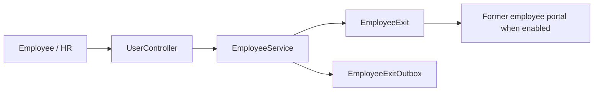

# Offboarding

Last verified against code: 2026-09-07.

Offboarding is the employee-exit workflow: resignation/HR initiation, review, notice period, operational gates, completion, and a restricted former-employee portal. It remains deliberately separate from the employee directory: an exit updates compatibility employment fields but does not delete the employee.

Main entry points:

| Layer | Source |
|---|---|
| Employee UI | `../CMS-React/src/app/modules/users/components/EmployeeExitCaseCard.tsx` |
| Management UI | `../CMS-React/src/app/modules/users/components/EmployeeExitManagementCard.tsx` |
| Operations UI | `../CMS-React/src/app/modules/users/components/EmployeeExitOperationsPanel.tsx` |
| Policy UI | `../CMS-React/src/app/modules/users/components/EmployeeExitPolicySettings.tsx` |
| API | `Codeji.CMS.API/Controllers/UserController.cs`; `PublicFormerEmployeePortalController.cs` |
| Service | `Codeji.CMS.Services/Employees/EmployeeService.cs`; `FormerEmployeePortalService.cs` |
| Entities | `Codeji.CMS.Repository/Entities/Employees/EmployeeExit.cs`, policy/template/outbox/final-settlement entities |
| Contracts | `Codeji.CMS.DTO/Employee/EmployeeExitDtos.cs` |

Critical invariants: the service derives actor and company from authenticated context; state-changing requests include `Version`; client company IDs are not trusted; policy values are snapshotted onto a new case; operations are gates only when the resolved policy requires them.

## Additive employee lifecycle integration

`EmployeeExit` remains authoritative for a completed exit. `EmpUser.Lifecycle` is an additive read model with independent dimensions: `EmploymentStatus`, `AvailabilityStatus`, `AccountStatus`, `PayrollStatus`, `OffboardingStatus`, `FormerPortalStatus`, and `AlumniStatus`.

- A real exit starts or completes through the existing `EmployeeExit` workflow; it must not be simulated by setting an account inactive.
- Direct HR exits and approved resignations synchronize lifecycle employment to `NoticePeriod` while the employee remains current.
- Completion synchronizes employment to `Resigned` or `Terminated`, closes the account, moves payroll to `FinalSettlement`, records an audit transition, and does not grant former-portal access automatically.
- Leave, sabbatical, suspension, and absconding review remain temporary/current states. `AbscondingUnderReview` becomes a former state only after an authorized completed exit decision.
- Resume Work is used for sabbatical and temporary absence; Rejoin remains restricted to completed former-employee exits.

See [../employee-lifecycle-status-model.md](../employee-lifecycle-status-model.md), [../employee-lifecycle-transition-matrix.md](../employee-lifecycle-transition-matrix.md), and [../employee-lifecycle-production-todo.md](../employee-lifecycle-production-todo.md).

## How policy settings work

The Company Details → Offboarding screen is the company’s process builder. A policy is resolved by scope (company, department, or role) when a new exit case is created, and the resolved values are copied into that case snapshot so later policy edits do not rewrite active cases.

- Presets are editable starting configurations, not restrictions.
- Each module’s `Enabled` state controls whether that work appears in the journey.
- `BlocksCompletion` is independent: an enabled module may be informational, or may block completion until cleared.
- Notice-period values define the default date/pay calculation; review, follow-up, clearance, and portal switches control the corresponding workflow surfaces.
- More-specific policies override broader policies for newly created cases; existing cases keep their snapshot.
- The server validates dependencies, tenant ownership, permissions, optimistic `Version`, and completion gates. UI switches only configure intent and never replace authorization.

Read [FLOW.md](FLOW.md) for lifecycle, [API.md](API.md) for endpoint ownership and testing, [UI.md](UI.md) for client mapping, [DATA_AND_RULES.md](DATA_AND_RULES.md) for the core data/rules, and the preserved detailed reference [../offboarding-module-current-flow.md](../offboarding-module-current-flow.md) for policy, portal, operations, and deployment-level implementation detail.
