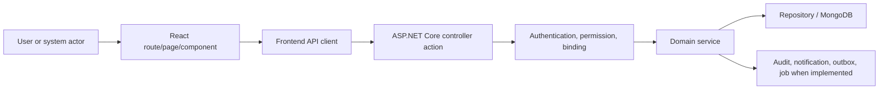

# Payroll and Salary Functional and Current Flow

**Last verified against code:** 2026-09-02

This is a source-trace document. Each flow begins at an extracted controller action and names the direct service call when the controller exposes one. Persistence, side effects and failure behavior are not guessed when the delegated source must still be inspected.

## 1. End-to-End Architecture

## 2. Major Action Flows

### FLOW-001 - GeneratePayRollForMonthly

#### Trigger

An HTTP client calls `POST api/AutoPayroll/GeneratePayRollMonthly`.

#### Actor and preconditions

Authorization evidence: `[Route("api/[controller]")] [Authorize] [HttpPost] [Route("GeneratePayRollMonthly")] [ModulePermission(AppModule.PayrollSettings, [Permission.Create, Permission.Edit]`.
The actor must also satisfy any company, ownership, relationship, state and concurrency checks in the delegated service.

#### Step-by-step flow

1. Routing selects `AutoPayrollController.GeneratePayRollForMonthly()`.
2. ASP.NET Core applies authentication/authorization filters and binds the request.
3. Parameters are bound from `[FromBody] ProcessPayrollRequestDto model`.
4. The controller executes/delegates to `PayrollPeriodRules.IsClosedPeriod()`.
5. The service validates domain rules and resolves company-owned records.
6. Repository operations read or mutate the applicable Mongo records.
7. Audit, notification, outbox or background effects occur only where the inspected implementation performs them.
8. The result flows through the shared API response/error pipeline.

#### Frontend flow

React route/page -> component handler -> frontend service/client -> this endpoint. The exact caller must be confirmed from the frontend source inventory.

#### Permission flow

Authenticated principal -> controller/module guard -> service company/ownership/relationship rule -> allowed mutation/read. UI visibility is not an authorization boundary.

#### Database changes

> WARNING: Follow the direct service call into repository/entity code. The HTTP verb does not prove insert/update/delete semantics.

#### Final state and failure paths

- Success state: the state returned/persisted by the service.
- Binding/validation failure: determined by DTO/model validation and service checks.
- Unauthorized/forbidden: determined by authentication, permission and relationship guards.
- Not found/company mismatch: must not reveal another company record.
- Conflict/stale state: verify version and transition rules where applicable.
- Partial side-effect failure: inspect transaction/outbox/retry implementation before asserting recovery.

#### Service evidence found

- `Codeji.CMS.Services/PayRoll/PayrollPeriodRules.cs:4`; signals: ; errors: ; statuses: .

### FLOW-002 - GetEmpPayRollData

#### Trigger

An HTTP client calls `POST api/PayRoll/GetEmpPayRollData`.

#### Actor and preconditions

Authorization evidence: `[Route("api/[controller]")] [Authorize] [HttpPost] [Route("GetEmpPayRollData")] [ModulePermission(AppModule.PayRoll, Permission.View)]`.
The actor must also satisfy any company, ownership, relationship, state and concurrency checks in the delegated service.

#### Step-by-step flow

1. Routing selects `PayRollController.GetEmpPayRollData()`.
2. ASP.NET Core applies authentication/authorization filters and binds the request.
3. Parameters are bound from `[FromBody] GetEmpPayRollRequestDto payload`.
4. The controller executes/delegates to `PayrollPeriodRules.IsClosedPeriod()`.
5. The service validates domain rules and resolves company-owned records.
6. Repository operations read or mutate the applicable Mongo records.
7. Audit, notification, outbox or background effects occur only where the inspected implementation performs them.
8. The result flows through the shared API response/error pipeline.

#### Frontend flow

React route/page -> component handler -> frontend service/client -> this endpoint. The exact caller must be confirmed from the frontend source inventory.

#### Permission flow

Authenticated principal -> controller/module guard -> service company/ownership/relationship rule -> allowed mutation/read. UI visibility is not an authorization boundary.

#### Database changes

> WARNING: Follow the direct service call into repository/entity code. The HTTP verb does not prove insert/update/delete semantics.

#### Final state and failure paths

- Success state: the state returned/persisted by the service.
- Binding/validation failure: determined by DTO/model validation and service checks.
- Unauthorized/forbidden: determined by authentication, permission and relationship guards.
- Not found/company mismatch: must not reveal another company record.
- Conflict/stale state: verify version and transition rules where applicable.
- Partial side-effect failure: inspect transaction/outbox/retry implementation before asserting recovery.

#### Service evidence found

- `Codeji.CMS.Services/PayRoll/PayrollPeriodRules.cs:4`; signals: ; errors: ; statuses: .

### FLOW-003 - GetSalarySlip

#### Trigger

An HTTP client calls `POST api/PayRoll/GeneratePaySlip`.

#### Actor and preconditions

Authorization evidence: `[Route("api/[controller]")] [Authorize] [HttpPost] [Route("GeneratePaySlip")]`.
The actor must also satisfy any company, ownership, relationship, state and concurrency checks in the delegated service.

#### Step-by-step flow

1. Routing selects `PayRollController.GetSalarySlip()`.
2. ASP.NET Core applies authentication/authorization filters and binds the request.
3. Parameters are bound from `PayslipRequestDto model`.
4. The controller executes/delegates to `PayrollPeriodRules.IsClosedPeriod()`.
5. The service validates domain rules and resolves company-owned records.
6. Repository operations read or mutate the applicable Mongo records.
7. Audit, notification, outbox or background effects occur only where the inspected implementation performs them.
8. The result flows through the shared API response/error pipeline.

#### Frontend flow

React route/page -> component handler -> frontend service/client -> this endpoint. The exact caller must be confirmed from the frontend source inventory.

#### Permission flow

Authenticated principal -> controller/module guard -> service company/ownership/relationship rule -> allowed mutation/read. UI visibility is not an authorization boundary.

#### Database changes

> WARNING: Follow the direct service call into repository/entity code. The HTTP verb does not prove insert/update/delete semantics.

#### Final state and failure paths

- Success state: the state returned/persisted by the service.
- Binding/validation failure: determined by DTO/model validation and service checks.
- Unauthorized/forbidden: determined by authentication, permission and relationship guards.
- Not found/company mismatch: must not reveal another company record.
- Conflict/stale state: verify version and transition rules where applicable.
- Partial side-effect failure: inspect transaction/outbox/retry implementation before asserting recovery.

#### Service evidence found

- `Codeji.CMS.Services/PayRoll/PayrollPeriodRules.cs:4`; signals: ; errors: ; statuses: .

### FLOW-004 - GetEmployeeSalarySlip

#### Trigger

An HTTP client calls `POST api/PayRoll/GenerateEmployeePaySlip`.

#### Actor and preconditions

Authorization evidence: `[Route("api/[controller]")] [Authorize] [HttpPost] [Route("GenerateEmployeePaySlip")] [ModulePermission(AppModule.PayRoll, Permission.View)]`.
The actor must also satisfy any company, ownership, relationship, state and concurrency checks in the delegated service.

#### Step-by-step flow

1. Routing selects `PayRollController.GetEmployeeSalarySlip()`.
2. ASP.NET Core applies authentication/authorization filters and binds the request.
3. Parameters are bound from `EmployeePayslipRequestDto model`.
4. The controller executes/delegates to `PayrollPeriodRules.IsClosedPeriod()`.
5. The service validates domain rules and resolves company-owned records.
6. Repository operations read or mutate the applicable Mongo records.
7. Audit, notification, outbox or background effects occur only where the inspected implementation performs them.
8. The result flows through the shared API response/error pipeline.

#### Frontend flow

React route/page -> component handler -> frontend service/client -> this endpoint. The exact caller must be confirmed from the frontend source inventory.

#### Permission flow

Authenticated principal -> controller/module guard -> service company/ownership/relationship rule -> allowed mutation/read. UI visibility is not an authorization boundary.

#### Database changes

> WARNING: Follow the direct service call into repository/entity code. The HTTP verb does not prove insert/update/delete semantics.

#### Final state and failure paths

- Success state: the state returned/persisted by the service.
- Binding/validation failure: determined by DTO/model validation and service checks.
- Unauthorized/forbidden: determined by authentication, permission and relationship guards.
- Not found/company mismatch: must not reveal another company record.
- Conflict/stale state: verify version and transition rules where applicable.
- Partial side-effect failure: inspect transaction/outbox/retry implementation before asserting recovery.

#### Service evidence found

- `Codeji.CMS.Services/PayRoll/PayrollPeriodRules.cs:4`; signals: ; errors: ; statuses: .

### FLOW-005 - UploadPayloadData

#### Trigger

An HTTP client calls `POST api/PayRoll/UploadPayloadData`.

#### Actor and preconditions

Authorization evidence: `[Route("api/[controller]")] [Authorize] [HttpPost] [Route("UploadPayloadData")] [ModulePermission(AppModule.PayRoll, [Permission.Create, Permission.Edit]`.
The actor must also satisfy any company, ownership, relationship, state and concurrency checks in the delegated service.

#### Step-by-step flow

1. Routing selects `PayRollController.UploadPayloadData()`.
2. ASP.NET Core applies authentication/authorization filters and binds the request.
3. Parameters are bound from `[FromBody] EmplyeePayRollRequestDto model`.
4. The controller executes/delegates to `PayrollPeriodRules.IsClosedPeriod()`.
5. The service validates domain rules and resolves company-owned records.
6. Repository operations read or mutate the applicable Mongo records.
7. Audit, notification, outbox or background effects occur only where the inspected implementation performs them.
8. The result flows through the shared API response/error pipeline.

#### Frontend flow

React route/page -> component handler -> frontend service/client -> this endpoint. The exact caller must be confirmed from the frontend source inventory.

#### Permission flow

Authenticated principal -> controller/module guard -> service company/ownership/relationship rule -> allowed mutation/read. UI visibility is not an authorization boundary.

#### Database changes

> WARNING: Follow the direct service call into repository/entity code. The HTTP verb does not prove insert/update/delete semantics.

#### Final state and failure paths

- Success state: the state returned/persisted by the service.
- Binding/validation failure: determined by DTO/model validation and service checks.
- Unauthorized/forbidden: determined by authentication, permission and relationship guards.
- Not found/company mismatch: must not reveal another company record.
- Conflict/stale state: verify version and transition rules where applicable.
- Partial side-effect failure: inspect transaction/outbox/retry implementation before asserting recovery.

#### Service evidence found

- `Codeji.CMS.Services/PayRoll/PayrollPeriodRules.cs:4`; signals: ; errors: ; statuses: .

### FLOW-006 - AddUpdatePayRoll

#### Trigger

An HTTP client calls `POST api/PayRoll/AddUpdatePayRoll`.

#### Actor and preconditions

Authorization evidence: `[Route("api/[controller]")] [Authorize] [HttpPost] [Route("AddUpdatePayRoll")] [ModulePermission(AppModule.PayRoll, [Permission.Create, Permission.Edit]`.
The actor must also satisfy any company, ownership, relationship, state and concurrency checks in the delegated service.

#### Step-by-step flow

1. Routing selects `PayRollController.AddUpdatePayRoll()`.
2. ASP.NET Core applies authentication/authorization filters and binds the request.
3. Parameters are bound from `[FromBody] AddUpdatePayRollRequestDto model`.
4. The controller executes/delegates to `PayrollPeriodRules.IsClosedPeriod()`.
5. The service validates domain rules and resolves company-owned records.
6. Repository operations read or mutate the applicable Mongo records.
7. Audit, notification, outbox or background effects occur only where the inspected implementation performs them.
8. The result flows through the shared API response/error pipeline.

#### Frontend flow

React route/page -> component handler -> frontend service/client -> this endpoint. The exact caller must be confirmed from the frontend source inventory.

#### Permission flow

Authenticated principal -> controller/module guard -> service company/ownership/relationship rule -> allowed mutation/read. UI visibility is not an authorization boundary.

#### Database changes

> WARNING: Follow the direct service call into repository/entity code. The HTTP verb does not prove insert/update/delete semantics.

#### Final state and failure paths

- Success state: the state returned/persisted by the service.
- Binding/validation failure: determined by DTO/model validation and service checks.
- Unauthorized/forbidden: determined by authentication, permission and relationship guards.
- Not found/company mismatch: must not reveal another company record.
- Conflict/stale state: verify version and transition rules where applicable.
- Partial side-effect failure: inspect transaction/outbox/retry implementation before asserting recovery.

#### Service evidence found

- `Codeji.CMS.Services/PayRoll/PayrollPeriodRules.cs:4`; signals: ; errors: ; statuses: .

### FLOW-007 - ProcessPayrollMonth

#### Trigger

An HTTP client calls `POST api/PayRoll/ProcessPayrollMonth`.

#### Actor and preconditions

Authorization evidence: `[Route("api/[controller]")] [Authorize] [HttpPost] [Route("ProcessPayrollMonth")] [ModulePermission(AppModule.PayRoll, [Permission.Create, Permission.Edit]`.
The actor must also satisfy any company, ownership, relationship, state and concurrency checks in the delegated service.

#### Step-by-step flow

1. Routing selects `PayRollController.ProcessPayrollMonth()`.
2. ASP.NET Core applies authentication/authorization filters and binds the request.
3. Parameters are bound from `[FromBody] ProcessPayrollRequestDto model`.
4. The controller executes/delegates to `PayrollPeriodRules.IsClosedPeriod()`.
5. The service validates domain rules and resolves company-owned records.
6. Repository operations read or mutate the applicable Mongo records.
7. Audit, notification, outbox or background effects occur only where the inspected implementation performs them.
8. The result flows through the shared API response/error pipeline.

#### Frontend flow

React route/page -> component handler -> frontend service/client -> this endpoint. The exact caller must be confirmed from the frontend source inventory.

#### Permission flow

Authenticated principal -> controller/module guard -> service company/ownership/relationship rule -> allowed mutation/read. UI visibility is not an authorization boundary.

#### Database changes

> WARNING: Follow the direct service call into repository/entity code. The HTTP verb does not prove insert/update/delete semantics.

#### Final state and failure paths

- Success state: the state returned/persisted by the service.
- Binding/validation failure: determined by DTO/model validation and service checks.
- Unauthorized/forbidden: determined by authentication, permission and relationship guards.
- Not found/company mismatch: must not reveal another company record.
- Conflict/stale state: verify version and transition rules where applicable.
- Partial side-effect failure: inspect transaction/outbox/retry implementation before asserting recovery.

#### Service evidence found

- `Codeji.CMS.Services/PayRoll/PayrollPeriodRules.cs:4`; signals: ; errors: ; statuses: .

### FLOW-008 - Get

#### Trigger

An HTTP client calls `GET api/payroll/divisor-policy`.

#### Actor and preconditions

Authorization evidence: `[ApiController,Authorize,Route("api/payroll/divisor-policy")] [HttpGet,ModulePermission(AppModule.PayrollSettings,Permission.View)]`.
The actor must also satisfy any company, ownership, relationship, state and concurrency checks in the delegated service.

#### Step-by-step flow

1. Routing selects `PayrollDivisorPolicyController.Get()`.
2. ASP.NET Core applies authentication/authorization filters and binds the request.
3. Parameters are bound from `[FromQuery]DateTime month`.
4. The controller executes/delegates to `service.GetEffective()`.
5. The service validates domain rules and resolves company-owned records.
6. Repository operations read or mutate the applicable Mongo records.
7. Audit, notification, outbox or background effects occur only where the inspected implementation performs them.
8. The result flows through the shared API response/error pipeline.

#### Frontend flow

React route/page -> component handler -> frontend service/client -> this endpoint. The exact caller must be confirmed from the frontend source inventory.

#### Permission flow

Authenticated principal -> controller/module guard -> service company/ownership/relationship rule -> allowed mutation/read. UI visibility is not an authorization boundary.

#### Database changes

> WARNING: Follow the direct service call into repository/entity code. The HTTP verb does not prove insert/update/delete semantics.

#### Final state and failure paths

- Success state: the state returned/persisted by the service.
- Binding/validation failure: determined by DTO/model validation and service checks.
- Unauthorized/forbidden: determined by authentication, permission and relationship guards.
- Not found/company mismatch: must not reveal another company record.
- Conflict/stale state: verify version and transition rules where applicable.
- Partial side-effect failure: inspect transaction/outbox/retry implementation before asserting recovery.

#### Service evidence found

- `Codeji.CMS.Services/PayRoll/AutoPayRollServices.cs:69`; signals: company/tenant context reference, version/concurrency or update-result reference, repository/data-access reference; errors: PENDING_REVIEW, LHD_ED_LIMIT_EXCEEDED, CANCELLED, DEDUCTION_APPROVED, APPLIED_TO_PAYROLL, LHD_ED_POLICY; statuses: .
- `Codeji.CMS.Services/PayRoll/PayrollDivisorPolicyService.cs:9`; signals: company/tenant context reference, version/concurrency or update-result reference, repository/data-access reference, audit/history metadata reference; errors: CALENDAR_DAYS, WORKING_DAYS, FIXED_30_DAYS; statuses: .

### FLOW-009 - Save

#### Trigger

An HTTP client calls `POST api/payroll/divisor-policy`.

#### Actor and preconditions

Authorization evidence: `[ApiController,Authorize,Route("api/payroll/divisor-policy")] [HttpPost,ModulePermission(AppModule.PayrollSettings,Permission.Edit)]`.
The actor must also satisfy any company, ownership, relationship, state and concurrency checks in the delegated service.

#### Step-by-step flow

1. Routing selects `PayrollDivisorPolicyController.Save()`.
2. ASP.NET Core applies authentication/authorization filters and binds the request.
3. Parameters are bound from `PayrollDivisorPolicyDto dto`.
4. The controller executes/delegates to `service.Save()`.
5. The service validates domain rules and resolves company-owned records.
6. Repository operations read or mutate the applicable Mongo records.
7. Audit, notification, outbox or background effects occur only where the inspected implementation performs them.
8. The result flows through the shared API response/error pipeline.

#### Frontend flow

React route/page -> component handler -> frontend service/client -> this endpoint. The exact caller must be confirmed from the frontend source inventory.

#### Permission flow

Authenticated principal -> controller/module guard -> service company/ownership/relationship rule -> allowed mutation/read. UI visibility is not an authorization boundary.

#### Database changes

> WARNING: Follow the direct service call into repository/entity code. The HTTP verb does not prove insert/update/delete semantics.

#### Final state and failure paths

- Success state: the state returned/persisted by the service.
- Binding/validation failure: determined by DTO/model validation and service checks.
- Unauthorized/forbidden: determined by authentication, permission and relationship guards.
- Not found/company mismatch: must not reveal another company record.
- Conflict/stale state: verify version and transition rules where applicable.
- Partial side-effect failure: inspect transaction/outbox/retry implementation before asserting recovery.

#### Service evidence found

- `Codeji.CMS.Services/PayRoll/PayrollDivisorPolicyService.cs:10`; signals: company/tenant context reference, version/concurrency or update-result reference, repository/data-access reference, audit/history metadata reference; errors: CALENDAR_DAYS, WORKING_DAYS, FIXED_30_DAYS; statuses: .

### FLOW-010 - CreateSalary

#### Trigger

An HTTP client calls `POST api/Salary/UpdateSalary`.

#### Actor and preconditions

Authorization evidence: `[Route("api/[controller]")] [Authorize] [HttpPost] [Route("UpdateSalary")] [ModulePermission(AppModule.Employees, [Permission.Create, Permission.Edit]`.
The actor must also satisfy any company, ownership, relationship, state and concurrency checks in the delegated service.

#### Step-by-step flow

1. Routing selects `SalaryController.CreateSalary()`.
2. ASP.NET Core applies authentication/authorization filters and binds the request.
3. Parameters are bound from `[FromBody] CreateSalaryDto dto`.
4. The controller executes/delegates to `_salaryService.CreateSalaryAsync()`.
5. The service validates domain rules and resolves company-owned records.
6. Repository operations read or mutate the applicable Mongo records.
7. Audit, notification, outbox or background effects occur only where the inspected implementation performs them.
8. The result flows through the shared API response/error pipeline.

#### Frontend flow

React route/page -> component handler -> frontend service/client -> this endpoint. The exact caller must be confirmed from the frontend source inventory.

#### Permission flow

Authenticated principal -> controller/module guard -> service company/ownership/relationship rule -> allowed mutation/read. UI visibility is not an authorization boundary.

#### Database changes

> WARNING: Follow the direct service call into repository/entity code. The HTTP verb does not prove insert/update/delete semantics.

#### Final state and failure paths

- Success state: the state returned/persisted by the service.
- Binding/validation failure: determined by DTO/model validation and service checks.
- Unauthorized/forbidden: determined by authentication, permission and relationship guards.
- Not found/company mismatch: must not reveal another company record.
- Conflict/stale state: verify version and transition rules where applicable.
- Partial side-effect failure: inspect transaction/outbox/retry implementation before asserting recovery.

### FLOW-011 - GetActiveSalary

#### Trigger

An HTTP client calls `GET api/Salary/active/{userId}`.

#### Actor and preconditions

Authorization evidence: `[Route("api/[controller]")] [Authorize] [HttpGet("active/{userId}")]`.
The actor must also satisfy any company, ownership, relationship, state and concurrency checks in the delegated service.

#### Step-by-step flow

1. Routing selects `SalaryController.GetActiveSalary()`.
2. ASP.NET Core applies authentication/authorization filters and binds the request.
3. Parameters are bound from `Guid userId`.
4. The controller executes/delegates to `_salaryService.GetActiveSalaryAsync()`.
5. The service validates domain rules and resolves company-owned records.
6. Repository operations read or mutate the applicable Mongo records.
7. Audit, notification, outbox or background effects occur only where the inspected implementation performs them.
8. The result flows through the shared API response/error pipeline.

#### Frontend flow

React route/page -> component handler -> frontend service/client -> this endpoint. The exact caller must be confirmed from the frontend source inventory.

#### Permission flow

Authenticated principal -> controller/module guard -> service company/ownership/relationship rule -> allowed mutation/read. UI visibility is not an authorization boundary.

#### Database changes

> WARNING: Follow the direct service call into repository/entity code. The HTTP verb does not prove insert/update/delete semantics.

#### Final state and failure paths

- Success state: the state returned/persisted by the service.
- Binding/validation failure: determined by DTO/model validation and service checks.
- Unauthorized/forbidden: determined by authentication, permission and relationship guards.
- Not found/company mismatch: must not reveal another company record.
- Conflict/stale state: verify version and transition rules where applicable.
- Partial side-effect failure: inspect transaction/outbox/retry implementation before asserting recovery.

### FLOW-012 - GetSalaryHistory

#### Trigger

An HTTP client calls `GET api/Salary/history/{userId}`.

#### Actor and preconditions

Authorization evidence: `[Route("api/[controller]")] [Authorize] [HttpGet("history/{userId}")]`.
The actor must also satisfy any company, ownership, relationship, state and concurrency checks in the delegated service.

#### Step-by-step flow

1. Routing selects `SalaryController.GetSalaryHistory()`.
2. ASP.NET Core applies authentication/authorization filters and binds the request.
3. Parameters are bound from `Guid userId`.
4. The controller executes/delegates to `_salaryService.GetSalaryHistoryAsync()`.
5. The service validates domain rules and resolves company-owned records.
6. Repository operations read or mutate the applicable Mongo records.
7. Audit, notification, outbox or background effects occur only where the inspected implementation performs them.
8. The result flows through the shared API response/error pipeline.

#### Frontend flow

React route/page -> component handler -> frontend service/client -> this endpoint. The exact caller must be confirmed from the frontend source inventory.

#### Permission flow

Authenticated principal -> controller/module guard -> service company/ownership/relationship rule -> allowed mutation/read. UI visibility is not an authorization boundary.

#### Database changes

> WARNING: Follow the direct service call into repository/entity code. The HTTP verb does not prove insert/update/delete semantics.

#### Final state and failure paths

- Success state: the state returned/persisted by the service.
- Binding/validation failure: determined by DTO/model validation and service checks.
- Unauthorized/forbidden: determined by authentication, permission and relationship guards.
- Not found/company mismatch: must not reveal another company record.
- Conflict/stale state: verify version and transition rules where applicable.
- Partial side-effect failure: inspect transaction/outbox/retry implementation before asserting recovery.

### FLOW-013 - GetCompanySalaries

#### Trigger

An HTTP client calls `POST api/Salary/GetCompanySalaries`.

#### Actor and preconditions

Authorization evidence: `[Route("api/[controller]")] [Authorize] [HttpPost] [Route("GetCompanySalaries")] [ModulePermission(AppModule.PayrollSettings, Permission.View)]`.
The actor must also satisfy any company, ownership, relationship, state and concurrency checks in the delegated service.

#### Step-by-step flow

1. Routing selects `SalaryController.GetCompanySalaries()`.
2. ASP.NET Core applies authentication/authorization filters and binds the request.
3. Parameters are bound from `[FromBody] CompanySalaryFilterDto filter`.
4. The controller executes/delegates to `CurrentContext.CompanyId()`.
5. The service validates domain rules and resolves company-owned records.
6. Repository operations read or mutate the applicable Mongo records.
7. Audit, notification, outbox or background effects occur only where the inspected implementation performs them.
8. The result flows through the shared API response/error pipeline.

#### Frontend flow

React route/page -> component handler -> frontend service/client -> this endpoint. The exact caller must be confirmed from the frontend source inventory.

#### Permission flow

Authenticated principal -> controller/module guard -> service company/ownership/relationship rule -> allowed mutation/read. UI visibility is not an authorization boundary.

#### Database changes

> WARNING: Follow the direct service call into repository/entity code. The HTTP verb does not prove insert/update/delete semantics.

#### Final state and failure paths

- Success state: the state returned/persisted by the service.
- Binding/validation failure: determined by DTO/model validation and service checks.
- Unauthorized/forbidden: determined by authentication, permission and relationship guards.
- Not found/company mismatch: must not reveal another company record.
- Conflict/stale state: verify version and transition rules where applicable.
- Partial side-effect failure: inspect transaction/outbox/retry implementation before asserting recovery.

## 3. Service and UI Evidence Inventory

- `Codeji.CMS.Services/PayRoll/AutoPayRollServices.cs` - symbols: IMongoDbRepository, AutoPayrollServices, GeneratePayrollForMonthAsync, monthStart, monthEnd, employees, divisorSetting, divisorPolicy, validationErrors, exitDate, summary, processedCount, skippedNoSalaryCount, consideredCount, payrollMutations, eligibleFrom, eligibleTo, attendanceSummary, RollbackPayrollRunAsync, attendanceException, salaryRecords, daysInMonth
- `Codeji.CMS.Services/PayRoll/Interface/IAutoPayRollServices.cs` - symbols: IAutoPayRollServices, GeneratePayrollForMonthAsync
- `Codeji.CMS.Services/PayRoll/Interface/IPayRollServices.cs` - symbols: IPayRollServices, GenerateEmpSalarySlip, GenerateEmployeeSalarySlip, AddUpdatePayRoll, ProcessPayrollMonth
- `Codeji.CMS.Services/PayRoll/PayrollCalculationRules.cs` - symbols: 
- `Codeji.CMS.Services/PayRoll/PayrollDivisorPolicyService.cs` - symbols: IPayrollDivisorPolicyService, GetEffective, Save, date, item, allowed, versions, newStart, open
- `Codeji.CMS.Services/PayRoll/PayRollHostedServices.cs` - symbols: ILogger, PayrollHostedService, indiaZone, nowUtc, nowIndia, scheduledTimeIndia, scheduledUtc, delay, RunPayroll, autoPayroll, companyService, companies, currentMonth
- `Codeji.CMS.Services/PayRoll/PayrollPeriodRules.cs` - symbols: 
- `Codeji.CMS.Services/PayRoll/PayRollServices.cs` - symbols: IMongoDbRepository, PayRollServices, GenerateEmpSalarySlip, GenerateEmployeeSalarySlip, BuildSalarySlipAsync, salarySlipModel, monthStart, templateFilePath, fileContent, logoPath, templateContent, pdfName, readonly, List, errors, missingColumns, missingColumnLabels, row, rowMissingFields, Task, result, validationErrors, payData, employeeIds, empUsers, existingEmployeeIds
- `src/app/modules/payroll/AddUpdateEmployeePayRoll.tsx` - symbols: PayRollFormValues, PropsType, FormFieldProps, sections, AddUpdateEmployeePayRoll, handleAddUpdate, paperSx, fields
- `src/app/modules/payroll/components/payrollActionButtonSx.ts` - symbols: payrollActionButtonSx
- `src/app/modules/payroll/components/PayRollTable.tsx` - symbols: Column, amountColumns, TableProps, PayRollTable, userModulePermissions, hasEditPermission, handlePreviewPaySlip, response, contentType, errorData, errorJson, handleClosePreview, processedData, grossPay, totalDeductions, netPay, visibleRows, tabIndex, hasPayRoll, isProcessed
- `src/app/modules/payroll/components/ProcessPayrollModal.tsx` - symbols: Props, ProcessPayrollModal, availableIds, allSelected, partiallySelected, toggleAll, toggleEmployee
- `src/app/modules/payroll/components/UploadPayRollData.tsx` - symbols: ValidFileExtension, requiredHeaders, moneyHeaders, SAMPLE_FILE_URL, KeyMappingType, PropsType, normalizeHeader, value, readWorkSheetObject, workSheet, HeaderValidationResult, validateHeaderRow, sheetData, row, normalizedCells, missingHeaders, roundSheetMoneyColumns, range, headerCell, cell, rounded, mapExcelRowtoPayLoad, targetKey, UploadPayRollData, inputRef, handleCloseModal, validateWorkSheet, sheet, handleWorkSheetChange, handleFileChange
- `src/app/modules/payroll/models.ts` - symbols: PayRollDataModel, PayRollRequestModel, PayslipPayload, EmployeePayslipPayload, PayRollResponseModel, AddUpdatePayRollPayload, ProcessPayrollMonthPayload, GetPayRollResponseModel
- `src/app/modules/payroll/PayRollManagement.tsx` - symbols: PayRollManagement, userModulePermissions, hasCreatePermission, hasEditPermission, payrollRows, processableRows, isMonthProcessed, handleDateChange, handleSearchChange, handleRowClick, handlePageRefresh, handleProcessMonth, handleModalClose, sx, placement
- `src/app/modules/payroll/services.ts` - symbols: GetPayRollPayload, uploadEmpPayRollData, postRequest, generatePaySlip, generateEmployeePaySlip, getEmployeePayRollData, processPayrollMonth, addUpdateEmployeePayRoll
- `src/app/modules/payrollsettings/components/AddUpdateEmployeeSalary.tsx` - symbols: PropsType, AddUpdateEmployeeSalary, formRef, policyRef, handleUserUpdate, handleSave
- `src/app/modules/payrollsettings/components/SalaryTable.tsx` - symbols: Column, amountColumns, TableProps, SalaryTable, userModulePermissions, hasEditPermission, rows, tabIndex
- `src/app/modules/payrollsettings/model.ts` - symbols: CompanySalaryResponseModel, CompanySalaryFilterPayload, ProcessPayrollPayload
- `src/app/modules/payrollsettings/PayrollSettings.tsx` - symbols: AttendanceMonthLockStatus, AttendanceLockBlockingIssue, AttendanceMonthLockValidationResult, userModulesPermissions, hasProcessPermission, handleSearchChange, handlePageRefresh, handleRowClick, handleModalClose, handleProcessMonthChange, cancelled, employeeResponse, handleProcessSalary, handleValidateAndLock, selectedMonth, currentMonth, openAttendanceCell, sx
- `src/app/modules/payrollsettings/services.ts` - symbols: getCompanySalaries, postRequest, processPayroll

## 4. Cross-Module and Recovery Rules

- Preserve tenant/company filters at every service/repository boundary.
- Preserve optimistic version/state checks for stateful workflows.
- Treat derived attendance/payroll/notification state as a cross-module dependency, not a UI-only effect.
- Verify whether Mongo transactions are available before describing rollback as atomic.
- Verify outbox/job retry behavior from the actual processor before promising delivery.

