# Codeji HRMS Payroll & Statutory TDS — Enterprise Azure DevOps Specification

> **Project:** Codeji HRMS Enterprise Suite  
> **Module:** Payroll Engine & Statutory Tax Compliance (TDS u/s 192, 115BAC, EPF, ESIC, PT)  
> **Document Type:** Azure DevOps Epic / Feature / User Story / Bug Hierarchical Specification  
> **Status:** APPROVED & ACTIVE  
> **Version:** 2.0.0  
> **Architectural Standard:** C# 13 / .NET 10 Web API, MongoDB 8, React 19 / TypeScript 5, Vite, Vitest, xUnit, Material-UI  
> **Statutory Benchmarks:** Income Tax Act 1961 (Section 192, 115BAC, 87A, 10(13A), 206AA), Finance Act 2024, EPFO Gazette S.O. 5109(E), ESIC Act 1948, Payment of Gratuity Act 1972, State Professional Tax Acts

---

## 1. Architectural Work Item Hierarchy

```mermaid
graph TD
    EPIC01["EPIC-PAY-01: Attendance & Proration Engine"] --> FEAT011["FEAT-PAY-01-01: Tenant Divisor Policy Engine"]
    EPIC01 --> FEAT012["FEAT-PAY-01-02: Loss-of-Pay Proration & Mid-Month Rates"]
    
    EPIC02["EPIC-PAY-02: Statutory EPF & ESIC Compliance"] --> FEAT021["FEAT-PAY-02-01: EPF Wage Ceiling Transition to ₹25k"]
    EPIC02 --> FEAT022["FEAT-PAY-02-02: ESIC 6-Month Continuation Rule"]
    EPIC02 --> FEAT023["FEAT-PAY-02-03: EPFO ECR v2 & ESIC Monthly Return Export"]
    
    EPIC03["EPIC-PAY-03: Section 192 TDS Projection Engine"] --> FEAT031["FEAT-PAY-03-01: New Tax Regime u/s 115BAC Engine"]
    EPIC03 --> FEAT032["FEAT-PAY-03-02: Old Regime Chapter VI-A & HRA Exemption"]
    EPIC03 --> FEAT033["FEAT-PAY-03-03: Section 87A Rebate & Marginal Relief Cliff"]
    EPIC03 --> FEAT034["FEAT-PAY-03-04: Section 206AA Missing PAN 20% Override"]
    
    EPIC04["EPIC-PAY-04: Employee Tax Declaration Self-Service"] --> FEAT041["FEAT-PAY-04-01: Old vs New Regime Live Simulator"]
    EPIC04 --> FEAT042["FEAT-PAY-04-02: Landlord PAN Mandatory Enforcement"]
    EPIC04 --> FEAT043["FEAT-PAY-04-03: Proof Document Upload & Split-Screen Review"]
    
    EPIC05["EPIC-PAY-05: State Professional Tax Engine"] --> FEAT051["FEAT-PAY-05-01: Multi-State Monthly Slabs & Gender Exemptions"]
    EPIC05 --> FEAT052["FEAT-PAY-05-02: Maharashtra February Spike (₹300) Engine"]
    
    EPIC06["EPIC-PAY-06: Enterprise Governance & Maker-Checker"] --> FEAT061["FEAT-PAY-06-01: 5-Stage Approval Workflow & Cryptographic Lock"]
    EPIC06 --> FEAT062["FEAT-PAY-06-02: Retrospective Correction Runs & Adjustment Ledger"]
    
    EPIC07["EPIC-PAY-07: Bank Batch Payouts & Form 16 Wizard"] --> FEAT071["FEAT-PAY-07-01: Corporate Bank Batch NEFT/RTGS File Generator"]
    EPIC07 --> FEAT072["FEAT-PAY-07-02: Annual Form 16 Part A/B Bulk Generation"]
    
    EPIC08["EPIC-PAY-08: Full & Final Settlement & Gratuity"] --> FEAT081["FEAT-PAY-08-01: Payment of Gratuity Act 1972 Engine"]
    EPIC08 --> FEAT082["FEAT-PAY-08-02: Leave Encashment & Notice Recovery"]
```



---

## EPIC-PAY-01: Attendance & Proration Engine (Divisor Rules & Loss-of-Pay Governance)
**Owner:** Payroll Engine Core Team & Time & Attendance Lead  
**Business Outcome:** Accurately calculate earned gross wages from contractual gross based on tenant-specific calendar or working-day policies without negative net salary.

### FEAT-PAY-01-01: Tenant Divisor Policy Engine
#### US-PAY-01-01-01: Multi-Divisor Daily Rate Calculation
- **As a** Payroll Administrator  
- **I want** to configure the salary proration divisor policy per company (`CALENDAR_DAYS`, `FIXED_30_DAYS`, or `WORKING_DAYS`)  
- **So that** monthly employee salaries reflect company attendance and leave policy.
- **Priority:** P1 (High) | **Story Points:** 5 | **Risk:** Low

##### Acceptance Criteria (Gherkin)
```gherkin
Scenario: Prorating salary using CALENDAR_DAYS in a 31-day month
  Given a company configured with DivisorPolicy = "CALENDAR_DAYS"
  And an employee with monthly Basic salary of ₹62,000
  When the employee has 2 days of Loss of Pay (LOP) in May (31 days)
  Then the daily wage is calculated as ₹62,000 / 31 = ₹2,000
  And the earned Basic salary is ₹62,000 - (2 * ₹2,000) = ₹58,000.

Scenario: Prorating salary using FIXED_30_DAYS in February
  Given a company configured with DivisorPolicy = "FIXED_30_DAYS"
  And an employee with monthly Basic salary of ₹60,000
  When the employee has 1 day of LOP in February
  Then the daily wage is calculated as ₹60,000 / 30 = ₹2,000
  And the earned Basic salary is ₹60,000 - ₹2,000 = ₹58,000.
```

##### Technical Implementation Details
- **Services:** `Codeji.CMS.Services/Payroll/PayrollCalculationRules.cs`
- **Data Entities:** `CompanyPayrollPolicy` (`DivisorPolicy`, `WorkWeekPattern`)
- **Unit Tests:** `DivisorPolicy_CalculatesAccurateDailyRate_Calendar_Fixed30_Working` in `Codeji.CMS.Services.Tests`.

---

### FEAT-PAY-01-02: Loss-of-Pay (LOP) Proration & Mid-Month Rates
#### US-PAY-01-02-01: Mid-Month Joiner/Exit Proration with Negative Net Pay Guard
- **As a** Finance Manager  
- **I want** the payroll engine to calculate prorated wages for employees joining or leaving mid-cycle, and cap deductions at gross earnings  
- **So that** negative pay slips are strictly prevented and uncollected deductions roll over to arrears.
- **Priority:** P1 (High) | **Story Points:** 5 | **Risk:** Medium

##### Acceptance Criteria (Gherkin)
```gherkin
Scenario: Employee joins on the 16th of a 30-day month
  Given an employee joining on June 16 with a monthly CTC Gross of ₹90,000
  When June payroll is processed using "CALENDAR_DAYS"
  Then the active days count is 15 days
  And the earned gross wage is ₹45,000
  And statutory deductions (EPF, PT) are calculated on the earned ₹45,000.

Scenario: Excessive LOP days prevent negative net salary
  Given an employee whose total voluntary deductions exceed earned gross wages
  When the payroll engine calculates net pay
  Then net pay is floored at ₹0.00
  And the remaining uncollected balance is created as an ArrearsAdjustment for the next cycle.
```

---

## EPIC-PAY-02: Statutory EPF & ESIC Compliance
**Owner:** Statutory Compliance Officer & Backend Services Lead  
**Business Outcome:** 100% compliance with EPFO and ESIC regulations, eliminating employer liability, inspection penalties, and manual filing overhead.

### FEAT-PAY-02-01: EPF Wage Ceiling Transition (Gazette Notification S.O. 5109(E))
#### US-PAY-02-01-01: Date-Based Dynamic EPF Ceiling Transition (₹15,000 to ₹25,000)
- **As a** Compliance Auditor  
- **I want** the system to apply ₹15,000 ceiling prior to September 17, 2026, and ₹25,000 ceiling thereafter  
- **So that** statutory EPF contributions automatically adhere to the official Gazette notification without manual configuration.
- **Priority:** P1 (High) | **Story Points:** 5 | **Risk:** Low

##### Acceptance Criteria (Gherkin)
```gherkin
Scenario: Payroll run before transition date caps EPF wage at ₹15,000
  Given a payroll cycle date of "2026-08-31"
  And an employee with Basic wage of ₹35,000 and "CAPPED_CEILING" policy
  When EPF contribution is computed
  Then the EPF Wage Base is capped at ₹15,000
  And Employee EPF is ₹1,800 (12%) and Employer EPS is ₹1,250 (8.33%).

Scenario: Payroll run on or after transition date caps EPF wage at ₹25,000
  Given a payroll cycle date of "2026-09-30" (post S.O. 5109(E))
  And an employee with Basic wage of ₹35,000 and "CAPPED_CEILING" policy
  When EPF contribution is computed
  Then the EPF Wage Base is capped at ₹25,000
  And Employee EPF is ₹3,000 (12%) and Employer EPS is ₹2,083 (8.33%).
```

---

### FEAT-PAY-02-02: ESIC 6-Month Contribution Period Continuation Rule
#### US-PAY-02-02-01: Mid-Term Salary Hike ESIC Coverage Continuation
- **As an** HR Operations Specialist  
- **I want** an employee covered by ESIC on April 1 to remain covered through September 30 even if a mid-cycle appraisal increases gross wage above ₹21,000  
- **So that** the organization complies with the ESIC Act 1948 contribution period rule.
- **Priority:** P1 (High) | **Story Points:** 5 | **Risk:** Medium

##### Acceptance Criteria (Gherkin)
```gherkin
Scenario: Employee receiving appraisal remains covered through end of contribution period
  Given an employee with Gross Wage of ₹20,000 on April 1 (within contribution period April-Sept)
  When the employee receives an increment to ₹26,000 effective July 1
  Then ESIC deduction continues for July, August, and September at 0.75% of earned gross
  And ESIC coverage ceases only at the start of the next contribution period on October 1.
```

---

### FEAT-PAY-02-03: EPFO ECR v2.0 & ESIC Monthly Return Export Engine
#### US-PAY-02-03-01: 1-Click EPFO ECR `#~#` Delimited File Export
- **As a** Payroll Accountant  
- **I want** to export an official EPFO ECR v2.0 formatted text file directly from an approved payroll run  
- **So that** I can upload the file to the Unified Member Portal without manual formatting.
- **Priority:** P1 (High) | **Story Points:** 8 | **Risk:** Low

##### Acceptance Criteria (Gherkin)
```gherkin
Scenario: Exporting EPFO ECR file for an approved payroll run
  Given a processed payroll run for 150 employees with UANs
  When the administrator clicks "Export EPFO ECR"
  Then a file named "ECR_{CompanyCode}_{Month}_{Year}.txt" is downloaded
  And each line contains fields delimited by "#~#" formatted as:
    `UAN#~#MemberName#~#GrossWages#~#EPFWages#~#EPSWages#~#EDLIWages#~#EEContribution#~#EPSContribution#~#ERContribution#~#NCPDays#~#Refunds`
  And NCP (Non-Contributing Period) matches the exact Loss-of-Pay days for each member.
```

---

## EPIC-PAY-03: Section 192 TDS Projection Engine (Income Tax)
**Owner:** Tax Architecture Specialist & Principal Software Engineer  
**Business Outcome:** Prevent tax under-withholding or penalties u/s 201(1A), correctly calculate marginal relief under Section 87A, and enforce Finance Act 2024 provisions.

### FEAT-PAY-03-01: New Tax Regime u/s 115BAC Engine (Default Statutory Regime)
#### US-PAY-03-01-01: Automated Standard Deduction (₹75k) and FY 2024-26 Slabs
- **As a** Salaried Employee  
- **I want** the payroll engine to apply the default Section 115BAC slabs and ₹75,000 standard deduction  
- **So that** my monthly TDS deduction reflects the lowest statutory tax liability without requiring manual declaration.
- **Priority:** P1 (High) | **Story Points:** 5 | **Risk:** Low

##### Acceptance Criteria (Gherkin)
```gherkin
Scenario: Employee under New Regime with ₹15,00,000 CTC
  Given an employee opted into "NEW_115BAC" with projected gross ₹15,00,000
  When annual taxable income is computed
  Then ₹75,000 standard deduction is applied automatically
  And Net Taxable Income is ₹14,25,000
  And progressive slab tax is calculated across 0-4L, 4-8L, 8-12L, and 12-16L bands
  And 4% Health & Education Cess is added to the tax amount.
```

---

### FEAT-PAY-03-02: Old Tax Regime Chapter VI-A & HRA Exemption Calculator
#### US-PAY-03-02-01: HRA Least-of-Three Exemption Calculation (Section 10(13A))
- **As an** Employee choosing the Old Tax Regime  
- **I want** my HRA tax exemption calculated as the lowest of Actual HRA, Rent paid - 10% Basic, or 50%/40% of Basic  
- **So that** my eligible tax exemption is deducted from my annual taxable gross.
- **Priority:** P1 (High) | **Story Points:** 5 | **Risk:** Low

##### Acceptance Criteria (Gherkin)
```gherkin
Scenario: HRA calculation for employee living in a Metro city
  Given an employee in Mumbai (Metro = true) with Basic ₹6,00,000 and HRA ₹2,40,000
  When the employee declares annual rent paid of ₹2,10,000 with landlord PAN
  Then the three statutory limbs evaluated are:
    1. Actual HRA = ₹2,40,000
    2. Rent - 10% Basic = ₹2,10,000 - ₹60,000 = ₹1,50,000
    3. 50% Basic (Metro) = ₹3,00,000
  And the approved HRA exemption is ₹1,50,000 (the minimum).
```

---

### FEAT-PAY-03-03: Section 87A Full Rebate & Marginal Relief Cliff Calculation
#### US-PAY-03-03-01: Marginal Relief Engine at ₹12,00,000 Boundary
- **As an** Employee with net taxable income slightly above ₹12 Lakhs under the New Regime  
- **I want** the tax engine to apply Section 87A marginal relief  
- **So that** my tax payable does not exceed the income earned above ₹12,00,000.
- **Priority:** P1 (High) | **Story Points:** 8 | **Risk:** High

##### Acceptance Criteria (Gherkin)
```gherkin
Scenario: Taxable income exactly ₹12,00,000 yields zero tax
  Given an employee under NEW_115BAC with net taxable income of ₹12,00,000
  When tax liability is evaluated
  Then full Section 87A rebate applies (up to ₹60,000)
  And net tax payable before cess is ₹0.00.

Scenario: Marginal relief applies for income slightly exceeding ₹12,00,000
  Given an employee with net taxable income of ₹12,15,000
  And standard slab tax on ₹12,15,000 is ₹62,250
  When marginal relief is evaluated
  Then excess income above ₹12,00,000 is ₹15,000
  And tax payable cannot exceed ₹15,000
  And marginal relief is ₹62,250 - ₹15,000 = ₹47,250
  And final tax payable before cess is capped at ₹15,000.
```

---

### FEAT-PAY-03-04: Section 206AA Missing / Inoperative PAN 20% Flat TDS
#### US-PAY-03-04-01: Enforce Statutory 20% Rate for Missing or Inoperative PAN
- **As a** Tax Compliance Auditor  
- **I want** the system to detect employees with missing PAN or invalid PAN format and apply 20% flat TDS without slab benefits  
- **So that** the company avoids default notices under Section 201 for insufficient TDS deduction.
- **Priority:** P1 (High) | **Story Points:** 5 | **Risk:** Medium

##### Acceptance Criteria (Gherkin)
```gherkin
Scenario: Employee without PAN gets 20% flat withholding
  Given an employee record with PAN = null or empty
  When monthly payroll run is executed
  Then the TDS engine overrides standard slab calculation
  And applies flat 20% TDS on earned gross salary
  And flags the employee pay slip with statutory remark "TDS deducted u/s 206AA due to missing PAN".
```

---

## EPIC-PAY-04: Employee Tax Declaration Self-Service & Verification
**Owner:** Employee Experience Lead & Payroll Operations  
**Business Outcome:** Empower employees to optimize tax savings with full clarity while streamlining HR audit and verification of investment proofs.

### FEAT-PAY-04-01: Interactive Old vs. New Regime Comparison Simulator
#### US-PAY-04-01-01: Real-Time Comparative Tax Simulator in Employee Self-Service
- **As an** Employee  
- **I want** to see a side-by-side comparison of my estimated annual tax under Old Regime vs New Regime based on my declared deductions  
- **So that** I can make a mathematically informed choice on which regime minimizes my tax liability.
- **Priority:** P2 (Medium) | **Story Points:** 8 | **Risk:** Low

##### Acceptance Criteria (Gherkin)
```gherkin
Scenario: Real-time calculation shows recommendation badge
  Given an employee on the Tax Declaration page with CTC ₹18,00,000
  When the employee enters ₹1,50,000 in 80C and ₹2,00,000 in Home Loan Interest
  Then the comparison card updates in real-time without page reload
  And displays "Old Regime Tax: ₹1,61,200" vs "New Regime Tax: ₹1,48,200"
  And highlights the New Regime with a "Recommended: Saves ₹13,000" badge.
```

---

### FEAT-PAY-04-02: Statutory Landlord PAN Mandatory Enforcement
#### US-PAY-04-02-01: CBDT Landlord PAN Validation for Rent > ₹1,00,000
- **As a** Payroll Reviewer  
- **I want** the system to require and validate a 10-character Landlord PAN when declared annual rent exceeds ₹1,00,000  
- **So that** HRA exemption claims comply with CBDT Circular requirements.
- **Priority:** P1 (High) | **Story Points:** 3 | **Risk:** Low

##### Acceptance Criteria (Gherkin)
```gherkin
Scenario: Rent > ₹1,00,000 without PAN triggers error
  Given an employee entering declared annual rent of ₹1,80,000
  When the employee leaves the Landlord PAN field blank
  Then the form displays an inline error: "Mandatory: CBDT mandates Landlord PAN when annual rent exceeds ₹1,00,000"
  And the submit button is disabled or triggers a warning confirmation.
```

---

### FEAT-PAY-04-03: Proof Document Upload & Split-Screen Review Queue
#### US-PAY-04-03-01: Side-by-Side Proof Verification & Partial Approval
- **As an** HR Payroll Administrator  
- **I want** to view uploaded proof attachments side-by-side with declared amounts and enter approved amounts with reviewer notes  
- **So that** only legally substantiated deductions enter the active TDS computation.
- **Priority:** P1 (High) | **Story Points:** 8 | **Risk:** Medium

##### Acceptance Criteria (Gherkin)
```gherkin
Scenario: Approving partial amount with audit remark
  Given an employee declaration of ₹1,50,000 under Section 80C
  When the reviewer inspects the uploaded receipts and finds only ₹1,20,000 valid
  Then the reviewer sets Approved Section 80C = ₹1,20,000 with note "Receipt for ₹30k unreadable"
  And upon approval, the active payroll engine uses ₹1,20,000 for TDS projection
  And the employee receives an automated notification explaining the discrepancy.
```

---

## EPIC-PAY-05: State Professional Tax (PT) Engine
**Owner:** Statutory Operations Specialist  
**Business Outcome:** Multi-state compliance across all Indian states and Union Territories, including gender-based rules and seasonal spikes.

### FEAT-PAY-05-01: Multi-State Monthly Slabs & Gender Exemptions
#### US-PAY-05-01-01: Dynamic State Slab Evaluation by Work Location
- **As a** Multi-Location Enterprise HR  
- **I want** Professional Tax deducted according to the employee's work location state  
- **So that** branches in Karnataka, Maharashtra, Telangana, and West Bengal comply with state-specific acts.
- **Priority:** P1 (High) | **Story Points:** 5 | **Risk:** Low

##### Acceptance Criteria (Gherkin)
```gherkin
Scenario: Deducting PT for Maharashtra with female exemption
  Given an employee located in Maharashtra
  When the employee's monthly gross is ₹24,000 and gender is "Female"
  Then PT deduction is ₹0.00 (exempt up to ₹25,000 for women).

Scenario: Deducting PT for Karnataka
  Given an employee located in Karnataka
  When the employee's monthly gross is ₹28,000
  Then PT deduction is ₹200.00.
```

---

### FEAT-PAY-05-02: Maharashtra February Spike (₹300) Engine
#### US-PAY-05-02-01: Automated February Surcharge Spike
- **As a** Payroll Accountant in Maharashtra  
- **I want** the engine to automatically deduct ₹300 in February instead of ₹200  
- **So that** annual PT deduction equals exactly ₹2,500 per statutory schedule.
- **Priority:** P1 (High) | **Story Points:** 3 | **Risk:** Low

##### Acceptance Criteria (Gherkin)
```gherkin
Scenario: February payroll run in Maharashtra
  Given an employee in Maharashtra earning ₹50,000/month
  When payroll is executed for the month of February
  Then the PT deduction is automatically calculated as ₹300
  And for all other months (April to January), PT is ₹200.
```

---

## EPIC-PAY-06: Enterprise Governance, Maker-Checker Workflow & Correction Runs
**Owner:** Enterprise Security & Audit Lead  
**Business Outcome:** Enforce SOX/SOC2 segregation of duties (Maker-Checker), prevent unauthorized salary releases, and provide audited retrospective correction.

### FEAT-PAY-06-01: 5-Stage Approval Workflow & Cryptographic Run Lock
#### US-PAY-06-01-01: Maker-Checker Multi-Tier Authorization
- **As a** Finance Controller  
- **I want** payroll runs to transition through `CALCULATED` -> `UNDER_REVIEW` -> `APPROVED` -> `PROCESSED` -> `PAID` with strict role permissions  
- **So that** the person who calculates payroll cannot unilaterally approve or disburse funds.
- **Priority:** P1 (High) | **Story Points:** 8 | **Risk:** Low

##### Acceptance Criteria (Gherkin)
```gherkin
Scenario: Segregation of duties prevents self-approval
  Given a payroll run calculated by user "HR_MAKER"
  When user "HR_MAKER" attempts to execute "Approve Payroll"
  Then the action is rejected with 403 Forbidden: "Maker cannot approve their own payroll run"
  And only a user with role "FINANCE_CHECKER" or "SUPER_ADMIN" can approve.
```

---

### FEAT-PAY-06-02: Retrospective Correction Runs & Adjustment Ledger
#### US-PAY-06-02-01: Audited Correction Run for Closed Months
- **As an** HR Operations Director  
- **I want** to execute a versioned correction run on an already paid month with an audited justification  
- **So that** retroactive salary hikes or missed attendance days are adjusted in the subsequent payroll cycle without mutating historic records.
- **Priority:** P1 (High) | **Story Points:** 8 | **Risk:** Medium

##### Acceptance Criteria (Gherkin)
```gherkin
Scenario: Creating correction run generates delta adjustment entries
  Given a closed and paid payroll run for April
  When a correction is approved due to 2 days retroactive attendance regularization
  Then an adjustment entry "ArrearsBasic = +₹4,000" is staged for May payroll
  And the April historic run remains unmodified with an audit log "CorrectionRunCreated".
```

---

## EPIC-PAY-07: Banking Payouts & Statutory Year-End Filing (Form 16 / NEFT)
**Owner:** Treasury Operations & Reporting Lead  
**Business Outcome:** 1-click bank salary disbursement for corporate accounts and automated bulk generation of Income Tax Form 16 Part A & B.

### FEAT-PAY-07-01: Corporate Bank Batch NEFT/RTGS File Generator
#### US-PAY-07-01-01: Multi-Bank Batch Payout Export (HDFC CMS, ICICI CIB, SBI)
- **As a** Treasury Officer  
- **I want** to export bank-ready disbursement batch files formatted to HDFC CMS, ICICI CIB, or SBI NetBanking formats  
- **So that** corporate salary disbursement is executed in bulk via direct corporate banking upload.
- **Priority:** P1 (High) | **Story Points:** 5 | **Risk:** Low

##### Acceptance Criteria (Gherkin)
```gherkin
Scenario: Exporting HDFC CMS Salary Batch file
  Given an approved payroll run with 200 employees having verified IFSC and Account numbers
  When the Treasury Officer selects "Export Bank File -> HDFC CMS"
  Then a CSV file is generated with layout:
    `Beneficiary Account No, Amount, Beneficiary Name, IFSC, Narration, Value Date`
  And invalid accounts or missing IFSCs are flagged in a pre-export validation report.
```

---

### FEAT-PAY-07-02: Annual Form 16 Part A & Part B Generation & Bulk Zip Wizard
#### US-PAY-07-02-01: Automated Form 16 PDF & Certificate Generation
- **As a** Payroll Accountant  
- **I want** to generate digitally verifiable Form 16 PDFs combining TRACES Part A data with payroll Part B salary breakdowns  
- **So that** all company employees receive their statutory annual tax certificates prior to the June 15 statutory deadline.
- **Priority:** P1 (High) | **Story Points:** 13 | **Risk:** Medium

##### Acceptance Criteria (Gherkin)
```gherkin
Scenario: Bulk generation of Form 16 for all employees
  Given the completion of Financial Year 2025-26 payroll and uploaded TRACES text file
  When the admin triggers "Generate Annual Form 16"
  Then the engine compiles Part A (TDS challan deposits) and Part B (Section 17 salary break-up)
  And produces a password-protected PDF (password = PAN + DOB) for each employee
  And generates a downloadable bulk ZIP file for HR records.
```

---

## EPIC-PAY-08: Full & Final Settlement (F&F) & Gratuity Calculation Engine
**Owner:** Offboarding & Compliance Operations  
**Business Outcome:** Seamless employee exit settlement, statutory gratuity payout under Payment of Gratuity Act 1972, and leave encashment tax exemption.

### FEAT-PAY-08-01: Payment of Gratuity Act 1972 Statutory Calculator
#### US-PAY-08-01-01: Gratuity Computation for Tenured Employees (>= 5 Years)
- **As an** HR Exit Coordinator  
- **I want** the system to compute statutory gratuity for employees completing $\ge 5$ continuous years of service  
- **So that** exit settlements comply with the Payment of Gratuity Act 1972 with tax exemption up to ₹20,00,000.
- **Priority:** P1 (High) | **Story Points:** 5 | **Risk:** Low

##### Acceptance Criteria (Gherkin)
```gherkin
Scenario: Employee completing 6 years and 7 months of continuous service
  Given an exiting employee with 6 years and 7 months tenure (rounded to 7 years)
  And Last Drawn Basic + DA = ₹52,000
  When Gratuity is calculated using formula (15 * LastDrawn * TenureYears) / 26
  Then Gratuity Payable is (15 * ₹52,000 * 7) / 26 = ₹2,10,000
  And the amount is 100% tax-exempt under Section 10(10).
```

---

### FEAT-PAY-08-02: Leave Encashment & Notice Recovery Engine
#### US-PAY-08-02-01: Encashment Calculation with Section 10(10AA) Exemption
- **As a** Finance Manager  
- **I want** accumulated earned leaves encashed at last drawn basic wage, with tax exemption evaluated up to ₹25,00,000  
- **So that** employee offboarding payouts are legally accurate.
- **Priority:** P1 (High) | **Story Points:** 5 | **Risk:** Low

---

## 2. Defects & Technical Gaps Tracker (Bugs)

| Defect ID | Severity | Module / Component | Description | Resolution Plan | Status |
|---|---|---|---|---|---|
| `BUG-PAY-01` | **P2** | `TaxDeclarationSelfService.tsx` | Landlord PAN helper text missing when annual rent exceeds ₹1,00,000. | Added inline error/helper text and uppercase normalization. | `[DONE]` |
| `BUG-PAY-02` | **P2** | `TaxDeclarationSelfService.tsx` | Ambiguity regarding Chapter VI-A deductions under New Tax Regime (u/s 115BAC). | Added dynamic regime guidance alert explaining ₹75k standard deduction vs lack of 80C under 115BAC. | `[DONE]` |
| `BUG-PAY-03` | **P2** | `PayrollRunsPanel.tsx` | Missing direct 1-click Bank NEFT/RTGS CSV export button for approved payroll runs. | Added `Export bank CSV` action on payment batches. | `[DONE]` |
| `BUG-PAY-04` | **P2** | `PayrollReportsService.cs` | EPFO ECR text format export not available as a direct download. | Integrated `Export EPFO ECR` text file (`#~#` format) and `Export ESIC return` in Reports tab. | `[DONE]` |
| `BUG-PAY-05` | **P3** | `TaxDeclarationReviewQueue.tsx` | Review queue does not render side-by-side PDF preview of uploaded investment proofs. | Integrate `PdfViewer` into review modal with partial approval controls. | `[PLANNED]` |
| `BUG-PAY-06` | **P3** | `TaxDeclarationSelfService.tsx` | Lack of real-time side-by-side Old vs New Tax Regime comparison simulator. | Implemented client-side comparative simulator showing Old vs New tax delta and recommendation. | `[DONE]` |
