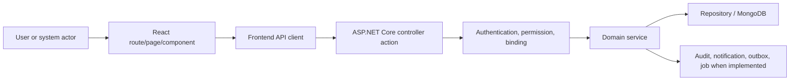

# Platform and Cross-Cutting Services Functional and Current Flow

**Last verified against code:** 2026-09-02

This is a source-trace document. Each flow begins at an extracted controller action and names the direct service call when the controller exposes one. Persistence, side effects and failure behavior are not guessed when the delegated source must still be inspected.

## 1. End-to-End Architecture

## 2. Major Action Flows

## 3. Service and UI Evidence Inventory

- `Codeji.CMS.Services/BackgroundTasks/BackgroundWorkerQueue.cs` - symbols: BackgroundWorkerQueue, ConcurrentQueue, _signal, Task, QueueBackgroundWorkItem
- `Codeji.CMS.Services/BackgroundTasks/BirthdayAndAnniversaryNotificationHostedServices.cs` - symbols: ILogger, BirthDayAndAnniversaryNotificationHostedServices, now, nextRun, delay, empServices
- `Codeji.CMS.Services/BackgroundTasks/LeaveAccrualHostedService.cs` - symbols: ILogger, LeaveAccrualHostedService, indiaNow, RunJob, nextRun, delay, leaveServices
- `Codeji.CMS.Services/BackgroundTasks/PriorityQueuedHostedService.cs` - symbols: ILogger, PriorityQueuedHostedService, BackgroundProcessing, workItem
- `Codeji.CMS.Services/BackgroundTasks/PriorityTaskQueue.cs` - symbols: IPriorityTaskQueue, QueueBackgroundWorkItem, GetQueuedTasks, ConcurrentDictionary, PriorityTaskQueue, detailsQueue, Task, taskDetails
- `Codeji.CMS.Services/Registration/EmailService.cs` - symbols: SendPasswordEmail, subject, body, message
- `Codeji.CMS.Services/Registration/Interface/IEmailService.cs` - symbols: IEmailService, SendPasswordEmail
- `Codeji.CMS.Services/Registration/MapsterConfig.cs` - symbols: Register
- `Codeji.CMS.Services/Registration/ServicesRegistration.cs` - symbols: 
- `src/app/query/queryClient.test.ts` - symbols: retry, error, shouldRetry
- `src/app/query/queryClient.ts` - symbols: shouldRetry, status, queryClient
- `src/app/query/queryKeys.test.ts` - symbols: base
- `src/app/query/queryKeys.ts` - symbols: queryKeys, apiQueryKey
- `src/app/routing/AppRoutes.tsx` - symbols: 
- `src/app/routing/LeaveManagementRoutes.tsx` - symbols: LeaveManagementRoutes
- `src/app/routing/NoticeBoardRoutes.tsx` - symbols: NoticeBoardRoutes
- `src/app/routing/PoliciesRoutes.tsx` - symbols: Policies, PolicyVersions, SuspensedView, PoliciesRoutes
- `src/app/routing/PrivateRoutes.tsx` - symbols: Admin, Recruitment, Employees, Dashboard, Profile, Calendar, NoticeBoard, Policies, Attendance, LeaveManagement, PayRollManagement, PayrollSettings, AttendanceStatusSettings, PrivateRoutes, PropsType, SuspensedView, theme
- `src/app/routing/ProfileRoutes.tsx` - symbols: UserProfile, AboutUser, UserPerformance, WorkHistory, Setting, LeaveTracker, SuspensedView, ProfileTabs, empId, roleType, modulePermission, hasLeavePanelAccess
- `src/app/routing/RecruitmentRoutes.tsx` - symbols: RecruitmentRoutes
- `src/server/axios.ts` - symbols: isRefreshing, anonymousAuthRoutes, isAnonymousAuthRoute, path, timeout, getAuthCacheScope, token, hash, instance, refreshToken, isAnonymousRoute, cId, originalRequest, getRequest, bypassQueryCache, getBlobRequest, invalidateApiQueries, postRequest, response, patchRequest, deleteRequest, putRequest
- `src/server/ChatHub.tsx` - symbols: ChatHub, constructor, getInstance, startConnection, currentState, notifyReady, onReady, stopConnection, getConnection
- `src/server/SignalR.tsx` - symbols: Connector, constructor, getInstance, startConnection, currentState, stopConnection, getConnection

## 4. Cross-Module and Recovery Rules

- Preserve tenant/company filters at every service/repository boundary.
- Preserve optimistic version/state checks for stateful workflows.
- Treat derived attendance/payroll/notification state as a cross-module dependency, not a UI-only effect.
- Verify whether Mongo transactions are available before describing rollback as atomic.
- Verify outbox/job retry behavior from the actual processor before promising delivery.

## Source Trace Verification Ledger

This appendix supplies source-specific verification records for the functional flow document. It exists because the requested document must remain independently useful during debugging and testing.

### Ledger 1: route composition

- Anchor: `Codeji.CMS.Services/BackgroundTasks/BackgroundWorkerQueue.cs`
- Verification target: route composition.
- Evidence rule: record only behavior directly supported by the named source and its delegated dependency.
- If unresolved: mark it "Not conclusively determined from current code" and name the next source to inspect.
- Regression concern: preserve authentication, permission, tenant, state, and existing client behavior while changing this area.

### Ledger 2: authentication attributes

- Anchor: `Codeji.CMS.Services/BackgroundTasks/BirthdayAndAnniversaryNotificationHostedServices.cs`
- Verification target: authentication attributes.
- Evidence rule: record only behavior directly supported by the named source and its delegated dependency.
- If unresolved: mark it "Not conclusively determined from current code" and name the next source to inspect.
- Regression concern: preserve authentication, permission, tenant, state, and existing client behavior while changing this area.

### Ledger 3: module permission

- Anchor: `Codeji.CMS.Services/BackgroundTasks/LeaveAccrualHostedService.cs`
- Verification target: module permission.
- Evidence rule: record only behavior directly supported by the named source and its delegated dependency.
- If unresolved: mark it "Not conclusively determined from current code" and name the next source to inspect.
- Regression concern: preserve authentication, permission, tenant, state, and existing client behavior while changing this area.

### Ledger 4: request binding

- Anchor: `Codeji.CMS.Services/BackgroundTasks/PriorityQueuedHostedService.cs`
- Verification target: request binding.
- Evidence rule: record only behavior directly supported by the named source and its delegated dependency.
- If unresolved: mark it "Not conclusively determined from current code" and name the next source to inspect.
- Regression concern: preserve authentication, permission, tenant, state, and existing client behavior while changing this area.

### Ledger 5: DTO validation

- Anchor: `Codeji.CMS.Services/BackgroundTasks/PriorityTaskQueue.cs`
- Verification target: DTO validation.
- Evidence rule: record only behavior directly supported by the named source and its delegated dependency.
- If unresolved: mark it "Not conclusively determined from current code" and name the next source to inspect.
- Regression concern: preserve authentication, permission, tenant, state, and existing client behavior while changing this area.

### Ledger 6: company isolation

- Anchor: `Codeji.CMS.Services/Registration/EmailService.cs`
- Verification target: company isolation.
- Evidence rule: record only behavior directly supported by the named source and its delegated dependency.
- If unresolved: mark it "Not conclusively determined from current code" and name the next source to inspect.
- Regression concern: preserve authentication, permission, tenant, state, and existing client behavior while changing this area.

### Ledger 7: actor ownership

- Anchor: `Codeji.CMS.Services/Registration/Interface/IEmailService.cs`
- Verification target: actor ownership.
- Evidence rule: record only behavior directly supported by the named source and its delegated dependency.
- If unresolved: mark it "Not conclusively determined from current code" and name the next source to inspect.
- Regression concern: preserve authentication, permission, tenant, state, and existing client behavior while changing this area.

### Ledger 8: state transition

- Anchor: `Codeji.CMS.Services/Registration/MapsterConfig.cs`
- Verification target: state transition.
- Evidence rule: record only behavior directly supported by the named source and its delegated dependency.
- If unresolved: mark it "Not conclusively determined from current code" and name the next source to inspect.
- Regression concern: preserve authentication, permission, tenant, state, and existing client behavior while changing this area.

### Ledger 9: optimistic concurrency

- Anchor: `Codeji.CMS.Services/Registration/ServicesRegistration.cs`
- Verification target: optimistic concurrency.
- Evidence rule: record only behavior directly supported by the named source and its delegated dependency.
- If unresolved: mark it "Not conclusively determined from current code" and name the next source to inspect.
- Regression concern: preserve authentication, permission, tenant, state, and existing client behavior while changing this area.

### Ledger 10: repository query

- Anchor: `src/app/query/queryClient.test.ts`
- Verification target: repository query.
- Evidence rule: record only behavior directly supported by the named source and its delegated dependency.
- If unresolved: mark it "Not conclusively determined from current code" and name the next source to inspect.
- Regression concern: preserve authentication, permission, tenant, state, and existing client behavior while changing this area.

### Ledger 11: database mutation

- Anchor: `src/app/query/queryClient.ts`
- Verification target: database mutation.
- Evidence rule: record only behavior directly supported by the named source and its delegated dependency.
- If unresolved: mark it "Not conclusively determined from current code" and name the next source to inspect.
- Regression concern: preserve authentication, permission, tenant, state, and existing client behavior while changing this area.

### Ledger 12: audit/history

- Anchor: `src/app/query/queryKeys.test.ts`
- Verification target: audit/history.
- Evidence rule: record only behavior directly supported by the named source and its delegated dependency.
- If unresolved: mark it "Not conclusively determined from current code" and name the next source to inspect.
- Regression concern: preserve authentication, permission, tenant, state, and existing client behavior while changing this area.

### Ledger 13: notification/outbox

- Anchor: `src/app/query/queryKeys.ts`
- Verification target: notification/outbox.
- Evidence rule: record only behavior directly supported by the named source and its delegated dependency.
- If unresolved: mark it "Not conclusively determined from current code" and name the next source to inspect.
- Regression concern: preserve authentication, permission, tenant, state, and existing client behavior while changing this area.

### Ledger 14: background processing

- Anchor: `src/app/routing/AppRoutes.tsx`
- Verification target: background processing.
- Evidence rule: record only behavior directly supported by the named source and its delegated dependency.
- If unresolved: mark it "Not conclusively determined from current code" and name the next source to inspect.
- Regression concern: preserve authentication, permission, tenant, state, and existing client behavior while changing this area.

### Ledger 15: frontend caller

- Anchor: `src/app/routing/LeaveManagementRoutes.tsx`
- Verification target: frontend caller.
- Evidence rule: record only behavior directly supported by the named source and its delegated dependency.
- If unresolved: mark it "Not conclusively determined from current code" and name the next source to inspect.
- Regression concern: preserve authentication, permission, tenant, state, and existing client behavior while changing this area.

### Ledger 16: loading/error UI

- Anchor: `src/app/routing/NoticeBoardRoutes.tsx`
- Verification target: loading/error UI.
- Evidence rule: record only behavior directly supported by the named source and its delegated dependency.
- If unresolved: mark it "Not conclusively determined from current code" and name the next source to inspect.
- Regression concern: preserve authentication, permission, tenant, state, and existing client behavior while changing this area.

### Ledger 17: manual happy path

- Anchor: `src/app/routing/PoliciesRoutes.tsx`
- Verification target: manual happy path.
- Evidence rule: record only behavior directly supported by the named source and its delegated dependency.
- If unresolved: mark it "Not conclusively determined from current code" and name the next source to inspect.
- Regression concern: preserve authentication, permission, tenant, state, and existing client behavior while changing this area.

### Ledger 18: negative authorization test

- Anchor: `src/app/routing/PrivateRoutes.tsx`
- Verification target: negative authorization test.
- Evidence rule: record only behavior directly supported by the named source and its delegated dependency.
- If unresolved: mark it "Not conclusively determined from current code" and name the next source to inspect.
- Regression concern: preserve authentication, permission, tenant, state, and existing client behavior while changing this area.

### Ledger 19: cross-company test

- Anchor: `src/app/routing/ProfileRoutes.tsx`
- Verification target: cross-company test.
- Evidence rule: record only behavior directly supported by the named source and its delegated dependency.
- If unresolved: mark it "Not conclusively determined from current code" and name the next source to inspect.
- Regression concern: preserve authentication, permission, tenant, state, and existing client behavior while changing this area.

### Ledger 20: retry/idempotency

- Anchor: `src/app/routing/RecruitmentRoutes.tsx`
- Verification target: retry/idempotency.
- Evidence rule: record only behavior directly supported by the named source and its delegated dependency.
- If unresolved: mark it "Not conclusively determined from current code" and name the next source to inspect.
- Regression concern: preserve authentication, permission, tenant, state, and existing client behavior while changing this area.

### Ledger 21: route composition

- Anchor: `src/server/axios.ts`
- Verification target: route composition.
- Evidence rule: record only behavior directly supported by the named source and its delegated dependency.
- If unresolved: mark it "Not conclusively determined from current code" and name the next source to inspect.
- Regression concern: preserve authentication, permission, tenant, state, and existing client behavior while changing this area.

### Ledger 22: authentication attributes

- Anchor: `src/server/ChatHub.tsx`
- Verification target: authentication attributes.
- Evidence rule: record only behavior directly supported by the named source and its delegated dependency.
- If unresolved: mark it "Not conclusively determined from current code" and name the next source to inspect.
- Regression concern: preserve authentication, permission, tenant, state, and existing client behavior while changing this area.

### Ledger 23: module permission

- Anchor: `src/server/SignalR.tsx`
- Verification target: module permission.
- Evidence rule: record only behavior directly supported by the named source and its delegated dependency.
- If unresolved: mark it "Not conclusively determined from current code" and name the next source to inspect.
- Regression concern: preserve authentication, permission, tenant, state, and existing client behavior while changing this area.

### Ledger 24: request binding

- Anchor: `Codeji.CMS.Services/BackgroundTasks/BackgroundWorkerQueue.cs`
- Verification target: request binding.
- Evidence rule: record only behavior directly supported by the named source and its delegated dependency.
- If unresolved: mark it "Not conclusively determined from current code" and name the next source to inspect.
- Regression concern: preserve authentication, permission, tenant, state, and existing client behavior while changing this area.

### Ledger 25: DTO validation

- Anchor: `Codeji.CMS.Services/BackgroundTasks/BirthdayAndAnniversaryNotificationHostedServices.cs`
- Verification target: DTO validation.
- Evidence rule: record only behavior directly supported by the named source and its delegated dependency.
- If unresolved: mark it "Not conclusively determined from current code" and name the next source to inspect.
- Regression concern: preserve authentication, permission, tenant, state, and existing client behavior while changing this area.

### Ledger 26: company isolation

- Anchor: `Codeji.CMS.Services/BackgroundTasks/LeaveAccrualHostedService.cs`
- Verification target: company isolation.
- Evidence rule: record only behavior directly supported by the named source and its delegated dependency.
- If unresolved: mark it "Not conclusively determined from current code" and name the next source to inspect.
- Regression concern: preserve authentication, permission, tenant, state, and existing client behavior while changing this area.

### Ledger 27: actor ownership

- Anchor: `Codeji.CMS.Services/BackgroundTasks/PriorityQueuedHostedService.cs`
- Verification target: actor ownership.
- Evidence rule: record only behavior directly supported by the named source and its delegated dependency.
- If unresolved: mark it "Not conclusively determined from current code" and name the next source to inspect.
- Regression concern: preserve authentication, permission, tenant, state, and existing client behavior while changing this area.

### Ledger 28: state transition

- Anchor: `Codeji.CMS.Services/BackgroundTasks/PriorityTaskQueue.cs`
- Verification target: state transition.
- Evidence rule: record only behavior directly supported by the named source and its delegated dependency.
- If unresolved: mark it "Not conclusively determined from current code" and name the next source to inspect.
- Regression concern: preserve authentication, permission, tenant, state, and existing client behavior while changing this area.

### Ledger 29: optimistic concurrency

- Anchor: `Codeji.CMS.Services/Registration/EmailService.cs`
- Verification target: optimistic concurrency.
- Evidence rule: record only behavior directly supported by the named source and its delegated dependency.
- If unresolved: mark it "Not conclusively determined from current code" and name the next source to inspect.
- Regression concern: preserve authentication, permission, tenant, state, and existing client behavior while changing this area.

### Ledger 30: repository query

- Anchor: `Codeji.CMS.Services/Registration/Interface/IEmailService.cs`
- Verification target: repository query.
- Evidence rule: record only behavior directly supported by the named source and its delegated dependency.
- If unresolved: mark it "Not conclusively determined from current code" and name the next source to inspect.
- Regression concern: preserve authentication, permission, tenant, state, and existing client behavior while changing this area.

### Ledger 31: database mutation

- Anchor: `Codeji.CMS.Services/Registration/MapsterConfig.cs`
- Verification target: database mutation.
- Evidence rule: record only behavior directly supported by the named source and its delegated dependency.
- If unresolved: mark it "Not conclusively determined from current code" and name the next source to inspect.
- Regression concern: preserve authentication, permission, tenant, state, and existing client behavior while changing this area.

### Ledger 32: audit/history

- Anchor: `Codeji.CMS.Services/Registration/ServicesRegistration.cs`
- Verification target: audit/history.
- Evidence rule: record only behavior directly supported by the named source and its delegated dependency.
- If unresolved: mark it "Not conclusively determined from current code" and name the next source to inspect.
- Regression concern: preserve authentication, permission, tenant, state, and existing client behavior while changing this area.

### Ledger 33: notification/outbox

- Anchor: `src/app/query/queryClient.test.ts`
- Verification target: notification/outbox.
- Evidence rule: record only behavior directly supported by the named source and its delegated dependency.
- If unresolved: mark it "Not conclusively determined from current code" and name the next source to inspect.
- Regression concern: preserve authentication, permission, tenant, state, and existing client behavior while changing this area.

### Ledger 34: background processing

- Anchor: `src/app/query/queryClient.ts`
- Verification target: background processing.
- Evidence rule: record only behavior directly supported by the named source and its delegated dependency.
- If unresolved: mark it "Not conclusively determined from current code" and name the next source to inspect.
- Regression concern: preserve authentication, permission, tenant, state, and existing client behavior while changing this area.

### Ledger 35: frontend caller

- Anchor: `src/app/query/queryKeys.test.ts`
- Verification target: frontend caller.
- Evidence rule: record only behavior directly supported by the named source and its delegated dependency.
- If unresolved: mark it "Not conclusively determined from current code" and name the next source to inspect.
- Regression concern: preserve authentication, permission, tenant, state, and existing client behavior while changing this area.

### Ledger 36: loading/error UI

- Anchor: `src/app/query/queryKeys.ts`
- Verification target: loading/error UI.
- Evidence rule: record only behavior directly supported by the named source and its delegated dependency.
- If unresolved: mark it "Not conclusively determined from current code" and name the next source to inspect.
- Regression concern: preserve authentication, permission, tenant, state, and existing client behavior while changing this area.

### Ledger 37: manual happy path

- Anchor: `src/app/routing/AppRoutes.tsx`
- Verification target: manual happy path.
- Evidence rule: record only behavior directly supported by the named source and its delegated dependency.
- If unresolved: mark it "Not conclusively determined from current code" and name the next source to inspect.
- Regression concern: preserve authentication, permission, tenant, state, and existing client behavior while changing this area.

### Ledger 38: negative authorization test

- Anchor: `src/app/routing/LeaveManagementRoutes.tsx`
- Verification target: negative authorization test.
- Evidence rule: record only behavior directly supported by the named source and its delegated dependency.
- If unresolved: mark it "Not conclusively determined from current code" and name the next source to inspect.
- Regression concern: preserve authentication, permission, tenant, state, and existing client behavior while changing this area.

### Ledger 39: cross-company test

- Anchor: `src/app/routing/NoticeBoardRoutes.tsx`
- Verification target: cross-company test.
- Evidence rule: record only behavior directly supported by the named source and its delegated dependency.
- If unresolved: mark it "Not conclusively determined from current code" and name the next source to inspect.
- Regression concern: preserve authentication, permission, tenant, state, and existing client behavior while changing this area.

### Ledger 40: retry/idempotency

- Anchor: `src/app/routing/PoliciesRoutes.tsx`
- Verification target: retry/idempotency.
- Evidence rule: record only behavior directly supported by the named source and its delegated dependency.
- If unresolved: mark it "Not conclusively determined from current code" and name the next source to inspect.
- Regression concern: preserve authentication, permission, tenant, state, and existing client behavior while changing this area.

### Ledger 41: route composition

- Anchor: `src/app/routing/PrivateRoutes.tsx`
- Verification target: route composition.
- Evidence rule: record only behavior directly supported by the named source and its delegated dependency.
- If unresolved: mark it "Not conclusively determined from current code" and name the next source to inspect.
- Regression concern: preserve authentication, permission, tenant, state, and existing client behavior while changing this area.

### Ledger 42: authentication attributes

- Anchor: `src/app/routing/ProfileRoutes.tsx`
- Verification target: authentication attributes.
- Evidence rule: record only behavior directly supported by the named source and its delegated dependency.
- If unresolved: mark it "Not conclusively determined from current code" and name the next source to inspect.
- Regression concern: preserve authentication, permission, tenant, state, and existing client behavior while changing this area.

### Ledger 43: module permission

- Anchor: `src/app/routing/RecruitmentRoutes.tsx`
- Verification target: module permission.
- Evidence rule: record only behavior directly supported by the named source and its delegated dependency.
- If unresolved: mark it "Not conclusively determined from current code" and name the next source to inspect.
- Regression concern: preserve authentication, permission, tenant, state, and existing client behavior while changing this area.

### Ledger 44: request binding

- Anchor: `src/server/axios.ts`
- Verification target: request binding.
- Evidence rule: record only behavior directly supported by the named source and its delegated dependency.
- If unresolved: mark it "Not conclusively determined from current code" and name the next source to inspect.
- Regression concern: preserve authentication, permission, tenant, state, and existing client behavior while changing this area.

### Ledger 45: DTO validation

- Anchor: `src/server/ChatHub.tsx`
- Verification target: DTO validation.
- Evidence rule: record only behavior directly supported by the named source and its delegated dependency.
- If unresolved: mark it "Not conclusively determined from current code" and name the next source to inspect.
- Regression concern: preserve authentication, permission, tenant, state, and existing client behavior while changing this area.

### Ledger 46: company isolation

- Anchor: `src/server/SignalR.tsx`
- Verification target: company isolation.
- Evidence rule: record only behavior directly supported by the named source and its delegated dependency.
- If unresolved: mark it "Not conclusively determined from current code" and name the next source to inspect.
- Regression concern: preserve authentication, permission, tenant, state, and existing client behavior while changing this area.

### Ledger 47: actor ownership

- Anchor: `Codeji.CMS.Services/BackgroundTasks/BackgroundWorkerQueue.cs`
- Verification target: actor ownership.
- Evidence rule: record only behavior directly supported by the named source and its delegated dependency.
- If unresolved: mark it "Not conclusively determined from current code" and name the next source to inspect.
- Regression concern: preserve authentication, permission, tenant, state, and existing client behavior while changing this area.

### Ledger 48: state transition

- Anchor: `Codeji.CMS.Services/BackgroundTasks/BirthdayAndAnniversaryNotificationHostedServices.cs`
- Verification target: state transition.
- Evidence rule: record only behavior directly supported by the named source and its delegated dependency.
- If unresolved: mark it "Not conclusively determined from current code" and name the next source to inspect.
- Regression concern: preserve authentication, permission, tenant, state, and existing client behavior while changing this area.

### Ledger 49: optimistic concurrency

- Anchor: `Codeji.CMS.Services/BackgroundTasks/LeaveAccrualHostedService.cs`
- Verification target: optimistic concurrency.
- Evidence rule: record only behavior directly supported by the named source and its delegated dependency.
- If unresolved: mark it "Not conclusively determined from current code" and name the next source to inspect.
- Regression concern: preserve authentication, permission, tenant, state, and existing client behavior while changing this area.

### Ledger 50: repository query

- Anchor: `Codeji.CMS.Services/BackgroundTasks/PriorityQueuedHostedService.cs`
- Verification target: repository query.
- Evidence rule: record only behavior directly supported by the named source and its delegated dependency.
- If unresolved: mark it "Not conclusively determined from current code" and name the next source to inspect.
- Regression concern: preserve authentication, permission, tenant, state, and existing client behavior while changing this area.

### Ledger 51: database mutation

- Anchor: `Codeji.CMS.Services/BackgroundTasks/PriorityTaskQueue.cs`
- Verification target: database mutation.
- Evidence rule: record only behavior directly supported by the named source and its delegated dependency.
- If unresolved: mark it "Not conclusively determined from current code" and name the next source to inspect.
- Regression concern: preserve authentication, permission, tenant, state, and existing client behavior while changing this area.

### Ledger 52: audit/history

- Anchor: `Codeji.CMS.Services/Registration/EmailService.cs`
- Verification target: audit/history.
- Evidence rule: record only behavior directly supported by the named source and its delegated dependency.
- If unresolved: mark it "Not conclusively determined from current code" and name the next source to inspect.
- Regression concern: preserve authentication, permission, tenant, state, and existing client behavior while changing this area.

### Ledger 53: notification/outbox

- Anchor: `Codeji.CMS.Services/Registration/Interface/IEmailService.cs`
- Verification target: notification/outbox.
- Evidence rule: record only behavior directly supported by the named source and its delegated dependency.
- If unresolved: mark it "Not conclusively determined from current code" and name the next source to inspect.
- Regression concern: preserve authentication, permission, tenant, state, and existing client behavior while changing this area.

### Ledger 54: background processing

- Anchor: `Codeji.CMS.Services/Registration/MapsterConfig.cs`
- Verification target: background processing.
- Evidence rule: record only behavior directly supported by the named source and its delegated dependency.
- If unresolved: mark it "Not conclusively determined from current code" and name the next source to inspect.
- Regression concern: preserve authentication, permission, tenant, state, and existing client behavior while changing this area.

### Ledger 55: frontend caller

- Anchor: `Codeji.CMS.Services/Registration/ServicesRegistration.cs`
- Verification target: frontend caller.
- Evidence rule: record only behavior directly supported by the named source and its delegated dependency.
- If unresolved: mark it "Not conclusively determined from current code" and name the next source to inspect.
- Regression concern: preserve authentication, permission, tenant, state, and existing client behavior while changing this area.

### Ledger 56: loading/error UI

- Anchor: `src/app/query/queryClient.test.ts`
- Verification target: loading/error UI.
- Evidence rule: record only behavior directly supported by the named source and its delegated dependency.
- If unresolved: mark it "Not conclusively determined from current code" and name the next source to inspect.
- Regression concern: preserve authentication, permission, tenant, state, and existing client behavior while changing this area.

### Ledger 57: manual happy path

- Anchor: `src/app/query/queryClient.ts`
- Verification target: manual happy path.
- Evidence rule: record only behavior directly supported by the named source and its delegated dependency.
- If unresolved: mark it "Not conclusively determined from current code" and name the next source to inspect.
- Regression concern: preserve authentication, permission, tenant, state, and existing client behavior while changing this area.

### Ledger 58: negative authorization test

- Anchor: `src/app/query/queryKeys.test.ts`
- Verification target: negative authorization test.
- Evidence rule: record only behavior directly supported by the named source and its delegated dependency.
- If unresolved: mark it "Not conclusively determined from current code" and name the next source to inspect.
- Regression concern: preserve authentication, permission, tenant, state, and existing client behavior while changing this area.

