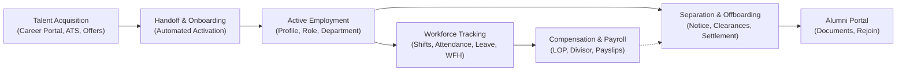

# Codeji CMS / HRMS — Executive Summary

> **Document Status**: Complete & Authoritative  
> **Source-of-Truth**: Verified from Repository Implementation  
> **Runtime Target**: ASP.NET Core (.NET 10) | React 18 (TypeScript, Vite) | MongoDB (Custom Driver Repository)  
> **Last Verified**: September 2026

---

## 1. Executive Synopsis

The **Codeji Content & Human Resource Management System (Codeji CMS / HRMS)** is an enterprise-grade, multi-tenant workforce operating platform engineered to manage the entire employee lifecycle—from public talent acquisition and multi-stage applicant evaluation, through preboarding, automated onboarding activation, shift-governed attendance tracking, multi-tier leave administration, and automated payroll synthesis, to structured resignation, multi-departmental clearance workflows, full and final settlement (FnF), and post-separation alumni engagement.

The solution is architected as two decoupled, high-performance systems:
1. **CMS-Backend-Core**: A modular, service-oriented ASP.NET Core Web API running on **.NET 10 (`net10.0`)**, featuring strict JWT-driven multi-tenant boundary isolation, dynamic role-based access control (RBAC), deterministic multi-level policy engines, transactional outbox processors, SignalR real-time messaging hubs, and an in-house schema/index migration pipeline.
2. **CMS-React**: A modern Single Page Application (SPA) built with React 18, TypeScript, Vite, Material-UI (MUI), Redux Toolkit, and TanStack Query, offering role-tailored workspaces for Company Administrators, HR Managers, HR Executives, Reporting Managers, Employees, and Former Alumni.

---

## 2. Business Value & Problem Statement

Modern growing enterprises face fragmented HR tooling where applicant tracking systems (ATS), daily attendance logs, leave balances, payroll calculators, and offboarding checklists reside in disconnected silos. This fragmentation leads to:
- **Data Drift**: Inconsistencies between approved leaves and monthly payroll deductions.
- **Compliance & Security Vulnerabilities**: Former employees retaining system credentials or unauthorized data visibility across multi-tenant boundaries.
- **Operational Churn**: Manual calculations of Loss-of-Pay (LOP), late-arrival penalties, and notice-period buyouts.
- **Lack of Auditability**: Disputed final settlements and undocumented clearance approvals.

Codeji HRMS solves these organizational challenges by establishing a single, cryptographically enforced source of truth across all employment dimensions.

---

## 3. High-Level Architectural Foundations

| Layer | Technology | Architectural Responsibility |
|---|---|---|
| **Client SPA** | React 18, TypeScript, Vite, MUI v5 | Responsive UI, state management (Redux + React Query), token refresh queue interceptors, dynamic breadcrumbs, localized views (i18n). |
| **API Gateway / Host** | ASP.NET Core (.NET 10), Kestrel, Reverse Proxy Integration | Route dispatching, IP rate limiting partitions (`career-sensitive`, `account-sensitive`), SSL termination, CORS allow-listing (`*.codeji.in`, `localhost`). |
| **Security Pipeline** | Custom Middleware (`AntiforgeryMiddleware`, `CompanyIdMiddleware`) | Anti-CSRF verification, AppVersion lock (`426 Upgrade Required`), strict JWT tenant claim validation (`company_id`, `user_id`, `role_id`), RBAC authorization (`ModulePermissionAttribute`). |
| **Application Services** | C# Business Services Layer | Domain logic, deterministic policy resolution, cross-module coordinators (`RecruitmentOnboardingService`, `AutoPayrollServices`, `EmployeeService`). |
| **Realtime & Workers** | SignalR Core, IHostedService Background Queues | WebSocket event distribution (`NotificationHub`, `ChatHub`), 9 background background workers handling outbox polling, leave accrual, birthday alerts, and reconciliations. |
| **Data Persistence** | MongoDB, MongoDB C# Driver v2.28+ | High-throughput document store, multi-tenant collection indexing, custom repository pattern (`MongoRepository<T>`), migration engine (`Codeji.CMS.Migrations`). |

---

## 4. Key Platform Highlights & Differentiators

### 4.1 Guaranteed Tenant Boundary Isolation
Unlike multi-tenant architectures that rely on client-supplied headers or query parameters for company resolution, Codeji enforces tenant identity strictly from cryptographically signed JWT bearer claims (`company_id`). The system rejects any request where client-provided IDs conflict with the token context. Public anonymous routes (e.g., career job applications) resolve tenant context exclusively via verified server-side identifiers (such as registered public company slugs or one-time capability tokens).

### 4.2 Multi-Dimensional Employee State Machine
Employee status is not a simplistic boolean. Codeji tracks 7 orthogonal lifecycle dimensions:
1. **Employment Status**: `PreJoining`, `Active`, `NoticePeriod`, `Suspended`, `Resigned`, `Terminated`, `Retired`, `ContractEnded`, `Deceased`.
2. **Availability Status**: `Working`, `AnnualLeave`, `SickLeave`, `MaternityLeave`, `Sabbatical`, `UnauthorizedAbsence`, `AbscondingUnderReview`.
3. **Account Status**: `Active`, `Locked`, `TemporarilyDisabled`, `Limited`, `Suspended`, `Closed`.
4. **Payroll Status**: `Active`, `Hold`, `Paused`, `FinalSettlement`, `Closed`.
5. **Offboarding Status**: `None`, `PendingManagerApproval`, `PendingHrApproval`, `NoticePeriod`, `Discussion`, `Completed`, `Withdrawn`.
6. **Former Portal Status**: `NotEligible`, `Eligible`, `Invited`, `Active`, `Revoked`, `Expired`.
7. **Alumni Status**: `NotApplicable`, `Eligible`, `Invited`, `Member`, `OptedOut`, `Blocked`.

### 4.3 Deterministic Policy Resolution Engine
Policies governing Leave, Attendance Penalties, Notice Periods, and Offboarding Clearance adhere to strict precedence rules:
$$\text{Precedence} = \text{Specific Department} \longrightarrow \text{Specific Role} \longrightarrow \text{Company Wide}$$
When a lifecycle event (such as a resignation) is initiated, the system takes an immutable **Policy Snapshot** (`EmployeeExitPolicySnapshot`), guaranteeing that future policy modifications do not retroactively alter inflight legal or financial obligations.

### 4.4 Automated Attendance-to-Payroll Pipeline
Monthly payroll calculations do not rely on subjective estimates. AutoPayroll strictly requires:
1. Approved and locked monthly attendance summaries (`MonthlyAttendanceSummary.IsApproved && MonthlyAttendanceSummary.IsLocked`).
2. Zero unreviewed attendance exceptions (`PENDING_REVIEW`).
3. Mathematical application of the tenant's configured divisor policy (`FIXED_30_DAYS`, `WORKING_DAYS`, or `CALENDAR_DAYS`).
4. Loss-of-Pay (LOP) deduction computed as:
$$\text{Total LOP Days} = \text{Attendance Unpaid Days} + \text{Approved Policy Penalty Days}$$

### 4.5 Resilient Asynchronous Outbox Architecture
To avoid distributed transaction failure modes between MongoDB and external channels (SMTP email, push notifications, external webhooks), Codeji employs the **Transactional Outbox Pattern** across Recruitment (`RecruitmentEmailOutbox`), Attendance reminders (`AttendanceNotificationOutbox`), and Employee Exits (`EmployeeExitOutbox`). Background workers process queues idempotently with exponential backoff and dead-letter tracking.

---

## 5. Scope of Current System Verification

This documentation package has been generated by directly inspecting and tracing every controller, service, repository, entity, frontend component, migration, and test in the active repository.

| Module / Subsystem | Implementation Status | Key Discovered Artifacts |
|---|---|---|
| **Recruitment & ATS** | Verified Complete | `ApplicantsController.cs`, `RecruitmentLifecycleDrawer.tsx`, 24 backend services, candidate offer public portal. |
| **Employee Lifecycle** | Verified Complete | `UserController.cs`, `EmployeeService.cs` (364 KB), multi-dimensional status model, automated onboarding activation. |
| **Attendance & Shifts** | Verified Complete | `AttendanceController.cs`, `AttendancePenaltyService.cs`, office schedules, punch classification (`P`, `HD`, `LHD`, `ED`), monthly locks. |
| **Leave & WFH** | Verified Complete | `LeaveManagementController.cs`, `WorkFromHomeController.cs`, accrual worker, half-day segments, balance reconciliation. |
| **Payroll & Salary** | Verified Complete | `PayRollController.cs`, `AutoPayrollServices.cs`, salary structure, divisor policy, PDF payslips. |
| **Offboarding & FnF** | Verified Complete | `EmployeeExit.cs`, `EmployeeFinalSettlement.cs`, multi-department clearance templates, former employee portal. |
| **Company Administration** | Verified Complete | `CompanyMasterController.cs`, departments, job roles, locations, sequences, custom attributes. |
| **Security & RBAC** | Verified Complete | `AntiforgeryMiddleware.cs`, `CompanyIdMiddleware.cs`, `RoleServices.cs`, Cartesian module permission model. |

---

## 6. Document Suite Navigation

Technical leads, product managers, architects, and compliance officers should navigate this documentation package using the following structure:
- **Foundational Architecture**: Chapters `01` through `04` detailing repository layouts, system design, and database modeling.
- **Security & Governance**: Chapters `05` through `07` and `11` detailing authentication, authorization, RBAC, tenant isolation, and policies.
- **Workflows & Integrations**: Chapters `08` through `10` and `14` detailing cross-module dependencies, event cascades, notifications, and integrations.
- **Production Assessment**: Chapters `12`, `13`, and `15` detailing error handling, auditability, and production readiness gaps.
- **Executive Summaries**: Chapters `16` through `18` providing future roadmaps, slide-ready presentation summaries, and business proposals.
- **Deep Dives**: The `modules/` directory contains 29 comprehensive chapter documents providing exhaustive file-by-file breakdowns of every subsystem.
- **Visual Reference**: The `diagrams/` directory contains 11 standalone Mermaid specifications.
- **Traceability & Validation**: `SOURCE-TRACEABILITY.md` maps every feature to source code, and `UNVERIFIED-AREAS.md` maintains transparent accounting of system boundaries.
