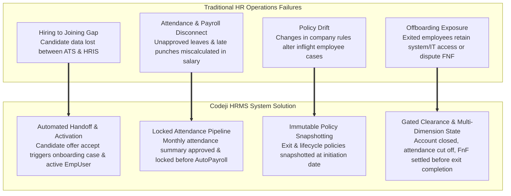
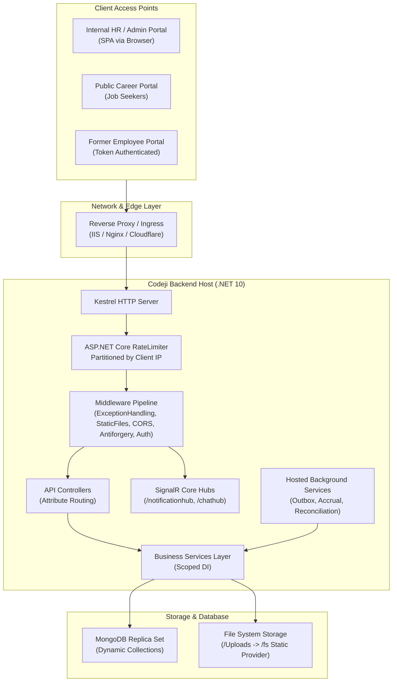

# Codeji CMS / HRMS — Project Overview

> **Document Status**: Complete & Authoritative  
> **Source-of-Truth**: Verified from Repository Implementation  
> **Target Audience**: Technical Architects, Engineering Leads, Product Managers, Delivery Managers  
> **Last Verified**: September 2026

---

## 1. Product Mission & Vision

The **Codeji HRMS** platform is designed to provide mid-market and enterprise organizations with a unified, self-governing Human Resource Information System (HRIS). Its mission is to eliminate friction across organizational boundaries by providing an automated, auditable, and mathematically rigorous bridge connecting recruitment, core employment records, time tracking, compensation, and separation.

The platform embodies five core engineering principles:
1. **Source-of-Truth Integrity**: Every critical business state (e.g., employment activation, leave approval, payroll lock, exit clearance) is owned and verified on the server. The client SPA reflects state but cannot unilaterally dictate state transitions.
2. **Deterministic Governance**: Business decisions—such as whether an employee is eligible for leave, subject to attendance deductions, or required to serve notice—are resolved through deterministic, hierarchical policies rather than ad-hoc code checks.
3. **Strict Multi-Tenant Isolation**: Tenant boundaries are enforced at the network, middleware, service, and database query layers, preventing data leakage across distinct corporate entities.
4. **Resilient Asynchrony**: External I/O (such as sending candidate emails, attendance punch alerts, or exit notifications) is decoupled from primary request transactions via transactional outbox queues.
5. **Auditable Lifecycle Traceability**: Every status modification records who initiated it, when it became effective, the prior value, and the underlying reason code.

---

## 2. Core Problem Space & Operational Challenges Addressed

Enterprise organizations operating without a unified HRMS encounter significant operational friction. The Codeji platform directly addresses these key industry bottlenecks:

---

## 3. Supported Stakeholder Personas & Capabilities

The platform defines distinct operational personas. Each persona is assigned tailored UI layouts, actions, and server-verified permissions:

| Persona | Primary Responsibilities | Discovered Capabilities in Codebase |
|---|---|---|
| **Super / Company Administrator** | Tenant administration, system governance, and master data setup. | Configures company profile, departments, job roles/designations, office locations, work schedules, custom attributes, employee ID sequence templates, role-permission matrices, and global policy assignments. Full bypass on module permission evaluations. |
| **HR Manager** | Strategic HR management, policy administration, workforce supervision. | Manages recruitment requisitions, reviews job applications, schedules interviews, issues offers, tracks onboarding checklists, approves leave/WFH requests, manages attendance exceptions, oversees offboarding cases, and approves final settlements. |
| **HR Executive** | Day-to-day HR operations and employee record maintenance. | Equivalent operational permissions to HR Manager under default seed roles (`EnumsHelper.Roles.HRExecutive`), executes candidate screening, candidate verification, attendance adjustments, and document uploads. |
| **Reporting Manager** | Direct departmental supervision and team approvals. | Evaluates team leave and WFH requests (`ApproveTeam`, `ViewTeam`), reviews resignation notices, participates in joint exit discussions, and conducts handover clearance task sign-offs. |
| **Employee** | Self-service operations and personal data management. | Views own profile, submits personal details (education, certifications, emergency contacts, PAN, bank details), marks daily attendance punch, requests leaves and WFH, downloads generated payslips, views company notice board, and submits self-resignation. |
| **Candidate / Applicant** | External job seekers and prospective employees. | Searches public career portal (`/careers`), applies to vacancies with resume upload, tracks application status via public capability token, receives offer letters, and reviews/accepts/rejects offers via `/candidate/offer`. |
| **Former Employee / Alumni** | Exited personnel requiring separation records. | Accesses the dedicated `/former-employee` portal via secure one-time access tokens or OTP sessions to download historical payslips, experience certificates, tax documents, and final settlement summaries. |

---

## 4. High-Level Functional Domain Breakdown

### 4.1 Talent Acquisition & ATS (`recruitment/`)
- Public Career Marketplace (`/careers`, `/careers/:companyCode`) with custom company branding and vacancy filters.
- Requisition lifecycle management, job posting creation, and applicant tracking across 7 core stages (`New`, `InProgress`, `OnHold`, `Shortlisted`, `Selected`, `Rejected`, `ReApply`).
- Advanced recruitment pipeline: candidate screening queues, structured interview scheduling, interviewer scorecards, interview debriefs, multi-level offer approval policies, offer issuance, candidate negotiation tracking, and candidate sharing.
- Resume extraction review queue, duplicate candidate detection engine, talent pool curation, candidate privacy governance, and audit logging export.

### 4.2 Onboarding & Employee Activation (`employees/`, `recruitment/`)
- Preboarding case tracking (`RecruitmentPreboardingCase`) for pre-hire document submission and background check verification.
- Onboarding case engine (`RecruitmentOnboardingCase`) with customizable task checklists (IT provisioning, workstation allocation, policy training).
- **Automated Lifecycle Activation**: Transitioning an onboarding case to `Completed` automatically triggers `ActivateEmployeeLifecycle`, transitioning `EmpUser` to `Active`, setting availability to `Working`, activating user accounts, initiating payroll eligibility, and recording history.

### 4.3 Workforce Time & Attendance (`attendance/`, `holidays/`)
- Daily attendance recording (`AttendanceModel`, `AttendanceDaySegment`) with automated office status classification (`P`, `HD`, `LHD`, `ED`, `LHD+ED`).
- Shift and schedule management (`CompanyOfficeSchedule`), defining start/end times, check-in/out tolerance windows, and grace periods.
- Attendance penalty engine (`AttendancePenaltyService`): tracking late arrivals and early departures against monthly policy limits (`CombinedLhdEdMonthlyLimit`), raising attendance exceptions (`AttendancePayrollException`), and managing HR resolution overrides.
- Monthly attendance locking (`AttendanceMonthLock`): validating and locking an attendance period prior to payroll processing.
- Multi-tier leave administration (`LeaveRequest`, `LeavePolicy`, `EmployeeLeaveBalance`): supporting sick, casual, earned, maternity, paternity leaves, and monthly accrual processing via `LeaveAccrualHostedService`.
- Integrated Work From Home (WFH) management (`WorkFromHomeRequest`): supporting full-day and half-day segment requests, timing validations, and conflict reconciliation with attendance punches.
- Comprehensive calendar system (`CalendarEntity`, `WeeklyOffSetting`, `Holidays`): coordinating national/cultural holidays, weekly off days, and company working calendar rules.

### 4.4 Compensation & Payroll (`payroll/`, `payrollsettings/`)
- Standardized salary structure definition (`SalaryModel`): defining CTC, basic pay, allowances (HRA, LTA, other), and statutory deductions (EPF, ESIC, professional tax, income tax).
- Divisor policy governance (`PayrollDivisorPolicy`): configuring monthly salary daily rates based on Fixed 30 Days, Actual Working Days, or Calendar Days.
- AutoPayroll execution engine (`AutoPayrollServices`): validating locked attendance, computing Loss of Pay (LOP) days, applying partial-month prorations for mid-month joiners and exits, and committing monthly payroll mutations.
- Digital payslip generation (`PdfService`): rendering pixel-perfect HTML/CSS templates into PDF documents with currency formatting in English words and secure download endpoints.

### 4.5 Separation, Clearances & Final Settlement (`employees/`, `formerEmployeePortal/`)
- Multi-path separation initiation: employee self-service resignation or HR-initiated termination/contract end.
- Resignation review workflow: manager review, HR review, joint discussion threads, withdrawal requests, and proposed Last Working Date (LWD) negotiations.
- Notice period engine: calculating required notice days from snapshot policies, tracking buyouts, waivers, and automated notice countdown reminders.
- Clearance workflow: multi-department clearance templates (IT Access, Finance, Assets, Handover Tasks, Benefits, Resignation Evidence).
- Full & Final Settlement (`EmployeeFinalSettlement`): reconciling unpaid salary from payroll, leave encashments, outstanding dues, notice recoveries, and reimbursement disbursements.
- Former employee lifecycle: revoking active refresh sessions, creating attendance cutoff records, transitioning employment status to `Resigned`/`Terminated`, and provisioning token-based alumni portal access.

---

## 5. Deployment Topology & Environments

### 5.1 Verified Runtime Specifications
- **Operating System Compatibility**: Windows Server (IIS Integration enabled via `builder.WebHost.UseIISIntegration()`) and Linux (Kestrel standalone behind reverse proxies).
- **Target Framework**: .NET 10 (`net10.0`).
- **Database Engine**: MongoDB 6.0+ (utilizing official C# Driver v2.28.0).
- **Frontend Build**: Vite 5.x bundling React 18 with TypeScript 5.x.
- **Node.js Environment**: Node 18+ LTS for frontend compilation and testing.
