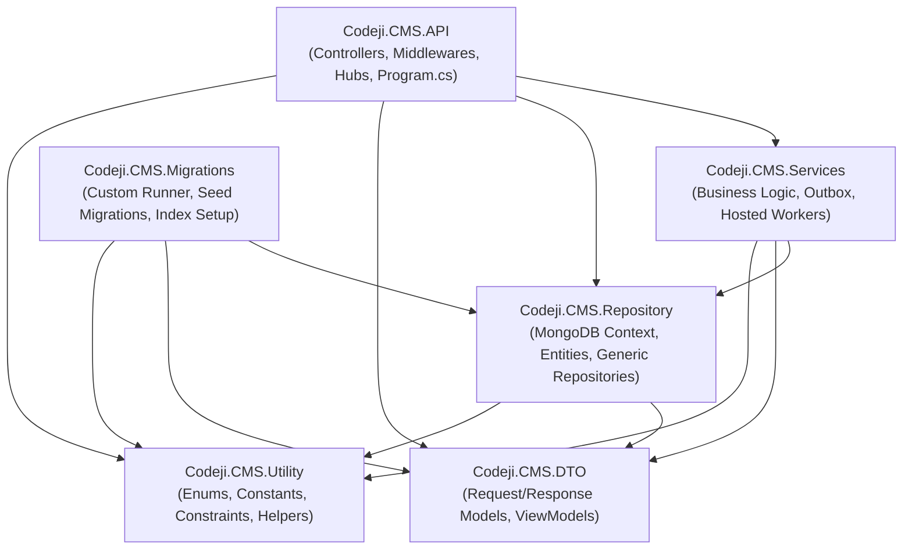
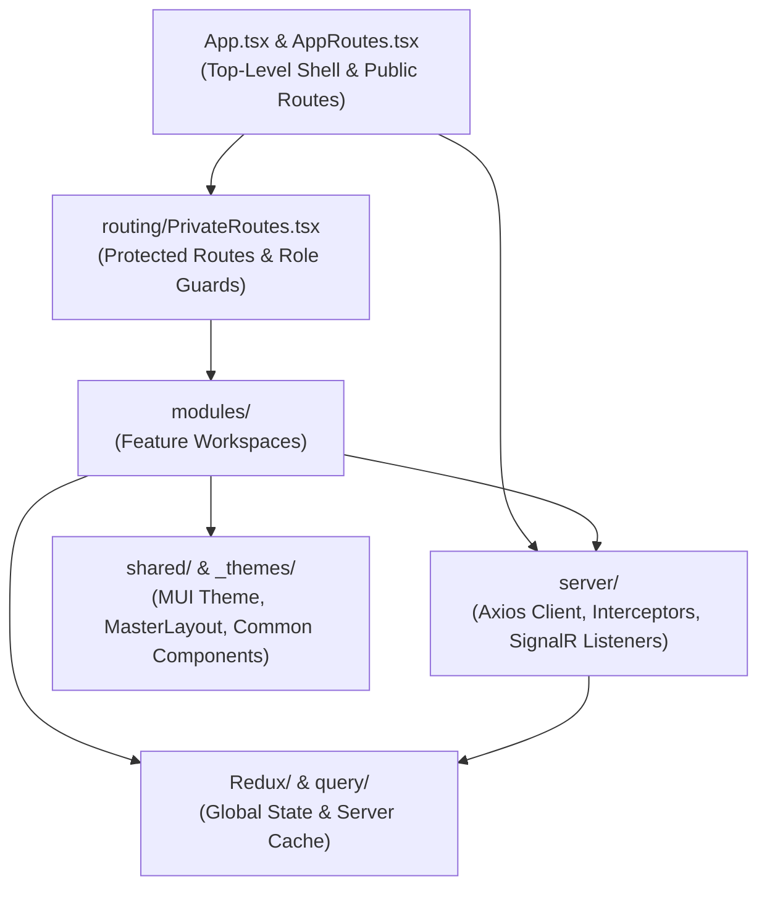

# Codeji CMS / HRMS — Repository Architecture

> **Document Status**: Complete & Authoritative  
> **Source-of-Truth**: Verified from Repository Implementation  
> **Target Repositories**: `CMS-Backend-Core`, `CMS-React`  
> **Last Verified**: September 2026

---

## 1. Monorepo / Multi-Root Repository Topology

The Codeji CMS / HRMS codebase is organized as a multi-root workspace comprising two primary engineering repositories alongside quality assurance, document generation, and project management artifacts:

```text
CMS/
├── CMS-Backend-Core/          # ASP.NET Core (.NET 10) Web API, Services, Repositories, Migrations
├── CMS-React/                 # React 18, TypeScript, Vite SPA client
├── docs/                      # Central system & architectural documentation package
├── qa/                        # Quality assurance suites, postman collections, test run scripts
├── pdf_builder/               # PDF rendering utilities and template build tooling
└── _validation/               # Automation scripts for regression and pipeline verification
```

---

## 2. Backend Architectural Structure (`CMS-Backend-Core`)

The backend follows Clean Architecture principles with clear layer separation across 6 distinct projects, bound together by dependency injection in `Codeji.CMS.API`:



### 2.1 Layer-by-Layer Architectural Breakdown

#### `Codeji.CMS.API`
- **Path**: `CMS-Backend-Core/Codeji.CMS.API`
- **Purpose**: Web API host, HTTP request termination, protocol mediation, authentication filter pipeline, real-time WebSocket communication, rate limiting, and static file provisioning.
- **Why It Exists**: Exposes RESTful JSON endpoints and SignalR hubs to internal and external clients while securing the application perimeter.
- **How It Communicates**: Receives HTTP/HTTPS requests from clients, invokes `Codeji.CMS.Services` via registered scoped interfaces, dispatches SignalR events via `IHubContext`, and streams file responses (e.g. PDF payslips, uploaded documents).
- **Important Files**:
  - `Program.cs`: Startup orchestrator configuring Kestrel, RateLimiter, CORS, JWT Bearer, Antiforgery, SignalR, MongoDB client, and DI container.
  - `Controllers/`: 43 API controllers handling account, employee, recruitment, attendance, leave, payroll, and company management.
  - `App_Start/AntyForgeryMiddleware.cs`: Core security gate executing anti-CSRF checks, AppVersion matching, and delegating to `CompanyIdMiddleware`.
  - `App_Start/AuthenticateUserRequest.cs` (`CompanyIdMiddleware`): Enforces authenticated tenant claims (`CompanyId`), checks active company/user records, and evaluates `ModulePermissionAttribute`.
  - `ChatHub/ChatHub.cs` & `Notification/NotificationHub.cs`: SignalR real-time event distribution endpoints.
- **Architectural Responsibility**: Host configuration, route dispatching, security filtering, and HTTP transport serialization.
- **Dependencies**: Depends on `Codeji.CMS.Services`, `Codeji.CMS.Repository`, `Codeji.CMS.DTO`, `Codeji.CMS.Utility`.
- **Potential Concerns**: High cyclomatic complexity in `UserController.cs` (51.5 KB) which handles user, profile, lifecycle, and offboarding operations within a single controller.

#### `Codeji.CMS.Services`
- **Path**: `CMS-Backend-Core/Codeji.CMS.Services`
- **Purpose**: Core application business logic, workflow coordination, deterministic policy evaluation, calculation algorithms, and background worker execution.
- **Why It Exists**: Isolates domain business logic from the HTTP transport layer and database persistence mechanisms.
- **How It Communicates**: Injected into controllers via interfaces, consumes `IMongoDbRepository<T>` for data persistence, coordinates cross-module events, and enqueues outbox records.
- **Important Folders & Files**:
  - `Registration/ServicesRegistration.cs`: Centralized extension method `AddBusinessServices` registering all 40+ scoped services.
  - `Employees/EmployeeService.cs` (364 KB): Primary employee management service covering profile editing, contract lifecycle, bulk imports, and offboarding orchestration.
  - `Employees/OffboardingPolicyResolver.cs`: Pure functional policy resolution engine implementing Department -> Role -> Company precedence.
  - `Attendance/AttendancePenaltyService.cs` (49.9 KB): Manages late arrival/early departure limits, monthly exception reviews, and lock validation.
  - `Attendance/AttendanceStatusCalculationService.cs`: Evaluates punch times against office schedules to assign `P`, `HD`, `LHD`, `ED`, `LHD+ED`.
  - `LeaveManagement/LeaveManagementService.cs` (128 KB): Leave requests, entitlement calculations, approval workflows, and balance tracking.
  - `PayRoll/AutoPayRollServices.cs` (20.8 KB): Gated monthly payroll generation engine validating locked attendance and computing LOP deductions.
  - `Recruitments/`: 24 specialized recruitment services covering candidate tracking, screening queues, scorecards, offers, and talent pools.
  - `BackgroundTasks/`: `LeaveAccrualHostedService`, `PriorityQueuedHostedService`, `BirthDayAndAnniversaryNotificationHostedServices`.
- **Architectural Responsibility**: Business domain validation, workflow transactionality, policy enforcement, and asynchronous job processing.
- **Dependencies**: Depends on `Codeji.CMS.Repository`, `Codeji.CMS.DTO`, `Codeji.CMS.Utility`.
- **Potential Concerns**: `EmployeeService.cs` is monolithic (364 KB, 7,000+ lines); splitting into dedicated lifecycle, profile, and contract services is recommended for maintainability.

#### `Codeji.CMS.Repository`
- **Path**: `CMS-Backend-Core/Codeji.CMS.Repository`
- **Purpose**: MongoDB data access abstraction, database context management, collection mappings, and entity domain definitions.
- **Why It Exists**: Encapsulates MongoDB driver queries and provides a standardized, testable repository interface (`IMongoDbRepository<T>`).
- **How It Communicates**: Consumed exclusively by `Codeji.CMS.Services` and `Codeji.CMS.Migrations`. Communicates with MongoDB server via `MongoClient`.
- **Important Files**:
  - `Repositories/MongoDbContext.cs`: Manages `IMongoDatabase` resolution and returns dynamic typed collections via `GetCollection<TEntity>()`.
  - `Repositories/MongoRepository.cs` (20.7 KB): Generic repository implementing CRUD, pagination, filtering, soft-delete expressions, sorting, and optimistic concurrency updates.
  - `Entities/`: Strongly typed C# domain entities mapped to MongoDB collections:
    - `Employees/EmpUser.cs`: The root employee record.
    - `Employees/EmployeeLifecycle.cs`: Multi-dimensional lifecycle state model.
    - `Employees/EmployeeExit.cs`: Separation audit trail with embedded policy snapshot.
    - `Employees/EmployeeFinalSettlement.cs`: Full & Final financial record.
    - `Attendance/AttendanceModel.cs`: Daily employee attendance record.
    - `Leave/LeaveRequest.cs` & `LeavePolicy.cs`: Leave records and policy configurations.
    - `Recruitments/Applicant.cs`, `JobVacancy.cs`, `RecruitmentOffer.cs`: ATS domain models.
    - `RolePermissions/Roles.cs`, `Module.cs`, `Permission.cs`, `RolePermission.cs`: RBAC definitions.
- **Architectural Responsibility**: Document schema mapping, BSON serialization, query construction, and data integrity enforcement.
- **Dependencies**: Depends on MongoDB.Driver, `Codeji.CMS.DTO`, `Codeji.CMS.Utility`.
- **Potential Concerns**: Custom repository abstracts away some native MongoDB features such as aggregation pipelines or multi-document transactions when running on standalone nodes.

#### `Codeji.CMS.DTO`
- **Path**: `CMS-Backend-Core/Codeji.CMS.DTO`
- **Purpose**: Data Transfer Objects, API contract definitions, command/query models, and view models.
- **Why It Exists**: Prevents direct exposure of internal database entities over public APIs, preventing over-posting and enabling API versioning.
- **How It Communicates**: Serialized/deserialized by ASP.NET Core JSON formatters, mapped to/from entities in services via Mapster (`ServiceMapper`).
- **Important Files**:
  - `userModel.cs`: Core user/employee DTO (`UserModel`) with regex validations for PAN and bank account formats.
  - `Attendance/`: `AdminAttendanceCreateDto`, `AttendancePenaltyDtos`, `WorkFromHomeDto`.
  - `Employee/`: `EmployeeExitDtos.cs` (31.6 KB), `EmployeeLifecycleDtos.cs`.
  - `PayRoll/`: `GetEmpPayRollRequestDto`, `PayslipRequestDto`, `SalarySlipModel`.
  - `Recruitments/`: Commands and view models for screening, offers, applications, and onboarding queues.
- **Architectural Responsibility**: External contract stabilization and request input validation.
- **Dependencies**: Minimal dependencies on system annotations.

#### `Codeji.CMS.Migrations`
- **Path**: `CMS-Backend-Core/Codeji.CMS.Migrations`
- **Purpose**: Custom database migration and schema evolution runner.
- **Why It Exists**: MongoDB is schema-less by default; this project provides structured, timestamped migrations ensuring required collections, compound unique indexes, and seed records exist across environments.
- **How It Communicates**: Executed during application deployment or manually via console runner. Interacts directly with MongoDB via `IMongoDatabase`.
- **Important Files**:
  - `Program.cs`: Migration runner discovering all classes implementing `IMigration` and executing unapplied migrations tracked in the `Migration` collection.
  - `Migrations/`: Over 65 migration files setting up unique indexes (e.g. `AddRecruitmentCoreIndexes.cs`, `AddEmployeeLifecycleIndexes.cs`, `HardenHrTenantIndexes.cs`) and seeding default roles, modules, permissions, and templates.
- **Architectural Responsibility**: Database schema versioning, index provisioning, and environment bootstrapping.
- **Dependencies**: Depends on MongoDB.Driver, `Codeji.CMS.Repository`.

#### `Codeji.CMS.Utility`
- **Path**: `CMS-Backend-Core/Codeji.CMS.Utility`
- **Purpose**: Cross-cutting utilities, system enums, permission constants, date/time helpers, and security sanitizers.
- **Why It Exists**: Houses pure, shared domain constants and helper functions accessible across all layers without circular dependencies.
- **Important Files**:
  - `Constraints/ConstraintHelper.cs`: Defines string constants for `AppModule` and `Permission`.
  - `Enums/EnumsHelper.cs`: System-wide enums for Roles, ClaimTypes, Employment Types, and Statuses.
  - `Helpers/IndiaTime.cs`: Standardizes date/time calculations to Indian Standard Time (IST) where business rules require local calendar alignment.
  - `middlewares/CurrentContext.cs`: Resolves authenticated user, tenant, and role claims from `IHttpContextAccessor`.
- **Architectural Responsibility**: Centralized system constraints and invariant definitions.

---

## 3. Frontend Architectural Structure (`CMS-React`)

The frontend is organized as a modular, feature-oriented React application structured around business domains:



### 3.1 Frontend Folder Breakdown

| Path | Purpose | Important Files | Key Architectural Responsibility |
|---|---|---|---|
| `src/app/routing` | Client-side routing, code splitting, permission gates. | `AppRoutes.tsx`, `PrivateRoutes.tsx`, `RecruitmentRoutes.tsx`, `ProfileRoutes.tsx`. | Lazy loads feature modules via React Suspense; enforces client-side permission protection via `<ProtectedRoute />`. |
| `src/app/modules/admin` | Company master administration. | `adminRoutes.tsx`, `CompanyMaster.tsx`, `CompanyDetails.tsx`, `Roles.tsx`, `EditPermission.tsx`. | Admin workspace for managing departments, job roles, locations, sequences, and role-permission matrices. |
| `src/app/modules/recruitment` | Full-scale recruitment & ATS portal. | `Applications.tsx`, `Jobs.tsx`, `RecruitmentLifecycleDrawer.tsx` (50.6 KB), `RecruitmentSettings.tsx`, `services.ts`. | Manages job postings, candidate pipelines, interview workflows, scorecards, offer letters, and onboarding queues. |
| `src/app/modules/employees` | Employee directory and lifecycle management. | `Employees.tsx`, `EmployeeLifecycleManagement.tsx`, `EmployeeLifecycleCaseQueue.tsx`, `EmployeeLifecycleReconciliationPanel.tsx`. | Employee directory table, lifecycle policy configuration, case review queues, and employment status reconciliation. |
| `src/app/modules/users` | Profile view, settings, and offboarding center. | `UserProfile.tsx`, `AboutUser.tsx`, `EmployeeExitCaseCard.tsx` (73 KB), `EmployeeExitManagementCard.tsx` (66 KB), `EmployeeExitPolicySettings.tsx` (59 KB). | Handles personal employee profiles, self-service settings, and the complete HR/Manager separation and offboarding workspace. |
| `src/app/modules/attendance` | Workforce punch and exception tracking. | `EmployeeAttendance.tsx` (31 KB), `AttendanceCalendar.tsx` (78.8 KB), `MonthlyAttendanceExceptions.tsx` (44.4 KB), `AttendanceStatusSettings.tsx`. | Daily punch grid, office schedule configuration, late/early deduction rules, monthly exception resolution, and month locking. |
| `src/app/modules/leaves` | Leave management & WFH requests. | `LeaveManagement.tsx`, `LeaveRequest.tsx`, `AddLeavePolicy.tsx` (48.3 KB), `WorkFromHome.tsx` (23.7 KB), `EmployeesLeaveBalance.tsx`. | Multi-type leave requests, balance tracking, accrual displays, WFH segment booking, and policy authoring. |
| `src/app/modules/payroll` | Payroll generation & payslip distribution. | `PayRollManagement.tsx`, `PayRollTable.tsx`, `ProcessPayrollModal.tsx`, `UploadPayRollData.tsx`, `services.ts`. | Runs AutoPayroll, validates monthly attendance readiness, inspects salary breakdowns, and downloads PDF payslips. |
| `src/app/modules/payrollsettings` | Salary structure & compensation rules. | `PayrollSettings.tsx`, `SalaryTable.tsx`, `AddUpdateEmployeeSalary.tsx`. | Manages employee salary components (Basic, HRA, LTA, EPF, ESIC, Tax) and tenant divisor policies. |
| `src/app/modules/careerPortal` | Public career marketplace. | `CareerMarketplace.tsx`, `CareerJobDetails.tsx`, `SavedJobsPage.tsx`, `CareerPreferencesPage.tsx`. | Unauthenticated candidate-facing job discovery portal with custom company branding and vacancy filters. |
| `src/app/modules/formerEmployeePortal` | Alumni document and separation portal. | `FormerEmployeePortalExperience.tsx`. | Lightweight, unauthenticated-app portal for departed employees accessing payslips and experience certificates via one-time tokens. |
| `src/server` | HTTP client and WebSocket connectors. | `axios.ts` (7.6 KB), `SignalR.tsx`, `ChatHub.tsx`. | Axios instance with 401 refresh token queue interceptor, `Accept-Language` header injection, and SignalR hub connection managers. |
| `src/app/Redux` | Synchronous client UI state. | `store.ts`, `authSlice.ts`, `userSlice.ts`. | Manages authenticated user tokens, user profile metadata, and theme preferences. |
| `src/app/query` | Asynchronous server cache management. | `queryClient.ts`, `queryKeys.ts`. | TanStack Query configuration for caching server responses, background refetching, and cache invalidation. |
| `src/utils` | Enums, constants, formatters, and helpers. | `enums.ts`, `Constant.ts`, `common.ts`, `currencyInput.ts`. | Houses shared frontend enums, route definitions, currency-in-words formatters, and UI permission evaluators. |

---

## 4. Supporting Repositories & Tooling

### 4.1 `docs/`
- **Purpose**: System-wide documentation repository housing technical specifications, architectural blueprints, sprint deliverables, and compliance reviews.
- **Architectural Meaning**: Forms the definitive engineering and operational handbook for all development, audit, and onboarding activities.

### 4.2 `qa/`
- **Purpose**: Automated API test collections, Postman integration suites, and end-to-end regression scripts used during release gates.

### 4.3 `pdf_builder/`
- **Purpose**: Dedicated rendering pipeline supporting HTML-to-PDF compilation for employee payslips, appointment letters, and experience certificates.

---

## 5. Architectural Communication & Dependency Matrix

The following matrix records how code layers communicate across architectural boundaries:

| Calling Layer | Target Layer | Communication Mechanism | Transport / Protocol |
|---|---|---|---|
| `CMS-React` Modules | `CMS-Backend-Core` Controllers | Axios HTTP Client (`src/server/axios.ts`) | RESTful JSON over HTTPS |
| `CMS-React` Notifications | `CMS-Backend-Core` Hubs | `@microsoft/signalr` | WebSockets (`/notificationhub`, `/chathub`) |
| `Codeji.CMS.API` | `Codeji.CMS.Services` | ASP.NET Core Dependency Injection | In-Process Interface Calls (`Scoped`) |
| `Codeji.CMS.Services` | `Codeji.CMS.Repository` | Repository Pattern (`IMongoDbRepository<T>`) | In-Process C# Linq Expressions |
| `Codeji.CMS.Repository` | MongoDB Cluster | MongoDB C# Driver v2.28 | TCP Wire Protocol (Mongo Connection String) |
| `Codeji.CMS.Services` (Outbox) | SMTP / External Gateway | Hosted Services (`BackgroundService`) | SMTP / HTTPS Webhooks |
| `CMS-Backend-Core` | Static Files (`/Uploads`) | `PhysicalFileProvider` (`/fs/*`) | HTTP File Streaming with Custom CORS |
