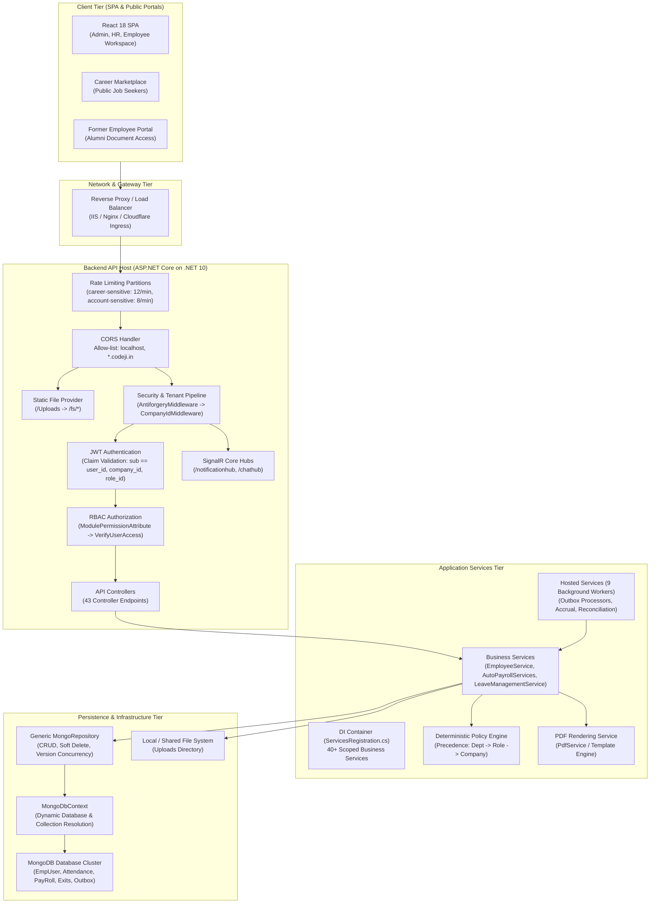
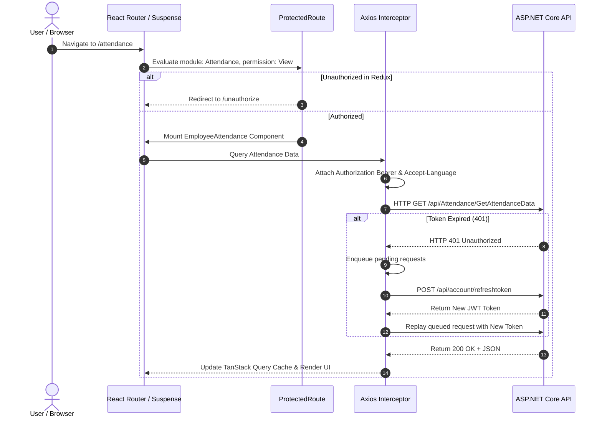
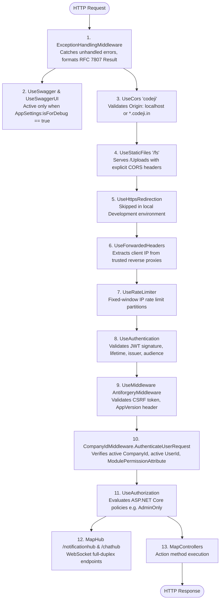
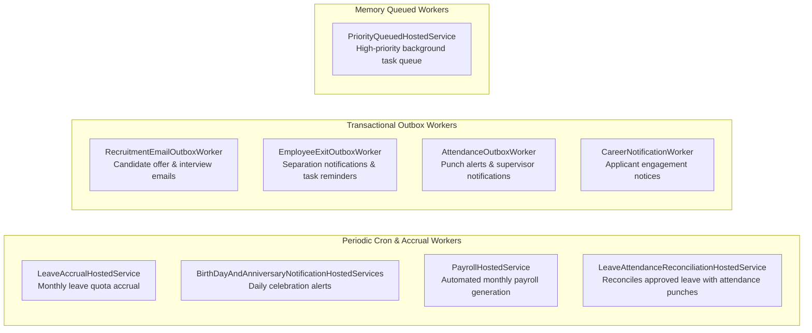

# Codeji CMS / HRMS — System Architecture

> **Document Status**: Complete & Authoritative  
> **Source-of-Truth**: Verified from Repository Implementation  
> **Runtime Frameworks**: ASP.NET Core (.NET 10) | React 18 (TypeScript, Vite) | MongoDB  
> **Last Verified**: September 2026

---

## 1. End-to-End System Topology

The Codeji HRMS platform is structured as an enterprise-grade distributed system designed for high concurrency, strict tenant isolation, and auditable operational workflows:



---

## 2. Frontend Application Architecture

### 2.1 Technology Stack & Architectural Principles
The frontend application (`CMS-React`) is engineered using **React 18** with **TypeScript** and bundled via **Vite**. The client-side architecture enforces:
- **Modular Component Isolation**: Features reside in self-contained directories under `src/app/modules/`.
- **Hybrid State Architecture**:
  - Synchronous UI and Session State: Managed via **Redux Toolkit** (`src/app/Redux`). Stores authenticated tokens, current user payload, and theme configuration.
  - Asynchronous Server Cache State: Managed via **TanStack Query** (`src/app/query`). Eliminates state drift through automated query key invalidation (`queryClient.invalidateQueries`).
- **Resilient Transport Interception**:
  - `src/server/axios.ts`: Configures global request/response interceptors.
  - Automatic `Accept-Language` header injection based on active localization.
  - Non-blocking 401 token refresh queue: Concurrently queues pending API calls while asynchronously renewing the access token via `/api/account/refreshtoken`.
- **Granular Route Guarding**:
  - `src/app/modules/users/about/components/ProtectedRoute.tsx`: Intercepts route navigation. Validates that the active user possesses the required module permission (`Permission.View`, `Permission.Edit`) or role type before mounting lazy-loaded components.



---

## 3. Backend HTTP Middleware Pipeline

The backend request pipeline in `Codeji.CMS.API/Program.cs` is ordered with strict security precedence:



### 3.1 Middleware Verification & Responsibilities

| Order | Middleware Component | Source Reference | Responsibility & Invariants |
|---|---|---|---|
| **1** | `ExceptionHandlingMiddleware` | `Program.cs:338` | Global try/catch handler ensuring no raw stack traces leak to the client; transforms exceptions into standardized `Result` envelopes. |
| **2** | `UseCors("codeji")` | `Program.cs:363` | Allows credentials, any header, any method, but strictly limits origins to `localhost` or domain suffix `.codeji.in`. |
| **3** | `UseStaticFiles("/fs")` | `Program.cs:366` | Serves physical files from `/Uploads`. Because static file middleware is terminal, custom CORS response headers are attached in `OnPrepareResponse`. |
| **4** | `UseForwardedHeaders` | `Program.cs:401` | Resolves real client IP from `X-Forwarded-For` using explicit `KnownProxies` configured in `appsettings.json`. |
| **5** | `UseRateLimiter` | `Program.cs:402` | Protects sensitive unauthenticated endpoints: `career-sensitive` (12 req/min), `account-sensitive` (8 req/min), `career-analytics` (30 req/min). |
| **6** | `UseAuthentication` | `Program.cs:403` | Validates JWT Bearer signature using symmetric secret key. In `OnTokenValidated`, strictly validates that `sub == user_id`, `company_id` is present, and `role_id` is present. |
| **7** | `AntiforgeryMiddleware` | `Program.cs:407` | Validates `XSRF-TOKEN` cookie/header on state-changing unauthenticated requests. Validates `AppVersion` header against server version (returns `426 Upgrade Required` on mismatch). |
| **8** | `CompanyIdMiddleware` | `AntyForgeryMiddleware.cs:60` | Resolves `company_id` and `user_id` from claims. Validates that the company and user exist and are active in MongoDB. Evaluates endpoint `ModulePermissionAttribute` against the user's role permissions. |
| **9** | `UseAuthorization` | `Program.cs:408` | Executes ASP.NET Core policy handlers (`AdminOnly`, `HrExitOverride`). |
| **10** | `MapControllers` | `Program.cs:427` | Dispatches request to target controller action. |

---

## 4. Application & Service Layer Architecture

### 4.1 Clean Service Separation
Business logic is decoupled from ASP.NET Core controllers into specialized domain services implementing interfaces registered with **Scoped** lifetime in `Codeji.CMS.Services/Registration/ServicesRegistration.cs`:

```text
Controllers (Codeji.CMS.API)
     │ (Calls DTO-based interface methods)
     ▼
Business Services (Codeji.CMS.Services)
     │ (Applies business rules, validates policies, maps models)
     ▼
Generic Repositories (Codeji.CMS.Repository)
     │ (Executes typed Mongo queries via LINQ)
     ▼
MongoDB Driver (MongoDB.Driver)
```

### 4.2 Data Transfer Object (DTO) & Mapping Pattern
To enforce data contracts and prevent internal schema leakage:
1. All client inputs are bound to strongly typed Request DTOs in `Codeji.CMS.DTO`.
2. DTOs use system annotations (e.g. `[RegularExpression]` for PAN and Bank Accounts) for declarative validation.
3. Object mapping between Entities and DTOs is executed via **Mapster** (`ServiceMapper` / `MapsterConfig`), scanned assembly-wide at startup. Direct database entities are never returned raw across the API boundary.

---

## 5. Persistence & Data Access Architecture

### 5.1 Dynamic MongoDB Collection Resolution
Persistence is implemented on top of the official MongoDB C# Driver (`MongoDB.Driver v2.28.0`). The system eschews Entity Framework in favor of a lightweight, high-performance generic repository:

```csharp
// Codeji.CMS.Repository.Repositories.MongoDbContext
public IMongoCollection<TEntity> GetCollection<TEntity>()
{
    return _appDatabase.GetCollection<TEntity>(typeof(TEntity).Name);
}
```

- Each entity corresponds to a collection named after its C# class (e.g., `EmpUser`, `Attendance`, `EmployeeExit`, `LeaveRequest`, `EmpPayRoll`).
- `MongoRepository<TEntity>` implements `IMongoDbRepository<TEntity>`, exposing asynchronous LINQ-compatible querying (`FirstOrDefault`, `GetAll`, `AddOne`, `AddMany`, `Update`, `DeleteOne`, `Count`, `Exist`).

### 5.2 Optimistic Concurrency Control
Concurrent mutations to high-stakes lifecycle entities (such as `EmployeeExit`, `RecruitmentOnboardingCase`, `AttendancePenaltyPolicy`, and `EmpUser.Lifecycle`) are protected by explicit integer `Version` fields:
```csharp
// Concurrency check example in RecruitmentOnboardingService
var filter = Builders<RecruitmentOnboardingCase>.Filter.Where(x => 
    x.CompanyId == companyId && 
    x.CaseId == onboarding.CaseId && 
    (x.Version == version || x.Version == 0));

var updated = await cases.Update(filter, onboarding);
if (!updated.Success)
    return Fail(RecruitmentErrorCodes.ConcurrencyConflict, 
        "Onboarding case was changed by another user.", StatusCodes.Status409Conflict);
```
If two administrators attempt conflicting updates simultaneously, the second write fails with HTTP `409 Conflict`, requiring a client refresh.

---

## 6. Background Workers & Asynchronous Job Architecture

The platform runs **9 distinct `IHostedService` / `BackgroundService` background workers** registered in `Program.cs`:



| Worker Name | Implementation Class | Execution Cycle | Core Responsibility |
|---|---|---|---|
| **Leave Accrual** | `LeaveAccrualHostedService` | Periodic (Daily check, triggers monthly) | Grants monthly leave entitlements based on active `LeavePolicy` configuration. |
| **Birthdays & Anniversaries** | `BirthDayAndAnniversaryNotificationHostedServices` | Daily at 00:00 IST | Scans active employees for matching DOB / DateOfJoining; publishes celebration notices via `NotificationHub`. |
| **Payroll Worker** | `PayrollHostedService` | Periodic (Monthly closed period) | Triggers `AutoPayrollServices` to generate draft payroll for closed months. |
| **Leave-Attendance Reconciliation** | `LeaveAttendanceReconciliationHostedService` | Periodic background loop | Ensures approved leave requests retroactively update daily attendance status records to `L`. |
| **Recruitment Outbox** | `RecruitmentEmailOutboxWorker` | Polling loop (5-15s) | Reads pending `RecruitmentEmailOutbox` records, dispatches emails via SMTP, and records retry counts / errors. |
| **Exit Outbox** | `EmployeeExitOutboxWorker` | Polling loop (15-30s) | Reads `EmployeeExitOutbox`, dispatches separation reminders and manager clearance alerts. |
| **Attendance Outbox** | `AttendanceOutboxWorker` | Polling loop (10-30s) | Transmits attendance punch anomalies and manager alerts. |
| **Career Notifications** | `CareerNotificationWorker` | Polling loop (30s) | Dispatches candidate job alert emails and subscription updates. |
| **Priority Task Queue** | `PriorityQueuedHostedService` | Continuous channel listener | Executes ad-hoc background tasks enqueued via `IPriorityTaskQueue`. |
