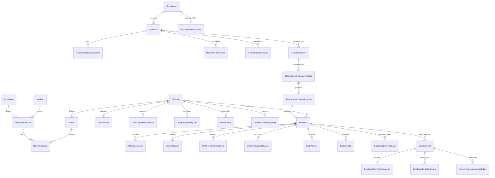
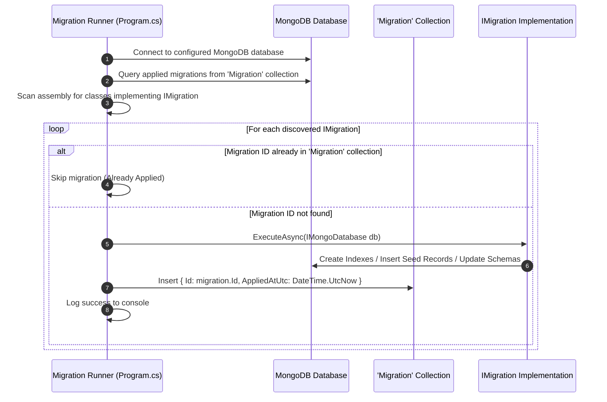

# Codeji CMS / HRMS — Database Architecture

> **Document Status**: Complete & Authoritative  
> **Source-of-Truth**: Verified from Repository Implementation & Database Migrations  
> **Database Engine**: MongoDB (Document Store)  
> **Driver**: MongoDB C# Driver v2.28+  
> **Last Verified**: September 2026

---

## 1. Database Paradigm & Engine Selection

The Codeji HRMS utilizes **MongoDB** as its primary persistence engine. While traditional HR systems frequently rely on relational databases (RDBMS), MongoDB was selected to accommodate:
1. **Polymorphic and Document-Centric Data**: Complex, nested structures such as multi-dimensional employee lifecycle histories, embedded policy snapshots, clearance checklists, and discussion message threads are naturally represented as single, atomic documents.
2. **Schema Flexibility across Diverse Enterprises**: Tenant-defined custom attributes (`UserCustomAttribute`, `CompanyCustomAttributes`) vary across companies without necessitating ALTER TABLE schema migrations.
3. **High-Performance Sharding & Multi-Tenancy**: Tenant-keyed collections (`CompanyId`) allow efficient horizontal scaling and compound indexed querying.

---

## 2. Core Entity Architecture & Base Classes

Every persistent entity in `Codeji.CMS.Repository.Entities` derives from a standardized base class hierarchy ensuring uniform auditing, soft deletion, and tenant scoping:

```csharp
// BaseClass definition in Codeji.CMS.Repository.Entities
public class BaseClass : IImplementsId, ISupportSoftDelete, ISupportAuditing, ISupportFiltering
{
    [BsonId(IdGenerator = typeof(UniqueIdGenerator))]
    public string Id { get; set; } = string.Empty;
    public string CompanyId { get; set; } = string.Empty;
    public string CreatedBy { get; set; } = string.Empty;
    public DateTime CreatedDate { get; set; } = DateTime.UtcNow;
    public string? UpdatedBy { get; set; }
    public DateTime? UpdatedDate { get; set; }
    public bool IsDeleted { get; set; } = false;
    public DateTime? DeletedDate { get; set; }
    public string? DeletedBy { get; set; }
}
```

### 2.1 Cross-Cutting Persistence Contracts
- `IImplementsId`: Enforces a uniform primary key named `Id` (or mapped entity identifier) generated via `UniqueIdGenerator`.
- `ISupportSoftDelete`: Mandates the `IsDeleted` boolean flag. Queries via `MongoRepository<T>` automatically apply the filter `!x.IsDeleted` by default unless explicitly overridden (`withDefaultFilter: false`).
- `ISupportAuditing`: Automatically records creation and mutation timestamps in UTC along with the executing actor ID.
- `ISupportFiltering`: Facilitates tenant-level filtering by ensuring `CompanyId` exists on all business entities.

---

## 3. Entity-Relationship & Document Map

Although MongoDB is non-relational, logical relationships exist between documents linked via string-based foreign identifiers. The following diagram maps the core database entity network:



---

## 4. Master Collection Catalog

The table below catalogs every verified MongoDB collection, its domain ownership, primary key, foreign references, and indexing invariants:

| Collection Name | C# Entity Class | Primary Key | Foreign Key References | Critical Indexes |
|---|---|---|---|---|
| **`Company`** | `Company` | `CompanyId` | None | `{ CompanyId: 1 }` (Unique), `{ CompanyCode: 1 }` |
| **`Department`** | `Department` | `DepartmentId` | `CompanyId` | `{ CompanyId: 1, DepartmentName: 1 }` |
| **`Roles`** | `Roles` | `RolesId` | `CompanyId` | `{ CompanyId: 1, RoleType: 1 }`, `{ CompanyId: 1, Titles: 1 }` |
| **`Module`** | `Module` | `ModuleId` | None | `{ ModuleConstant: 1 }` (Unique) |
| **`Permission`** | `Permission` | `PermissionId` | None | `{ PermissionConstant: 1 }` (Unique) |
| **`ModulePermission`** | `ModulePermission` | `ModulePermissionId` | `ModuleId`, `PermissionId` | `{ ModuleId: 1, PermissionId: 1 }` (Unique) |
| **`RolePermission`** | `RolePermission` | `RolePermissionId` | `RoleId`, `ModulePermissionId`, `CompanyId` | `{ CompanyId: 1, RoleId: 1, ModulePermissionId: 1 }` (Unique) |
| **`EmpUser`** | `EmpUser` | `UserId` | `CompanyId`, `RoleId`, `Department`, `ReportingManager` | `{ CompanyId: 1, UserId: 1 }` (Unique), `{ CompanyId: 1, EmployeeId: 1 }` (Unique), `{ Email: 1 }` |
| **`EmployeeLifecycleCase`**| `EmployeeLifecycleCase` | `CaseId` | `CompanyId`, `UserId` | `{ CompanyId: 1, CaseId: 1 }`, `{ CompanyId: 1, UserId: 1, Status: 1 }` |
| **`EmployeeLifecyclePolicy`**| `EmployeeLifecyclePolicy`| `EmployeeLifecyclePolicyId`| `CompanyId`, `DepartmentId`, `RoleId` | `{ CompanyId: 1, PolicyType: 1, Version: 1 }` |
| **`Attendance`** | `AttendanceModel` | `AttendanceId` | `CompanyId`, `UserId`, `EmployeeId` | `{ CompanyId: 1, UserId: 1, AttendanceDate: 1 }` (Unique) |
| **`AttendanceDaySegment`** | `AttendanceDaySegment` | `SegmentId` | `CompanyId`, `UserId`, `AttendanceDate` | `{ CompanyId: 1, UserId: 1, AttendanceDate: 1, SegmentIndex: 1 }` (Unique) |
| **`AttendancePenaltyPolicy`**| `AttendancePenaltyPolicy`| `Id` | `CompanyId`, `UserId` | `{ CompanyId: 1, UserId: 1, EffectiveFrom: 1 }` |
| **`MonthlyAttendanceSummary`**|`MonthlyAttendanceSummary`| `SummaryId` | `CompanyId`, `EmployeeId`, `PayrollMonth` | `{ CompanyId: 1, EmployeeId: 1, PayrollMonth: 1 }` (Unique) |
| **`AttendanceMonthLock`** | `AttendanceMonthLock` | `LockId` | `CompanyId`, `PayrollMonth` | `{ CompanyId: 1, PayrollMonth: 1 }` (Unique) |
| **`LeaveRequest`** | `LeaveRequest` | `LeaveRequestId` | `CompanyId`, `UserId`, `LeavePolicyId` | `{ CompanyId: 1, UserId: 1, StartDate: 1, EndDate: 1 }` |
| **`LeavePolicy`** | `LeavePolicy` | `LeavePolicyId` | `CompanyId`, `DepartmentId` | `{ CompanyId: 1, LeaveTypeId: 1, IsActive: 1 }` |
| **`EmployeeLeaveBalance`** | `EmployeeLeaveBalance` | `EmployeeLeaveBalanceId`| `CompanyId`, `UserId`, `LeaveTypeId` | `{ CompanyId: 1, UserId: 1, LeaveTypeId: 1, Year: 1 }` (Unique) |
| **`WorkFromHomeRequest`** | `WorkFromHomeRequest` | `RequestId` | `CompanyId`, `UserId` | `{ CompanyId: 1, UserId: 1, StartDate: 1 }` |
| **`Holidays`** | `Holidays` | `HolidayId` | `CompanyId` | `{ CompanyId: 1, HolidayDate: 1 }` |
| **`Salary`** | `SalaryModel` | `SalaryId` | `CompanyId`, `UserId` | `{ CompanyId: 1, UserId: 1 }` (Unique) |
| **`EmpPayRoll`** | `EmpPayRoll` | `PayRollId` | `CompanyId`, `EmployeeId`, `PayMonth` | `{ CompanyId: 1, EmployeeId: 1, PayMonth: 1 }` (Unique) |
| **`PayrollDivisorPolicy`** | `PayrollDivisorPolicy` | `PolicyId` | `CompanyId` | `{ CompanyId: 1, EffectiveFrom: 1 }` |
| **`EmployeeExit`** | `EmployeeExit` | `EmployeeExitId` | `CompanyId`, `EmployeeUserId` | `{ CompanyId: 1, EmployeeUserId: 1 }` (Unique for active), `{ Status: 1 }` |
| **`EmployeeExitPolicy`** | `EmployeeExitPolicy` | `EmployeeExitPolicyId` | `CompanyId`, `DepartmentId`, `RoleId` | `{ CompanyId: 1, ExitType: 1, IsActive: 1 }` |
| **`EmployeeFinalSettlement`**| `EmployeeFinalSettlement`| `EmployeeFinalSettlementId`| `CompanyId`, `EmployeeExitId`, `EmployeeUserId` | `{ CompanyId: 1, EmployeeExitId: 1 }` (Unique) |
| **`FormerEmployeeAccessToken`**|`FormerEmployeeAccessToken`|`TokenId`| `CompanyId`, `EmployeeUserId` | `{ TokenHash: 1 }` (Unique), `{ ExpiresAtUtc: 1 }` |
| **`JobVacancy`** | `JobVacancy` | `VacancyId` | `CompanyId`, `DepartmentId` | `{ CompanyId: 1, JobCode: 1 }` (Unique), `{ Slug: 1 }` |
| **`Applicant`** | `Applicant` | `ApplicantId` | `CompanyId`, `JobVacancyId` | `{ CompanyId: 1, Email: 1, JobVacancyId: 1 }` |
| **`RecruitmentOffer`** | `RecruitmentOffer` | `OfferId` | `CompanyId`, `ApplicantId` | `{ CompanyId: 1, ApplicantId: 1 }` |
| **`RecruitmentOnboardingCase`**|`RecruitmentOnboardingCase`|`CaseId`| `CompanyId`, `ApplicantId`, `EmployeeUserId` | `{ CompanyId: 1, ApplicantId: 1 }` (Unique) |
| **`RecruitmentEmailOutbox`**| `RecruitmentEmailOutbox` | `OutboxId` | `CompanyId` | `{ Status: 1, NextAttemptAtUtc: 1 }` |
| **`EmployeeExitOutbox`** | `EmployeeExitOutbox` | `OutboxId` | `CompanyId` | `{ Status: 1, NextAttemptAtUtc: 1 }` |
| **`AttendanceNotificationOutbox`**|`AttendanceNotificationOutbox`|`OutboxId`| `CompanyId` | `{ Status: 1, NextAttemptAtUtc: 1 }` |
| **`Migration`** | `Migration` | `Id` | None | `{ Id: 1 }` (Unique) |

---

## 5. Schema Evolution & Migration Engine (`Codeji.CMS.Migrations`)

Codeji implements an in-house database migration runner in `Codeji.CMS.Migrations` rather than relying on an external ORM migration tool:



### 5.1 Structure of an `IMigration` Class
Every migration implements the `IMigration` interface with an immutable timestamped identifier:
```csharp
public interface IMigration
{
    string Id { get; }
    Task ExecuteAsync(IMongoDatabase db);
}

public class AddRecruitmentCoreIndexes : IMigration
{
    public string Id => $"2026-09-18-{typeof(AddRecruitmentCoreIndexes).Name}";

    public async Task ExecuteAsync(IMongoDatabase db)
    {
        var migrations = db.GetCollection<Migration>("Migration");
        if (await migrations.Find(m => m.Id == Id).AnyAsync()) return;

        var applicants = db.GetCollection<BsonDocument>("Applicant");
        await applicants.Indexes.CreateOneAsync(
            new CreateIndexModel<BsonDocument>(
                Builders<BsonDocument>.IndexKeys
                    .Ascending("CompanyId")
                    .Ascending("Email")
                    .Ascending("JobVacancyId"),
                new CreateIndexOptions { Unique = true }));

        // Mark as applied
        await migrations.InsertOneAsync(new Migration { Id = Id, AppliedAt = DateTime.UtcNow });
    }
}
```

---

## 6. Document Immutability & Historical Snapshotting

A defining architectural principle of the Codeji database design is **Point-in-Time Snapshotting**:
- **Exit Policy Snapshotting**: When an employee submits a resignation or HR initiates an exit, `EmployeeExitPolicySnapshot` is serialized directly inside the `EmployeeExit` document. If HR subsequently modifies company notice periods or clearance rules, the separated employee's case remains governed by the exact rules in force at initiation.
- **Processed Payroll Immutability**: Once payroll for a given month is marked `IsProcessed == true`, the document cannot be recalculated or deleted. A new retroactive adjustment or manual revision must be processed.
- **Lifecycle History Log**: The `EmpUser.Lifecycle.History` subdocument array appends every status change across the 7 lifecycle dimensions, capturing the prior state, new state, effective UTC date, acting user ID, and machine-readable reason code (`ReasonCode`).
