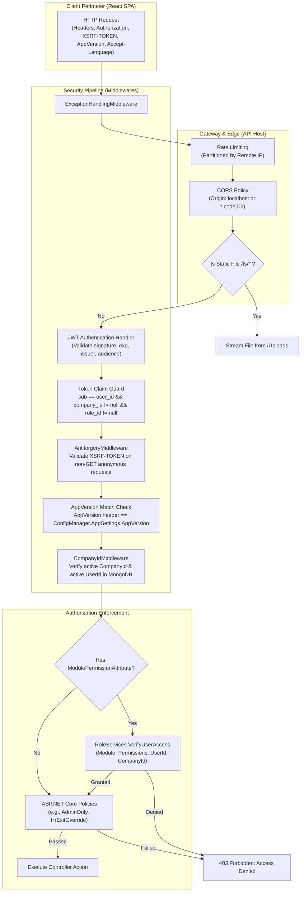
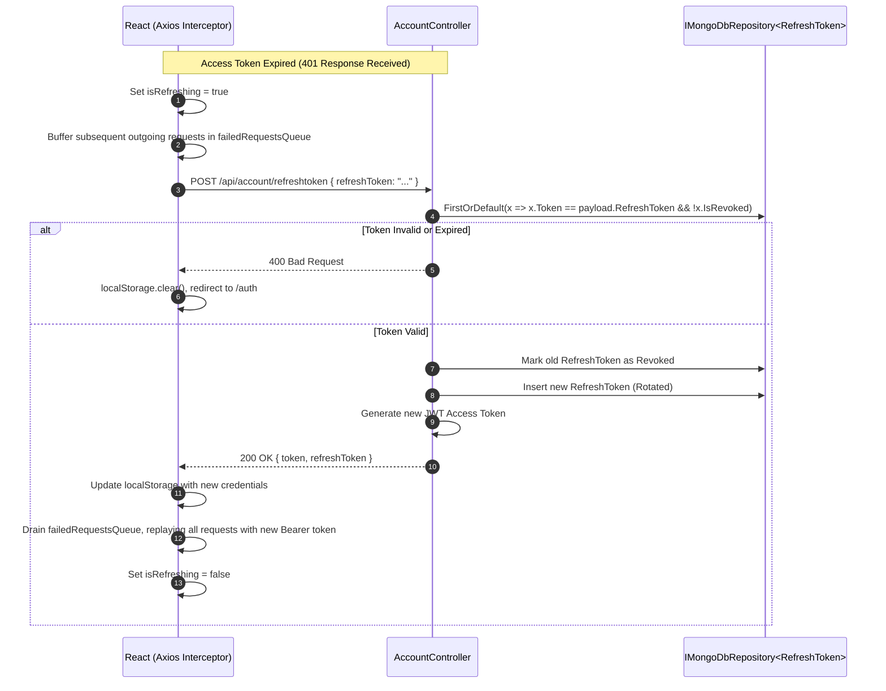

# Codeji CMS / HRMS — Authentication & Authorization Architecture

> **Document Status**: Complete & Authoritative  
> **Source-of-Truth**: Verified from Repository Implementation  
> **Security Standards**: JWT Bearer Tokens | Anti-CSRF (XSRF-TOKEN) | Dynamic RBAC | ASP.NET Core Authorization  
> **Last Verified**: September 2026

---

## 1. Security Architecture Overview

The Codeji HRMS platform employs a defense-in-depth security model combining cryptographic authentication, token-bound tenant identification, anti-forgery verification, application version pinning, and dual-layer authorization (client-side route protection coupled with server-side middleware enforcement):



---

## 2. Authentication: The JWT Bearer Token Lifecycle

### 2.1 Credential Exchange & Login
Authentication begins at `POST /api/Account/Login` (`AccountController.cs`), consuming `LoginModel`:
```csharp
public class LoginModel
{
    public required string Email { get; set; }
    public required string Password { get; set; }
}
```
1. `AccountServices.LoginAsync` locates the employee record in `EmpUser` matching the normalized email.
2. The user's stored password hash is validated using a salted cryptographic hasher.
3. The system verifies that the account is active (`Status == true`), the tenant company exists and is active (`Company.IsActive == true`), and the assigned role exists in `Roles`.
4. If valid, the system issues a **JWT Access Token** paired with a cryptographically random **Refresh Token**.

### 2.2 Authoritative JWT Claims Structure
The JWT access token is signed using an HMAC-SHA256 secret key (`ConfigManager.Jwt.SecretKey`). It contains explicit, cryptographically unforgeable identity and tenancy claims:

| Claim Type | Standard JWT Name | Description & Verification Rules |
|---|---|---|
| `sub` | `JwtRegisteredClaimNames.Sub` | The user's primary database ID (`UserId`). Must match `user_id` claim exactly. |
| `user_id` | `ClaimTypesEnum.user_id` | Explicit application user identifier (`EmpUser.UserId`). |
| `company_id` | `ClaimTypesEnum.company_id` | The single authoritative tenant ID (`EmpUser.CompanyId`). |
| `role_id` | `ClaimTypesEnum.role_id` | The assigned role document ID (`EmpUser.RoleId`). |
| `admin_id` | `ClaimTypesEnum.admin_id` | Present if user possesses administrative elevation. |
| `exp` | `JwtRegisteredClaimNames.Exp` | Token expiration timestamp (default: 60 minutes). |
| `iss` | `JwtRegisteredClaimNames.Iss` | Configured API URL (`ConfigManager.AppSettings.APIUrl`). |
| `aud` | `JwtRegisteredClaimNames.Aud` | Configured Web App URL (`ConfigManager.AppSettings.AppUrl`). |

### 2.3 Strict Claim Integrity Gate (`OnTokenValidated`)
In `Program.cs`, the JWT bearer handler configures a zero-trust claim integrity validator:
```csharp
options.Events = new JwtBearerEvents
{
    OnTokenValidated = context =>
    {
        var principal = context.Principal;
        var subject = principal?.FindFirst(JwtRegisteredClaimNames.Sub)?.Value
            ?? principal?.FindFirst(ClaimTypes.NameIdentifier)?.Value;
        var userId = principal?.FindFirst("user_id")?.Value;
        var companyId = principal?.FindFirst("company_id")?.Value;
        var roleId = principal?.FindFirst("role_id")?.Value;

        if (string.IsNullOrWhiteSpace(subject) || string.IsNullOrWhiteSpace(userId) ||
            !string.Equals(subject, userId, StringComparison.Ordinal) ||
            string.IsNullOrWhiteSpace(companyId) || string.IsNullOrWhiteSpace(roleId))
        {
            context.Fail("Required tenant identity claims are missing or inconsistent.");
        }
        return Task.CompletedTask;
    }
};
```
If an adversary tampers with token claims or attempts cross-tenant manipulation, the token is invalidated prior to reaching application code.

---

## 3. Refresh Token Protocol & Concurrency Management

To prevent user session interruption, the frontend and backend maintain an automated refresh protocol:



---

## 4. Perimeter Protections: Anti-CSRF & AppVersion Locking

### 4.1 Anti-CSRF Middleware (`AntiforgeryMiddleware`)
- Configured in `Program.cs` via `builder.Services.AddAntiforgery` with cookie name `X_CSRFTken` and header name `XSRF-TOKEN`.
- Automatically skipped for authenticated requests (as JWT Bearer tokens stored in local storage are immune to ambient browser credential reuse) and HTTP GET methods.
- Executed on unauthenticated state-changing POST/PUT operations (e.g. initial login, password reset, public vacancy applications) unless running in local debug mode.

### 4.2 Application Version Pinning (`426 Upgrade Required`)
To prevent data corruption caused by stale client SPA assets calling updated backend API contracts following a deployment:
- Clients pass their bundled application version in the `AppVersion` HTTP header.
- `AntiforgeryMiddleware` compares this header against `ConfigManager.AppSettings.AppVersion`.
- If a mismatch is detected on non-exempt endpoints, the backend immediately halts request execution and returns **HTTP 426 Upgrade Required**:
```json
{
  "StatusCode": 426,
  "Message": "Upgrade Required"
}
```
The client catches this status code and triggers an automatic browser cache bust and reload.

---

## 5. Server-Side Authorization Pipeline

Authorization is enforced at two distinct layers:
1. **Endpoint Filter Layer**: Declared using the `[ModulePermission]` attribute on controller actions.
2. **Dynamic Service Layer**: Evaluated against the database-backed role-permission matrix in `RoleServices.VerifyUserAccess`.

### 5.1 Declarative Endpoint Decoration
Controllers declare their required module and permission levels declaratively:
```csharp
[HttpPost]
[Route("GetEmpPayRollData")]
[ModulePermission(AppModule.PayRoll, Permission.View)]
public async Task<ActionResult<Result<GetEmpPayRollResponseDto>>> GetEmpPayRollData(...)
```

### 5.2 Middleware Execution (`CompanyIdMiddleware`)
Inside `CompanyIdMiddleware.AuthenticateUserRequest`:
1. Resolves `CompanyId` and `UserId` from the authenticated claims principal via `CurrentContext`.
2. Validates that the tenant company is active:
   `await _companyService.IsActiveCompanyExist(company_Id)`.
3. Validates that the requesting employee is active:
   `await _employeeService.IsUserActive(userId)`.
4. Inspects endpoint metadata for `ModulePermissionAttribute`. If found:
   ```csharp
   bool isValid = await _roleServices.VerifyUserAccess(
       permissionAttribute.Module, 
       permissionAttribute.Permissions, 
       userId, 
       company_Id);

   if (!isValid)
   {
       context.Response.StatusCode = StatusCodes.Status403Forbidden;
       await context.Response.WriteAsync("Access Denied");
       return null;
   }
   ```

### 5.3 Deterministic Access Evaluation (`RoleServices.VerifyUserAccess`)
The core evaluation logic in `RoleServices.cs` executes as follows:
1. **Tenant Integrity Check**: Confirms that `user.CompanyId == companyId`. If mismatched, immediately returns `false`.
2. **Administrator Elevation**: If the user's role has `role.RoleType == EnumsHelper.Roles.Administrator`, access is granted unconditionally (`return true`).
3. **Cartesian Permission Lookup**:
   - Queries `RolePermission` for the user's `RoleId` within the active `CompanyId`.
   - Constructs candidate strings matching `{Module}.{Permission}` (e.g. `PayRoll.View`, `Attendance.Edit`).
   - Returns `true` if any candidate matches the user's assigned permissions.
4. **Role-Based Exceptions**: Grants HR Managers and HR Executives baseline access to company dashboard metrics and attendance views even when legacy granular permissions are transitioning.

---

## 6. Frontend Route Guarding (`ProtectedRoute`)

Client-side UI visibility and navigation security are governed by `<ProtectedRoute />` (`src/app/modules/users/about/components/ProtectedRoute.tsx`):
- Reads active user permissions from the Redux store (`state.user.userData.modulePermission`).
- Evaluates `adminOnly` flags: non-administrator users navigating to `/admin/*` or `/attendance-settings` are blocked.
- Checks module permissions:
  ```typescript
  hasModuleFeaturePermission(ModulesName.LeaveManagement, Permission.View, modulePermission)
  ```
- If unauthorized, prevents component mounting and renders `<UnAuthorizedAccess type="unauthorise" />`.
> [!IMPORTANT]
> Frontend route guarding is strictly a user-experience enhancement to hide unexecutable UI elements. All security-sensitive actions are independently and unconditionally authorized on the backend.
