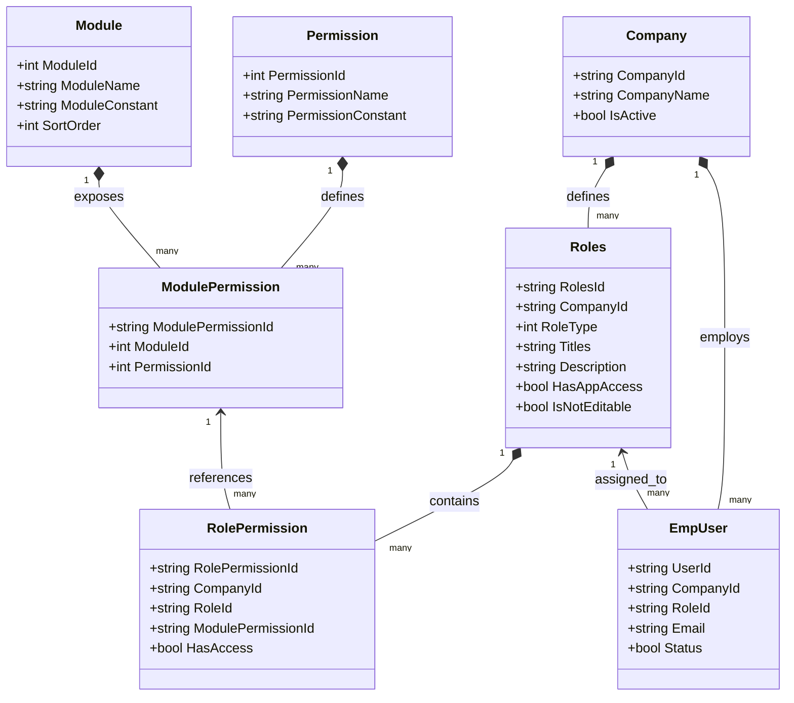
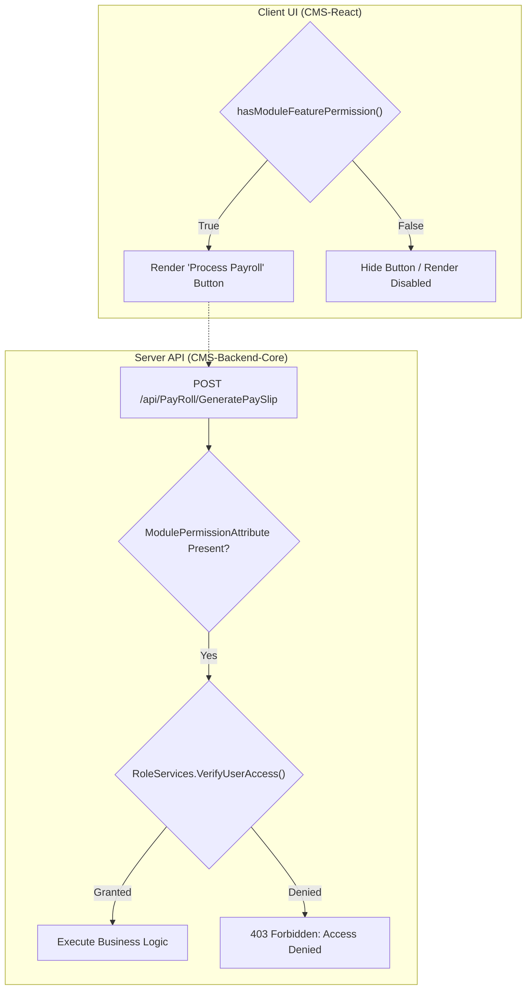

# Codeji CMS / HRMS — Role & Permission Model

> **Document Status**: Complete & Authoritative  
> **Source-of-Truth**: Verified from Repository Implementation & Seed Migrations  
> **Authorization Paradigm**: Dynamic Role-Based Access Control (RBAC)  
> **Last Verified**: September 2026

---

## 1. Role-Based Access Control (RBAC) Architecture

Codeji HRMS implements a dynamic, database-driven Role-Based Access Control model. Rather than hardcoding static role checks across controllers, the platform defines permissions as fine-grained, Cartesian-product intersections of **Modules** and **Actions**, assigned to tenant-scoped **Roles**:

---

## 2. Standard System Roles & Default Templates

When a new company registers or defaults are seeded (`RoleServices.DefaultRoleTemplates`), 4 standard roles are provisioned:

| Role Name | Enum ID | Default Role Title | Default Properties | Functional Responsibilities |
|---|---|---|---|---|
| **Administrator** | `1` | Company Administrator | `IsNotEditable: true`, `HasAppAccess: true` | Complete, unrestricted administrative control. Bypasses all granular permission checks across all modules. Reserved for client account owners. |
| **HR Manager** | `2` | HR Manager | `IsNotEditable: false`, `HasAppAccess: true` | Full operational authority over employee lifecycles, recruitment, leave policies, attendance locks, payroll execution, and separation cases. |
| **HR Executive** | `4` | HR Executive | `IsNotEditable: false`, `HasAppAccess: true` | Operational peer to HR Manager for day-to-day HR workflows (candidate processing, attendance adjustments, employee data entry). |
| **Employee** | `3` | Employee | `IsNotEditable: false`, `HasAppAccess: true` | Self-service access: personal profile, daily punch, personal leave/WFH requests, personal payslips, company notice board. |

> [!NOTE]
> Custom roles can be created per company (e.g. `Recruiter`, `IT Admin`, `Payroll Specialist`) with arbitrary permission combinations. The `Administrator` role is flagged `IsNotEditable: true` to prevent accidental lockout.

---

## 3. Registered Modules & Permission Constants

### 3.1 Registered Application Modules (`AppModule`)
Source reference: `Codeji.CMS.Utility.Constraints.AppModule`:

| Module Constant | UI Display Name | Key Functional Domain |
|---|---|---|
| `Dashboard` | Dashboard | Executive metrics, upcoming birthdays, workforce counters. |
| `Employees` | Employees | Employee directory, profile management, lifecycle cases. |
| `Attendance` | Attendance | Daily punch logs, shift rosters, penalties, month locks. |
| `Leave_Management` | Leave Management | Leave requests, balances, leave policies, WFH bookings. |
| `Calendar` | Calendar | Company calendar, weekly off schedules, holidays. |
| `Notice_Board` | Notice Board | Company-wide announcements, circulars, urgent alerts. |
| `Jobs` | Jobs | Recruitment requisitions and job postings. |
| `Applications` | Applications | Candidate applicant tracking, screening, scorecards. |
| `Process_Log` | Process Log | Recruitment audit history and stage transitions. |
| `PayRoll` | PayRoll | Monthly payroll runs, LOP deductions, payslip generation. |
| `Policy` | Policy | Company policy document library and compliance. |
| `Payroll_Settings` | Payroll Settings | Salary structure components and divisor policies. |
| `Career_Profile` | Career Profile | Public career page branding, marketplace themes. |
| `Work_From_Home` | Work From Home | Remote work request workflow and hours tracking. |
| `Offboarding` | Offboarding | Separation cases, clearances, handover, final settlements. |

### 3.2 Granular Permission Actions (`Permission`)
Source reference: `Codeji.CMS.Utility.Constraints.Permission`:

| Category | Permission Constant | Functional Meaning |
|---|---|---|
| **CRUD Baseline** | `View` | Read-only inspection of module data. |
| | `Create` | Permission to author new records. |
| | `Edit` | Permission to modify existing records. |
| | `Delete` | Soft-delete or archive authority. |
| **Self-Service** | `ViewOwn` | Restricts visibility strictly to records owned by the calling employee. |
| | `CreateOwn` | Authorizes submission of requests for oneself. |
| | `EditOwn` | Modifies personal draft requests. |
| | `CancelOwn` | Cancels personal pending requests before approval. |
| **Supervisory** | `ViewTeam` | Grants visibility into direct and indirect subordinates' records. |
| | `ApproveTeam` | Authority to approve/reject subordinates' leave or WFH requests. |
| | `ViewAll` | Organization-wide visibility across all departments. |
| | `CreateForEmployee` | HR/Manager authority to submit a punch or leave on behalf of a worker. |
| | `Override` | Administrative power to bypass standard business limits (e.g. penalty limits). |
| | `Revoke` | Authority to revoke previously issued approvals or access tokens. |
| **Workflow Specific**| `Submit` | Submits draft cases for formal approval. |
| | `Review` | Conducts intermediate reviews (e.g. Manager Resignation Review). |
| | `Approve` | Executes final sign-off. |
| | `Complete` | Executes lifecycle terminal transitions (e.g. Exit Completion). |
| | `Evidence` | Uploads and verifies legal/resignation evidence documents. |
| | `Download` | Authority to export audit logs, bulk Excel data, or payslips. |
| **Offboarding Operations** | `PolicyManage` | Authors and modifies exit policies. |
| | `CaseManage` | Orchestrates separation cases and sets Last Working Dates. |
| | `AssetManage` | Verifies physical asset returns and evaluates damage deductions. |
| | `AccessManage` | Coordinates IT single sign-on, email, and hardware access revocation. |
| | `FinanceManage` | Computes dues, loans, and reconciles Full & Final settlements. |
| | `BenefitsManage` | Handles gratuity, health insurance transfer, and encashment. |
| | `EvidenceManage` | Reviews resignation letters and non-disclosure sign-offs. |
| | `PortalManage` | Provisions and revokes alumni portal access tokens. |

---

## 4. Master Role-Permission Matrix (Default Baseline)

The table below outlines the default operational permissions assigned across standard roles upon tenant initialization:

| Module | Action | Admin | HR Manager | HR Executive | Employee |
|---|---|:---:|:---:|:---:|:---:|
| **Dashboard** | View | Yes | Yes | Yes | Yes |
| **Employees** | View / ViewAll | Yes | Yes | Yes | View (Directory only) |
| | Create / Edit / Delete | Yes | Yes | Yes | No |
| | EditOwn (Profile) | Yes | Yes | Yes | Yes (Limited fields) |
| **Attendance** | ViewAll | Yes | Yes | Yes | No |
| | ViewOwn | Yes | Yes | Yes | Yes |
| | CreateForEmployee | Yes | Yes | Yes | No |
| | LockMonth / Override | Yes | Yes | No | No |
| **Leave Management**| ViewAll / Approve | Yes | Yes | Yes | No |
| | ViewOwn / CreateOwn | Yes | Yes | Yes | Yes |
| | ManagePolicies | Yes | Yes | No | No |
| **Work From Home** | ViewAll / Approve | Yes | Yes | Yes | No |
| | ViewOwn / CreateOwn | Yes | Yes | Yes | Yes |
| **Jobs & Vacancies** | View / Create / Edit | Yes | Yes | Yes | No |
| **Applications (ATS)**| View / Review / Score | Yes | Yes | Yes | No |
| | IssueOffer | Yes | Yes | No | No |
| **PayRoll** | ViewAll / Process | Yes | Yes | No | No |
| | ViewOwn (Payslip) | Yes | Yes | Yes | Yes |
| **Offboarding** | ViewAll / CaseManage | Yes | Yes | Yes | No |
| | Resign (CreateOwn) | Yes | Yes | Yes | Yes |
| | CompleteExit / Settle | Yes | Yes | No | No |
| **Company Master** | Manage Settings | Yes | No | No | No |
| **Roles & Permissions**| Create / Edit Roles | Yes | No | No | No |

---

## 5. Server-Side Enforcement vs. Client-Side Visibility

A critical architectural distinction in Codeji HRMS is the strict bifurcation between **UI visibility** and **Server-side authorization**:

1. **Client-Side Hiding is NOT Security**: If an employee inspects DOM elements and enables a hidden button or fires an API request directly via curl or Postman, the request is intercepted by `CompanyIdMiddleware`.
2. **Authoritative Backend Rejection**: `RoleServices.VerifyUserAccess` resolves the user's assigned role from MongoDB in the current tenant scope. If the role lacks the specific module-permission pair, the request is aborted immediately with HTTP `403 Forbidden`.
3. **Multi-Tenant Isolation**: Role permissions are scoped to `CompanyId`. A user granted Administrator privileges in Company A possesses zero permissions in Company B.
