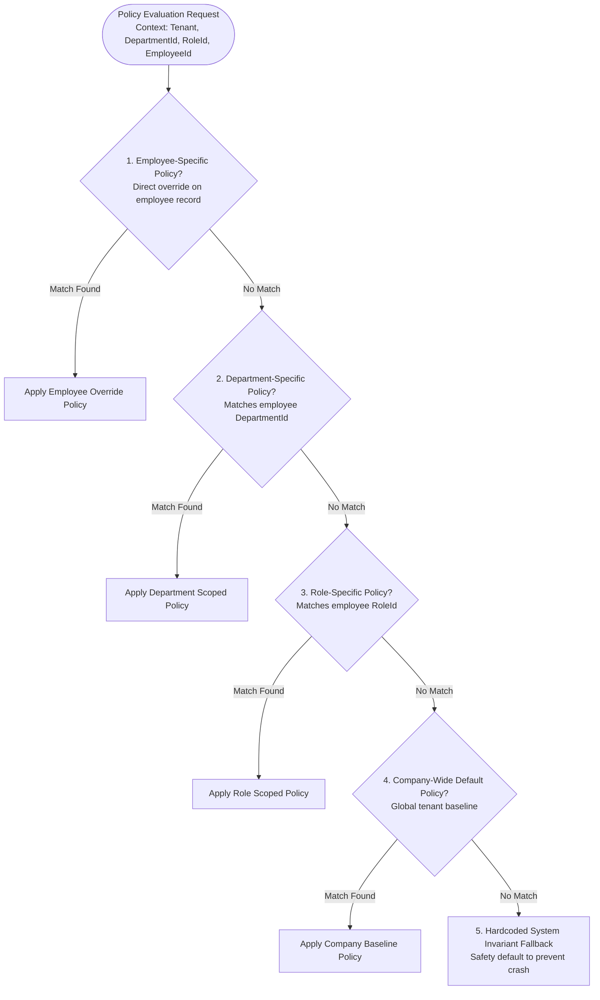
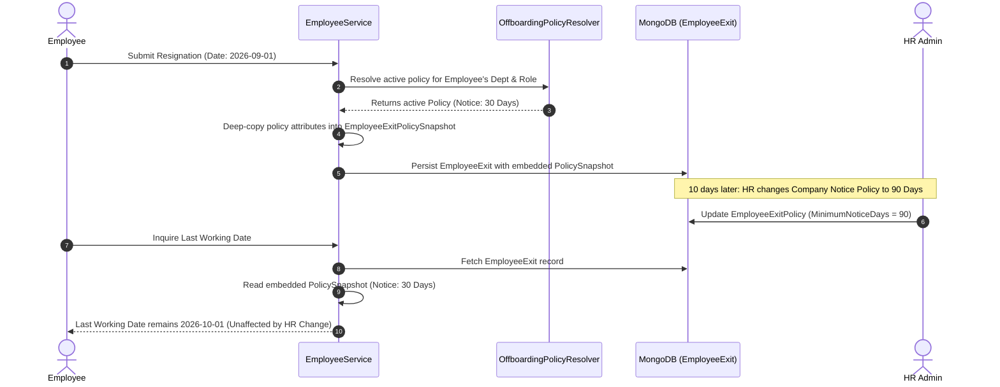

# Codeji CMS / HRMS — Policy & Configuration Engine

> **Document Status**: Complete & Authoritative  
> **Source-of-Truth**: Verified from Repository Implementation  
> **Core Components**: `OffboardingPolicyResolver.cs`, `EmployeeLifecyclePolicyService.cs`, `LeavePolicy.cs`, `AttendancePenaltyPolicy.cs`, `PayrollDivisorPolicy.cs`  
> **Last Verified**: September 2026

---

## 1. Engine Philosophy: Deterministic Hierarchical Governance

Enterprise HR organizations operate under multi-tiered labor regulations, departmental conventions, and employment contracts. Hardcoding rules (such as notice period duration or attendance penalty thresholds) into application code creates fragile, unmaintainable systems.

Codeji HRMS solves this with a **Deterministic Policy Resolution Engine**. The engine evaluates operational policies across five distinct organizational tiers, resolving rules based on explicit, verified precedence:



---

## 2. Core Policy Domains Implemented

The platform manages five core policy domains verified from the repository:

### 2.1 Offboarding & Separation Policy (`EmployeeExitPolicy`)
- **Entity Reference**: `Codeji.CMS.Repository.Entities.Employees.EmployeeExitPolicy`
- **Resolver**: `Codeji.CMS.Services.Employees.OffboardingPolicyResolver`
- **Configurable Parameters**:
  - `MinimumNoticeDays`: Mandatory notice period (e.g. 30, 60, 90 days).
  - `NoticePaySalaryBasis`: Compensation formula for shortfall recovery (`GrossMonthly` or `BasicMonthly`).
  - `NoticePayDailyRateDivisor`: Daily divisor for buyout calculations (default: 30).
  - `AllowEmployeeSelfResignation`: Toggle permitting employee self-service resignations.
  - `AllowRejoin`: Designates whether separated employees under this policy are eligible for future rehire.
  - `RequireManagerReview`: Mandates immediate manager sign-off prior to HR review.
  - `RequireHrReview`: Requires HR executive approval before notice period begins.
  - `RequireResignationEvidence`: Enforces signed PDF letter upload before submission.
  - `RequireEmployeeAcknowledgement`: Mandates employee digital signature on final clearance terms.
  - `EnableFormerEmployeePortal`: Governs alumni document portal provisioning.
  - `NoticePeriodReminderEveryDays`: Frequency (in days) for automated notice countdown reminders.

### 2.2 Employee Lifecycle & Contract Policy (`EmployeeLifecyclePolicy`)
- **Entity Reference**: `Codeji.CMS.Repository.Entities.Employees.EmployeeLifecyclePolicy`
- **Service**: `Codeji.CMS.Services.Employees.EmployeeLifecyclePolicyService`
- **Configurable Parameters**:
  - `ContractType`: `Permanent`, `Probation`, `Contractual`, `Internship`.
  - `ProbationDurationMonths`: Standard probation window (e.g. 3 or 6 months).
  - `ConfirmationReviewNoticeDays`: Advance warning days before probation confirmation review.
  - `ContractExtensionThresholdDays`: Advance warning window for expiring temporary contracts.
  - `AbscondingReviewThresholdDays`: Inactivity period before unapproved absence escalates to absconding review.

### 2.3 Leave Entitlement Policy (`LeavePolicy`)
- **Entity Reference**: `Codeji.CMS.Repository.Entities.Leave.LeavePolicy`
- **Service**: `Codeji.CMS.Services.LeaveManagement.LeaveManagementService`
- **Configurable Parameters**:
  - `LeaveTypeId`: `SickLeave`, `CasualLeave`, `EarnedLeave`, `MaternityLeave`, `PaternityLeave`.
  - `AccrualPeriod`: Monthly, Yearly, or None (lump sum grant).
  - `DaysPerYear`: Total annual entitlement.
  - `MaxConsecutiveDays`: Single-request duration ceiling.
  - `RequiresAttachment`: Mandates medical certificate upload for leaves exceeding threshold.
  - `AllowHalfDay`: Permits 0.5-day segment bookings.
  - `CarryForwardLimit`: Maximum unused days carried into subsequent calendar years.
  - `IsEncashable`: Governs whether unused days convert to cash in Full & Final settlement.

### 2.4 Attendance Penalty & Exception Policy (`AttendancePenaltyPolicy`)
- **Entity Reference**: `Codeji.CMS.Repository.Entities.Attendance.AttendancePenaltyPolicy`
- **Service**: `Codeji.CMS.Services.Attendance.AttendancePenaltyService`
- **Configurable Parameters**:
  - `CombinedLhdEdMonthlyLimit`: Maximum allowable combined Late Half Day (`LHD`) and Early Departure (`ED`) occurrences per calendar month before financial deductions apply.
  - `DeductionDaysPerExceededLimit`: Penalty deduction days (e.g. 0.5 or 1.0 day LOP per violation).
  - `GraceMinutes`: Leniency window (e.g. 15 minutes) before a check-in is classified as late.
  - `EffectiveFrom` / `EffectiveTo`: Date-bounded validity windows supporting scheduled policy revisions.

### 2.5 Payroll Divisor Policy (`PayrollDivisorPolicy`)
- **Entity Reference**: `Codeji.CMS.Repository.Entities.Employees.PayrollDivisorPolicy`
- **Service**: `Codeji.CMS.Services.PayRoll.PayrollDivisorPolicyService`
- **Calculation Rules**: `PayrollCalculationRules.ResolveDivisor`:
  $$\text{Divisor} = \begin{cases} 30 & \text{if policy is } \texttt{"FIXED\_30\_DAYS"} \\ \text{Eligible Working Days} & \text{if policy is } \texttt{"WORKING\_DAYS"} \\ \text{Days in Month (28--31)} & \text{otherwise (Default Calendar Days)} \end{cases}$$

---

## 3. Deterministic Precedence Implementation

The precedence logic in `OffboardingPolicyResolver.cs` is strictly deterministic. Query ordering from MongoDB can never alter resolution outcome:

```csharp
public static class OffboardingPolicyResolver
{
    public static ResolvedOffboardingPolicy? Resolve(
        IEnumerable<EmployeeExitPolicy> policies,
        OffboardingPolicyContext context)
    {
        var active = policies.Where(x => x.IsActive).ToList();
        var requestedExitType = EmployeeLifecycleStatuses.NormalizeCompletedEmploymentStatus(context.ExitType);

        // 1. Evaluate Exact Exit Type Match (Resigned, Terminated, Retired, etc.)
        return ResolveForExitType(active, context, requestedExitType, exactExitType: true)
            // 2. Fallback to Generic Policy (ExitType is null or empty)
            ?? ResolveForExitType(active, context, null, exactExitType: false);
    }

    private static ResolvedOffboardingPolicy? ResolveForExitType(
        IEnumerable<EmployeeExitPolicy> active,
        OffboardingPolicyContext context,
        string? exitType,
        bool exactExitType)
    {
        var candidates = active.Where(policy => exactExitType
            ? string.Equals(EmployeeLifecycleStatuses.NormalizeCompletedEmploymentStatus(policy.ExitType), exitType, StringComparison.Ordinal)
            : string.IsNullOrWhiteSpace(policy.ExitType));

        // Priority 1: Exact Department Match
        var department = candidates
            .Where(x => !string.IsNullOrWhiteSpace(context.DepartmentId)
                && (x.DepartmentIds.Contains(context.DepartmentId!, StringComparer.Ordinal)
                    || string.Equals(x.DepartmentId, context.DepartmentId, StringComparison.Ordinal))
                && string.IsNullOrWhiteSpace(x.RoleId))
            .OrderBy(x => x.EmployeeExitPolicyId, StringComparer.Ordinal)
            .FirstOrDefault();
        if (department is not null)
            return new() { Policy = department, SourceScope = $"Department:{context.DepartmentId}", ExitType = exitType };

        // Priority 2: Exact Role Match
        var role = candidates
            .Where(x => !string.IsNullOrWhiteSpace(context.RoleId)
                && string.Equals(x.RoleId, context.RoleId, StringComparison.Ordinal)
                && !x.DepartmentIds.Any() && string.IsNullOrWhiteSpace(x.DepartmentId))
            .OrderBy(x => x.EmployeeExitPolicyId, StringComparer.Ordinal)
            .FirstOrDefault();
        if (role is not null)
            return new() { Policy = role, SourceScope = $"Role:{context.RoleId}", ExitType = exitType };

        // Priority 3: Company Wide Baseline
        var company = candidates
            .Where(x => x.DepartmentIds.Count == 0 && string.IsNullOrWhiteSpace(x.DepartmentId) && string.IsNullOrWhiteSpace(x.RoleId))
            .OrderBy(x => x.EmployeeExitPolicyId, StringComparer.Ordinal)
            .FirstOrDefault();
        return company is null ? null : new() { Policy = company, SourceScope = "Company", ExitType = exitType };
    }
}
```

---

## 4. Immutable Policy Snapshotting Pattern

A major architectural flaw in many HR systems is retroactive policy mutation: if an organization updates its notice period from 30 days to 90 days, employees currently serving a 30-day notice find their expected exit date illegally altered.

Codeji HRMS guarantees point-in-time compliance via **Immutable Policy Snapshotting**:



The snapshot records:
1. `PolicySourceScope`: Exact tier that won resolution (`Department:Engineering`, `Role:SeniorDev`, or `Company`).
2. `PolicyExitType`: The normalized separation type (`Resigned`, `Terminated`).
3. Complete parameter freeze (`MinimumNoticeDays`, `NoticePaySalaryBasis`, `NoticePayDailyRateDivisor`, clearance gates).
