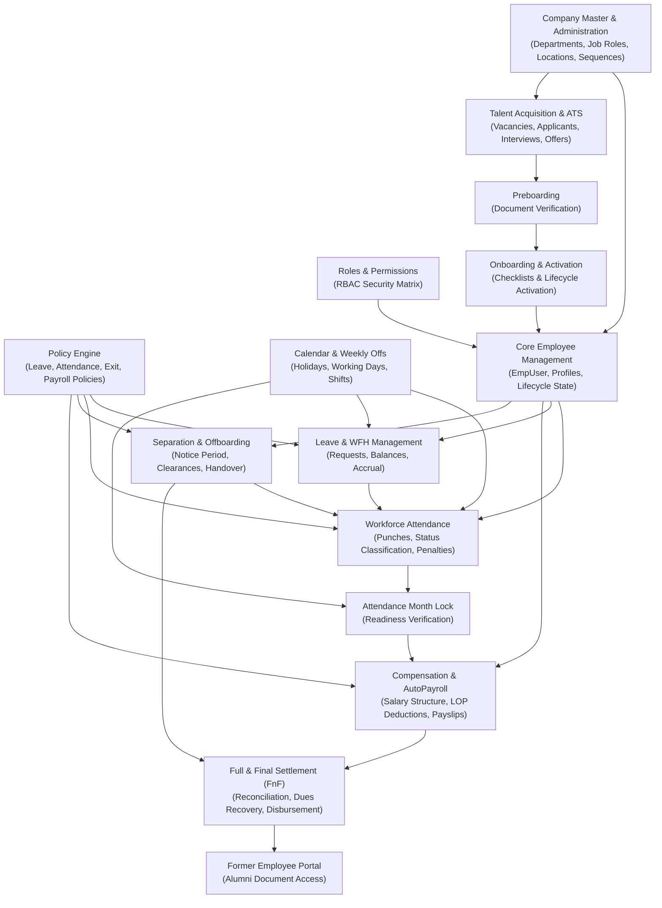

# Codeji CMS / HRMS — Module Dependency Map

> **Document Status**: Complete & Authoritative  
> **Source-of-Truth**: Verified from Repository Implementation  
> **Scope**: Cross-Module Coupling, Data Dependencies, Event Triggers, and Invariants  
> **Last Verified**: September 2026

---

## 1. Global Inter-Module Dependency Graph

The Codeji HRMS platform is an interconnected state machine where each module both consumes upstream organizational context and feeds downstream operational or financial calculations:



---

## 2. Master Module Dependency Matrix

The matrix below details the operational coupling, read/write boundaries, asynchronous triggers, and blocking conditions across every major functional domain:

| Module Name | Depends On (Upstream) | Used By (Downstream) | Reads From | Writes To | Triggers (Events/Side Effects) | Blocks (Downstream Preconditions) |
|---|---|---|---|---|---|---|
| **Company Master** | System Initialization | All Modules | None | `Company`, `Department`, `CompanyJobRole`, `CompanyOfficeLocations`, `CompanyWorkingDays` | Seeds default roles and settings upon company creation. | Blocks employee creation until at least one department and role exist. |
| **Roles & Permissions** | Company Master | All Modules | `Module`, `Permission` | `Roles`, `RolePermission`, `ModulePermission` | Cache invalidation on permission changes. | Blocks unauthorized API invocation at middleware perimeter. |
| **Recruitment (ATS)** | Company Master, Roles | Preboarding, Onboarding | `CompanyJobRole`, `Department` | `JobVacancy`, `Applicant`, `RecruitmentInterview`, `RecruitmentOffer` | `RecruitmentEmailOutbox` on status transitions; creates preboarding case on offer acceptance. | Blocks hiring handoff until an offer is formally accepted. |
| **Preboarding** | Recruitment | Onboarding | `Applicant`, `RecruitmentOffer` | `RecruitmentPreboardingCase` | Verifies identity and educational documents. | Blocks onboarding initialization until required pre-hire documents are approved. |
| **Onboarding** | Preboarding | Core Employee | `RecruitmentOffer`, `Department` | `RecruitmentOnboardingCase`, `EmpUser` | Invokes `ActivateEmployeeLifecycle`, transitioning `EmpUser` to `Active`. | Blocks active workforce operations until onboarding checklist is completed. |
| **Core Employee** | Onboarding, Company Master, Roles | Attendance, Leave, Payroll, Offboarding | `Roles`, `Department` | `EmpUser`, `EmpCertificationDetails`, `EmpEducationDetails`, `EmpSkills` | Real-time presence tracking via `IEmployeePresenceService`. | Blocks all workforce modules if `Status == false` or employee is soft-deleted. |
| **Work Shifts & Calendar** | Company Master | Attendance, Leave, Payroll | `CompanyWorkingDays` | `CompanyOfficeSchedule`, `WeeklyOffSetting`, `Holidays`, `CalendarEntity` | Recalculates effective office schedules. | Blocks attendance status evaluation if calendar is uninitialized. |
| **Attendance** | Core Employee, Calendar, Shifts | Attendance Lock, Payroll | `CompanyOfficeSchedule`, `AttendancePenaltyPolicy` | `AttendanceModel`, `AttendanceDaySegment`, `AttendancePayrollException` | `AttendanceOutboxWorker` for punch anomalies; raises `PENDING_REVIEW` exceptions. | Blocks monthly lock if unreviewed punch discrepancies exist. |
| **Leave & WFH** | Core Employee, Policy Engine | Attendance, Payroll | `LeavePolicy`, `EmployeeLeaveBalance` | `LeaveRequest`, `WorkFromHomeRequest`, `EmployeeLeaveBalance` | Reconciles daily attendance status to `L` via background service. | Blocks leave approval if employee balance is insufficient. |
| **Attendance Month Lock** | Attendance, Leave | AutoPayroll | `MonthlyAttendanceSummary`, `AttendancePayrollException` | `AttendanceMonthLock` | Locks attendance records against further retroactive mutation. | **Hard Block on AutoPayroll**: Payroll generation fails if month is not locked. |
| **Payroll & Salary** | Core Employee, Attendance Lock, Policy | Final Settlement | `SalaryModel`, `MonthlyAttendanceSummary`, `PayrollDivisorPolicy` | `EmpPayRoll`, `PdfService` (Payslips) | Publishes payslips; enqueues payment notifications. | Blocks final settlement calculation until last active month payroll is processed. |
| **Offboarding** | Core Employee, Policy Engine | Final Settlement, Alumni Portal | `EmployeeExitPolicy`, `EmployeeExitClearanceTemplate` | `EmployeeExit`, `EmployeeExitOutbox` | `EmployeeExitOutboxWorker` dispatches clearance alerts; sets `AttendanceCutoff`. | Blocks exit completion until all departmental clearance items are signed off. |
| **Final Settlement (FnF)** | Offboarding, Payroll | Former Employee Portal | `EmpPayRoll`, `EmployeeLeaveBalance`, `SalaryModel` | `EmployeeFinalSettlement` | Generates settlement voucher; updates `EmpUser.Lifecycle.PayrollStatus` to `Closed`. | Blocks alumni portal financial document availability until settlement is paid. |
| **Former Employee Portal**| Final Settlement, Offboarding | External Alumni | `EmployeeExit`, `EmployeeFinalSettlement`, `EmpPayRoll` | `FormerEmployeeAccessToken` | Issues secure one-time capability tokens or OTP authentication sessions. | None (Terminal lifecycle boundary). |

---

## 3. High-Impact Inter-Module Cascades

### 3.1 The Recruitment-to-Active Workforce Cascade
```text
Recruitment Offer Accepted (/candidate/offer)
       │
       ▼
RecruitmentPreboardingCase (Document upload & verification)
       │
       ▼
RecruitmentOnboardingCase Created (Tasks: IT setup, badge, contracts)
       │
       ▼ (All tasks marked 'Completed' or 'Skipped')
RecruitmentOnboardingService.ActivateEmployeeLifecycle
       ├── EmpUser.EmploymentStatus = "Active"
       ├── EmpUser.Lifecycle.AvailabilityStatus = "Working"
       ├── EmpUser.Lifecycle.AccountStatus = "Active"
       ├── EmpUser.Lifecycle.PayrollStatus = "Active"
       ├── EmpUser.Status = true
       └── History appended (ReasonCode: "RECRUITMENT_ONBOARDING_COMPLETED")
```

### 3.2 The Daily Workforce & Time Cascade
```text
Employee Marks Check-In / Check-Out
       │
       ▼
AttendanceStatusCalculationService
       ├── Consumes CompanyOfficeSchedule (StartTime, EndTime, GraceMinutes)
       ├── Evaluates Tolerance Boundaries
       └── Assigns Status: P, HD, LHD, ED, or LHD+ED
       │
       ▼
AttendancePenaltyService
       ├── Increments Monthly Late/Early Counter
       └── If Counter > CombinedLhdEdMonthlyLimit:
                 Raises AttendancePayrollException ("PENDING_REVIEW")
```

### 3.3 The Separation & Settlement Cascade
```text
Employee Exit Completed (LWD reached & clearances approved)
       │
       ├── 1. EmpUser.Status = false (Account deactivated)
       ├── 2. EmpUser.Lifecycle.AccountStatus = "Closed"
       ├── 3. RefreshToken collection: All active tokens for UserId revoked
       ├── 4. AttendanceCutoff record inserted (Blocks punches after LWD)
       ├── 5. Future Leave & WFH requests after LWD automatically cancelled
       ├── 6. EmployeeFinalSettlement initiated (Consumes last processed payroll)
       ├── 7. EmployeeExitOutbox enqueued (Separation confirmation emails)
       └── 8. FormerEmployeeAccessToken provisioned for alumni portal
```
