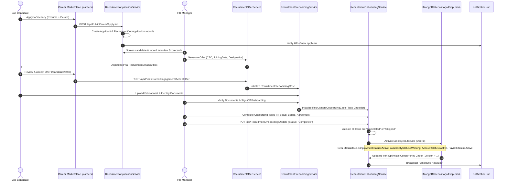
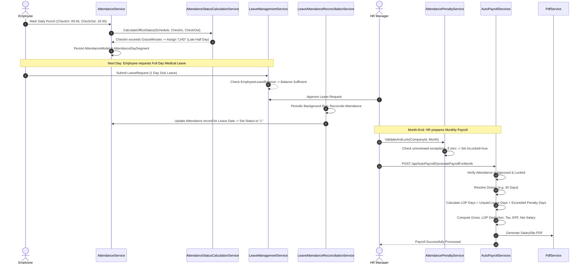
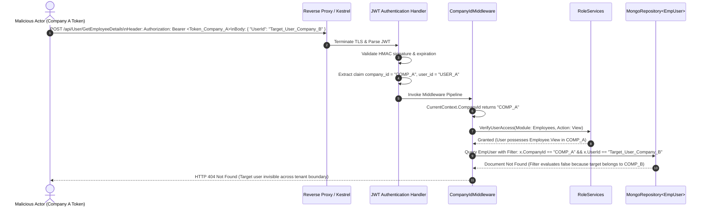

# Codeji CMS / HRMS — Cross-Module Workflows

> **Document Status**: Complete & Authoritative  
> **Source-of-Truth**: Verified from Repository Implementation  
> **Workflows Traced**: Joining, Daily Operations, Resignation/Offboarding, Rejoining, Multi-Tenant Isolation  
> **Last Verified**: September 2026

---

## 1. Master Workflow A: Recruitment to Active Employment

This workflow traces a job applicant from external application on the career portal to fully activated employment:



---

## 2. Master Workflow B: Daily Workforce Operations & Payroll Synthesis

This workflow traces how daily employee activity (punching in, requesting remote work, or taking leave) flows into the monthly payroll calculation:



---

## 3. Master Workflow C: Resignation, Clearances & Final Settlement

This workflow traces an employee separation from resignation submission through departmental clearance to full and final financial closure:

```mermaid
sequenceDiagram
    autonumber
    actor Emp as Employee
    participant EmpSvc as EmployeeService
    participant Resolver as OffboardingPolicyResolver
    actor Mgr as Reporting Manager
    actor HR as HR Manager
    participant Outbox as EmployeeExitOutbox
    participant FnfSvc as EmployeeFinalSettlement
    participant FormerPortal as FormerEmployeePortalService

    Emp->>EmpSvc: POST /api/User/SubmitResignation (Reason, Attachment)
    EmpSvc->>Resolver: Resolve active EmployeeExitPolicy
    EmpSvc->>EmpSvc: Snapshot policy into EmployeeExit document
    EmpSvc->>EmpSvc: Status = "PendingManagerApproval"
    EmpSvc->>Outbox: Queue manager notification
    Mgr->>EmpSvc: Review & Recommend Last Working Date (LWD)
    HR->>EmpSvc: Approve Resignation -> Status = "NoticePeriod"
    Note over EmpSvc,Outbox: Notice Period Begins. Reminders fired every N days.
    
    HR->>EmpSvc: Initialize Clearance Checklists
    Note over HR,EmpSvc: IT revokes credentials; Asset Manager inspects hardware; Finance reviews advances
    HR->>EmpSvc: Sign off Clearances -> Status = "PendingSettlement"
    
    HR->>FnfSvc: Calculate Final Settlement
    FnfSvc->>FnfSvc: Pull last active processed payroll + unpaid days + leave encashment - notice recovery
    HR->>FnfSvc: Approve Settlement & Record Payment Voucher Reference
    
    HR->>EmpSvc: POST /api/User/CompleteEmployeeExit (ExitId)
    EmpSvc->>EmpSvc: Validate all clearances complete & settlement approved
    EmpSvc->>EmpSvc: Set EmpUser.Status = false, EmploymentStatus = "Resigned", AccountStatus = "Closed"
    EmpSvc->>EmpSvc: Revoke all active RefreshTokens
    EmpSvc->>EmpSvc: Insert AttendanceCutoff (Prohibits future punches)
    EmpSvc->>FormerPortal: Provision FormerEmployeeAccessToken
    FormerPortal-->>Emp: Email secure link to /former-employee
```

---

## 4. Master Workflow D: Employee Rejoin & Status Restoration

When a separated employee is re-hired by the organization:
1. **Rejoin Eligibility Verification**:
   - The system inspects the former employee's separation record (`EmployeeExit`).
   - Verifies `PolicySnapshot.AllowRejoin == true`. If the exit was classified as `Terminated` for misconduct with rejoin barred, rehire is blocked.
2. **Account Reactivation**:
   - `POST /api/User/RejoinEmployee`: Admin provides new Date of Joining, designation, reporting manager, and compensation structure.
   - `EmpUser.Status` is flipped from `false` to `true`.
   - `EmpUser.Lifecycle.EmploymentStatus` transitions from `Resigned`/`Terminated` to `Active`.
   - `EmpUser.Lifecycle.AvailabilityStatus` transitions to `Working`.
   - `EmpUser.Lifecycle.AccountStatus` transitions to `Active`.
   - `EmpUser.Lifecycle.PayrollStatus` transitions to `Active`.
   - `AlumniStatus` is updated to `NotApplicable`.
3. **Attendance & Shift Re-enrollment**:
   - Removes or archives the prior `AttendanceCutoff` record, allowing punch registration from the new Date of Joining forward.
   - Assigns a current `CompanyOfficeSchedule`.
4. **Historical Continuity**:
   - Historical attendance records, prior payslips, and previous separation records remain linked to the permanent `UserId` for statutory audit continuity.

---

## 5. Master Workflow E: Multi-Tenant Boundary Enforcement

The diagram below demonstrates how the backend systematically prevents cross-tenant data access:


Even if an authenticated user attempts to request an entity by a valid foreign ID, database queries enforce `x.CompanyId == currentCompanyId`, ensuring that foreign tenant resources evaluate as non-existent.
