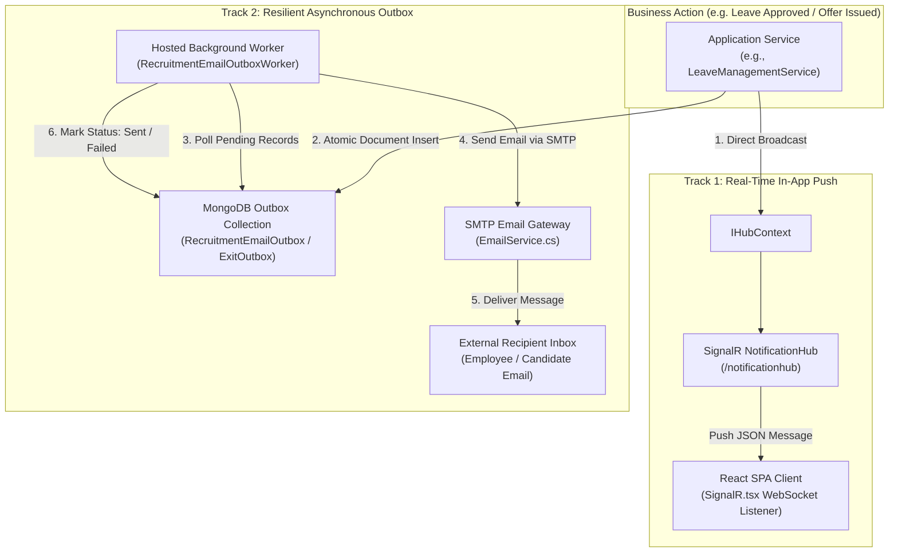

# Codeji CMS / HRMS — Notification Architecture

> **Document Status**: Complete & Authoritative  
> **Source-of-Truth**: Verified from Repository Implementation  
> **Core Technologies**: SignalR Core (WebSockets) | Transactional Outbox Pattern | SMTP Background Services  
> **Last Verified**: September 2026

---

## 1. Notification Architecture Overview

Enterprise HR operations require both instantaneous in-app user feedback (e.g., leave approval badges, system broadcasts) and reliable, asynchronous external communications (e.g., candidate interview invites, manager clearance alerts).

Codeji HRMS decouples real-time UI messaging from external I/O using a dual-track architecture:
1. **Real-Time Push Track**: Powered by **ASP.NET Core SignalR** (`NotificationHub`, `ChatHub`) over persistent WebSockets, delivering low-latency events directly to active browser sessions.
2. **Resilient Transactional Outbox Track**: Backed by dedicated MongoDB outbox collections (`RecruitmentEmailOutbox`, `EmployeeExitOutbox`, `AttendanceNotificationOutbox`) and background polling workers (`IHostedService`), guaranteeing that external delivery failures (e.g. SMTP outages) do not disrupt transactional database operations.



---

## 2. Real-Time SignalR Architecture

### 2.1 Hub Configuration & Security Handshake
The platform registers two SignalR hubs in `Program.cs`:
- `/notificationhub`: Broadcasts system announcements, birthday celebrations, leave approvals, and personal action badges.
- `/chathub`: Facilitates peer-to-peer discussions and exit interview threads.

#### The WebSocket Authentication Protocol
Because web browser WebSocket implementations cannot attach custom HTTP `Authorization: Bearer` headers during connection establishment, Codeji implements the query-string token extraction pattern:
```csharp
// Program.cs: JWT Bearer Token Event Configuration
OnMessageReceived = context =>
{
    var accessToken = context.Request.Query["access_token"];
    var path = context.HttpContext.Request.Path;
    if (!string.IsNullOrEmpty(accessToken) && 
       (path.StartsWithSegments("/notificationhub") || path.StartsWithSegments("/chathub")))
    {
        // Bind query token as authoritative Bearer credential
        context.Token = accessToken;
    }
    return Task.CompletedTask;
}
```

### 2.2 Client-Side Lifecycle Management (`SignalR.tsx`)
On the React client, connection state is managed using `@microsoft/signalr`:
- Initiates connection upon successful Redux user login.
- Configures automatic reconnection (`withAutomaticReconnect([0, 2000, 5000, 10000, 30000])`).
- Registers event listeners for inbound messages:
  - `ReceiveNotification`: Updates unread notification counters in the top navigation bar.
  - `ReceiveMessage`: Appends inbound chat messages to the active drawer.

### 2.3 Verified System Notification Types
Source reference: `Codeji.CMS.Utility.Enums.NOTIFICATION_TYPE`:

| Enum ID | Type Name | Triggering Event | Primary Target Audience |
|---|---|---|---|
| `1` | `NOTICE` | New company notice board circular posted | All active employees in tenant |
| `2` | `LEAVE_REQUEST` | Subordinate submits leave or WFH application | Direct Reporting Manager |
| `3` | `LEAVE_REQUEST_APPROVED` | Manager approves leave application | Subordinate Employee |
| `4` | `LEAVE_REQUEST_REJECTED` | Manager rejects leave application | Subordinate Employee |
| `5` | `BIRTHDAY` | Daily birthday alert (00:00 IST) | Entire tenant organization |
| `6` | `WORK_ANNIVERSARY` | Daily anniversary milestone (00:00 IST) | Entire tenant organization |
| `7` | `MESSAGE` | Discussion thread response / Peer message | Conversation participants |

---

## 3. Transactional Outbox Architecture

Directly calling an external SMTP server or third-party email API inside an HTTP request handler creates major operational vulnerabilities:
- Network latency causes slow UI response times.
- If the email server times out, the database transaction might roll back even though the email was sent, or vice versa (dual-write problem).

Codeji resolves this by implementing the **Transactional Outbox Pattern** across 4 dedicated workers:

### 3.1 Recruitment Email Outbox (`RecruitmentEmailOutboxWorker`)
- **Collection**: `RecruitmentEmailOutbox`
- **Enqueued By**: `RecruitmentOfferService`, `ApplicantServices`, `RecruitmentInterviewService`
- **Data Payload**:
  - `RecipientEmail`, `Subject`, `BodyHtml`, `TemplateCode`
  - `CompanyId`, `ApplicantId`, `OfferId`
  - `Status`: `Pending`, `Processing`, `Sent`, `Failed`
  - `AttemptCount`, `MaxAttempts` (default: 3), `NextAttemptAtUtc`, `LastError`
- **Execution Mechanism**:
  1. Worker executes every 5–15 seconds via `BackgroundService`.
  2. Queries up to 50 records matching:
     `Status == "Pending" && NextAttemptAtUtc <= DateTime.UtcNow`.
  3. Dispatches messages via `IEmailService`.
  4. On success: Updates `Status = "Sent"`, `SentAtUtc = DateTime.UtcNow`.
  5. On failure: Increments `AttemptCount`, sets exponential backoff delay (`NextAttemptAtUtc = UtcNow.AddMinutes(Math.Pow(2, AttemptCount))`), and captures error stack trace.

### 3.2 Employee Exit Outbox (`EmployeeExitOutboxWorker`)
- **Collection**: `EmployeeExitOutbox`
- **Enqueued By**: `EmployeeService.InitiateEmployeeExit`, `EmployeeService.SubmitResignation`
- **Responsibilities**:
  - Sends immediate notification to the reporting manager upon resignation submission.
  - Sends periodic countdown reminders to employee and manager during the notice period (governed by `PolicySnapshot.NoticePeriodReminderEveryDays`).
  - Dispatches departmental clearance reminder alerts to IT, Finance, and HR managers.

### 3.3 Attendance Anomaly Outbox (`AttendanceOutboxWorker`)
- **Collection**: `AttendanceNotificationOutbox`
- **Enqueued By**: `AttendancePenaltyService`, `AttendanceInitializationService`
- **Responsibilities**:
  - Alerts supervisors when an employee breaches monthly late arrival limits (`LHD`).
  - Dispatches missing punch reminders to workers with incomplete day segments.

### 3.4 Career Engagement Worker (`CareerNotificationWorker`)
- **Responsibilities**:
  - Dispatches job application receipts to candidates.
  - Broadcasts automated job alerts to subscribed candidates based on career preferences.

---

## 4. Failure Recovery & Operational Invariants

1. **At-Least-Once Delivery**: Outbox workers ensure messages are never silently dropped. In the event of an ungraceful server crash during dispatch, the record remains in `Processing` or `Pending` status and is recovered on service restart.
2. **Dead-Letter State**: When a record reaches `AttemptCount >= MaxAttempts`, its status transitions to `Failed`. It is excluded from automatic polling loops to prevent poison-pill thread exhaustion.
3. **Tenant Context Scoping**: Every outbox record embeds `CompanyId`. SMTP sender credentials and templates are resolved using the tenant's configured email credentials (`CompanyEmailSettings`).
