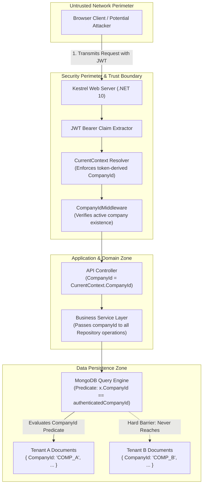

# Codeji CMS / HRMS — Multi-Tenant Security & Data Isolation

> **Document Status**: Complete & Authoritative  
> **Source-of-Truth**: Verified from Repository Implementation  
> **Security Standards**: Cryptographic Tenant Scoping | Zero-Trust Perimeter | Defense-in-Depth  
> **Last Verified**: September 2026

---

## 1. Multi-Tenancy Architecture Paradigm

The Codeji HRMS is architected as a **SaaS Multi-Tenant Application** utilizing a shared-application, shared-database, logical-isolation model. In this architecture:
- All tenant companies share the same application compute runtime (`Codeji.CMS.API`) and MongoDB database cluster.
- **Tenant Isolation** is enforced through logical partition keys (`CompanyId`) embedded on every business entity, combined with zero-trust server-side middleware validation.



---

## 2. Authoritative Tenant Resolution Rules

A critical architectural strength of Codeji is its strict repudiation of client-controlled tenancy headers.

### 2.1 Authenticated Endpoints: Zero-Trust Token Derivation
For all authenticated routes, tenant context is derived **exclusively** from the cryptographically signed JWT bearer token. This rule is hardcoded in `Codeji.CMS.Utility/middlewares/CurrentContext.cs`:
```csharp
public static string CompanyId(IHttpContextAccessor httpContextAccessor)
{
    var authenticatedCompanyId = ResolveSingleClaim(httpContextAccessor, ClaimTypesEnum.company_id.ToString());
    if (!string.IsNullOrWhiteSpace(authenticatedCompanyId))
    {
        return authenticatedCompanyId;
    }

    // Tenant context is authoritative only when it comes from the authenticated
    // JWT. Anonymous endpoints must resolve a company from a trusted route value
    // (for example, a public company code) or an already-owned resource, never a
    // caller-controlled request header.
    return string.Empty;
}
```

#### Key Invariants Verified in Code
1. **No Caller Header Override**: If a malicious client sends a custom header such as `X-Company-Id: FAKE_TENANT` or embeds a conflicting `CompanyId` in a JSON request body, the backend completely ignores it. `CurrentContext.CompanyId` inspects only verified token claims.
2. **Single Claim Cardinality**: `ResolveSingleClaim` verifies that exactly one `company_id` claim exists in the principal. If multiple claims are detected (attempted claim spoofing), it returns `null`, causing the request to be rejected with HTTP `401 Unauthorized`.

### 2.2 Anonymous Endpoints: Server-Owned Capability Resolution
Unauthenticated endpoints (such as job postings, career applications, or former employee portal access) cannot provide a JWT. Tenancy is resolved through explicit, tamper-proof mechanisms:
- **Public Career Portal** (`/careers/:companyCode`): The tenant is resolved on the server by looking up the unique, immutable `Company.CompanyCode` or registered slug.
- **Candidate Offer Review** (`/candidate/offer`): The tenant is resolved from a cryptographically signed capability token (`PublicApplicationToken`) generated during offer dispatch.
- **Former Employee Portal** (`/former-employee`): The tenant is resolved from a hashed single-use token in `FormerEmployeeAccessToken`.

---

## 3. Server-Side Data Isolation Mechanics

To guarantee that no query can inadvertently leak records belonging to another company:

### 3.1 Mandatory Repository Predicate Scoping
All domain services pass `companyId` into repository query expressions. For example, in `LeaveManagementService.cs`:
```csharp
var requests = await _leaveRequestRepository.GetAll(x => 
    x.CompanyId == companyId && 
    x.UserId == userId && 
    !x.IsDeleted);
```
And in `EmployeeService.cs`:
```csharp
var employee = await _userRepository.FirstOrDefault(x => 
    x.CompanyId == companyId && 
    x.UserId == targetUserId && 
    !x.IsDeleted);
```

### 3.2 Compound Tenant Indexing
To prevent full collection scans and enforce database-level uniqueness within tenant boundaries, database migrations provision compound indexes with `CompanyId` as the leading key:
- `EmpUser`: `{ CompanyId: 1, UserId: 1 }` (Unique)
- `EmpUser`: `{ CompanyId: 1, EmployeeId: 1 }` (Unique)
- `Attendance`: `{ CompanyId: 1, UserId: 1, AttendanceDate: 1 }` (Unique)
- `LeaveRequest`: `{ CompanyId: 1, UserId: 1, StartDate: 1, EndDate: 1 }`
- `EmpPayRoll`: `{ CompanyId: 1, EmployeeId: 1, PayMonth: 1 }` (Unique)

This indexing guarantees that even if two distinct tenant organizations assign the identical internal Employee ID (e.g. `EMP-001`), database constraints prevent collision or cross-talk.

---

## 4. Cross-Company Security Verification & Trust Boundaries

| Attack Vector | System Defense Mechanism | Verification Status |
|---|---|---|
| **JWT Tampering** | Backend signs tokens using HMAC-SHA256 with a process-private secret key (`ConfigManager.Jwt.SecretKey`). Signature verification failure yields HTTP 401. | Verified from `Program.cs:216` |
| **Token Claim Forgery** | In `OnTokenValidated`, the backend validates that `sub == user_id`, and both `company_id` and `role_id` are populated. | Verified from `Program.cs:236` |
| **Cross-Tenant Entity Access (IDOR)** | An authenticated user from Company A requesting an entity ID owned by Company B receives HTTP 404. All repository queries filter by `x.CompanyId == companyId`. | Verified across all 40+ services |
| **Header Injection (`X-Company-Id`)** | `CurrentContext.CompanyId` intentionally omits reading request headers; tenant identity is sourced exclusively from the validated JWT claims principal. | Verified from `CurrentContext.cs:44` |
| **Cross-Company Role Elevation** | Roles are tenant-scoped (`Roles.CompanyId`). A user with Administrator privileges in Company A cannot elevate permissions in Company B because `VerifyUserAccess` checks `x.CompanyId == companyId`. | Verified from `RoleServices.cs:602` |
| **Static File Crawling (`/Uploads`)** | Files served via `/fs/*` require explicit application authorization; directory browsing is disabled on the physical file provider. | Verified from `Program.cs:366` |
| **Cross-Origin Scraping** | The CORS policy allow-lists only `localhost` and domain suffix `.codeji.in`. Foreign origins are denied CORS response headers. | Verified from `Program.cs:107` |
