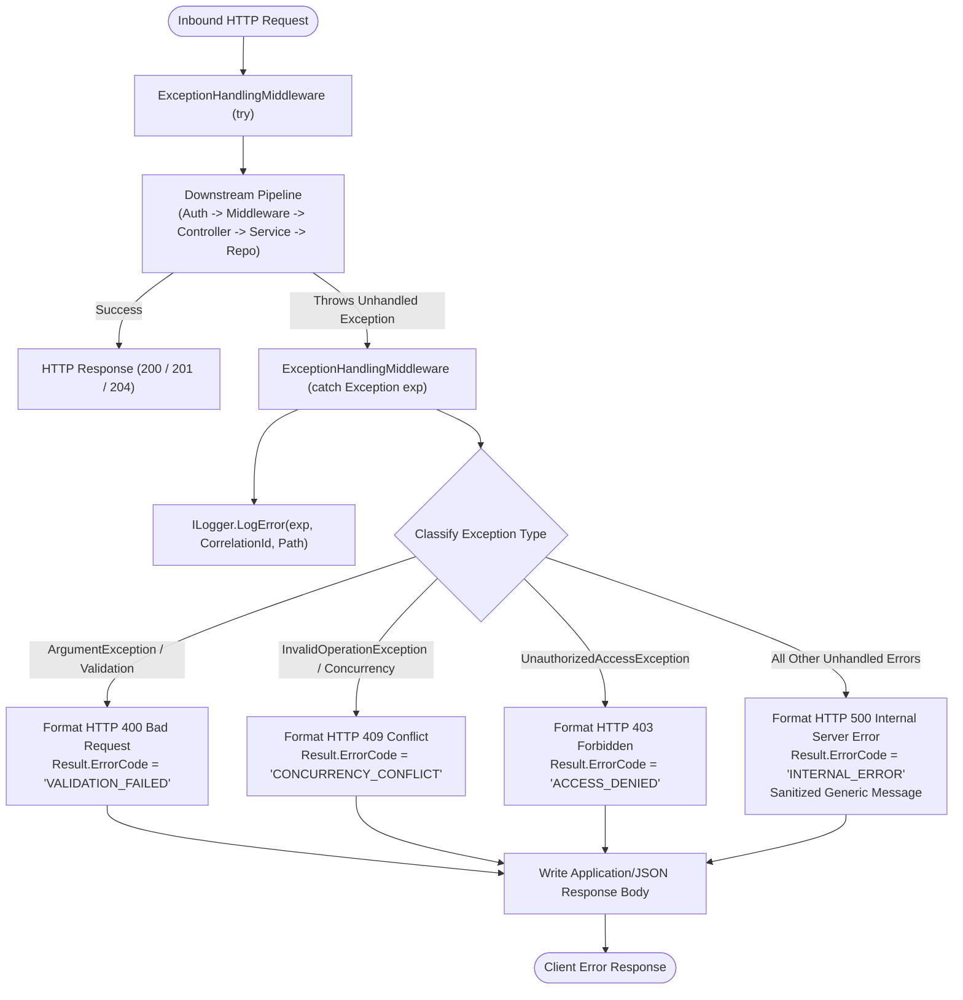

# Codeji CMS / HRMS — Error Handling & Resilience Architecture

> **Document Status**: Complete & Authoritative  
> **Source-of-Truth**: Verified from Repository Implementation  
> **Standards**: RFC 7807 Standardized Problem Responses | Standardized Result<T> Envelope | Client Toast Pipelines  
> **Last Verified**: September 2026

---

## 1. Unified Error Handling Philosophy

The Codeji HRMS platform enforces a zero-unhandled-exception philosophy across both frontend and backend systems. The error-handling architecture is engineered to guarantee:
1. **Security**: Unhandled runtime exceptions never leak internal database connection strings, BSON driver serialization details, or raw stack traces to client browsers.
2. **Predictable Client Contracts**: APIs return a standardized, uniform JSON envelope (`Result<T>`) indicating success, status code, error code, and localized message.
3. **Deterministic State Protection**: Invalid state transitions (e.g. attempting to approve a rejected leave, or generate payroll without a locked attendance month) fail fast with descriptive domain error codes and appropriate HTTP status codes.

---

## 2. Server-Side Exception Handling Architecture

The backend implements a centralized exception handling middleware registered as the very first component in the HTTP pipeline:



### 2.1 Standardized Response Envelope (`Result<T>`)
Source reference: `Codeji.CMS.Domain.Models.Result<T>`:
```csharp
public class Result<T>
{
    public bool Success { get; set; } = true;
    public int StatusCode { get; set; } = StatusCodes.Status200OK;
    public string? ErrorCode { get; set; }
    public string? Message { get; set; }
    public T? MethodResult { get; set; }
    public List<T>? MethodResults { get; set; }
    public int TotalRecords { get; set; }
}
```

#### Typical Client Error Response Payload
```json
{
  "success": false,
  "statusCode": 409,
  "errorCode": "CONCURRENCY_CONFLICT",
  "message": "Onboarding case was changed by another user.",
  "methodResult": null,
  "methodResults": null,
  "totalRecords": 0
}
```

---

## 3. Standard HTTP Status Code Mappings

The backend maps application outcomes to canonical HTTP status codes:

| HTTP Status Code | Standard Meaning | Usage within Codeji CMS / HRMS |
|---|---|---|
| **`200 OK`** | Success | Request succeeded. Response contains requested data in `methodResult` or `methodResults`. |
| **`400 Bad Request`** | Client Validation Error | Malformed request body, missing required fields (e.g. employee ID), or regex validation failure (e.g. invalid PAN number format). |
| **`401 Unauthorized`** | Authentication Failure | Missing or invalid Bearer token; expired JWT; or subject/user_id claim inconsistency. |
| **`403 Forbidden`** | Authorization Failure | Authenticated identity lacks required module permission in `RoleServices.VerifyUserAccess` ("Access Denied"). |
| **`404 Not Found`** | Resource Missing | Entity does not exist within the tenant company scope. |
| **`409 Conflict`** | State Machine / Concurrency Conflict | Optimistic concurrency version mismatch (`Version != expectedVersion`), or invalid state transition (e.g. re-approving a closed case). |
| **`426 Upgrade Required`** | Client Version Deprecation | Client `AppVersion` header mismatches `ConfigManager.AppSettings.AppVersion`. Client must reload. |
| **`429 Too Many Requests`** | Rate Limit Breached | Remote IP exceeded configured partition limits on sensitive endpoints (`career-sensitive`, `account-sensitive`). |
| **`500 Internal Server Error`** | Unhandled Infrastructure Failure | Sanitized system failure response; details logged to server console/file with correlation ID. |

---

## 4. Specialized Domain Error Codes

The platform defines structured string error codes to support granular client handling. For example, in `Codeji.CMS.Services.Recruitments.RecruitmentErrorCodes`:

| Error Code Constant | Numerical Status | Business Condition |
|---|---|---|
| `RecruitmentErrorCodes.InvalidRequest` | `400` | Mandatory payload parameter is null or empty. |
| `RecruitmentErrorCodes.InvalidTransition` | `409` | Lifecycle rule violated (e.g. closing an onboarding case while required tasks remain pending). |
| `RecruitmentErrorCodes.ConcurrencyConflict` | `409` | The document's integer `Version` changed in MongoDB while the client was editing. |
| `RecruitmentErrorCodes.DuplicateCandidate` | `409` | An applicant with the same email or phone already exists for the job vacancy. |
| `RecruitmentErrorCodes.PolicyViolation` | `422` | Proposed offer CTC exceeds the requisition budget limits. |

---

## 5. Client-Side Error Handling Pipeline (`CMS-React`)

The frontend application coordinates errors across three layers:
1. **Axios Response Interceptors (`src/server/axios.ts`)**:
   - Catches `401 Unauthorized`: Triggers automatic token refresh and transparent request re-issuance; redirects to `/auth` on refresh failure.
   - Catches `426 Upgrade Required`: Detects frontend version deprecation and triggers a window refresh.
2. **Global Toast Notification Provider (`ToastProvider.tsx` / `notify.ts`)**:
   - Automatically intercepts rejected TanStack Query mutations and displays user-friendly MUI snackbar alerts.
3. **React Error Boundaries (`src/app/modules/errors/ErrorsPage.tsx`)**:
   - Catches unhandled React component tree rendering exceptions, displaying graceful fallback views (`404 Not Found`, `500 Server Error`, `Unauthorized Access`) without unmounting the top navigation shell.
