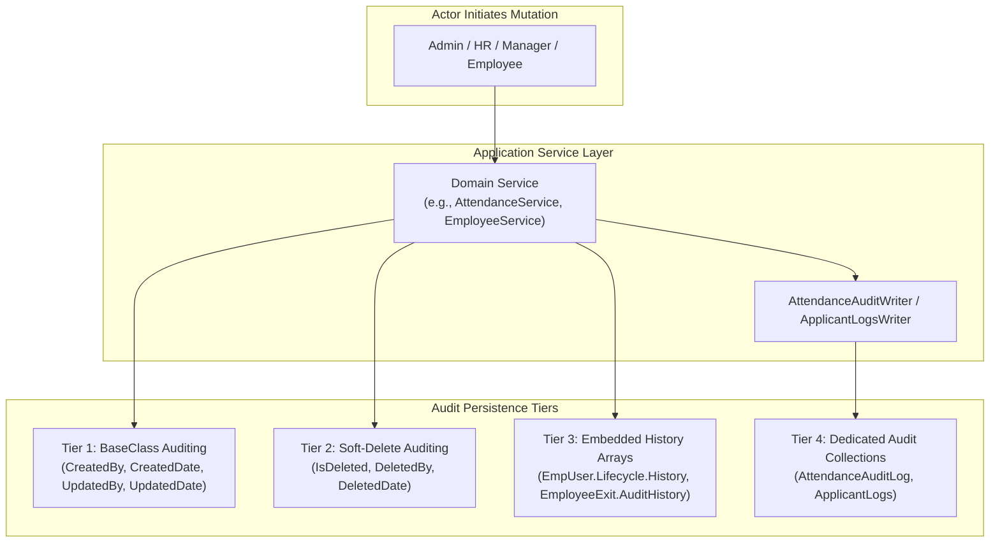

# Codeji CMS / HRMS — Audit & History Architecture

> **Document Status**: Complete & Authoritative  
> **Source-of-Truth**: Verified from Repository Implementation  
> **Audit Domains**: Entity Mutation Audits | Attendance Adjustments | ATS Logs | Separation Events | Compliance History  
> **Last Verified**: September 2026

---

## 1. Auditing Architecture & Principles

In human resource management, data mutation traceability is an absolute legal, financial, and operational requirement. Disputed terminations, retroactive salary revisions, and altered attendance punch records require rigorous, tamper-evident audit trails.

Codeji HRMS implements a multi-tiered auditing architecture:
1. **Pervasive Entity-Level Auditing**: Standardized tracking on every persistent document via `ISupportAuditing` and `ISupportSoftDelete`.
2. **Specialized Temporal Audit Collections**: Standalone collections recording operational events (e.g. `AttendanceAuditLog`, `ApplicantLogs`).
3. **Embedded Lifecycle History Arrays**: Append-only subdocument arrays tracking state transitions directly within parent documents (e.g. `EmpUser.Lifecycle.History`, `EmployeeExit.AuditHistory`).
4. **Structured Audit Exports**: Dedicated export services supporting statutory compliance reviews.



---

## 2. Pervasive Entity-Level Auditing (`BaseClass`)

Every persistent business entity derives from `BaseClass` in `Codeji.CMS.Repository.Entities`:
- `CreatedBy`: User ID of the initiating authenticated actor.
- `CreatedDate`: Timestamp of creation recorded in UTC.
- `UpdatedBy`: User ID of the most recent modifying actor.
- `UpdatedDate`: Timestamp of last mutation recorded in UTC.

### 2.1 Soft-Delete Auditing Protocol
To ensure data is never lost or unrecoverably destroyed:
- Direct database document deletion (`DeleteMany`, `Remove`) is prohibited for business records.
- Soft-delete marks `IsDeleted = true`, recording `DeletedDate = DateTime.UtcNow` and `DeletedBy = actorUserId`.
- All standard queries via `MongoRepository<T>` automatically append `!x.IsDeleted`, ensuring deactivated records remain invisible to standard UI operations while preserved for regulatory audits.

---

## 3. Dedicated Domain Audit Collections

### 3.1 Attendance Mutation Audit (`AttendanceAuditLog`)
- **Collection**: `AttendanceAuditLog`
- **Writer**: `Codeji.CMS.Services.Attendance.AttendanceAuditWriter`
- **Purpose**: Tracks every modification, punch override, or supervisor correction applied to an employee's daily attendance.
- **Fields Captured**:
  - `AttendanceId`, `CompanyId`, `UserId`, `AttendanceDate`
  - `ActionType`: `CHECK_IN_OVERRIDE`, `STATUS_CORRECTION`, `EXCEPTION_RESOLVED`
  - `OldStatus`, `NewStatus`
  - `OldTotalHours`, `NewTotalHours`
  - `ReasonText`, `PerformedByUserId`, `PerformedAtUtc`

### 3.2 Recruitment & Applicant Logs (`ApplicantLogs`)
- **Collection**: `ApplicantLogs`
- **Controller**: `ApplicantsController.cs` / `RecruitmentAuditController.cs`
- **Purpose**: Records all recruitment lifecycle interactions, candidate stage progressions, interviewer debriefs, and hiring decisions.
- **Fields Captured**:
  - `ApplicantId`, `JobVacancyId`, `CompanyId`
  - `PreviousStage`, `NewStage`
  - `ActionByUserId`, `ActionDateUtc`
  - `Remarks`, `ScorecardId`, `OfferId`

---

## 4. Embedded Lifecycle History Modeling

### 4.1 Employee Multi-Dimension Lifecycle History (`EmpUser.Lifecycle.History`)
Rather than relying on separate disconnected tables, `EmpUser` maintains an embedded array of status transitions:
```csharp
public sealed class EmployeeLifecycleStatusHistory
{
    public string Dimension { get; set; } = string.Empty; // e.g. "EmploymentStatus", "AvailabilityStatus"
    public string PreviousValue { get; set; } = string.Empty;
    public string NewValue { get; set; } = string.Empty;
    public string? ReasonCode { get; set; } // e.g. "RECRUITMENT_ONBOARDING_COMPLETED", "PROBATION_CONFIRMED"
    public string? Reason { get; set; }
    public DateTime EffectiveFromUtc { get; set; } = DateTime.UtcNow;
    public DateTime? EffectiveToUtc { get; set; }
    public DateTime? ExpectedReturnDate { get; set; }
    public string ChangedBy { get; set; } = string.Empty;
    public DateTime ChangedAtUtc { get; set; } = DateTime.UtcNow;
}
```

### 4.2 Separation Audit History (`EmployeeExit.AuditHistory`)
Every separation case (`EmployeeExit`) maintains an append-only audit trail:
- Captures resignation submission timestamp and resignation letter attachment URL.
- Records manager review remarks, proposed LWD adjustments, and discussion messages (`EmployeeExitDiscussionMessage`).
- Records clearance sign-offs across IT, Assets, Finance, and HR with individual reviewer timestamps.

---

## 5. Compliance, Reporting & Audit Exports

### 5.1 Recruitment Audit Export Service (`RecruitmentAuditExportService`)
- Implemented in `Codeji.CMS.Services.Recruitments.RecruitmentAuditExportService`.
- Exposes administrative endpoints to export comprehensive hiring histories for equal opportunity compliance and recruitment process reviews.
- Outputs structured Excel / CSV data detailing candidate application dates, rejection reasons, interview ratings, and offer acceptance timelines.

### 5.2 Payroll Audit Integrity
- AutoPayroll runs enforce historical immutability: once `EmpPayRoll.IsProcessed == true`, the record cannot be edited.
- Every processed payslip records the source divisor policy, locked monthly attendance summary ID, Loss-of-Pay days breakdown, and exact calculating timestamp.
