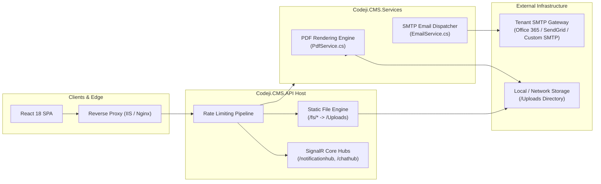

# Codeji CMS / HRMS — Integration Architecture

> **Document Status**: Complete & Authoritative  
> **Source-of-Truth**: Verified from Repository Implementation  
> **Integrations**: SignalR WebSockets | SMTP Email Gateway | PDF Generation Engine | Static File Streaming | Reverse Proxy  
> **Last Verified**: September 2026

---

## 1. Integration Topology Overview

The Codeji HRMS platform is architected to interface cleanly with both internal subsystem dependencies and external edge network services:



---

## 2. Real-Time SignalR WebSockets Integration

### 2.1 Hub Protocols & Wire Configuration
SignalR is integrated natively via ASP.NET Core SignalR in `Program.cs`:
- **Transports**: Restricted to **WebSockets** (`HttpTransportType.WebSockets`) for maximum performance and low memory overhead. Long polling and server-sent events are disabled.
- **Buffer Thresholds**:
  - `ApplicationMaxBufferSize = 6,000,000` (6 MB)
  - `TransportMaxBufferSize = 6,000,000` (6 MB)
  - `MaximumReceiveMessageSize = 64 * 1024` (64 KB)
- **Hub Endpoints**:
  - `app.MapHub<NotificationHub>("/notificationhub")`
  - `app.MapHub<ChatHub>("/chathub")`

### 2.2 In-App Presence Tracking (`IEmployeePresenceService`)
- Implemented as a singleton in `EmployeePresenceService.cs`.
- Tracks active WebSocket client connections associated with each `UserId`.
- Used by dashboard widgets and chat components to display online/offline status indicators.

---

## 3. PDF Rendering & Document Generation Engine (`PdfService`)

The generation of official enterprise documents (e.g. monthly payslips, offer letters, experience certificates) is managed by `PdfService.cs`:

### 3.1 Template Compilation Workflow
1. **HTML/CSS Template Sourcing**:
   - Templates reside in `Templates/SalarySlipTemplate.html`.
   - Supports CSS `@media print` rules, custom company logos, and tabular earnings/deductions breakdowns.
2. **Dynamic Variable Interpolation**:
   - Injects company details, employee name, PAN, UAN, Bank Account number, attendance summaries (P, HD, LOP days).
   - Injects mathematical currency calculations formatted as both numeric Indian Rupees (`₹`) and English words (via `IndianCurrencyWords.ToWords`).
3. **Byte Stream Delivery**:
   - Output is generated in-memory as a byte array (`byte[]`).
   - Delivered directly via controller file streams with `Content-Disposition: attachment; filename="Payslip_Month_Year.pdf"` and exposed via CORS headers (`Response.Headers.Append("Access-Control-Expose-Headers", "Content-Disposition")`).

---

## 4. Static File Storage & Streaming (`/fs/*`)

Employee resumes, uploaded certificates, resignation letters, and company branding assets are served through a secured static file provider:

### 4.1 Storage Directory Governance
- Root physical storage is configured in `Uploads/`.
- Startup verification in `Program.cs` ensures directory existence:
  ```csharp
  string uploadsPath = Path.Combine(Directory.GetCurrentDirectory(), "Uploads");
  if (!Directory.Exists(uploadsPath)) Directory.CreateDirectory(uploadsPath);
  ```

### 4.2 Static File CORS & Security Headers
Because ASP.NET Core's `UseStaticFiles` is terminal middleware, standard CORS middleware cannot attach response headers to static file requests. Codeji resolves this by configuring an explicit `OnPrepareResponse` hook:
```csharp
app.UseStaticFiles(new StaticFileOptions
{
    FileProvider = new PhysicalFileProvider(uploadsPath),
    RequestPath = new PathString("/fs"),
    OnPrepareResponse = ctx =>
    {
        var origin = ctx.Context.Request.Headers.Origin.ToString();
        if (string.IsNullOrEmpty(origin)) return;
        try
        {
            var host = new Uri(origin).Host;
            if (host == "localhost" || host.EndsWith(".codeji.in"))
            {
                ctx.Context.Response.Headers["Access-Control-Allow-Origin"] = origin;
                ctx.Context.Response.Headers["Access-Control-Allow-Credentials"] = "true";
                ctx.Context.Response.Headers["Vary"] = "Origin";
            }
        }
        catch (UriFormatException) { }
    }
});
```

---

## 5. SMTP Email Integration (`EmailService.cs`)

### 5.1 Architecture & Tenant Configuration
Outbound emails (e.g. candidate application acknowledgments, interview invites, password resets, exit notices) are routed through `IEmailService` in `Codeji.CMS.Services/Registration/EmailService.cs`.
- **Tenant-Scoped SMTP**: Supports custom tenant SMTP server configurations stored in `CompanyEmailSettings` (Host, Port, Username, Encrypted Password, SSL toggle, Sender Display Name).
- **Template System**: Integrates with `MailTemplate` documents stored in MongoDB, supporting dynamic token replacement (e.g. `{CandidateName}`, `{JobTitle}`, `{InterviewDate}`).

---

## 6. Reverse Proxy & Network Ingress Integration

When deployed behind enterprise reverse proxies (such as IIS, Nginx, or AWS ALB):
- **Forwarded Headers**: Configured via `ForwardedHeadersOptions` in `Program.cs:142`:
  - `ForwardedHeaders.XForwardedFor`
  - `ForwardedHeaders.XForwardedHost`
  - `ForwardedHeaders.XForwardedProto`
- **Trusted Proxies Verification**: Enforces `KnownProxies` populated strictly from `builder.Configuration.GetSection("ReverseProxy:TrustedProxies")`. Unconfigured reverse proxies are rejected, preventing client IP spoofing attacks against the RateLimiter partitions.
