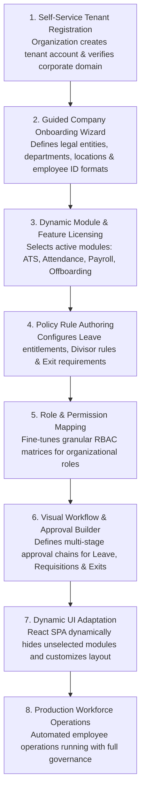
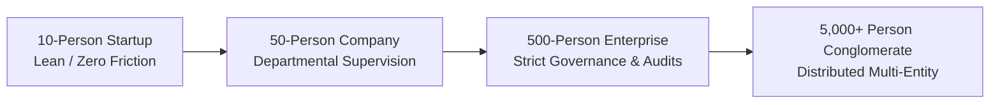

# Codeji CMS / HRMS — Future Product & Technical Roadmap

> **Document Status**: Complete & Authoritative  
> **Source-of-Truth**: Inferred Architectural Evolution & Industry Best Practices  
> **Vision**: Modular Multi-Tier SaaS HRIS for Global Enterprises  
> **Last Verified**: September 2026

---

## 1. The Strategic Product Vision

The long-term engineering vision for **Codeji HRMS** is to evolve from an internal enterprise workforce management platform into a **Self-Service, Modular SaaS Operating System**. Under this model, prospective tenant organizations can dynamically provision an environment, select licensed modules, author company policies, configure approval workflows, and have the React UI dynamically adapt without modifying core application code:

---

## 2. Scalability Across Organizational Growth Stages

A major strength of the Codeji architecture is its adaptability across diverse organization sizes. The platform can scale smoothly across four primary operating models:

### 2.1 Stage 1: 10-Employee Startup (Lean Operations)
- **Operational Need**: Minimal overhead, rapid onboarding, simple lump-sum leave grants, calendar-day payroll.
- **Architectural Adaptation**:
  - Auto-approval of leave and WFH requests (bypassing manager review tiers).
  - Single Company-Wide baseline policy for Leave, Notice Period (e.g. 15 days), and Attendance.
  - Absence of rigid shift boundaries (Grace period set to 120 minutes).

### 2.2 Stage 2: 50-Employee Growing Business (Departmental Routing)
- **Operational Need**: Hierarchical reporting, team attendance visibility, departmental budgets.
- **Architectural Adaptation**:
  - Activation of `ReportingManager` approval workflows for Leave and WFH.
  - Introduction of Department-specific Leave policies (e.g. Sales team travel vs. Engineering).
  - Monthly attendance summaries reviewed by managers prior to payroll lock.

### 2.3 Stage 3: 500-Employee Mid-Market Enterprise (Strict Governance)
- **Operational Need**: Multiple office locations, shift rosters, automated late-arrival penalties, locked payroll cycles, multi-department separation clearances.
- **Architectural Adaptation**:
  - Multi-location office schedules (`CompanyOfficeLocations`, `CompanyOfficeSchedule`).
  - Active enforcement of `AttendancePenaltyPolicy` and automated monthly locks (`AttendanceMonthLock`).
  - Formal multi-stage clearance templates: IT, Facilities, Finance, and HR sign-offs before FnF settlement.
  - Transactional outbox workers scaling on dedicated background compute nodes.

### 2.4 Stage 4: 5,000+ Employee Multi-Entity Conglomerate
- **Operational Need**: Multi-subsidiary corporate hierarchies, shared service centers, high-throughput biometric punch streams, multi-currency payroll.
- **Architectural Adaptation**:
  - Sharded MongoDB cluster partitioned by `CompanyId`.
  - MongoDB Change Streams replacing polling outbox workers.
  - Dedicated Redis distributed cache cluster for session tokens and permission sets.
  - IoT edge connectors syncing biometric hardware punches directly to `AttendanceDaySegment`.

---

## 3. Four-Phase Technical Delivery Roadmap

### Phase 1: Performance, Concurrency & Micro-Modularization (Near-Term)
- **Decomposition of Monolithic Classes**:
  - Split `EmployeeService.cs` (364 KB) into `EmployeeProfileService`, `EmployeeLifecycleService`, and `EmployeeSeparationService`.
  - Split `UserController.cs` (51.5 KB) into focused domain controllers.
- **Native MongoDB Multi-Document Transactions**:
  - Enforce `IClientSessionHandle` transactions across critical multi-collection operations in `AutoPayrollServices` and `EmployeeExit`.
- **Database Cursor Streaming**:
  - Replace in-memory list buffering in AutoPayroll with `IAsyncCursor` chunked processing.

### Phase 2: Enterprise Integration & Hardware Connectivity
- **Biometric IoT Hardware Gateway**:
  - Standardized REST/MQTT webhook receiver allowing on-premise biometric fingerprint/facial recognition punch machines to push attendance events into `AttendanceModel`.
- **Enterprise Messaging Connectors**:
  - Slack & Microsoft Teams bot integrations for one-click leave approvals, daily punch reminders, and celebratory notices.
- **Financial & ERP Export Hub**:
  - Direct journal entry export formatted for SAP, Oracle NetSuite, and QuickBooks accounting ledgers.

### Phase 3: AI-Assisted Workforce Intelligence
- **Intelligent ATS Resume Parsing**:
  - Deep-learning resume extraction pipeline automatically populating candidate work history, education, and skill tags.
- **Predictive Attrition Risk Scoring**:
  - Machine learning models analyzing attendance anomalies, frequent late arrivals, and leave patterns to alert HR to potential flight risks.
- **Automated Shift Optimization**:
  - Algorithmic shift scheduling matching employee availability with historical workload demands.

### Phase 4: Global Multi-Jurisdiction Expansion
- **Multi-Country Statutory Engines**:
  - Plug-in tax calculation modules supporting US (W-2 / 1099, FICA), UK (PAYE, National Insurance), and UAE (Gratuity, WPS) statutory payrolls.
- **Multi-Currency Compensation**:
  - Multi-currency salary definitions with automated exchange rate conversion and international wire export formats (SWIFT / ISO 20022).
