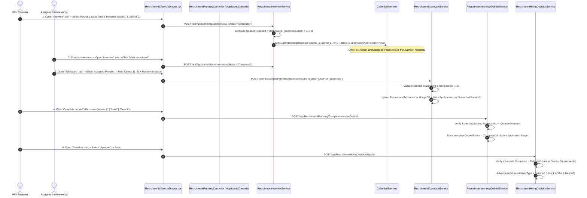

# 22. Recruitment Module Edge Cases & Interviewer Scorecard Architecture Report

## 1. Executive Summary

This report provides a comprehensive technical and architectural analysis of:
1. **How Interviewer Scoring, Quorum Calculation, Debriefs, and Hiring Decisions work end-to-end** across `CMS-Backend-Core` (`.NET` / MongoDB) and `CMS-React` (`React` / TypeScript).
2. **All Recruitment Lifecycle Edge Cases (`REC-EDGE-01` through `REC-EDGE-12`)**, including multi-panelist quorum rules, HR-assisted vs. direct panelist scoring, calendar privacy isolation, draft-to-submitted scorecard upgrades, multi-round sequential locks, and offer counter-negotiation loops.

---

## 2. End-to-End Flow: How an Interviewer Scores & How It Gets Saved

### Step-by-Step Lifecycle Sequence

---

### Detailed Breakdown of Each Phase in the Scoring Flow

#### Phase 1: Scheduling the Interview & Computing Panel Quorum
- **Where**: [`RecruitmentInterviewService.cs`](../../CMS-Backend-Core/Codeji.CMS.Services/Recruitments/RecruitmentInterviewService.cs) (`Upsert`)
- **What Happens**:
  1. Validates that every user ID in `command.PanelistUserIds` (up to 12 panelists) is an **active employee (`EmpUser.Status == true`)** in the current `CompanyId`.
  2. Automatically calculates the **panel quorum**:
     $$\text{QuorumRequired} = \max\left(1, \left\lfloor \frac{\text{Panelists.Length} + 1}{2} \right\rfloor\right)$$
     - 1 panelist $\rightarrow$ Quorum = **1 scorecard**
     - 2 panelists $\rightarrow$ Quorum = **1 scorecard**
     - 3 panelists $\rightarrow$ Quorum = **2 scorecards**
     - 4 panelists $\rightarrow$ Quorum = **2 scorecards**
  3. **Sequential Multi-Round Gate**: If scheduling **Round $N$ ($N > 1$)**, the service checks rounds $1 \dots N-1$. If any prior round is not `Completed` with `DebriefStatus == "Complete"`, it blocks scheduling Round $N$ with `409 Conflict` (`"Complete and debrief interview round {round} before scheduling round {N}"`).
  4. **Private Calendar Sync**: Calls `SyncCalendar`, creating/updating a `CalendarEntity` with `RestrictToTargetUsersAndHrAdmin = true` and `TargetUserIds` containing only the panelists and organizer—ensuring regular employees never see the interview on `/calendar`.

---

#### Phase 2: Entering & Saving the Scorecard (`Draft` $\rightarrow$ `Submitted` $\rightarrow$ `Locked`)
- **Where**: [`RecruitmentLifecycleDrawer.tsx`](../../CMS-React/src/app/modules/recruitment/applications/components/RecruitmentLifecycleDrawer.tsx) (`mode === "scorecard"`) $\rightarrow$ [`RecruitmentScorecardService.cs`](../../CMS-Backend-Core/Codeji.CMS.Services/Recruitments/RecruitmentScorecardService.cs) (`Upsert`)
- **What Gets Validated & Saved**:
  1. **Panelist Attribution (`ReviewerUserId`)**:
     - If an assigned panelist is logged in, their `userId` is automatically selected in the **Assigned interviewer / panelist** dropdown.
     - If an HR Manager or Administrator is entering feedback on behalf of an interviewer from a live panel debrief, they can select the specific assigned panelist from the **Assigned interviewer / panelist** dropdown.
  2. **Criterion Ratings (`1` to `5`) & Evidence Notes**:
     - Up to **20 custom criteria** per scorecard (e.g., `Technical assessment`, `System design`, `Problem solving`).
     - Every criterion must have a non-empty `Name` and an integer rating $r \in [1, 5]$, plus optional `Notes / evidence`.
  3. **Structured Recommendation & Automatic Debrief Alignment**:
     - Selecting `Recommendation` (`Strong Hire`, `Hire`, `Hold`, `No Hire`) automatically aligns the default `Debrief decision`:
       - `Strong Hire` / `Hire` $\rightarrow$ `Advance`
       - `Hold` $\rightarrow$ `Hold`
       - `No Hire` $\rightarrow$ `Reject`
  4. **State Machine (`RecruitmentScorecardStatus`)**:
     - `Draft`: Saved in MongoDB (`RecruitmentScorecard` collection) so the interviewer can revise their notes later. Does **not** count toward debrief quorum yet.
     - `Submitted`: Counts toward the interview's `QuorumRequired` and writes an immutable audit entry (`EventType = "ScorecardUpdated"`) in `ApplicantLogs`.
     - `Locked`: Freezes the scorecard permanently so neither criteria nor ratings can be altered after final sign-off.
  5. **Idempotent Upsert by `(CompanyId, ApplicantId, RoundNumber, ReviewerUserId)`**:
     - Clicking a card under **Saved scores by round (click to load/edit)** loads that panelist's existing scorecard so transitioning from `Draft` $\rightarrow$ `Submitted` $\rightarrow$ `Locked` updates the existing document (`Version + 1`) rather than creating duplicate records.

---

#### Phase 3: Completing the Interview Debrief
- **Where**: [`RecruitmentInterviewDebriefService.cs`](../../CMS-Backend-Core/Codeji.CMS.Services/Recruitments/RecruitmentInterviewDebriefService.cs) (`Complete`)
- **What Happens**:
  1. Queries all `RecruitmentScorecard` documents for `(CompanyId, InterviewId)` where `Status` is `Submitted` or `Locked`.
  2. Deduplicates by `ReviewerUserId` and verifies:
     $$\text{SubmittedScorecardsCount} \ge \text{Interview.QuorumRequired}$$
     If fewer scorecards have been submitted than `QuorumRequired`, it returns `409 Conflict` (`"Debrief requires X submitted interviewer scorecard(s); Y available."`).
  3. Marks `interview.Status = "Completed"`, `interview.DebriefStatus = "Complete"`, `interview.DebriefDecision = command.Decision` (`Advance`, `Hold`, or `Reject`), and records `DebriefedByUserId` + `DebriefedAtUtc`.
  4. Updates the canonical `RecruitmentJobApplication.CurrentStage` (`Advance -> Shortlisted`, `Hold -> OnHold`, `Reject -> Rejected`) and appends a `StageHistory` audit event.

---

#### Phase 4: Unlocking the Final Hiring Decision
- **Where**: [`RecruitmentHiringDecisionService.cs`](../../CMS-Backend-Core/Codeji.CMS.Services/Recruitments/RecruitmentHiringDecisionService.cs) (`Upsert`)
- **What Happens**:
  - When `requireInterviewBeforeDecision` is enabled (`Standard` / `Enterprise` mode), `RecruitmentHiringDecisionService.Upsert` verifies:
    1. At least 1 interview round exists (`allInterviews.Count > 0`).
    2. Every scheduled interview round has `Status == "Completed"` and `DebriefStatus == "Complete"`.
    3. Every round has at least one `Submitted`/`Locked` scorecard.
  - Once verified, saving `Decision = "Approve"` transitions `Applicant.ActivityType` to `Selected`, unlocking the **Offer** and **Employee Handoff** stages.

---

## 3. Comprehensive Catalog of Recruitment Edge Cases & How They Are Handled

| ID | Edge Case Scenario | Potential Failure Mode in Naive ATS | How Our System Handles & Resolves It |
| :--- | :--- | :--- | :--- |
| **`REC-EDGE-01`** | **HR Recording Scorecard for a Technical Panelist** | HR schedules an interview for `emp-tech-1`. When HR opens the Scorecard tab to log `emp-tech-1`'s feedback, `actorUserId` is HR's ID, which is not in `PanelistUserIds`. | **Resolved**: `RecruitmentLifecycleDrawer.tsx` provides an **Assigned interviewer / panelist** selector populated from `round.panelistUserIds`, and `RecruitmentScorecardService.cs` allows the interview creator / Admin / HR to submit or update scorecards attributed to the assigned panelist. |
| **`REC-EDGE-02`** | **Draft $\rightarrow$ Submitted Scorecard Upgrade** | Interviewer saves a `Draft` scorecard during the call, then clicks Save again with `Submitted`. Because a new `idempotencyKey` is generated on the second click, a naive lookup by `idempotencyKey` inserts a 2nd scorecard instead of updating the `Draft`. | **Resolved**: `RecruitmentScorecardService.Upsert` resolves existing scorecards by `(CompanyId, ApplicantId, RoundNumber, ReviewerUserId)` when `ScorecardId` is omitted, cleanly upgrading `Draft -> Submitted -> Locked` on the same document with optimistic concurrency (`Version + 1`). |
| **`REC-EDGE-03`** | **Multi-Criterion Notes Overwrite** | Having a global `Notes` input bound to `criteria[0].notes` alongside per-criterion `Notes` inputs overwrites Criterion 1's evidence when adding Criterion 2 or 3. | **Resolved**: Removed the duplicate trailing `Notes` input in `RecruitmentLifecycleDrawer.tsx` so each criterion (`criteria[0..19]`) preserves its own independent `rating` and `notes`. |
| **`REC-EDGE-04`** | **Multi-Panelist Split Vote & Quorum Gate** | A 3-person panel (`emp-1`, `emp-2`, `emp-3`) is scheduled. Only 1 panelist submits a scorecard and someone tries to complete the debrief. | **Resolved**: `RecruitmentInterviewService` sets `QuorumRequired = 2` ($\lfloor (3+1)/2 \rfloor$). `RecruitmentInterviewDebriefService` blocks debrief completion (`409 Conflict`) until at least 2 distinct assigned panelists submit scorecards. |
| **`REC-EDGE-05`** | **Scheduling Round 2 Before Round 1 Is Debriefed** | A recruiter tries to schedule Round 2 (System Design) while Round 1 (Coding) is still `Scheduled` or missing its debrief. | **Resolved**: `RecruitmentInterviewService.Upsert` enforces sequential round gating (`for round = 1..RoundNumber-1`), returning `409 Conflict` until all prior rounds are `Completed` and `DebriefStatus == Complete`. |
| **`REC-EDGE-06`** | **Calendar Privacy Leak to All Employees** | Syncing an interview to the company calendar exposes candidate names and interview times to every employee in the company. | **Resolved**: `RecruitmentInterviewService.SyncCalendar` sets `RestrictToTargetUsersAndHrAdmin = true` and `TargetUserIds = PanelistUserIds`. `CalendarServices.GetAllCalendarItems` and `Calendar.tsx` filter out interview events for everyone except **HR, Admin, and the assigned Panelists**. |
| **`REC-EDGE-07`** | **Candidate Placed `OnHold` After Debrief or Screening** | A strong candidate is put `OnHold` while another finalist is evaluated. Later, the first finalist declines and HR wants to `Approve` the `OnHold` candidate. | **Resolved**: Both `RecruitmentPipelineRules.AllowedTransitions` and `RecruitmentHiringDecisionService.Upsert` allow `OnHold -> Shortlisted / InProgress / Selected / Rejected` so `OnHold` candidates can be resumed and hired at any time. |
| **`REC-EDGE-08`** | **Candidate Applies to Multiple Job Openings (`VacancyId`)** | A candidate rejected for "Senior Backend Engineer" applies 2 months later to "Full-Stack Engineer" using the same email address. | **Resolved**: When `allowMultiVacancyApplications` is enabled (default `true`), `ApplicantServices.RegisterApplicants` scopes duplicate email checks to `!ap.IsDeleted && ap.VacancyId == model.VacancyId`, blocking duplicate submissions to the *same* vacancy while allowing applications to *new* vacancies. |
| **`REC-EDGE-09`** | **Duplicate Candidate Profiles Merged Mid-Pipeline** | A candidate applied twice with two different emails (`personal@` and `work@`). Round 1 scorecard was logged on Profile A, and HR merges Profile A into Profile B. | **Resolved**: `RecruitmentEnterpriseService.MigrateApplicantReferences` atomically migrates all **9 collections** (`offers`, `interviews`, `scorecards`, `notes`, `screeningReviews`, `hiringDecisions`, `onboardingCases`, `applications`, and `preboardingCases`) from source to target applicant and deduplicates analytics. |
| **`REC-EDGE-10`** | **Counter-Offer Negotiation & Offer Versioning** | A candidate receives a `Sent` offer of `12,00,000 INR` and requests `14,00,000 INR`. | **Resolved**: `RecruitmentOfferNegotiationService` logs the `RecruitmentOfferCounterRequest`, creates an immutable `RecruitmentOfferVersion` (`v2`) with recalculated `TotalCtc`, and preserves the full revision history in the `Offer negotiation` drawer tab. |
| **`REC-EDGE-11`** | **Startup Fast-Track vs. Enterprise Compliance Mode** | A 10-person startup wants to hire an engineer immediately after 1 founder chat without filling out scorecards, approval references, or preboarding checklists. | **Resolved**: Switching `/recruitment-settings` to `Simple (Startup & Agile)` disables `requireInterviewBeforeDecision`, `offerApproval`, and `requirePreboardingBeforeHandoff`, enabling direct `New -> Selected -> Offer Accepted -> Employee Handoff` in seconds. |
| **`REC-EDGE-12`** | **Downstream Employee Creation / Activation Retry** | During Onboarding completion, the employee activation call experiences a transient error. | **Resolved**: `RecruitmentOnboardingService` records the onboarding case state and exposes `RetryOnboardingActivation` (`Retry activation` button in the `Onboarding` drawer tab) with idempotency protection so HR can re-trigger employee activation without creating duplicate `EmpUser` records. |

