# CODEJI CMS / HRMS — COMPLETE SYSTEM ARCHITECTURE & PRODUCT REFERENCE BOOK (`CODEJI-HRMS-COMPLETE-SYSTEM-DOCUMENTATION.md`)

> **Document Classification**: Master Technical Architecture, Domain Model, Workflow & Product Reference  
> **Source of Truth**: Verified directly from `CMS-Backend-Core` (`.NET 10 / ASP.NET Core / MongoDB`) and `CMS-React` (`React 18 / TypeScript / Vite / MUI / Redux Toolkit / TanStack Query`)  
> **Repository Root**: `c:\Users\User 2\CMS`

---

## TABLE OF CONTENTS

1. [Part I — Executive Summary & Product Vision](#part-i--executive-summary--product-vision)
2. [Part II — Repository Structure & Engineering Organization](#part-ii--repository-structure--engineering-organization)
3. [Part III — End-to-End System Architecture & Request Pipeline](#part-iii--end-to-end-system-architecture--request-pipeline)
4. [Part IV — Database Architecture, Auditing & Optimistic Concurrency](#part-iv--database-architecture-auditing--optimistic-concurrency)
5. [Part V — Authentication, Multi-Tenant Isolation & RBAC Security](#part-v--authentication-multi-tenant-isolation--rbac-security)
6. [Part VI — Hierarchical Policy & Configuration Engine](#part-vi--hierarchical-policy--configuration-engine)
7. [Part VII — The 7-Dimensional Employee Lifecycle Engine](#part-vii--the-7-dimensional-employee-lifecycle-engine)
8. [Part VIII — Talent Acquisition, Preboarding & Onboarding](#part-viii--talent-acquisition-preboarding--onboarding)
9. [Part IX — Workforce Time, Attendance, Shifts, Leave, WFH & Calendar](#part-ix--workforce-time-attendance-shifts-leave-wfh--calendar)
10. [Part X — Compensation, Salary Structure & Automated Payroll Engine](#part-x--compensation-salary-structure--automated-payroll-engine)
11. [Part XI — Offboarding, Multi-Department Clearance, FnF & Alumni Portal](#part-xi--offboarding-multi-department-clearance-fnf--alumni-portal)
12. [Part XII — Real-Time Notifications, Chat & Transactional Outbox](#part-xii--real-time-notifications-chat--transactional-outbox)
13. [Part XIII — Complete Documentation Package Index](#part-xiii--complete-documentation-package-index)

---

## PART I — EXECUTIVE SUMMARY & PRODUCT VISION

**Codeji CMS / HRMS** is an enterprise-grade, multi-tenant Human Resource Management System engineered to unify the complete employee lifecycle—from candidate sourcing and token-gated preboarding to daily attendance status calculation, policy-driven leave accrual, automated monthly payroll with PDF payslip rendering, multi-department exit clearance, Full & Final (`FnF`) settlement reconciliation, and post-employment alumni self-service.

### Core Architectural Differentiators
1. **7-Dimensional Orthogonal Employee Lifecycle (`EmployeeLifecycle.cs`)**: Replaces brittle single-column status strings with 7 independent state dimensions (`EmploymentStatus`, `AvailabilityStatus`, `AccountStatus`, `PayrollStatus`, `OffboardingStatus`, `FormerPortalStatus`, `AlumniStatus`).
2. **Hard Pre-Payroll Safety Gates (`AttendanceMonthLock` & `AttendancePayrollException`)**: Prevents payroll corruption by blocking `AutoPayrollServices` until all monthly `LHD`/`ED` threshold exceptions are resolved (`APPROVED` or `WAIVED`) and the attendance month is explicitly locked.
3. **3-Tier Scoped Policy Resolution (`OffboardingPolicyResolver`)**: Dynamically resolves organizational rules with deterministic specificity (**Exact Department $\rightarrow$ Exact Role $\rightarrow$ Company Default**) and freezes an immutable `EmployeeExitPolicySnapshot` onto in-flight records.
4. **Dual-Realm Security Model**: Enforces strict JWT + `AppVersion` (`426 Upgrade Required`) + `CompanyIdMiddleware` RBAC for active staff while offering a dedicated, SHA-256 token-hashed **Former Employee Portal** (`PublicFormerEmployeePortalController`) for separated alumni.

---

## PART II — REPOSITORY STRUCTURE & ENGINEERING ORGANIZATION

```text
CMS/
├── CMS-Backend-Core/                  # .NET 10 (net10.0) Modular Layered Backend
│   ├── Codeji.CMS.API/                # HTTP Controllers, Middleware, SignalR Hubs, Templates, Program.cs
│   ├── Codeji.CMS.Services/           # Domain Services, Policy Resolvers, Hosted Background Workers
│   ├── Codeji.CMS.Repository/         # MongoDbContext, MongoRepository<T>, 50+ Domain Entities
│   ├── Codeji.CMS.DTO/                # Request/Response Contracts & Validation Attributes
│   ├── Codeji.CMS.Migrations/         # Database Seeders & Schema Backfill Migrations
│   └── Codeji.CMS.Utility/            # Cryptographic Helpers, Constants, Shared Extensions
│
├── CMS-React/                         # React 18 + TypeScript + Vite SPA Frontend
│   └── src/
│       ├── app/
│       │   ├── modules/               # Feature Modules (auth, employees, attendance, leave, payroll, offboarding...)
│       │   ├── Redux/                 # Redux Toolkit Global State Slices
│       │   ├── query/                 # TanStack Query Data Fetching & Cache Hooks
│       │   └── routing/               # Protected Routes, Role Guards & Public Portal Routes
│       └── server/
│           └── axios.ts               # Axios Client with AppVersion Header & 401 Refresh Queue
│
└── docs/project-documentation/        # This 63-File Master Architecture & Module Documentation Package
```

---

## PART III — END-TO-END SYSTEM ARCHITECTURE & REQUEST PIPELINE

Every API request traversing `CMS-Backend-Core` passes through a strictly ordered middleware pipeline configured in `Program.cs`:

```mermaid
flowchart LR
    Client["React 18 SPA\n(Axios + AppVersion Header)"] --> MW1["1. ExceptionHandlingMiddleware\n(Global Try/Catch -> Structured JSON)"]
    MW1 --> MW2["2. UseCors('codeji') &\nUseStaticFiles('/fs')"]
    MW2 --> MW3["3. UseRateLimiter"]
    MW3 --> MW4["4. UseAuthentication\n(JWT Bearer Validation:\nsub == user_id, company_id, role_id)"]
    MW4 --> MW5["5. AntiforgeryMiddleware\n- Checks AppVersion Header (426 if mismatch)\n- Calls CompanyIdMiddleware.AuthenticateUserRequest"]
    MW5 --> MW6["6. CompanyIdMiddleware\n- Verifies Active Company\n- Verifies Active EmpUser\n- Evaluates [ModulePermissionAttribute]\nvia RoleServices.VerifyUserAccess"]
    MW6 --> Ctrl["7. API Controller"]
    Ctrl --> Svc["8. Domain Service & Policy Engine"]
    Svc --> Repo["9. MongoRepository<TEntity>\n(Auto-filters !IsDeleted, increments Version)"]
    Repo --> DB[("10. MongoDB")]
```



---

## PART IV — DATABASE ARCHITECTURE, AUDITING & OPTIMISTIC CONCURRENCY

- **Collection Mapping**: `MongoDbContext.GetCollection<TEntity>(typeof(TEntity).Name)` maps each C# entity class to its dedicated MongoDB collection.
- **Soft-Delete Enforcement**: `MongoRepository<TEntity>` automatically applies `!x.IsDeleted` predicates across standard queries so deleted records never leak into operational calculations.
- **Automatic Auditing & Optimistic Locking (`ISupportAuditing`)**:
  - Tracks `CreatedBy`, `CreatedDate`, `UpdatedBy`, `UpdatedDate`.
  - Maintains an integer `Version` field incremented on every update to prevent lost updates under concurrent modifications.

---

## PART V — AUTHENTICATION, MULTI-TENANT ISOLATION & RBAC SECURITY

1. **JWT Claims**: Tokens embed `sub` / `user_id`, `company_id`, and `role_id`.
2. **Client Refresh Queue (`src/server/axios.ts`)**: When an access token expires (`401`), concurrent requests are queued in memory while a single `POST /api/auth/refresh` call rotates the `RefreshToken` and replays all queued requests seamlessly.
3. **Granular RBAC (`[ModulePermissionAttribute]`)**: Controllers declare module and action requirements (e.g., `[ModulePermission("payroll", "approve")]`), evaluated dynamically against the user's `Role` permission matrix in `RoleServices.VerifyUserAccess`.
4. **Strict Tenant Isolation**: `CompanyId` is extracted exclusively from the verified JWT claim inside `CompanyIdMiddleware`—never trusted from client query strings or body payloads.

---

## PART VI — HIERARCHICAL POLICY & CONFIGURATION ENGINE

Organizational rules are governed by 5 specialized policy engines:
1. **`EmployeeLifecyclePolicy`**: Governs `ProbationDays` and onboarding transition requirements.
2. **`CompanyOfficeSchedule`**: Governs `StartTime`, `EndTime`, `GraceMinutes`, `CheckInAllowedUntil`, `CheckOutAllowedFrom`, and `HalfDayThresholdHours`.
3. **`AttendancePenaltyPolicy`**: Governs `CombinedLhdEdMonthlyLimit` and automated `AttendancePayrollException` creation.
4. **`LeavePolicy`**: Governs annual quota, accrual rate, carry-forward caps, encashability (`IsEncashable`), `AllowOnProbation`, and `AllowDuringNoticePeriod`.
5. **`PayrollDivisorPolicy` & `EmployeeExitPolicy`**: Governs daily rate divisor modes (`FIXED_30_DAYS`, `WORKING_DAYS`, `CALENDAR_DAYS`) and 3-tier scoped exit rules (`Department -> Role -> Company`).

---

## PART VII — THE 7-DIMENSIONAL EMPLOYEE LIFECYCLE ENGINE

Implemented in `EmployeeLifecycle.cs` and orchestrated by `EmployeeLifecycleService.cs`:

| Dimension | Enum Values | Operational Purpose |
|---|---|---|
| **1. `EmploymentStatus`** | `Preboarding (0)`, `Onboarding (1)`, `Probation (2)`, `Active (3)`, `NoticePeriod (4)`, `Separated (5)`, `Withdrawn (6)` | Primary contractual employment state; controls leave & notice rules. |
| **2. `AvailabilityStatus`** | `Available`, `OnLeave`, `Remote`, `Unavailable` | Real-time daily scheduling & calendar presence. |
| **3. `AccountStatus`** | `PendingActivation`, `Active`, `Suspended`, `Deactivated` | Controls internal JWT login permission (`EmpUser.IsActive`). |
| **4. `PayrollStatus`** | `PendingSetup`, `Eligible`, `OnHold`, `FinalSettlementPending`, `FinalSettlementCompleted` | Controls inclusion in `AutoPayrollServices` vs `EmployeeFinalSettlement`. |
| **5. `OffboardingStatus`** | `None (0)`, `Initiated (1)`, `NoticePeriod (2)`, `ClearanceInProgress (3)`, `ReadyForSettlement (4)`, `Completed (5)` | Tracks multi-departmental exit progress. |
| **6. `FormerPortalStatus`** | `Disabled`, `Enabled`, `Expired`, `Revoked` | Controls access to `/former-employee` via `FormerEmployeeAccessToken`. |
| **7. `AlumniStatus`** | `NotApplicable`, `Eligible`, `Ineligible`, `Rejoined` | Governs boomerang re-hire eligibility (`EmployeeRejoinRecord`). |

---

## PART VIII — TALENT ACQUISITION, PREBOARDING & ONBOARDING

- **Recruitment (`RECRUITMENT.md`)**: Manages `JobPosition`, `Applicant` Kanban pipelines, multi-round interviews, `ApplicantLogs` audit trails, `RecruitmentAuditExportService` CSV exports, and `JobOffer` generation.
- **Preboarding (`PREBOARDING.md`)**: Provides candidates with a token-secured portal to accept offers and upload `PreboardingDocument` KYC files for HR verification before Day 1.
- **Onboarding (`ONBOARDING.md`)**: Converts verified candidates into `EmpUser` records, initializes the 7-dimensional `EmployeeLifecycle` (`EmploymentStatus = Probation`), and sets `ProbationEndDateUtc`.

---

## PART IX — WORKFORCE TIME, ATTENDANCE, SHIFTS, LEAVE, WFH & CALENDAR

### Daily Attendance Classification Formula (`AttendanceStatusCalculationService.cs`)
Given effective shift schedule (`StartTime`, `EndTime`, `CheckInAllowedUntil = StartTime + GraceMinutes`, `CheckOutAllowedFrom`, `HalfDayThresholdHours`):
- If worked hours $< \text{HalfDayThresholdHours} \rightarrow \mathbf{HD}$ (Half Day)
- Otherwise evaluate:
  - $\text{isLate} = (\text{CheckInTime} > \text{CheckInAllowedUntil})$
  - $\text{isEarly} = (\text{CheckOutTime} < \text{CheckOutAllowedFrom})$
  - `!isLate && !isEarly` $\rightarrow \mathbf{P}$ (Present)
  - `isLate && !isEarly` $\rightarrow \mathbf{LHD}$ (Late Half Day)
  - `!isLate && isEarly` $\rightarrow \mathbf{ED}$ (Early Departure)
  - `isLate && isEarly` $\rightarrow \mathbf{LHD+ED}$ (Combined Late + Early)

### Monthly Penalty & Lock Gate (`AttendancePenaltyService.cs`)
- If $(\text{LhdCount} + \text{EdCount} + \text{LhdEdCount}) > \text{CombinedLhdEdMonthlyLimit}$, creates an `AttendancePayrollException` (`Status = "PENDING_REVIEW"`).
- `AttendanceMonthLock.ValidateAndLock()` blocks month locking until **zero** `PENDING_REVIEW` exceptions remain.

---

## PART X — COMPENSATION, SALARY STRUCTURE & AUTOMATED PAYROLL ENGINE

### Automated Payroll Formula (`AutoPayrollServices.cs`)
1. **Gate Check**: Verifies period is open, `MonthlyAttendanceSummary.IsApproved && IsLocked == true`, and zero `PENDING_REVIEW` exceptions exist.
2. **Divisor Resolution (`PayrollCalculationRules.ResolveDivisor`)**:
   - `FIXED_30_DAYS` $\rightarrow 30$
   - `WORKING_DAYS` $\rightarrow \text{CompanyWorkingCalendarService.GetWorkingDaysInMonth}(Y, M)$
   - `CALENDAR_DAYS` $\rightarrow \text{DateTime.DaysInMonth}(Y, M)$
3. **Earnings & Deductions**:
   $$\text{GrossPay} = \text{BasicPay} + \text{HRA} + \text{LTA} + \text{Bonus} + \text{OtherAllowance}$$
   $$\text{TotalLossOfPayDays} = \text{UnpaidDays} + \text{ApprovedPenaltyDays}$$
   $$\text{LossOfPayDeduction} = \text{TotalLossOfPayDays} \times \left(\frac{\text{GrossPay}}{\text{Divisor}}\right)$$
   $$\text{TotalDeduction} = \text{LossOfPayDeduction} + \text{EPF} + \text{ESIC} + \text{HealthInsurance} + \text{IncomeTax}$$
   $$\text{NetSalary} = \text{GrossPay} - \text{TotalDeduction}$$
4. **Payslip PDF Rendering**: Compiles `Templates/SalarySlipTemplate.html` via `PdfService` into `/fs/salary-slips/{id}.pdf`.

---

## PART XI — OFFBOARDING, MULTI-DEPARTMENT CLEARANCE, FNF & ALUMNI PORTAL

1. **Policy Snapshot (`OffboardingPolicyResolver.cs`)**: Resolves `EmployeeExitPolicy` (`Department -> Role -> Company`) and freezes `EmployeeExitPolicySnapshot` on `EmployeeExit`.
2. **Multi-Department Clearances**: Tracks IT, Finance, Admin, Manager, and HR sign-offs (`EmployeeExitClearanceTemplate`), knowledge transfer (`EmployeeExitHandoverItem`), physical hardware returns & damage deductions (`EmployeeExitAsset`), benefit terminations (`EmployeeExitBenefitItem`), and `EmployeeExitInterview`.
3. **Full & Final Settlement (`EmployeeFinalSettlement.cs`)**:
   $$\text{NetPayable} = (\text{SalaryPayable}_{\text{SourcePayrollId}} + \text{LeaveEncashment} + \text{Reimbursements} + \text{Bonuses}) - (\text{Deductions} + \text{NoticeRecovery} + \text{OutstandingDues})$$
   - classifies `Direction` as `PayableToEmployee`, `ReceivableFromEmployee`, or `ZeroSettlement`.
4. **Exit Completion & Former Employee Portal (`PublicFormerEmployeePortalController.cs`)**:
   - Deactivates `EmpUser.IsActive`, revokes all `RefreshToken` sessions, creates `EmployeeExitAttendanceCutoff`, enqueues `EmployeeExitOutbox`, and issues a SHA-256 hashed `FormerEmployeeAccessToken` for `/former-employee`.

---

## PART XII — REAL-TIME NOTIFICATIONS, CHAT & TRANSACTIONAL OUTBOX

- **SignalR Real-Time Hubs**: `NotificationHub` (`/notificationHub`) and `ChatHub` (`/chatHub`) push instant WebSocket events to authenticated clients.
- **Background Hosted Services**:
  - `LeaveAccrualHostedService`: Executes scheduled leave balance accruals.
  - `AttendanceReminderHostedService`: Dispatches check-in/out reminders (`AttendanceReminderDispatchLog`).
  - `EmployeeExitOutboxProcessor`: Guarantees asynchronous delivery of exit notifications and alumni access links.

---

## PART XIII — COMPLETE DOCUMENTATION PACKAGE INDEX

### Core Architecture & Governance Chapters (`docs/project-documentation/`)
- [00-EXECUTIVE-SUMMARY.md](file:///c:/Users/User%202/CMS/docs/project-documentation/00-EXECUTIVE-SUMMARY.md)
- [01-PROJECT-OVERVIEW.md](file:///c:/Users/User%202/CMS/docs/project-documentation/01-PROJECT-OVERVIEW.md)
- [02-REPOSITORY-ARCHITECTURE.md](file:///c:/Users/User%202/CMS/docs/project-documentation/02-REPOSITORY-ARCHITECTURE.md)
- [03-SYSTEM-ARCHITECTURE.md](file:///c:/Users/User%202/CMS/docs/project-documentation/03-SYSTEM-ARCHITECTURE.md)
- [04-DATABASE-ARCHITECTURE.md](file:///c:/Users/User%202/CMS/docs/project-documentation/04-DATABASE-ARCHITECTURE.md)
- [05-AUTHENTICATION-AUTHORIZATION.md](file:///c:/Users/User%202/CMS/docs/project-documentation/05-AUTHENTICATION-AUTHORIZATION.md)
- [06-ROLE-PERMISSION-MODEL.md](file:///c:/Users/User%202/CMS/docs/project-documentation/06-ROLE-PERMISSION-MODEL.md)
- [07-POLICY-CONFIGURATION-ENGINE.md](file:///c:/Users/User%202/CMS/docs/project-documentation/07-POLICY-CONFIGURATION-ENGINE.md)
- [08-MODULE-DEPENDENCY-MAP.md](file:///c:/Users/User%202/CMS/docs/project-documentation/08-MODULE-DEPENDENCY-MAP.md)
- [09-CROSS-MODULE-WORKFLOWS.md](file:///c:/Users/User%202/CMS/docs/project-documentation/09-CROSS-MODULE-WORKFLOWS.md)
- [10-NOTIFICATION-ARCHITECTURE.md](file:///c:/Users/User%202/CMS/docs/project-documentation/10-NOTIFICATION-ARCHITECTURE.md)
- [11-TENANT-SECURITY.md](file:///c:/Users/User%202/CMS/docs/project-documentation/11-TENANT-SECURITY.md)
- [12-ERROR-HANDLING.md](file:///c:/Users/User%202/CMS/docs/project-documentation/12-ERROR-HANDLING.md)
- [13-AUDIT-AND-HISTORY.md](file:///c:/Users/User%202/CMS/docs/project-documentation/13-AUDIT-AND-HISTORY.md)
- [14-INTEGRATION-ARCHITECTURE.md](file:///c:/Users/User%202/CMS/docs/project-documentation/14-INTEGRATION-ARCHITECTURE.md)
- [15-PRODUCTION-READINESS.md](file:///c:/Users/User%202/CMS/docs/project-documentation/15-PRODUCTION-READINESS.md)
- [16-FUTURE-ROADMAP.md](file:///c:/Users/User%202/CMS/docs/project-documentation/16-FUTURE-ROADMAP.md)
- [17-PRESENTATION-SUMMARY.md](file:///c:/Users/User%202/CMS/docs/project-documentation/17-PRESENTATION-SUMMARY.md)
- [18-PROPOSAL-SUMMARY.md](file:///c:/Users/User%202/CMS/docs/project-documentation/18-PROPOSAL-SUMMARY.md)
- [SOURCE-TRACEABILITY.md](file:///c:/Users/User%202/CMS/docs/project-documentation/SOURCE-TRACEABILITY.md)
- [UNVERIFIED-AREAS.md](file:///c:/Users/User%202/CMS/docs/project-documentation/UNVERIFIED-AREAS.md)

### Module Deep-Dives (`docs/project-documentation/modules/`)
- [ADMIN.md](file:///c:/Users/User%202/CMS/docs/project-documentation/modules/ADMIN.md) | [COMPANY-SETTINGS.md](file:///c:/Users/User%202/CMS/docs/project-documentation/modules/COMPANY-SETTINGS.md) | [EMPLOYEE.md](file:///c:/Users/User%202/CMS/docs/project-documentation/modules/EMPLOYEE.md) | [EMPLOYEE-PROFILE.md](file:///c:/Users/User%202/CMS/docs/project-documentation/modules/EMPLOYEE-PROFILE.md) | [RECRUITMENT.md](file:///c:/Users/User%202/CMS/docs/project-documentation/modules/RECRUITMENT.md) | [PREBOARDING.md](file:///c:/Users/User%202/CMS/docs/project-documentation/modules/PREBOARDING.md) | [ONBOARDING.md](file:///c:/Users/User%202/CMS/docs/project-documentation/modules/ONBOARDING.md) | [PROBATION.md](file:///c:/Users/User%202/CMS/docs/project-documentation/modules/PROBATION.md) | [ATTENDANCE.md](file:///c:/Users/User%202/CMS/docs/project-documentation/modules/ATTENDANCE.md) | [WORK-SHIFT.md](file:///c:/Users/User%202/CMS/docs/project-documentation/modules/WORK-SHIFT.md) | [LEAVE.md](file:///c:/Users/User%202/CMS/docs/project-documentation/modules/LEAVE.md) | [WFH.md](file:///c:/Users/User%202/CMS/docs/project-documentation/modules/WFH.md) | [HOLIDAY.md](file:///c:/Users/User%202/CMS/docs/project-documentation/modules/HOLIDAY.md) | [CALENDAR.md](file:///c:/Users/User%202/CMS/docs/project-documentation/modules/CALENDAR.md) | [PAYROLL.md](file:///c:/Users/User%202/CMS/docs/project-documentation/modules/PAYROLL.md) | [PAYROLL-SETTINGS.md](file:///c:/Users/User%202/CMS/docs/project-documentation/modules/PAYROLL-SETTINGS.md) | [SALARY.md](file:///c:/Users/User%202/CMS/docs/project-documentation/modules/SALARY.md) | [BENEFITS.md](file:///c:/Users/User%202/CMS/docs/project-documentation/modules/BENEFITS.md) | [NOTICE-PERIOD.md](file:///c:/Users/User%202/CMS/docs/project-documentation/modules/NOTICE-PERIOD.md) | [OFFBOARDING.md](file:///c:/Users/User%202/CMS/docs/project-documentation/modules/OFFBOARDING.md) | [FINAL-SETTLEMENT.md](file:///c:/Users/User%202/CMS/docs/project-documentation/modules/FINAL-SETTLEMENT.md) | [ASSET-MANAGEMENT.md](file:///c:/Users/User%202/CMS/docs/project-documentation/modules/ASSET-MANAGEMENT.md) | [DOCUMENTS.md](file:///c:/Users/User%202/CMS/docs/project-documentation/modules/DOCUMENTS.md) | [NOTIFICATIONS.md](file:///c:/Users/User%202/CMS/docs/project-documentation/modules/NOTIFICATIONS.md) | [ROLE-PERMISSION.md](file:///c:/Users/User%202/CMS/docs/project-documentation/modules/ROLE-PERMISSION.md) | [POLICY.md](file:///c:/Users/User%202/CMS/docs/project-documentation/modules/POLICY.md) | [REPORTING.md](file:///c:/Users/User%202/CMS/docs/project-documentation/modules/REPORTING.md) | [ANALYTICS.md](file:///c:/Users/User%202/CMS/docs/project-documentation/modules/ANALYTICS.md) | [AUDIT.md](file:///c:/Users/User%202/CMS/docs/project-documentation/modules/AUDIT.md) | [SETTINGS.md](file:///c:/Users/User%202/CMS/docs/project-documentation/modules/SETTINGS.md)

### Architectural Diagrams (`docs/project-documentation/diagrams/`)
- [SYSTEM-CONTEXT.md](file:///c:/Users/User%202/CMS/docs/project-documentation/diagrams/SYSTEM-CONTEXT.md) | [MODULE-DEPENDENCIES.md](file:///c:/Users/User%202/CMS/docs/project-documentation/diagrams/MODULE-DEPENDENCIES.md) | [EMPLOYEE-LIFECYCLE.md](file:///c:/Users/User%202/CMS/docs/project-documentation/diagrams/EMPLOYEE-LIFECYCLE.md) | [REQUEST-FLOW.md](file:///c:/Users/User%202/CMS/docs/project-documentation/diagrams/REQUEST-FLOW.md) | [DATABASE-RELATIONSHIPS.md](file:///c:/Users/User%202/CMS/docs/project-documentation/diagrams/DATABASE-RELATIONSHIPS.md) | [AUTHORIZATION-FLOW.md](file:///c:/Users/User%202/CMS/docs/project-documentation/diagrams/AUTHORIZATION-FLOW.md) | [PAYROLL-FLOW.md](file:///c:/Users/User%202/CMS/docs/project-documentation/diagrams/PAYROLL-FLOW.md) | [ATTENDANCE-FLOW.md](file:///c:/Users/User%202/CMS/docs/project-documentation/diagrams/ATTENDANCE-FLOW.md) | [ONBOARDING-FLOW.md](file:///c:/Users/User%202/CMS/docs/project-documentation/diagrams/ONBOARDING-FLOW.md) | [OFFBOARDING-FLOW.md](file:///c:/Users/User%202/CMS/docs/project-documentation/diagrams/OFFBOARDING-FLOW.md) | [RECRUITMENT-FLOW.md](file:///c:/Users/User%202/CMS/docs/project-documentation/diagrams/RECRUITMENT-FLOW.md)
