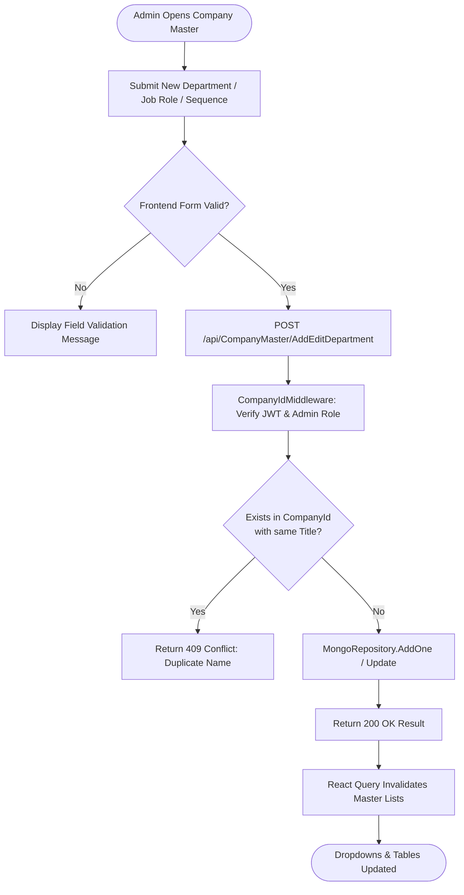
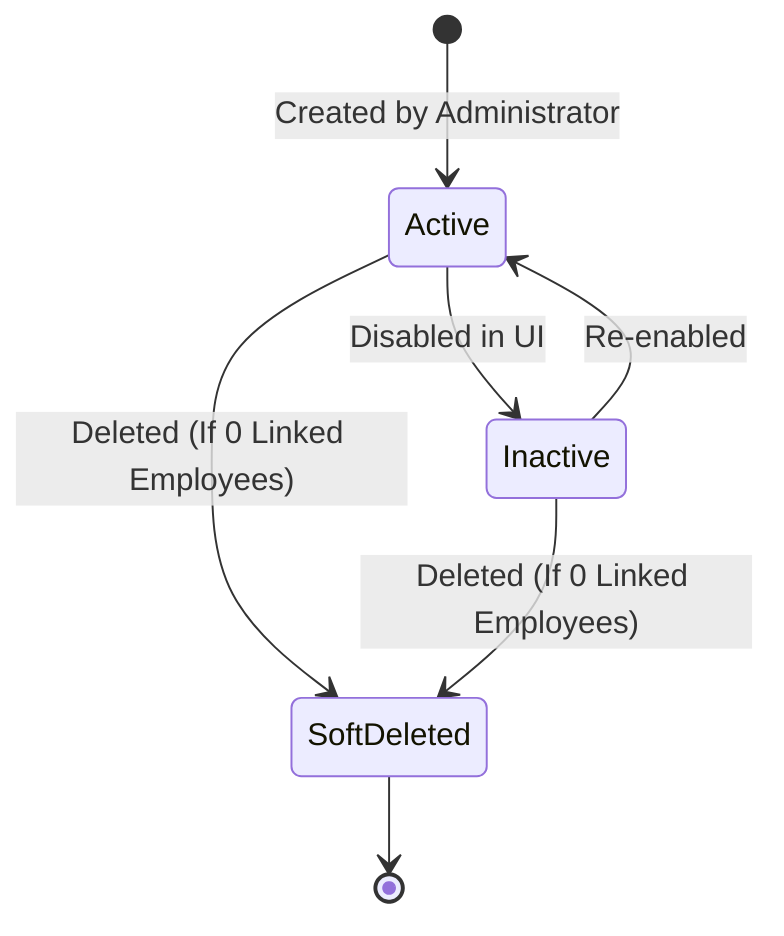

# Module Documentation — Company Administration & Master Data (`ADMIN`)

> **Document Status**: Complete & Authoritative  
> **Source-of-Truth**: Verified from Repository Implementation  
> **Primary Controllers**: `CompanyMasterController.cs`, `CompanyController.cs`  
> **Primary Services**: `CompanyMasterService.cs`, `CompanyService.cs`, `DefaultCompanySeeds.cs`  
> **Last Verified**: September 2026

---

## 1. Module Overview

- **What the module is**: The foundational administrative configuration suite governing the structural taxonomy of a tenant organization. It manages Departments, Job Roles/Designations, Office Locations, Working Days, Custom Employee Attributes, and Employee ID Sequence formatting.
- **Why HR organizations need it**: Every downstream HR process (hiring a candidate into a department, assigning a shift by location, generating sequential employee codes, or routing leave requests to a department manager) depends on standardized master entities.
- **What business problem it solves**: Eliminates free-text departmental typos, inconsistent designation titles, and manual employee ID numbering collisions across concurrent HR administrators.
- **Who uses it**: Exclusively **Company Administrators** (`Roles.Administrator`).
- **Where it fits in the HR lifecycle**: Stage 0 (Foundational Tenant Provisioning)—executed immediately upon company registration before employees or job vacancies are created.

---

## 2. Real-World Business Scenario

```text
Company: Codeji Technologies Pvt Ltd
Administrator: Vikram Mehta (Company Administrator)
Scenario: Opening a new R&D Center in Bengaluru
```
1. Vikram navigates to `/admin/companymaster`.
2. **Office Location**: Creates a new location `Bengaluru R&D Hub` with full street address and timezone `Asia/Kolkata`.
3. **Department**: Creates a new department `Artificial Intelligence & ML`.
4. **Job Roles**: Adds three designations linked to the department: `Principal AI Architect`, `ML Engineer II`, and `Data Annotator`.
5. **Working Days**: Configures Monday through Friday as working days (`IsWorking: true`) and Saturday/Sunday as weekly offs.
6. **Employee ID Sequence**: Configures prefix `CJ-BLR-` with zero-padding `4` (producing `CJ-BLR-0001`, `CJ-BLR-0002` automatically upon onboarding).

---

## 3. Supported Actors

| Actor | Capabilities in Module | Server Enforcement |
|---|---|---|
| **Company Administrator** | Full CRUD over Departments, Job Roles, Office Locations, Working Days, Custom Attributes, and ID Sequences. | Enforced via `ProtectedRoute adminOnly={true}` and backend `[Authorize(Policy = "AdminOnly")]` / `RoleServices`. |
| **HR Manager / Executive**| Read-only consumption of master lists (e.g. selecting departments in dropdowns during employee creation). | Cannot mutate master entities; write endpoints reject non-admin roles with HTTP 403. |
| **Employee** | Views own assigned department, designation, and location on profile. | No access to `/admin/*` routes. |

---

## 4. Frontend Implementation

| File | Responsibility | Calls | Used By |
|---|---|---|---|
| `src/app/modules/admin/adminRoutes.tsx` | Defines sub-routes `/admin/roles`, `/admin/companymaster/*`, `/admin/companydetails/*`. | React Router `<Outlet />` | `PrivateRoutes.tsx` |
| `src/app/modules/admin/companymaster/CompanyMaster.tsx` | Tabbed container hosting Department, Job Role, Location, Working Days, Custom Attributes, and ID Sequence sub-panels. | `companyMasterServices.ts` | `adminRoutes.tsx` |
| `src/app/modules/admin/companydetails/CompanyDetails.tsx` | Manages legal entity name, corporate logo upload, PAN/TAN/GST details, and SMTP email settings. | `companyServices.ts` | `adminRoutes.tsx` |

---

## 5. Backend Implementation

| Backend File | Responsibility | Dependencies |
|---|---|---|
| `Codeji.CMS.API/Controllers/CompanyMasterController.cs` | REST endpoints for managing Departments, Job Roles, Locations, Working Days, and Custom Attributes. | `ICompanyMasterService`, `IHttpContextAccessor` |
| `Codeji.CMS.API/Controllers/CompanyController.cs` | Manages company registration, profile updates, logo uploads, and employee ID sequences. | `ICompanyService`, `IMongoDbRepository<Company>` |
| `Codeji.CMS.Services/Companies/CompanyMasterService.cs` | Business validation, duplicate name checks within tenant, and soft-deletion guards (preventing deletion of departments with active employees). | `IMongoDbRepository<Department>`, `IMongoDbRepository<CompanyJobRole>` |
| `Codeji.CMS.Services/Companies/DefaultCompanySeeds.cs` | Seeds initial departments, roles, working days, and default templates when a new company registers. | `IMongoDatabase` |

---

## 6. API Documentation

| Method | URL | Purpose | Auth / Permission | Request DTO | Validation & Business Logic | Response |
|---|---|---|---|---|---|---|
| `POST` | `/api/CompanyMaster/AddEditDepartment` | Creates or updates a tenant department. | `[Authorize]` + Admin | `DepartmentDto` | Checks unique department title per `CompanyId` (case-insensitive). | `Result<string>` |
| `GET` | `/api/CompanyMaster/GetAllDepartments` | Lists active departments for dropdowns and tables. | `[Authorize]` | Query Params | Filters by `x.CompanyId == companyId && !x.IsDeleted`. | `Result<DepartmentDto>` |
| `DELETE` | `/api/CompanyMaster/DeleteDepartment/{id}`| Soft-deletes a department. | `[Authorize]` + Admin | Route `id` | Verifies zero active `EmpUser` records reference this department before setting `IsDeleted = true`. | `Result` |
| `POST` | `/api/CompanyMaster/AddEditJobRole` | Creates or edits a job designation mapped to a department. | `[Authorize]` + Admin | `JobRoleDto` | Validates parent `DepartmentId` exists in tenant. | `Result<string>` |
| `POST` | `/api/CompanyMaster/SaveOfficeLocation` | Saves physical office location details. | `[Authorize]` + Admin | `OfficeLocationDto`| Validates address fields and unique location name. | `Result` |
| `POST` | `/api/Company/SaveEmployeeIdSequence` | Configures prefix, suffix, and starting counter for Employee IDs. | `[Authorize]` + Admin | `EmployeeIdSequenceDto` | Ensures sequence format does not collide with existing `EmpUser.EmployeeId` values. | `Result` |

---

## 7. Database Model

### Entities
1. **`Department`** (`Codeji.CMS.Repository.Entities.Company.Department`)
   - **Primary Key**: `DepartmentId`
   - **Foreign Keys**: `CompanyId`
   - **Important Fields**: `DepartmentTitle` (Multilingual dictionary), `Description`, `IsActive`, `IsDeleted`.
2. **`CompanyJobRole`** (`Codeji.CMS.Repository.Entities.Company.CompanyJobRole`)
   - **Primary Key**: `JobRoleId`
   - **Foreign Keys**: `CompanyId`, `DepartmentId`
   - **Important Fields**: `JobRoleTitle` (Multilingual dictionary), `Level`, `IsDeleted`.
3. **`CompanyOfficeLocations`** (`Codeji.CMS.Repository.Entities.Company.CompanyOfficeLocations`)
   - **Primary Key**: `LocationId`
   - **Foreign Keys**: `CompanyId`
   - **Important Fields**: `LocationName`, `AddressLine1`, `City`, `State`, `Country`, `ZipCode`, `IsHeadOffice`.
4. **`EmployeeIdSequence`** (`Codeji.CMS.Repository.Entities.Employees.EmployeeIdSequence`)
   - **Primary Key**: `SequenceId`
   - **Foreign Keys**: `CompanyId`
   - **Important Fields**: `Prefix`, `CurrentNumber`, `PaddingLength`, `Separator`.

---

## 8. Business Rules

- **Business Rule**: A department or job role cannot be deleted if one or more active employees (`EmpUser.IsDeleted == false && EmpUser.Status == true`) are currently assigned to it.
- **Validation Rule**: Department and Job Role names must be unique within the same `CompanyId`.
- **Permission Rule**: Only users with `RoleType == Administrator` can create, update, or delete Company Master entities.
- **Security Rule**: `CompanyId` is never accepted from the client request payload; it is overwritten using `CurrentContext.CompanyId`.

---

## 9. Complete Workflow



---

## 10. State Machine

Master entities follow a binary lifecycle state machine:


---

## 11. Permissions

| Action | Admin | HR Manager | Reporting Manager | Employee |
|---|:---:|:---:|:---:|:---:|
| View Master Lists (Dropdowns) | Yes | Yes | Yes | Yes |
| Access `/admin/companymaster` UI | Yes | No | No | No |
| Create / Edit Department & Job Role | Yes | No | No | No |
| Delete Master Record | Yes | No | No | No |
| Configure Employee ID Sequence | Yes | No | No | No |

---

## 12. Dependencies

- **Depends On**: `Company` registration and `Roles` initialization.
- **Used By**: `Employees`, `Recruitment`, `LeavePolicy`, `EmployeeExitPolicy`, `Attendance`.
- **Reads From**: `Company`, `EmpUser` (for referential integrity checks on delete).
- **Writes To**: `Department`, `CompanyJobRole`, `CompanyOfficeLocations`, `CompanyWorkingDays`, `CompanyCustomAttributes`, `EmployeeIdSequence`.

---

## 13. Cross-Module Events

- Creating a new company triggers `DefaultCompanySeeds.SeedAsync()`, which populates default departments (`Engineering`, `Human Resources`, `Sales`, `Finance`), default roles, and default working days (`Monday`–`Friday`).
- Updating `CompanyWorkingDays` immediately affects `CompanyWorkingCalendarService`, altering working day counts in downstream `Leave` and `AutoPayroll` divisor calculations.

---

## 14. Failure Scenarios

- **Referential Integrity Block**: Attempting to delete a Department that still has active employees returns a validation failure explaining that employees must be reassigned first.
- **Concurrent Sequence Generation**: Handled via atomic MongoDB `FindOneAndUpdateAsync` increment on `EmployeeIdSequence.CurrentNumber` to guarantee no two employees receive the same `EmployeeId`.

---

## 15. Edge Cases

- **Multilingual Title Resolution**: `DepartmentTitle` and `JobRoleTitle` are stored as `Dictionary<string, string>` keyed by language code (`en`, `fr`, `de`, `es`, `zh`, `ja`). If a user switches UI language to French (`fr`) and a translation key is missing, the UI gracefully falls back to English (`en`).

---

## 16. Current Strengths

- Referential integrity checks prevent orphaned employee department references.
- Multilingual dictionary support built natively into master entities.
- Atomic sequence generation prevents duplicate employee IDs during bulk imports.

---

## 17. Current Gaps

- **Hierarchy Depth**: Departments are flat (single-level); nested sub-departments (e.g., `Engineering -> Backend -> Payments`) are not supported in the current schema.
- **Location-Specific Working Days**: `CompanyWorkingDays` applies company-wide rather than per `CompanyOfficeLocations`.

---

## 18. Recommended Improvements

- **Medium**: Add `ParentDepartmentId` to `Department` to support multi-level organizational org charts.
- **Low**: Link `CompanyWorkingDays` optionally to `LocationId` for multi-region enterprises.

---

## 19. Future Scope

- Visual drag-and-drop Organizational Chart builder synchronized with Department and Reporting Manager hierarchies.
