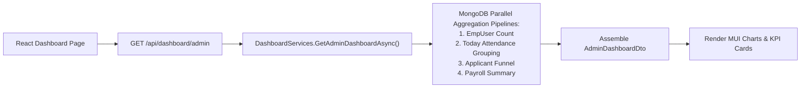

# DASHBOARD & ANALYTICS MODULE (`ANALYTICS.md`)

## 1. Module Overview
The **Dashboard & Analytics Module** aggregates key operational metrics into real-time visual dashboards (`DashboardController`, `DashboardServices`). It surfaces workforce headcounts, recruitment funnel progression, monthly attendance compliance percentages, leave balances, payroll cost rollups, and career analytics.

---

## 2. Real-World Business Scenario
1. **Executive Morning Overview**:
   - CEO logs into the Codeji CMS portal.
   - `GET /api/dashboard/summary` loads executive KPI cards:
     - Total Active Headcount: `142`
     - Today's Present: `131` (`92.2%`)
     - On Leave: `8` (`5.6%`)
     - WFH: `3` (`2.1%`)
     - Active Open Job Positions: `6`
     - Total In-Flight Candidates: `48`
     - Estimated Current Month Payroll: `₹1,18,50,000`

---

## 3. Actors
| Actor | Capabilities |
|---|---|
| **Executive / Super Admin / HR Admin** | Views organization-wide KPI tiles, hiring funnels, attendance trends, and payroll expense charts. |
| **Department Manager** | Views team-specific attendance, leave, and headcount metrics. |
| **Employee** | Views personal statistics (leaves remaining, monthly attendance percentages, upcoming holidays). |

---

## 4. Frontend Implementation
| File | Responsibility | Calls | Used By |
|---|---|---|---|
| `src/app/modules/dashboard/pages/AdminDashboardPage.tsx` | Main HR/Admin dashboard with KPI widgets, attendance pie charts, hiring pipeline cards, and payroll rollups. | `GET /api/dashboard/admin` | HR / Admin |
| `src/app/modules/dashboard/pages/EmployeeDashboardPage.tsx` | Self-service employee dashboard with personal leave balances, quick punch button, and announcements. | `GET /api/dashboard/employee` | All Employees |

---

## 5. Backend Implementation
| Backend File | Responsibility | Dependencies |
|---|---|---|
| `Controllers/DashboardController.cs` | Exposes aggregated metrics endpoints for admin and employee dashboards. | `IDashboardServices` |
| `Services/DashboardServices.cs` | Performs high-performance MongoDB aggregation pipelines across `EmpUser`, `Attendance`, `Leave`, `Applicant`, and `PayrollEntity`. | `IMongoRepository<EmpUser>`, `IMongoRepository<Attendance>`, `IMongoRepository<Leave>`, `IMongoRepository<Applicant>` |

---

## 6. API Documentation
| Method | URL | Purpose | Auth / Permission | Request / Response | Side Effects |
|---|---|---|---|---|---|
| `GET` | `/api/dashboard/admin` | Returns high-level company analytics and KPIs for HR/Admin. | JWT (`dashboard:read`) | `AdminDashboardDto` | None |
| `GET` | `/api/dashboard/employee` | Returns personalized metrics (leave balances, attendance status) for logged-in user. | JWT | `EmployeeDashboardDto` | None |

---

## 7. Database Model
Aggregates live operational collections using MongoDB aggregation pipelines (`$match`, `$group`, `$facet`, `$count`). No standalone materialized entity is required.

---

## 8. Business Rules
- **Role-Based Aggregation Scoping**:
  - Super Admin / HR Admin: Aggregates whole tenant.
  - Reporting Manager: Aggregates direct and indirect reports.
  - Employee: Aggregates only personal records.
- **Tenant Isolation**: Every aggregation pipeline stages `$match: { CompanyId: companyId, IsDeleted: false }` as its first operation.

---

## 9. Complete Workflow

---

## 10. State Machine
Read-only real-time aggregation queries.

---

## 11. Permissions
- `dashboard:read` — View organizational dashboard metrics.

---

## 12. Dependencies
- **Upstream**: `EMPLOYEE`, `ATTENDANCE`, `LEAVE`, `RECRUITMENT`, `PAYROLL`.
- **Downstream**: Frontend dashboard visualization components.

---

## 13. Cross-Module Events
- Real-time punches, leave approvals, and applicant stage changes immediately reflect upon the next dashboard fetch.

---

## 14. Failure Scenarios
- **Zero Data State**: Handled gracefully with zero-count defaults so new tenants see empty states rather than calculation crashes.

---

## 15. Edge Cases
- **Timezone Shifts on 'Today' Attendance**: Normalized to tenant local office timezone before aggregating check-ins.

---

## 16. Current Strengths
- Lean, on-demand MongoDB aggregation pipelines eliminate out-of-sync caching discrepancies.

---

## 17. Current Gaps
- Long-term multi-year trend analytics (e.g., year-over-year attrition comparison) are computed on-demand rather than pre-aggregated into monthly warehouse buckets.

---

## 18. Recommended Improvements
- Add a nightly aggregation worker storing monthly KPI snapshots in a `MonthlyAnalyticsSnapshot` collection for instant multi-year trend charts.

---

## 19. Future Scope
- Predictive AI turnover risk forecasting based on attendance irregularity and leave patterns.
