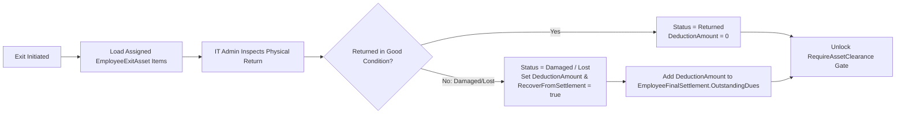

# ASSET MANAGEMENT & CLEARANCE MODULE (`ASSET-MANAGEMENT.md`)

## 1. Module Overview
The **Asset Management & Clearance Module** tracks physical and digital company assets issued to employees (laptops, monitors, access cards, mobile devices, peripherals) and governs their mandatory inspection, return, or financial recovery (`EmployeeExitAsset`) during employee offboarding.

---

## 2. Real-World Business Scenario
1. **Asset Assignment & Tracking**:
   - Upon joining, Rahul Sharma is issued a MacBook Pro (`AssetTag = "CODEJI-MBP-042"`) and an RFID Building Access Card (`AssetTag = "CODEJI-ID-109"`).
2. **Offboarding Asset Inspection**:
   - When Rahul enters offboarding, `EmployeeExitService` populates `EmployeeExitAsset` records for both items.
   - On his last working day, Rahul hands over both items to the IT / Asset Admin.
   - The RFID card is marked `Status = "Returned"`, `Condition = "Good"`, `DeductionAmount = 0`.
   - The MacBook Pro has a cracked display; IT marks `Status = "Damaged"`, `Condition = "Screen cracked"`, `DeductionAmount = 2500`, and `RecoverFromSettlement = true`.
3. **Financial Recovery Integration**:
   - `EmployeeFinalSettlement` automatically pulls `DeductionAmount = ₹2,500` into `OutstandingDues` and unlocks the `RequireAssetClearance` gate on `EmployeeExit`.

---

## 3. Actors
| Actor | Capabilities |
|---|---|
| **IT Admin / Asset Manager** | Records issued assets, inspects returned hardware during exit, sets `Condition` and `DeductionAmount`, and signs off asset clearance. |
| **HR Admin** | Monitors asset return readiness as part of `EmployeeExit` completion gates. |
| **Employee** | Views assigned company assets and return status during offboarding. |

---

## 4. Frontend Implementation
| File | Responsibility | Calls | Used By |
|---|---|---|---|
| `src/app/modules/offboarding/components/ExitAssetsTab.tsx` | Table and inspection modal for tracking `EmployeeExitAsset` items (`AssetName`, `AssetTag`, `Condition`, `Status`, `DeductionAmount`). | `GET /api/employee-exit/{id}/assets`, `POST /api/employee-exit/{id}/assets`, `PUT /api/employee-exit/{id}/assets/{assetId}` | IT Admin / HR Admin |

---

## 5. Backend Implementation
| Backend File | Responsibility | Dependencies |
|---|---|---|
| `Controllers/EmployeeExitController.cs` | Endpoints for listing, adding, inspecting, and clearing `EmployeeExitAsset` items. | `IEmployeeExitService` |
| `Services/EmployeeExitService.cs` | Validates `RequireAssetClearance` policy gate and aggregates `DeductionAmount` into `EmployeeFinalSettlement.OutstandingDues`. | `IMongoRepository<EmployeeExitAsset>`, `IMongoRepository<EmployeeFinalSettlement>` |

---

## 6. API Documentation
| Method | URL | Purpose | Auth / Permission | Request / Response | Side Effects |
|---|---|---|---|---|---|
| `GET` | `/api/employee-exit/{exitId}/assets` | Lists all assets assigned to the exiting employee. | JWT (`offboarding:read`) | `List<EmployeeExitAssetDto>` | None |
| `POST` | `/api/employee-exit/{exitId}/assets` | Registers an asset item requiring return/clearance for the exit case. | JWT (`offboarding:update`) | `CreateExitAssetDto` | Creates `EmployeeExitAsset` |
| `PUT` | `/api/employee-exit/{exitId}/assets/{assetId}` | Updates return status (`Returned`, `Damaged`, `Lost`), condition notes, and `DeductionAmount`. | JWT (`offboarding:update`) | `UpdateExitAssetDto` | Updates `EmployeeExitAsset`, feeds `EmployeeFinalSettlement` |

---

## 7. Database Model
### `EmployeeExitAsset` (`CMS-Backend-Core/Codeji.CMS.Repository/Entities/EmployeeExitAsset.cs`)
- `Id` (`string`, PK)
- `CompanyId` (`string`, FK)
- `ExitId` (`string`, FK -> `EmployeeExit.Id`)
- `EmployeeId` (`string`, FK)
- `AssetName` (`string`, e.g., `"MacBook Pro 14-inch"`)
- `AssetTag` (`string`, e.g., `"CODEJI-MBP-042"`)
- `Category` (`string`, `"Laptop"` | `"Accessory"` | `"IDCard"` | `"Mobile"` | `"Other"`)
- `Status` (`string`, `"PendingReturn"` | `"Returned"` | `"Damaged"` | `"Lost"` | `"Waived"`)
- `Condition` (`string`)
- `DeductionAmount` (`double`)
- `RecoverFromSettlement` (`bool`)
- `ClearedByUserId` (`string`)
- `ClearedAtUtc` (`DateTime?`)

---

## 8. Business Rules
- **Clearance Gate Rule**: When `EmployeeExit.PolicySnapshot.RequireAssetClearance == true`, `EmployeeExit` cannot transition to `Completed` while any `EmployeeExitAsset` has `Status == "PendingReturn"`.
- **Settlement Recovery Rule**: If `Status` is `"Damaged"` or `"Lost"` and `RecoverFromSettlement == true`, `DeductionAmount` must be $\ge 0$ and is automatically added to `EmployeeFinalSettlement.OutstandingDues`.

---

## 9. Complete Workflow

---

## 10. State Machine
`PendingReturn` $\rightarrow$ `Returned` | `Damaged` (Recovered in FnF) | `Lost` (Recovered in FnF) | `Waived`.

---

## 11. Permissions
- `offboarding:read` — View assigned exit assets.
- `offboarding:update` — Inspect assets, record damages/deductions, and mark cleared.

---

## 12. Dependencies
- **Upstream**: `OFFBOARDING` (`EmployeeExit`, `EmployeeExitPolicySnapshot`).
- **Downstream**: `FINAL-SETTLEMENT` (`EmployeeFinalSettlement.OutstandingDues`).

---

## 13. Cross-Module Events
- Recording `DeductionAmount > 0` triggers recalculation readiness on `EmployeeFinalSettlement`.

---

## 14. Failure Scenarios
- **Unreturned Asset at LWD**: Blocks `POST /api/employee-exit/{id}/complete` until IT either marks the asset `Returned` or switches it to `Lost` with `RecoverFromSettlement = true`.

---

## 15. Edge Cases
- **Employee Asset Buyback**: Handled by setting `Status = "Lost/Retained"` with the depreciated buyout value entered in `DeductionAmount` (`RecoverFromSettlement = true`).

---

## 16. Current Strengths
- Direct financial bridge between IT hardware inspection (`EmployeeExitAsset.DeductionAmount`) and Finance Final Settlement (`EmployeeFinalSettlement`).

---

## 17. Current Gaps
- Standalone day-to-day IT inventory procurement/stockroom lifecycle (before assignment to an employee) is not modeled as a separate warehouse module; asset tracking is currently focused on employee assignment and offboarding clearance (`EmployeeExitAsset`).

---

## 18. Recommended Improvements
- Add a global `CompanyAssetInventory` collection to track unassigned stock, warranty expiry dates, and serial numbers from procurement to disposal.

---

## 19. Future Scope
- QR-code / barcode label generation and scanning for instant asset check-in/check-out.
