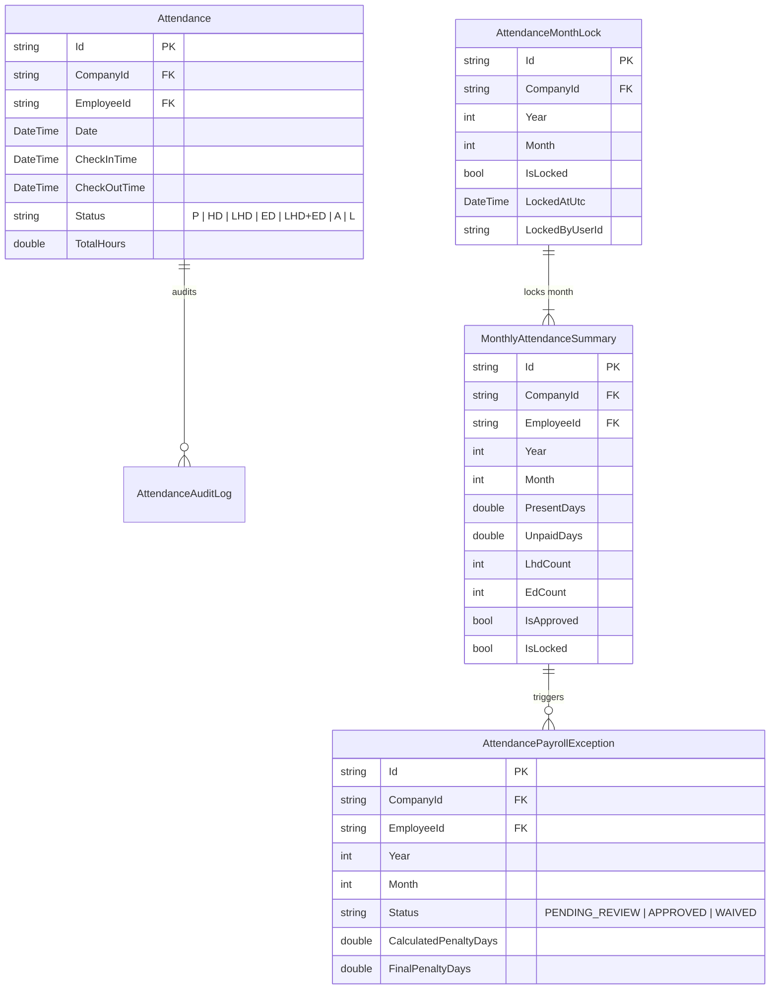
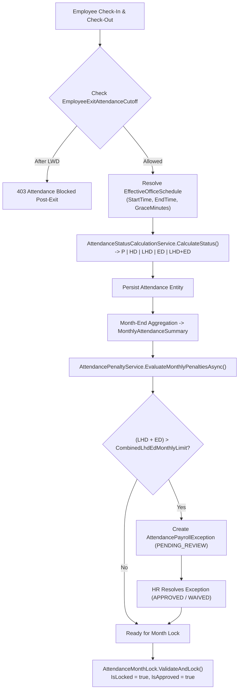
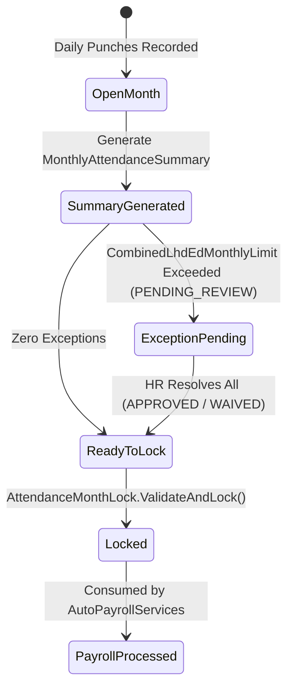

# ATTENDANCE MODULE (`ATTENDANCE.md`)

## 1. Module Overview
The **Attendance Module** is a core operational engine in **Codeji CMS / HRMS** that tracks daily employee check-in/check-out activity, evaluates shift compliance (`P`, `HD`, `LHD`, `ED`, `LHD+ED`), calculates late/early penalties (`AttendancePenaltyService`), enforces offboarding cutoffs (`EmployeeExitAttendanceCutoff`), and produces locked monthly attendance summaries (`MonthlyAttendanceSummary` & `AttendanceMonthLock`) required by `AutoPayrollServices`.

---

## 2. Real-World Business Scenario
1. **Daily Check-In / Check-Out**:
   - Rahul Sharma's effective office schedule (`CompanyOfficeSchedule`) is `09:30` to `18:30` with `CheckInAllowedUntil = 09:45` (`15m` grace) and `CheckOutAllowedFrom = 18:15`.
   - On Tuesday, Rahul checks in at `10:02` and checks out at `18:05`.
   - `AttendanceStatusCalculationService.CalculateStatus` detects `isLate = true` (`10:02 > 09:45`) and `isEarly = true` (`18:05 < 18:15`), assigning daily status **`LHD+ED`** (`Late Half Day + Early Departure`).
2. **Monthly Penalty Evaluation**:
   - Over April 2026, Rahul accumulates 4 occurrences of `LHD` / `ED` / `LHD+ED`.
   - `AttendancePenaltyService.EvaluateMonthlyPenaltiesAsync` compares this against `AttendancePenaltyPolicy.CombinedLhdEdMonthlyLimit = 3`. Because `4 > 3`, it raises an `AttendancePayrollException` (`Status = "PENDING_REVIEW"`, `PenaltyDays = 0.5`).
3. **HR Resolution & Month Lock**:
   - HR Manager reviews the exception via `POST /api/attendance-penalty/resolve` (`APPROVED`, `FinalPenaltyDays = 0.5`).
   - HR then runs `POST /api/attendance/lock-month`, which calls `AttendanceMonthLock.ValidateAndLock()` and locks `MonthlyAttendanceSummary` (`IsApproved = true`, `IsLocked = true`) so April payroll can run.

---

## 3. Actors
| Actor | Capabilities |
|---|---|
| **Employee** | Performs daily check-in/check-out, views personal attendance calendar, status codes (`P`, `LHD`, `ED`, `HD`), and monthly summary. |
| **Reporting Manager** | Views team attendance dashboard, late arrival trends, and attendance exceptions. |
| **HR Admin / Payroll Admin** | Configures `AttendancePenaltyPolicy`, edits/regularizes attendance (`AttendanceAuditLog`), resolves `AttendancePayrollException` items, and locks `AttendanceMonthLock`. |
| **Background Worker (`AttendanceReminderHostedService`)** | Dispatches automated check-in/check-out reminders (`AttendanceReminderDispatchLog`) according to `AttendanceReminderSetting`. |

---

## 4. Frontend Implementation
| File | Responsibility | Calls | Used By |
|---|---|---|---|
| `src/app/modules/attendance/pages/AttendancePage.tsx` | Main attendance calendar, daily punch widget, and status legend (`P`, `HD`, `LHD`, `ED`, `LHD+ED`). | `GET /api/attendance`, `POST /api/attendance/check-in`, `POST /api/attendance/check-out` | Employee / HR |
| `src/app/modules/attendance/components/MonthlySummaryTable.tsx` | Displays employee monthly rollup (`PresentDays`, `UnpaidDays`, `LhdCount`, `EdCount`, lock state). | `GET /api/attendance/monthly-summary` | HR / Payroll Admin |
| `src/app/modules/attendance/components/PenaltyExceptionsModal.tsx` | Lists `PENDING_REVIEW` exceptions from `AttendancePayrollException` for HR approval or waiver. | `GET /api/attendance-penalty/exceptions`, `POST /api/attendance-penalty/resolve` | HR Admin |

---

## 5. Backend Implementation
| Backend File | Responsibility | Dependencies |
|---|---|---|
| `Controllers/AttendanceController.cs` | Handles check-in, check-out, regularization, monthly summary generation, and month locking. | `IAttendanceService`, `IAttendancePenaltyService` |
| `Services/AttendanceStatusCalculationService.cs` | Pure deterministic calculation of daily status (`P`, `HD`, `LHD`, `ED`, `LHD+ED`) from punch times and `CompanyOfficeSchedule`. | `EffectiveOfficeScheduleService` |
| `Services/AttendancePenaltyService.cs` | Evaluates monthly `LHD`/`ED` counts against `AttendancePenaltyPolicy.CombinedLhdEdMonthlyLimit`, creates `AttendancePayrollException`, and enforces `AttendanceMonthLock.ValidateAndLock()`. | `IMongoRepository<AttendancePenaltyPolicy>`, `IMongoRepository<AttendancePayrollException>`, `IMongoRepository<AttendanceMonthLock>` |
| `Services/HostedServices/AttendanceReminderHostedService.cs` | Periodic `BackgroundService` that checks `AttendanceReminderSetting` and sends check-in/out notifications via `NotificationService`. | `IMongoRepository<AttendanceReminderDispatchLog>` |

---

## 6. API Documentation
| Method | URL | Purpose | Auth / Permission | Request / Response | Side Effects |
|---|---|---|---|---|---|
| `POST` | `/api/attendance/check-in` | Records employee daily check-in timestamp. | JWT (`attendance:create`) | `CheckInRequestDto` -> `AttendanceDto` | Checks `EmployeeExitAttendanceCutoff`; calculates initial status |
| `POST` | `/api/attendance/check-out` | Records employee daily check-out and computes worked hours & `Status`. | JWT (`attendance:update`) | `CheckOutRequestDto` -> `AttendanceDto` | Runs `AttendanceStatusCalculationService.CalculateStatus` |
| `PUT` | `/api/attendance/{id}/regularize` | HR/Manager manual override of punch times or status. | JWT (`attendance:update`) | `RegularizeAttendanceDto` | Writes immutable `AttendanceAuditLog` (`PreviousValue`, `NewValue`, `Reason`) |
| `POST` | `/api/attendance-penalty/evaluate` | Evaluates monthly `LHD`/`ED` limits and creates `AttendancePayrollException` records. | JWT (`attendance:update`) | `{ Year, Month }` | Creates/updates `AttendancePayrollException` |
| `POST` | `/api/attendance-penalty/resolve` | Approves or waives a `PENDING_REVIEW` penalty exception. | JWT (`attendance:approve`) | `ResolveExceptionDto` (`Status`, `FinalPenaltyDays`) | Unblocks month lock when zero `PENDING_REVIEW` remain |
| `POST` | `/api/attendance/lock-month` | Validates all summaries and locks the month for payroll. | JWT (`attendance:approve`) | `{ Year, Month }` | Calls `AttendanceMonthLock.ValidateAndLock()` |

---

## 7. Database Model

---

## 8. Business Rules
- **Daily Status Rule (`AttendanceStatusCalculationService`)**:
  - `HalfDayThresholdHours`: If total worked hours `< HalfDayThresholdHours` (or missing check-out), status is `HD` (Half Day).
  - `isLate`: `CheckInTime > (StartTime + GraceMinutes)` (`CheckInAllowedUntil`).
  - `isEarly`: `CheckOutTime < CheckOutAllowedFrom`.
  - Status matrix:
    - `!isLate && !isEarly` $\rightarrow$ **`P`** (Present)
    - `isLate && !isEarly` $\rightarrow$ **`LHD`** (Late Half Day / Late Arrival)
    - `!isLate && isEarly` $\rightarrow$ **`ED`** (Early Departure)
    - `isLate && isEarly` $\rightarrow$ **`LHD+ED`** (Combined Late + Early)
- **Offboarding Cutoff Rule**: If an `EmployeeExitAttendanceCutoff` exists for the employee and `Date > LastWorkingDayUtc`, check-in is blocked.
- **Penalty Rule (`AttendancePenaltyService`)**: If `(LhdCount + EdCount + LhdEdCount) > AttendancePenaltyPolicy.CombinedLhdEdMonthlyLimit`, an `AttendancePayrollException` (`PENDING_REVIEW`) is created.
- **Month Lock Gate (`AttendanceMonthLock.ValidateAndLock`)**: A month cannot be locked if any `AttendancePayrollException` in that `(CompanyId, Year, Month)` has `Status == "PENDING_REVIEW"`.

---

## 9. Complete Workflow

---

## 10. State Machine

---

## 11. Permissions
- `attendance:read` — View personal or team attendance records.
- `attendance:create` / `attendance:update` — Check-in, check-out, and manual regularization.
- `attendance:approve` — Resolve `AttendancePayrollException` and execute `AttendanceMonthLock`.

---

## 12. Dependencies
- **Upstream**: `WORK-SHIFT` (`EffectiveOfficeScheduleService`), `CALENDAR` (`CompanyWorkingCalendarService`), `LEAVE` & `WFH` (approved leaves/WFH overlay daily status), `OFFBOARDING` (`EmployeeExitAttendanceCutoff`).
- **Downstream**: `PAYROLL` (`AutoPayrollServices` requires locked `MonthlyAttendanceSummary` and reads approved `FinalPenaltyDays`).

---

## 13. Cross-Module Events
- **Manual Regularization**: Appends an immutable record to `AttendanceAuditLog`.
- **Month Lock**: Unblocks `AutoPayrollServices.GeneratePayrollForMonthAsync` for that `(CompanyId, Year, Month)`.

---

## 14. Failure Scenarios
- **Attempting to Lock Month with Unresolved Exceptions**: `AttendanceMonthLock.ValidateAndLock()` throws a domain validation error listing the unresolved `PENDING_REVIEW` exceptions.
- **Modifying Locked Month Attendance**: Regularization calls against a date in a locked `AttendanceMonthLock` are rejected (`409 Conflict`).

---

## 15. Edge Cases
- **Half-Day Leave + Punch**: When an employee has an approved half-day leave (`FirstHalf` or `SecondHalf`) or half-day WFH, `EffectiveOfficeScheduleService` adjusts the expected check-in/check-out window accordingly so they are not falsely marked `LHD` or `ED`.

---

## 16. Current Strengths
- Deterministic, policy-driven daily status classification (`P`, `HD`, `LHD`, `ED`, `LHD+ED`).
- Hard pre-payroll gate (`AttendanceMonthLock` + `AttendancePayrollException` review) prevents unverified attendance from leaking into salary calculations.

---

## 17. Current Gaps
- Biometric hardware webhook ingestion is not natively wired; punches currently originate from web/mobile API requests.

---

## 18. Recommended Improvements
- Add an idempotent batch punch ingestion endpoint (`POST /api/attendance/biometric-sync`) for external biometric devices.

---

## 19. Future Scope
- Geofenced / IP-whitelisted check-in rules per `CompanyOfficeSchedule`.
