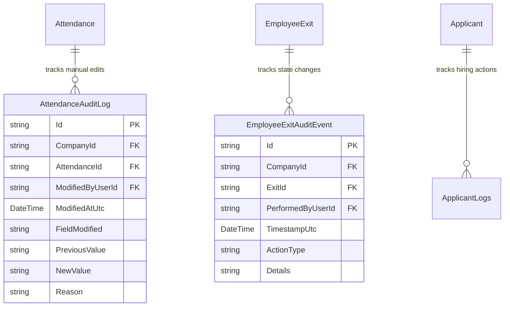
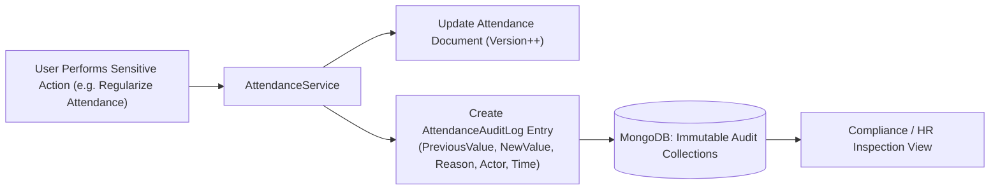

# AUDIT & COMPLIANCE LOGGING MODULE (`AUDIT.md`)

## 1. Module Overview
The **Audit & Compliance Logging Module** provides an immutable record of sensitive operational events across the application. It includes repository-level automatic auditing (`ISupportAuditing`), attendance override tracking (`AttendanceAuditLog`), applicant stage transition logs (`ApplicantLogs`), and offboarding event logs (`EmployeeExitAuditEvent`).

---

## 2. Real-World Business Scenario
1. **Attendance Regularization Audit**:
   - HR Admin modifies Rahul's punch record from `09:58` to `09:28` to waive a late half-day status.
   - The system automatically writes an immutable `AttendanceAuditLog` recording `OriginalCheckIn = 09:58`, `NewCheckIn = 09:28`, `ModifiedByUserId`, `ModifiedAtUtc`, and `Reason = "Subway signal failure verified"`.
2. **Offboarding Compliance Review**:
   - An employee disputes a notice shortfall recovery charge.
   - HR inspects `EmployeeExitAuditEvent` records for the exit case to verify who approved the notice adjustment, on what date, and what comments were entered.

---

## 3. Actors
| Actor | Capabilities |
|---|---|
| **Compliance Officer / Super Admin / HR Admin** | Searches, filters, and inspects audit trails across Attendance, Recruitment, Offboarding, and Core Entities. |
| **System Repositories** | Automatically populates `CreatedBy`, `CreatedDate`, `UpdatedBy`, `UpdatedDate`, and increments `Version` on entities implementing `ISupportAuditing`. |

---

## 4. Frontend Implementation
| File | Responsibility | Calls | Used By |
|---|---|---|---|
| `src/app/modules/audit/pages/AuditLogPage.tsx` | Searchable table for viewing system audit records with entity, actor, date, and action filters. | `GET /api/audit-logs` | Admin / Compliance |
| `src/app/modules/offboarding/components/ExitAuditTimeline.tsx` | Vertical timeline displaying all `EmployeeExitAuditEvent` entries for an exit case. | `GET /api/employee-exit/{id}/audit` | HR Admin |

---

## 5. Backend Implementation
| Backend File | Responsibility | Dependencies |
|---|---|---|
| `Repository/MongoRepository.cs` | Automatically updates `ISupportAuditing` fields (`UpdatedBy`, `UpdatedDate`, `Version`) on every `UpdateAsync`. | `MongoDbContext` |
| `Services/EmployeeExitService.cs` | Appends structured `EmployeeExitAuditEvent` records on every offboarding state change or clearance action. | `IMongoRepository<EmployeeExitAuditEvent>` |
| `Services/AttendanceService.cs` | Writes `AttendanceAuditLog` entries whenever punch times or statuses are regularized. | `IMongoRepository<AttendanceAuditLog>` |

---

## 6. API Documentation
| Method | URL | Purpose | Auth / Permission | Request / Response | Side Effects |
|---|---|---|---|---|---|
| `GET` | `/api/audit/attendance` | Returns attendance modification audit records. | JWT (`audit:read`) | `List<AttendanceAuditLogDto>` | None |
| `GET` | `/api/employee-exit/{exitId}/audit` | Returns immutable audit timeline for an exit case. | JWT (`offboarding:read`) | `List<EmployeeExitAuditEventDto>` | None |

---

## 7. Database Model

---

## 8. Business Rules
- **Immutability Rule**: Audit records (`AttendanceAuditLog`, `EmployeeExitAuditEvent`, `ApplicantLogs`) have no update or delete endpoints. Once inserted, they are permanent.
- **Optimistic Concurrency Protection**: Every audited entity increments integer `Version` on save. Attempting to update a stale version throws a concurrency conflict error.

---

## 9. Complete Workflow

---

## 10. State Machine
Append-only immutable event streams.

---

## 11. Permissions
- `audit:read` — View system audit trails.

---

## 12. Dependencies
- **Upstream**: All transactional modules modifying critical records.
- **Downstream**: Regulatory compliance and forensic dispute resolution.

---

## 13. Cross-Module Events
- Audit logging is an automatic side effect of all sensitive modifications.

---

## 14. Failure Scenarios
- **Audit Write Failure**: Wrapped in the same operational logic to ensure changes do not succeed without their audit record.

---

## 15. Edge Cases
- **System-Initiated Changes (Hosted Services)**: Logged with actor ID `"SYSTEM"` or service name.

---

## 16. Current Strengths
- Granular before-and-after change logging (`PreviousValue` vs `NewValue`) with mandatory `Reason` strings.

---

## 17. Current Gaps
- Centralized tamper-evident cryptographic log chaining (blockchain or HMAC hash chaining) is not currently implemented; reliance is on MongoDB document immutability.

---

## 18. Recommended Improvements
- Add HMAC cryptographic hashing per audit entry linking to previous entry's hash.

---

## 19. Future Scope
- Automated anomaly detection flagging suspicious out-of-hours bulk record edits.
