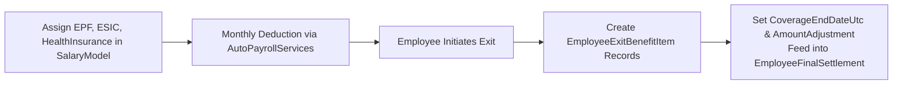

# BENEFITS & STATUTORY COMPLIANCE MODULE (`BENEFITS.md`)

## 1. Module Overview
The **Benefits & Statutory Compliance Module** tracks employee enrollment in statutory schemes (Employees' Provident Fund `EPF`, Employees' State Insurance `ESIC`), corporate group health insurance (`HealthInsurance`), and benefit continuation/termination during offboarding (`EmployeeExitBenefitItem`).

---

## 2. Real-World Business Scenario
1. **Active Employment Benefits**:
   - Rahul Sharma is enrolled in Group Medical Insurance (`HealthInsurance = ₹1,500/month`) and statutory Provident Fund (`EPF = ₹1,800/month`) within his `SalaryModel`.
2. **Offboarding Benefit Termination**:
   - When Rahul resigns, `EmployeeExitService` creates `EmployeeExitBenefitItem` records for his active benefits (`Health Insurance`, `EPF`, `Gratuity/LTA`).
   - HR/Finance sets the `CoverageEndDateUtc` (e.g., end of exit month `2026-06-30` for Group Health Insurance) and records final settlement adjustments (`AmountAdjustment`) before completing offboarding.

---

## 3. Actors
| Actor | Capabilities |
|---|---|
| **HR Admin / Benefits Admin** | Configures employee statutory/insurance amounts in `SalaryModel` and closes `EmployeeExitBenefitItem` records during offboarding. |
| **Finance / Payroll Admin** | Verifies monthly EPF/ESIC/Insurance deductions and processes final benefit adjustments in `EmployeeFinalSettlement`. |
| **Employee / Former Employee** | Views active deductions on salary slips and benefit termination status in the offboarding / alumni portal. |

---

## 4. Frontend Implementation
| File | Responsibility | Calls | Used By |
|---|---|---|---|
| `src/app/modules/payroll/pages/SalaryStructurePage.tsx` | Configures `EPF`, `ESIC`, `HealthInsurance`, and `LTA` components. | `PUT /api/salary/{id}` | HR / Payroll Admin |
| `src/app/modules/offboarding/components/ExitBenefitsTab.tsx` | Manages `EmployeeExitBenefitItem` clearance, coverage end dates, and settlement notes. | `GET /api/employee-exit/{id}/benefits`, `PUT /api/employee-exit/{id}/benefits` | HR / Finance |

---

## 5. Backend Implementation
| Backend File | Responsibility | Dependencies |
|---|---|---|
| `Services/AutoPayrollServices.cs` | Deducts `EPF`, `ESIC`, and `HealthInsurance` during monthly payroll processing. | `IMongoRepository<SalaryModel>` |
| `Services/EmployeeExitService.cs` | Tracks and closes `EmployeeExitBenefitItem` records during employee separation. | `IMongoRepository<EmployeeExitBenefitItem>` |

---

## 6. API Documentation
| Method | URL | Purpose | Auth / Permission | Request / Response | Side Effects |
|---|---|---|---|---|---|
| `GET` | `/api/employee-exit/{exitId}/benefits` | Lists benefit items (`EmployeeExitBenefitItem`) requiring termination/settlement for an exiting employee. | JWT (`offboarding:read`) | `List<EmployeeExitBenefitItemDto>` | None |
| `PUT` | `/api/employee-exit/{exitId}/benefits/{itemId}` | Updates benefit termination status, `CoverageEndDateUtc`, and settlement adjustment. | JWT (`offboarding:update`) | `UpdateExitBenefitItemDto` | Updates `EmployeeExitBenefitItem` |

---

## 7. Database Model
### `EmployeeExitBenefitItem` (`CMS-Backend-Core/Codeji.CMS.Repository/Entities/EmployeeExitBenefitItem.cs`)
- `Id` (`string`, PK)
- `CompanyId` (`string`, FK)
- `ExitId` (`string`, FK -> `EmployeeExit.Id`)
- `EmployeeId` (`string`, FK)
- `BenefitType` (`string`, `"EPF"` | `"ESIC"` | `"HealthInsurance"` | `"Gratuity"` | `"Other"`)
- `Status` (`string`, `"Pending"` | `"Terminated"` | `"Transferred"` | `"Settled"`)
- `CoverageEndDateUtc` (`DateTime?`)
- `AmountAdjustment` (`double`)
- `Notes` (`string`)

---

## 8. Business Rules
- **Statutory Deduction Rule**: `EPF`, `ESIC`, and `HealthInsurance` defined on `SalaryModel` are automatically included in `TotalDeduction` by `AutoPayrollServices`.
- **Exit Clearance Rule**: All `EmployeeExitBenefitItem` records associated with an `EmployeeExit` must be moved out of `Pending` status (`Terminated`, `Transferred`, or `Settled`) before final settlement closure.

---

## 9. Complete Workflow

---

## 10. State Machine
`EmployeeExitBenefitItem`: `Pending` $\rightarrow$ `Terminated` / `Transferred` / `Settled`.

---

## 11. Permissions
- `payroll:update` — Configure active benefit deductions.
- `offboarding:update` — Manage `EmployeeExitBenefitItem` closure.

---

## 12. Dependencies
- **Upstream**: `SALARY` (`SalaryModel`).
- **Downstream**: `PAYROLL` (`AutoPayrollServices`), `OFFBOARDING` (`EmployeeExit`), `FINAL-SETTLEMENT` (`EmployeeFinalSettlement`).

---

## 13. Cross-Module Events
- Benefit adjustments (`AmountAdjustment`) on `EmployeeExitBenefitItem` feed into `EmployeeFinalSettlement` calculations.

---

## 14. Failure Scenarios
- **Unclosed Benefit Item**: Attempting to finalize exit while `EmployeeExitBenefitItem.Status == "Pending"` triggers a clearance readiness warning.

---

## 15. Edge Cases
- **Insurance Portability**: `Status = "Transferred"` records corporate-to-retail policy conversion without financial deduction.

---

## 16. Current Strengths
- Explicit lifecycle tracking of benefits not only during active payroll but also through offboarding termination (`EmployeeExitBenefitItem`).

---

## 17. Current Gaps
- Standalone employee flexible benefit enrollment window (e.g., choosing parental insurance top-up plans self-service) is not yet separate from HR `SalaryModel` setup.

---

## 18. Recommended Improvements
- Add self-service insurance dependent declaration cards (`FamilyMembers`) linked to `HealthInsurance`.

---

## 19. Future Scope
- Direct ECR file generation for EPFO portal uploads.
