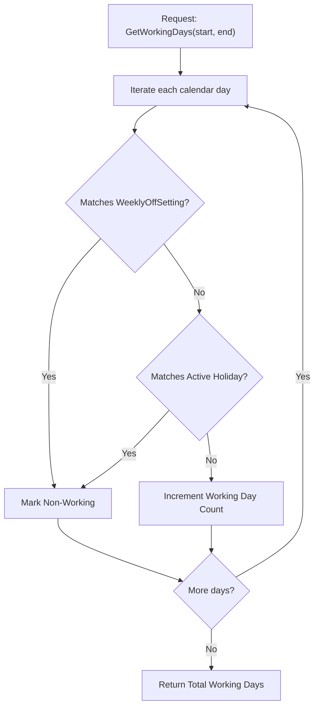

# COMPANY CALENDAR & WORKING DAYS MODULE (`CALENDAR.md`)

## 1. Module Overview
The **Company Calendar & Working Days Module** provides the core temporal infrastructure for **Codeji CMS / HRMS**. It unites weekly off configurations (`WeeklyOffSetting`), declared holidays (`Holidays`), and active employee schedules through `CompanyWorkingCalendarService`. It is the central authority for calculating working day counts, business day intervals, and payroll divisor calculations.

---

## 2. Real-World Business Scenario
1. **Weekly Off Configuration**: HR Admin configures the standard company working week: Sunday is always Off, Saturday has alternating off rules (2nd and 4th Saturday Off, 1st, 3rd, and 5th Saturday Working) via `WeeklyOffSetting`.
2. **Monthly Working Days Resolution**: For April 2026 (30 calendar days):
   - Sundays: 4 days
   - 2nd & 4th Saturdays: 2 days
   - Declared Holidays: 1 day (Mahavir Jayanti)
   - Total Non-Working Days = $4 + 2 + 1 = 7$ days
   - `CompanyWorkingCalendarService.GetWorkingDaysInMonth(2026, 4)` returns **23 working days**.
3. **Payroll Integration**: When `AutoPayrollServices` executes under `WORKING_DAYS` divisor mode, it queries `CompanyWorkingCalendarService` to retrieve 23 days, ensuring daily salary rates reflect actual working days.

---

## 3. Actors
| Actor | Capabilities |
|---|---|
| **HR Admin / Company Admin** | Configures `WeeklyOffSetting` (e.g., 5-day week, 6-day week, alternate Saturdays), views calendar audits. |
| **All Employees** | Views company working calendar, upcoming holidays, weekly offs, and working days on dashboard. |

---

## 4. Frontend Implementation
| File | Responsibility | Calls | Used By |
|---|---|---|---|
| `src/app/modules/calendar/pages/CompanyCalendarPage.tsx` | Interactive monthly calendar displaying working days, weekly offs, and holidays. | `GET /api/calendar/month` | All Users |
| `src/app/modules/settings/pages/WeeklyOffSettingsPage.tsx` | Configuration UI for weekly off patterns (days of week, alternating weekend logic). | `GET /api/calendar/weekly-off`, `PUT /api/calendar/weekly-off` | HR Admin |

---

## 5. Backend Implementation
| Backend File | Responsibility | Dependencies |
|---|---|---|
| `Controllers/CalendarController.cs` | Exposes calendar queries, monthly day breakdowns, and weekly off settings endpoints. | `ICalendarServices`, `ICompanyWorkingCalendarService` |
| `Services/CalendarServices.cs` | Assembles aggregate monthly view (holidays + weekly offs + leaves + birthdays) for frontend views. | `ICompanyWorkingCalendarService`, `IMongoRepository<Holidays>`, `IMongoRepository<EmpUser>` |
| `Services/CompanyWorkingCalendarService.cs` | Core deterministic service providing `IsWorkingDay(date)`, `GetWorkingDaysBetween(start, end)`, and `GetWorkingDaysInMonth(year, month)`. | `IMongoRepository<WeeklyOffSetting>`, `IMongoRepository<Holidays>` |

---

## 6. API Documentation
| Method | URL | Purpose | Auth / Permission | Request / Response | Side Effects |
|---|---|---|---|---|---|
| `GET` | `/api/calendar/month` | Returns composite calendar events for target year/month. | JWT (`calendar:read`) | `CalendarMonthResponseDto` | None |
| `GET` | `/api/calendar/working-days` | Returns exact working day count and dates for a month. | JWT (`calendar:read`) | `{ Year, Month }` -> `{ TotalWorkingDays, WorkingDates }` | None |
| `GET` | `/api/calendar/weekly-off` | Retrieves company weekly off configuration. | JWT (`settings:read`) | `WeeklyOffSettingDto` | None |
| `PUT` | `/api/calendar/weekly-off` | Updates weekly off pattern. | JWT (`settings:update`) | `UpdateWeeklyOffDto` | Recalculates working calendar caches |

---

## 7. Database Model
### `WeeklyOffSetting` (`CMS-Backend-Core/Codeji.CMS.Repository/Entities/WeeklyOffSetting.cs`)
- `Id` (`string`, PK)
- `CompanyId` (`string`, FK)
- `OffDaysOfWeek` (`List<DayOfWeek>`, e.g., `[Sunday]`)
- `AlternatingOffRules` (`List<AlternatingOffRule>`, e.g., Saturday rules: 2nd and 4th Saturday)
- `IsActive` (`bool`)
- `UpdatedByUserId` (`string`)
- `UpdatedAtUtc` (`DateTime`)

---

## 8. Business Rules
- **Non-Working Day Precedence**: A day is non-working if it is in `Holidays` OR matches `WeeklyOffSetting`.
- **Deduplication Rule**: If a declared holiday falls on a weekend/weekly off, `CompanyWorkingCalendarService` counts the day exactly once as non-working.
- **Date Boundary Enforcement**: `GetWorkingDaysBetween(startDate, endDate)` strictly requires `startDate <= endDate`.

---

## 9. Complete Workflow

---

## 10. State Machine
`WeeklyOffSetting` acts as a tenant configuration singleton. Updates trigger cache invalidation in `CompanyWorkingCalendarService`.

---

## 11. Permissions
- `calendar:read` — View calendar dates and monthly work day counts.
- `settings:update` — Configure `WeeklyOffSetting`.

---

## 12. Dependencies
- **Upstream**: `COMPANY-SETTINGS`, `HOLIDAY` (`Holidays`).
- **Downstream**: `ATTENDANCE`, `LEAVE` (deducts non-working days from leave requests), `WFH`, `PAYROLL` (`AutoPayrollServices` divisor calculation).

---

## 13. Cross-Module Events
- Changes to `WeeklyOffSetting` invalidate cached working day matrices across Leave and Payroll calculations.

---

## 14. Failure Scenarios
- **Missing WeeklyOffSetting**: Default fallback assumes Saturday and Sunday are off (5-day work week).

---

## 15. Edge Cases
- **Leap Years (February 29)**: Handled seamlessly via standard `.NET 10` `DateTime.DaysInMonth` calculations.

---

## 16. Current Strengths
- Centralized temporal logic eliminates discrepancies between leave day consumption and payroll working day divisors.

---

## 17. Current Gaps
- Roster-based employee-specific off days (e.g., shift workers who have Tuesday/Wednesday off) are currently unified at company/department setting level.

---

## 18. Recommended Improvements
- Support employee-level custom weekly off overrides for 24/7 operations.

---

## 19. Future Scope
- Integration with external Google Calendar / Microsoft Outlook feeds via iCal / CalDAV endpoints.
