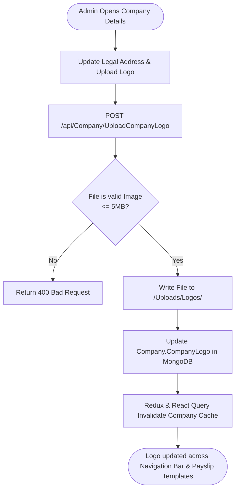
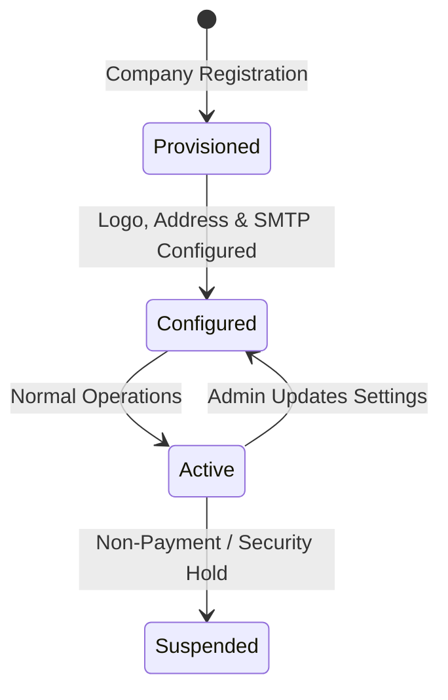

# Module Documentation — Company Settings & Configuration (`COMPANY-SETTINGS`)

> **Document Status**: Complete & Authoritative  
> **Source-of-Truth**: Verified from Repository Implementation  
> **Primary Controllers**: `CompanyController.cs`, `AttendanceStatusSettingsController.cs`  
> **Primary Services**: `CompanyService.cs`, `AttendanceStatusService.cs`, `DefaultCompanySeeds.cs`  
> **Last Verified**: September 2026

---

## 1. Module Overview

- **What the module is**: Manages tenant-level corporate profile data, branding assets (logos), legal and taxation identifiers, corporate email credentials (SMTP), notification defaults, and attendance status display configuration.
- **Why HR organizations need it**: Enterprise communications (offer letters, payslips, email notifications) must display the tenant company's official legal name, registered logo, tax registration numbers, and return email addresses.
- **What business problem it solves**: Eliminates hardcoded company branding and allows multi-tenant organizations to operate independently with distinct corporate visual identities and email delivery servers.
- **Who uses it**: Exclusively **Company Administrators**.
- **Where it fits in the HR lifecycle**: Foundational configuration governing all system-generated documents and emails.

---

## 2. Real-World Business Scenario

```text
Company: Apex Global Logistics Ltd
Administrator: Sarah Jenkins (Administrator)
Scenario: Setting up company branding and email notification infrastructure
```
1. Sarah logs into Codeji HRMS and navigates to `/admin/companydetails`.
2. **Company Profile**: Enters Legal Name `Apex Global Logistics Ltd`, corporate website, and head office address in Mumbai.
3. **Corporate Logo**: Uploads high-resolution SVG logo (streamed to `/Uploads` storage, referenced across all PDF payslips).
4. **Email Server Settings**: Configures SMTP server `smtp.office365.com`, port `587`, TLS enabled, and authenticated sender `hr@apexlogistics.com`.
5. **Attendance Status Presentation**: Navigates to `/attendance-settings` and customizes the UI display labels and badges for attendance statuses (e.g. labeling `LHD` as "Late Punch" with amber badge `#FFA000`).

---

## 3. Supported Actors

| Actor | Capabilities in Module | Server Enforcement |
|---|---|---|
| **Company Administrator** | Full authority to update corporate profile, logo, SMTP credentials, and attendance status settings. | Backend enforces `RoleType == Administrator` or policy `AdminOnly`. |
| **HR / Employee** | Read-only access to company branding (logo, company name) on UI top bar and payslips. | Write endpoints reject non-admin actors with HTTP 403. |

---

## 4. Frontend Implementation

| File | Responsibility | Calls | Used By |
|---|---|---|---|
| `src/app/modules/admin/companydetails/CompanyDetails.tsx` | UI tab managing company legal name, logo upload preview, address fields, and email settings form. | `companyServices.ts` | `adminRoutes.tsx` |
| `src/app/modules/attendance/AttendanceStatusSettings.tsx` | Admin panel customizing attendance status codes, labels, color hex codes, and leave eligibility rules. | `attendanceServices.ts` | `PrivateRoutes.tsx` (`/attendance-settings`) |

---

## 5. Backend Implementation

| Backend File | Responsibility | Dependencies |
|---|---|---|
| `Codeji.CMS.API/Controllers/CompanyController.cs` | Endpoints for company profile updates, logo uploading, email setting configuration, and company status checks. | `ICompanyService`, `IHttpContextAccessor` |
| `Codeji.CMS.API/Controllers/AttendanceStatusSettingsController.cs` | Manages tenant-level attendance status display settings (`AttendanceStatusSetting`). | `IAttendanceStatusService` |
| `Codeji.CMS.Services/Companies/CompanyService.cs` | Validates company uniqueness, handles image upload file streaming to disk, updates MongoDB documents. | `IMongoDbRepository<Company>`, `IMongoDbRepository<CompanyEmailSettings>` |
| `Codeji.CMS.Services/Attendance/AttendanceStatusService.cs` | Manages attendance status codes, active flags, and color mapping. | `IMongoDbRepository<AttendanceStatusSetting>` |

---

## 6. API Documentation

| Method | URL | Purpose | Auth / Permission | Request DTO | Validation & Business Logic | Response |
|---|---|---|---|---|---|---|
| `POST` | `/api/Company/UpdateCompanyDetails` | Updates company profile, address, and legal tax numbers. | `[Authorize]` + Admin | `CompanyDetailsDto` | Validates company exists and is active; updates MongoDB `Company` collection. | `Result<string>` |
| `POST` | `/api/Company/UploadCompanyLogo` | Uploads and persists company branding logo. | `[Authorize]` + Admin | `IFormFile` (Multipart) | Validates image MIME type (`image/png`, `image/jpeg`, `image/svg+xml`); saves to `/Uploads/Logos/`. | `Result<string>` (Logo URL) |
| `POST` | `/api/Company/SaveEmailSettings` | Configures tenant SMTP delivery credentials. | `[Authorize]` + Admin | `CompanyEmailSettingsDto` | Validates host/port format; encrypts password before saving to `CompanyEmailSettings`. | `Result` |
| `GET` | `/api/AttendanceStatusSettings/GetSettings` | Returns all active attendance status presentation configurations. | `[Authorize]` | Query Params | Scoped by `x.CompanyId == companyId`. | `Result<AttendanceStatusSettingDto>` |
| `POST` | `/api/AttendanceStatusSettings/UpdateSetting` | Updates presentation color or label for an attendance status code. | `[Authorize]` + Admin | `AttendanceStatusSettingDto` | Verifies core status code (e.g. `P`, `HD`, `LHD`) cannot be deleted or renamed. | `Result` |

---

## 7. Database Model

### Entities
1. **`Company`** (`Codeji.CMS.Repository.Entities.Company.Company`)
   - **Primary Key**: `CompanyId`
   - **Fields**: `CompanyName`, `CompanyCode`, `CompanyLogo`, `Website`, `Address`, `ContactEmail`, `TaxId`, `IsActive`.
2. **`CompanyEmailSettings`** (`Codeji.CMS.Repository.Entities.Company.CompanyEmailSettings`)
   - **Primary Key**: `EmailSettingsId`
   - **Fields**: `CompanyId`, `SmtpHost`, `SmtpPort`, `SmtpUsername`, `EncryptedPassword`, `EnableSsl`, `SenderDisplayName`.
3. **`AttendanceStatusSetting`** (`Codeji.CMS.Repository.Entities.Attendance.AttendanceStatusSetting`)
   - **Primary Key**: `SettingId`
   - **Fields**: `CompanyId`, `StatusCode` (`P`, `HD`, `LHD`, `ED`, `LHD+ED`, `L`), `DisplayName`, `ColorCodeHex`, `IsActive`.

---

## 8. Business Rules

- **Business Rule**: Core attendance status codes (`P`, `HD`, `LHD`, `ED`, `L`) are system constants. Organizations may customize their display labels and color codes, but cannot delete the core status codes.
- **Security Rule**: SMTP passwords are encrypted at rest using AES-256 before being persisted in `CompanyEmailSettings`.
- **Validation Rule**: Company logo files must not exceed 5 MB and must be verified image formats.

---

## 9. Complete Workflow



---

## 10. State Machine

Company settings operate as a singleton document per tenant:


---

## 11. Permissions

| Action | Admin | HR Manager | Reporting Manager | Employee |
|---|:---:|:---:|:---:|:---:|
| View Company Branding | Yes | Yes | Yes | Yes |
| Update Company Legal Profile | Yes | No | No | No |
| Upload Corporate Logo | Yes | No | No | No |
| Configure SMTP Server | Yes | No | No | No |
| Customize Attendance Status Colors | Yes | No | No | No |

---

## 12. Dependencies

- **Depends On**: `Company` document created during tenant registration.
- **Used By**: `PayRoll` (for logo on payslips), `EmailService` (for SMTP credentials), `AttendanceCalendar` (for status badges).
- **Reads From**: `Company`, `CompanyEmailSettings`, `AttendanceStatusSetting`.
- **Writes To**: `Company`, `CompanyEmailSettings`, `AttendanceStatusSetting`.

---

## 13. Cross-Module Events

- Updating the company logo immediately updates the header image rendered in `SalarySlipTemplate.html` for all future payslip downloads.
- Changing SMTP configuration in `CompanyEmailSettings` immediately alters the outbound transport credentials used by `RecruitmentEmailOutboxWorker` and `EmployeeExitOutboxWorker`.

---

## 14. Failure Scenarios

- **SMTP Misconfiguration**: If invalid SMTP credentials are saved, outbound emails fail during worker execution. Outbox records capture the SMTP exception and enter exponential retry backoff without blocking user operations.

---

## 15. Edge Cases

- **Missing Logo Fallback**: If an organization has not uploaded a company logo, `PdfService` gracefully falls back to rendering the text `Company.CompanyName` in the payslip header without throwing a null reference exception.

---

## 16. Current Strengths

- Centralized management of company branding assets.
- Clean isolation of SMTP settings per tenant company.
- Configurable attendance status presentation colors and display strings.

---

## 17. Current Gaps

- **Test SMTP Connection Tool**: The admin UI lacks a "Send Test Email" button to verify SMTP credentials before saving.

---

## 18. Recommended Improvements

- **Low**: Add a "Test Connection" endpoint on `CompanyController` allowing administrators to verify SMTP host and credentials immediately.

---

## 19. Future Scope

- Multi-brand enterprise configuration supporting distinct subsidiary logos and legal entities under a parent holding tenant.
