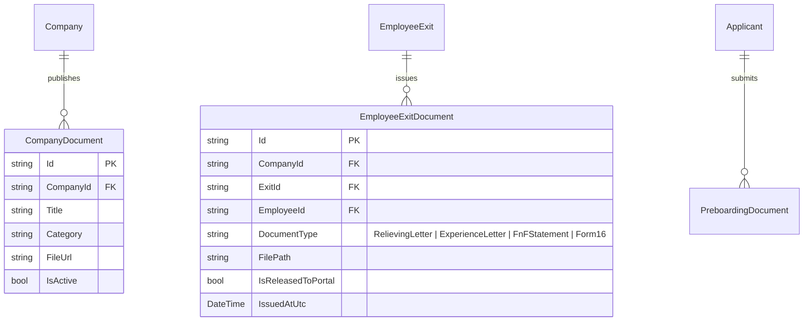
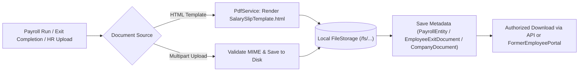

# DOCUMENT MANAGEMENT & PDF GENERATION MODULE (`DOCUMENTS.md`)

## 1. Module Overview
The **Document Management & PDF Generation Module** handles corporate policy documents (`CompanyDocument`), candidate resumes and preboarding KYC uploads (`PreboardingDocument`), automated HTML-to-PDF rendering (`PdfService` with `SalarySlipTemplate.html`), offboarding statutory letters (`EmployeeExitDocument` — Relieving Letter, Experience Certificate, FnF Statement), and static file serving mounted at `/fs` (`Program.cs`).

---

## 2. Real-World Business Scenario
1. **Employee & Candidate Uploads**:
   - During preboarding, candidate Priya Nair uploads her PAN card, Aadhaar card, and degree certificates (`PreboardingDocument`), stored under the tenant's isolated file directory and served via `/fs/...`.
2. **Automated Payslip PDF Generation**:
   - When `AutoPayrollServices` completes April 2026 payroll, `PdfService` injects Rahul Sharma's compensation numbers into `Templates/SalarySlipTemplate.html`, generates a PDF document, and persists the file path on `PayrollEntity.SlipPdfPath`.
3. **Exit Letters & Alumni Portal Delivery**:
   - Upon completing Rahul's exit, HR generates his **Relieving Letter** and **Experience Certificate** (`EmployeeExitDocument`).
   - Rahul logs into `/former-employee` using his `FormerEmployeeAccessToken` and downloads both PDFs securely via `PublicFormerEmployeePortalController`.

---

## 3. Actors
| Actor | Capabilities |
|---|---|
| **HR Admin** | Uploads `CompanyDocument` policies, verifies `PreboardingDocument` KYC files, and issues `EmployeeExitDocument` letters. |
| **Payroll Admin / System** | Generates batch PDF salary slips via `PdfService`. |
| **Employee / Candidate / Alumni** | Uploads KYC/profile documents and downloads payslips, company handbooks, and relieving letters. |

---

## 4. Frontend Implementation
| File | Responsibility | Calls | Used By |
|---|---|---|---|
| `src/app/modules/documents/pages/CompanyDocumentsPage.tsx` | Repository of company handbooks, policies, and announcements (`CompanyDocument`). | `GET /api/company-documents`, `POST /api/company-documents` | All Employees / HR |
| `src/app/modules/offboarding/components/ExitDocumentsTab.tsx` | Generates and manages `EmployeeExitDocument` files (Relieving Letter, Experience Letter, FnF Sheet) with visibility toggle for the Former Employee Portal. | `GET /api/employee-exit/{id}/documents`, `POST /api/employee-exit/{id}/documents` | HR Admin |
| `src/app/modules/payroll/pages/MySalarySlipsPage.tsx` | Triggers PDF download for generated salary slips. | `GET /api/payroll/{id}/download-slip` | Employee |

---

## 5. Backend Implementation
| Backend File | Responsibility | Dependencies |
|---|---|---|
| `Program.cs` (`UseStaticFiles("/fs")`) | Mounts the local storage directory (`FileStorage`) at `/fs` for controlled document and media streaming. | `PhysicalFileProvider` |
| `Services/PdfService.cs` | Compiles HTML templates (such as `Templates/SalarySlipTemplate.html`) into PDF byte arrays and writes them to disk. | HTML-to-PDF renderer |
| `Controllers/CompanyDocumentController.cs` | CRUD endpoints for company-wide documents and policy PDFs (`CompanyDocument`). | `ICompanyDocumentService` |
| `Controllers/PublicFormerEmployeePortalController.cs` | Streams `EmployeeExitDocument` and payslip PDFs to token-authenticated former employees. | `IFormerEmployeePortalService` |

---

## 6. API Documentation
| Method | URL | Purpose | Auth / Permission | Request / Response | Side Effects |
|---|---|---|---|---|---|
| `GET` | `/api/company-documents` | Lists company documents and handbooks for the tenant. | JWT (`documents:read`) | `List<CompanyDocumentDto>` | None |
| `POST` | `/api/company-documents` | Uploads a new company policy document (`multipart/form-data`). | JWT (`documents:create`) | `CompanyDocumentDto` | Writes file to `/fs/` storage |
| `POST` | `/api/employee-exit/{exitId}/documents` | Uploads or generates an `EmployeeExitDocument` (Relieving/Experience letter). | JWT (`offboarding:update`) | `EmployeeExitDocumentDto` | Makes document available on `/former-employee` |
| `GET` | `/api/public/former-employee/documents/{docId}` | Downloads released exit document via `FormerEmployeeAccessToken`. | `FormerEmployeeAccessToken` (`[AllowAnonymous]`) | Streams `application/pdf` | Logs download access |

---

## 7. Database Model

---

## 8. Business Rules
- **Portal Release Gate (`IsReleasedToPortal`)**: An `EmployeeExitDocument` is only visible on `/former-employee` if `IsReleasedToPortal == true` AND any negative `ReceivableFromEmployee` settlement dues have been cleared.
- **Template Token Replacement**: `PdfService` sanitizes and replaces template placeholders (`{{EmployeeName}}`, `{{NetSalary}}`, `{{MonthYear}}`, `{{CompanyName}}`) inside `Templates/SalarySlipTemplate.html`.

---

## 9. Complete Workflow

---

## 10. State Machine
`EmployeeExitDocument`: `Draft` $\rightarrow$ `Issued` $\rightarrow$ `ReleasedToPortal` (`IsReleasedToPortal = true`) $\rightarrow$ `Revoked`.

---

## 11. Permissions
- `documents:read` / `documents:create` — View and upload company documents.
- `offboarding:update` — Issue and release `EmployeeExitDocument` files.

---

## 12. Dependencies
- **Upstream**: `PAYROLL` (`AutoPayrollServices`), `PREBOARDING` (`PreboardingDocument`), `OFFBOARDING` (`EmployeeExit`).
- **Downstream**: `FormerEmployeePortalService` (post-exit document delivery).

---

## 13. Cross-Module Events
- Releasing an `EmployeeExitDocument` triggers a notification via `EmployeeExitOutbox` informing the former employee that their relieving/experience letter is ready for download.

---

## 14. Failure Scenarios
- **Missing Template File**: If `Templates/SalarySlipTemplate.html` is missing from deployment artifacts, `PdfService` throws an IO error logged via `ExceptionHandlingMiddleware`.

---

## 15. Edge Cases
- **Large File Uploads**: Enforced by ASP.NET Core multipart body size limits and MIME-type validation (`application/pdf`, `image/png`, `image/jpeg`).

---

## 16. Current Strengths
- Unified PDF generation (`PdfService`) and gated alumni document release (`IsReleasedToPortal`).

---

## 17. Current Gaps
- Files are stored on the local server disk (`/fs`) rather than an external cloud object store (AWS S3 / Azure Blob Storage) with pre-signed URLs.

---

## 18. Recommended Improvements
- Abstract file persistence behind an `IFileStorageProvider` interface supporting both local `/fs` and AWS S3 / Azure Blob Storage.

---

## 19. Future Scope
- Digital signature (`DSC` / DocuSign) cryptographic signing on generated PDF Payslips and Relieving Letters.
