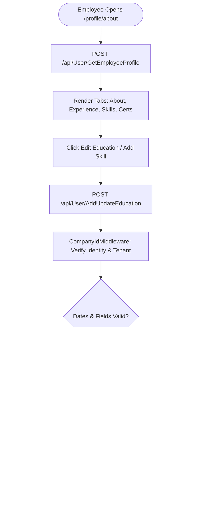
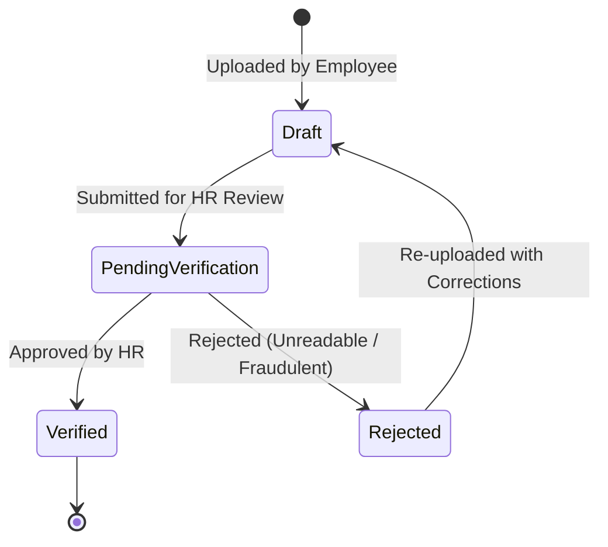

# Module Documentation — Employee Profile & Self-Service (`EMPLOYEE-PROFILE`)

> **Document Status**: Complete & Authoritative  
> **Source-of-Truth**: Verified from Repository Implementation  
> **Primary Controller**: `UserController.cs`  
> **Primary Services**: `EmployeeService.cs`, `AccountServices.cs`  
> **Primary Frontend Components**: `UserProfile.tsx`, `AboutUser.tsx`, `WorkHistory.tsx`, `Setting.tsx`  
> **Last Verified**: September 2026

---

## 1. Module Overview

- **What the module is**: The personal employee portfolio and self-service workspace. It captures and presents an individual's personal identity, contact info, emergency contacts, education credentials, technical skills, professional certifications, prior employment work history, banking details, and security preferences.
- **Why HR organizations need it**: Empowers employees to maintain their own personal and professional records, reducing HR administrative overhead while ensuring payroll has accurate bank account numbers and tax identifiers.
- **What business problem it solves**: Eliminates out-of-date emergency contacts, incorrect bank IFSC/account details causing payroll bounce-backs, and lost skill/certification metadata for resource allocation.
- **Who uses it**: All authenticated **Employees**, with administrative oversight by **HR Managers** and **Company Administrators**.
- **Where it fits in the HR lifecycle**: Active throughout an employee's tenure; continually updated as employees acquire new certifications, change addresses, or update banking details.

---

## 2. Real-World Business Scenario

```text
Employee: Ananya Deshmukh (User ID: USR-8821)
Department: Product Engineering
Action: Updating bank account details and adding AWS Certification
```
1. Ananya logs in and navigates to `/profile/about`.
2. **Bank Account Update**: Navigates to the Financial tab, enters her new bank account number `9876543210123` and PAN `ABCDE1234F`. The frontend and backend validate formats via regex.
3. **Certifications**: Navigates to the Certifications tab, clicks **Add Certification**, enters `AWS Certified Solutions Architect`, issuance date, expiration date, and uploads the verification PDF.
4. **Security Settings**: Navigates to `/profile/setting` and updates her password using `ChangePasswordRequest` (validating current password, minimum 8 characters, special characters).

---

## 3. Supported Actors

| Actor | Capabilities in Module | Server Enforcement |
|---|---|---|
| **Employee (Self-Service)** | Views own full profile; edits personal details, emergency contacts, skills, education, certifications, and password. | Enforced by `userId == currentUserId` checks in `EmployeeService`. Cannot edit own role, department, manager, or salary. |
| **HR Manager / Executive** | Views and edits all employee profiles within the tenant company; updates employment, department, designation, and compensation details. | Enforced via `[ModulePermission(Employees, Edit)]`. |
| **Reporting Manager** | Views subordinates' work history, education, skills, and emergency contact details. | Read-only visibility via directory. |

---

## 4. Frontend Implementation

| File | Responsibility | Calls | Used By |
|---|---|---|---|
| `src/app/routing/ProfileRoutes.tsx` | Sub-routes: `about`, `workhistory`, `leave`, `setting`, `performance`. | React Router `<Outlet />` | `PrivateRoutes.tsx` (`/profile/*`, `/employees/:employeeid/*`) |
| `src/app/modules/users/UserProfile.tsx` | Top-level profile shell displaying avatar, full name, job title, department badge, presence status, and tab navigation. | `userServices.ts` | `ProfileRoutes.tsx` |
| `src/app/modules/users/about/AboutUser.tsx` | Tabbed view displaying Personal Info, Emergency Contacts, Education, Skills, and Certifications. | `userServices.ts` | `ProfileRoutes.tsx` |
| `src/app/modules/users/workhistory/WorkHistory.tsx` | Timeline view of prior external employment and internal company promotions. | `userServices.ts` | `ProfileRoutes.tsx` |
| `src/app/modules/users/usersetting/Setting.tsx` | User security settings (change password, notification preferences). | `accountServices.ts` | `ProfileRoutes.tsx` |

---

## 5. Backend Implementation

| Backend File | Responsibility | Dependencies |
|---|---|---|
| `Codeji.CMS.API/Controllers/UserController.cs` | Endpoints for profile queries, personal info updates, skills/certifications/education CRUD, and avatar uploads. | `IEmployeeService`, `IAccountServices` |
| `Codeji.CMS.Services/Employees/EmployeeService.cs` | Manages profile subdocument updates, enforces self-edit field whitelists, and writes audit timestamps. | `IMongoDbRepository<EmpUser>`, `IMongoDbRepository<EmpSkills>`, `IMongoDbRepository<EmpEducationDetails>` |
| `Codeji.CMS.Services/Account/AccountServices.cs` | Validates current password and securely hashes new passwords using cryptographic salt. | `IMongoDbRepository<EmpUser>` |

---

## 6. API Documentation

| Method | URL | Purpose | Auth / Permission | Request DTO | Validation & Business Logic | Response |
|---|---|---|---|---|---|---|
| `POST` | `/api/User/GetEmployeeProfile` | Fetches complete employee profile dossier. | `[Authorize]` | `GetEmployeeProfileRequest` | If requesting another user's profile, requires `Employees.View`. | `Result<EmployeeProfileDto>` |
| `POST` | `/api/User/UpdatePersonalInfo` | Updates contact details, address, blood group, emergency contact. | `[Authorize]` | `EmployeePersonalInfo` | Validates caller is editing own record OR has `Employees.Edit`. | `Result` |
| `POST` | `/api/User/AddUpdateCertification` | Adds or modifies a professional certification. | `[Authorize]` | `EmployeeCertificationRequestModel` | Validates date ranges (issue date <= expiry date). | `Result` |
| `POST` | `/api/User/AddUpdateEducation` | Adds or modifies degree, university, GPA, and graduation year. | `[Authorize]` | `EmployeeEducationRequestModel` | Validates graduation year format. | `Result` |
| `POST` | `/api/User/AddUpdateSkills` | Updates technical and soft skill tags. | `[Authorize]` | `EmployeeSkillsRequestModel` | Scopes skills to company master taxonomy. | `Result` |
| `POST` | `/api/User/UploadProfilePicture` | Uploads user profile photo avatar. | `[Authorize]` | `IFormFile` (Multipart) | Validates image MIME type, crops and saves to `/Uploads/Profiles/`. | `Result<string>` (URL) |
| `POST` | `/api/Account/ChangePassword` | Changes user login password. | `[Authorize]` | `ChangePasswordRequest` | Verifies current password; enforces minimum length and complexity. | `Result` |

---

## 7. Database Model

### Persistent Entities
1. **`EmpUser`** (Embeds personal fields, PAN, Bank details, blood group, address).
2. **`EmpEducationDetails`** (`Codeji.CMS.Repository.Entities.Employees.EmpEducationDetails`)
   - **Primary Key**: `EducationId`
   - **Fields**: `UserId`, `CompanyId`, `Degree`, `Institution`, `FieldOfStudy`, `StartYear`, `EndYear`, `GradeOrGpa`.
3. **`EmpCertificationDetails`** (`Codeji.CMS.Repository.Entities.Employees.EmpCertificationDetails`)
   - **Primary Key**: `CertificationId`
   - **Fields**: `UserId`, `CompanyId`, `CertificationName`, `IssuingOrganization`, `IssueDate`, `ExpiryDate`, `CredentialId`, `CertificateUrl`.
4. **`EmpWorkHistory`** (`Codeji.CMS.Repository.Entities.Employees.EmpWorkHistory`)
   - **Primary Key**: `WorkHistoryId`
   - **Fields**: `UserId`, `CompanyId`, `CompanyName`, `JobTitle`, `StartDate`, `EndDate`, `Responsibilities`.
5. **`EmpSkills`** (`Codeji.CMS.Repository.Entities.Employees.EmpSkills`)
   - **Primary Key**: `SkillId`
   - **Fields**: `UserId`, `CompanyId`, `SkillName`, `ProficiencyLevel`.

---

## 8. Business Rules

- **Self-Service Boundaries**: Employees editing their own profile (`EmployeeSelfEditDto`) may mutate `PhoneNumber`, `EmergencyContact`, `PersonalEmail`, `Address`, `BloodGroup`, `Education`, `Certifications`, and `Skills`. They **cannot** mutate `Role`, `Department`, `JobRole`, `DateOfJoining`, `ReportingManager`, or `EmploymentStatus`.
- **Tax & Bank Account Validations**:
  - `PanNumber`: Enforces regex `[A-Z]{5}[0-9]{4}[A-Z]{1}$`.
  - `BankAccountNumber`: Enforces numeric regex `^[0-9]{9,18}$`.
- **Avatar Storage**: Images are uploaded to `/Uploads/Profiles/{UserId}_{timestamp}.jpg`. The relative path `/fs/Profiles/...` is stored in `EmpUser.ProfileUrl`.

---

## 9. Complete Workflow



---

## 10. State Machine

Profile credentials and document attachments operate under a verified/unverified lifecycle:


---

## 11. Permissions

| Action | Admin | HR Manager | Reporting Manager | Employee |
|---|:---:|:---:|:---:|:---:|
| View Own Profile | Yes | Yes | Yes | Yes |
| Edit Own Personal Info / Skills | Yes | Yes | Yes | Yes |
| Change Own Password | Yes | Yes | Yes | Yes |
| Edit Colleague's Department / Manager | Yes | Yes | No | No |
| View Other Employee's Sensitive Bank/PAN | Yes | Yes | No | No |

---

## 12. Dependencies

- **Depends On**: `EmpUser` (must exist in active state).
- **Used By**: `PayRoll` (consumes PAN and Bank Account for salary slips), `LeaveManagement` (profile leave tracker tab).
- **Reads From**: `EmpUser`, `EmpEducationDetails`, `EmpCertificationDetails`, `EmpSkills`, `EmpWorkHistory`.
- **Writes To**: `EmpUser`, `EmpEducationDetails`, `EmpCertificationDetails`, `EmpSkills`, `EmpWorkHistory`.

---

## 13. Cross-Module Events

- Updating Bank Account details immediately impacts subsequent AutoPayroll pay slip generation, ensuring the new account number appears on the official PDF voucher.

---

## 14. Failure Scenarios

- **Invalid PAN Format**: If an employee enters a lowercase or incorrect alphanumeric sequence (e.g. `abc12345`), the backend model validator catches it via `[RegularExpression]` and returns HTTP 400 with message `"Invalid Pan Number"`.

---

## 15. Edge Cases

- **Missing Emergency Contact**: The system highlights incomplete emergency contacts on the employee dashboard to encourage compliance before fieldwork or travel assignments.

---

## 16. Current Strengths

- Clean, tabbed UI allowing employees to self-manage certifications, education, and skills.
- Strict server-side regex validations on financial and tax identifiers.

---

## 17. Current Gaps

- **Document Expiration Alerts**: The system currently does not trigger automated email alerts when an employee's professional certification reaches its `ExpiryDate`.

---

## 18. Recommended Improvements

- **Medium**: Add a scheduled background worker scanning `EmpCertificationDetails` to alert employees and HR 30 days before certification expiry.

---

## 19. Future Scope

- Integration with LinkedIn Learning and Credly APIs for automatic verification and synchronization of digital credential badges.
