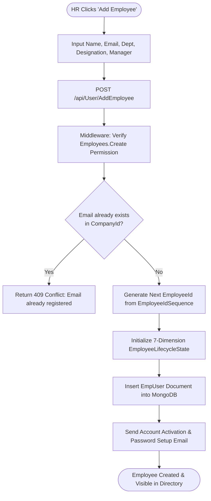
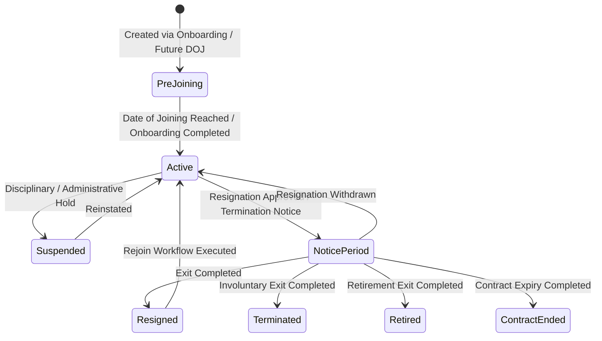

# Module Documentation — Core Employee Management (`EMPLOYEE`)

> **Document Status**: Complete & Authoritative  
> **Source-of-Truth**: Verified from Repository Implementation  
> **Primary Controller**: `UserController.cs`  
> **Primary Services**: `EmployeeService.cs` (364 KB), `EmployeeLifecycleTransitionService.cs`  
> **Primary Entity**: `EmpUser.cs`  
> **Last Verified**: September 2026

---

## 1. Module Overview

- **What the module is**: The central core HR registry that creates, stores, searches, and governs all employee records (`EmpUser`) within a tenant organization.
- **Why HR organizations need it**: Serves as the authoritative master record for identity, organizational hierarchy (department, designation, reporting manager), employment type (Full-Time, Part-Time, Contractual, Internship), and the 7 orthogonal lifecycle state dimensions.
- **What business problem it solves**: Eliminates fragmented employee spreadsheets and guarantees that attendance, leave, payroll, and separation modules all consume an identical, real-time employee state.
- **Who uses it**: **Company Administrators**, **HR Managers**, **HR Executives**, **Reporting Managers**, and **Employees**.
- **Where it fits in the HR lifecycle**: The central hub of the HR lifecycle—populated via direct HR creation, bulk Excel import, or automated promotion from the Recruitment Onboarding module.

---

## 2. Real-World Business Scenario

```text
Employee: Rahul Sharma (Employee ID: CJ-2026-0042)
Department: Engineering (Backend)
Designation: Senior Software Engineer
Reporting Manager: Ananya Verma (VP of Engineering)
Employment Type: Full-Time (1)
```
1. HR Manager Priya opens `/employees` and clicks **Add Employee** (or triggers bulk Excel import).
2. Enters Rahul's first name, last name, corporate email `rahul.sharma@codeji.in`, department `Engineering`, role `Employee`, and reporting manager `Ananya Verma`.
3. System atomically increments `EmployeeIdSequence` to assign `CJ-2026-0042`.
4. Initializes `EmpUser.Lifecycle` with `EmploymentStatus = "Active"`, `AvailabilityStatus = "Working"`, `AccountStatus = "Active"`, and `PayrollStatus = "Active"`.
5. Dispatches an email verification and password setup link via `InviteEmployeeDto`.

---

## 3. Supported Actors

| Actor | Capabilities in Module | Server Enforcement |
|---|---|---|
| **Company Administrator** | Full CRUD over all employee records, bulk imports, role reassignments, status overrides, and re-hiring. | Unconditional bypass in `RoleServices.VerifyUserAccess`. |
| **HR Manager / Executive**| Create, view, edit employee records; manage lifecycle transitions; initiate offboarding. | Enforced via `[ModulePermission(AppModule.Employees, Permission.View/Create/Edit)]`. |
| **Reporting Manager** | View directory and team members' basic employment profiles. | Scoped to directory read views (`Permission.View`). |
| **Employee** | View colleague directory; view and self-edit allowed personal profile fields. | Restricted from editing employment status, role, or manager. |

---

## 4. Frontend Implementation

| File | Responsibility | Calls | Used By |
|---|---|---|---|
| `src/app/modules/employees/Employees.tsx` | Main employee directory table with search, department/role filters, status pills, and Add/Import modal triggers. | `employeeServices.ts` | `PrivateRoutes.tsx` (`/employees`) |
| `src/app/modules/employees/EmployeeLifecycleManagement.tsx` | Workspace managing lifecycle policies, leave-to-status reconciliation, and open HR lifecycle cases. | `employeeLifecycleServices.ts` | `PrivateRoutes.tsx` (`/lifecycle-management`) |
| `src/app/modules/employees/components/EmployeeLifecycleCaseQueue.tsx` | Displays active probation, contract renewal, and long-term leave cases requiring HR review. | `employeeLifecycleServices.ts` | `EmployeeLifecycleManagement.tsx` |

---

## 5. Backend Implementation

| Backend File | Responsibility | Dependencies |
|---|---|---|
| `Codeji.CMS.API/Controllers/UserController.cs` (51.5 KB) | Exposes 60+ endpoints for employee CRUD, bulk import, profile queries, lifecycle transitions, and offboarding. | `IEmployeeService`, `IRoleService`, `IHttpContextAccessor` |
| `Codeji.CMS.Services/Employees/EmployeeService.cs` (364 KB) | Core domain service orchestrating employee creation, email uniqueness checks, sequence generation, lifecycle history tracking, and bulk imports. | `IMongoDbRepository<EmpUser>`, `IMongoDbRepository<Roles>`, `IEmailService` |
| `Codeji.CMS.Services/Employees/EmployeeLifecycleTransitionService.cs` | Validates and executes transitions across the 7 orthogonal lifecycle dimensions. | `IMongoDbRepository<EmpUser>` |
| `Codeji.CMS.Services/Employees/EmploymentPeriod.cs` | Pure domain helper determining whether an employee's joining and exit dates include them in a given attendance or payroll month. | `EmpUser` |

---

## 6. API Documentation

| Method | URL | Purpose | Auth / Permission | Request DTO | Validation & Business Logic | Response |
|---|---|---|---|---|---|---|
| `POST` | `/api/User/GetAllEmployees` | Paginated, filtered employee directory query. | `[ModulePermission(Employees, View)]` | `GetAllEmployeeRequestModel` | Filters by `CompanyId`, search keyword, department, role, and employment status. | `Result<GetAllEmployeeResponseModel>` |
| `POST` | `/api/User/AddEmployee` | Creates a new employee record and sends invitation email. | `[ModulePermission(Employees, Create)]` | `InviteEmployeeDto` | Verifies unique email in tenant; generates next `EmployeeId`; initializes `EmployeeLifecycleState`. | `Result<string>` |
| `POST` | `/api/User/UpdateEmployee` | Updates employment details (department, manager, role, status). | `[ModulePermission(Employees, Edit)]` | `UserModel` | Validates PAN/Bank regex; records lifecycle history if status changed. | `Result` |
| `POST` | `/api/User/BulkImportEmployees` | Batch imports employees from parsed Excel rows. | `[ModulePermission(Employees, Create)]` | `BulkImportEmployeesRequestDto` | Validates all rows for duplicate emails and valid departments; returns row-by-row success/error summary. | `Result<BulkImportEmployeesResponseDto>` |
| `DELETE`| `/api/User/DeleteEmployee/{id}` | Soft-deletes an employee record. | `[ModulePermission(Employees, Delete)]` | Route `id` | Sets `IsDeleted = true`, `Status = false`, and revokes active `RefreshToken` records. | `Result` |

---

## 7. Database Model

### Entity: `EmpUser` (`Codeji.CMS.Repository.Entities.Employees.EmpUser`)
- **Collection Name**: `EmpUser`
- **Primary Key**: `UserId`
- **Foreign Keys**: `CompanyId`, `RoleId`, `Department` (`DepartmentId`), `JobRole` (`JobRoleId`), `ReportingManager` (`UserId`).
- **Core Fields**: `FirstName`, `LastName`, `Email`, `EmployeeId`, `Gender`, `DateOfBirth`, `DateOfJoining`, `EmploymentType` (`1=FullTime`, `2=PartTime`, `3=Contractual`, `4=Internship`), `PhoneNumber`, `PanNumber`, `BankAccountNumber`.
- **State & Lifecycle Subdocument** (`EmpUser.Lifecycle` of type `EmployeeLifecycleState`):
  - `Version` (Optimistic concurrency integer)
  - `EmploymentStatus`: `PreJoining`, `Active`, `NoticePeriod`, `Suspended`, `Resigned`, `Terminated`, `Retired`, `ContractEnded`, `Deceased`.
  - `AvailabilityStatus`: `Working`, `AnnualLeave`, `SickLeave`, `MaternityLeave`, `Sabbatical`, `UnauthorizedAbsence`, `AbscondingUnderReview`.
  - `AccountStatus`: `Active`, `Locked`, `TemporarilyDisabled`, `Limited`, `Suspended`, `Closed`.
  - `PayrollStatus`: `Active`, `Hold`, `Paused`, `FinalSettlement`, `Closed`.
  - `OffboardingStatus`: `None`, `PendingManagerApproval`, `PendingHrApproval`, `NoticePeriod`, `Discussion`, `Completed`, `Withdrawn`.
  - `History`: `List<EmployeeLifecycleStatusHistory>` (Append-only transition log).

---

## 8. Business Rules

- **Unique Identity Rule**: No two active employees within the same `CompanyId` may share the same `Email` or `EmployeeId` (enforced via compound unique MongoDB indexes).
- **Self-Reporting Prohibition**: An employee's `ReportingManager` cannot be set to their own `UserId` (circular hierarchy check).
- **Regex Validation Rule**: `PanNumber` must match `[A-Z]{5}[0-9]{4}[A-Z]{1}$`; `BankAccountNumber` must match `^[0-9]{9,18}$`.
- **Active Authentication Rule**: `CompanyIdMiddleware` checks `EmpUser.Status == true` on every request. Flipping `Status = false` immediately blocks the user from executing any authenticated API call.

---

## 9. Complete Workflow



---

## 10. State Machine



---

## 11. Permissions

| Action | Admin | HR Manager | Reporting Manager | Employee |
|---|:---:|:---:|:---:|:---:|
| View Employee Directory | Yes | Yes | Yes | Yes |
| Create / Invite Employee | Yes | Yes | No | No |
| Bulk Import Employees | Yes | Yes | No | No |
| Edit Employment Status / Role | Yes | Yes | No | No |
| Delete / Deactivate Employee | Yes | Yes | No | No |

---

## 12. Dependencies

- **Depends On**: `CompanyMaster` (`Department`, `CompanyJobRole`, `EmployeeIdSequence`), `Roles`.
- **Used By**: `Attendance`, `LeaveManagement`, `WorkFromHome`, `PayRoll`, `Offboarding`, `NoticeBoard`.
- **Reads From**: `Department`, `CompanyJobRole`, `Roles`, `EmployeeIdSequence`.
- **Writes To**: `EmpUser`, `RefreshToken` (on deactivation).

---

## 13. Cross-Module Events

- **Employee Creation**: Triggers default leave balance allocation (`EmployeeLeaveBalance`) for active company leave policies.
- **Employee Deactivation**: Immediately invalidates JWT session verification in `CompanyIdMiddleware`, revokes all `RefreshToken` documents, and excludes the user from future attendance reminder jobs.

---

## 14. Failure Scenarios

- **Partial Bulk Import Failure**: If an uploaded Excel sheet contains 50 valid rows and 3 rows with invalid PAN formats or duplicate emails, `BulkImportEmployees` processes the valid records (or reports row-level validation errors in `BulkImportEmployeesResponseDto`) so HR can correct the specific failing rows.
- **Concurrent Lifecycle Update**: Protected by `EmpUser.Lifecycle.Version`. Concurrent updates return HTTP 409 Conflict.

---

## 15. Edge Cases

- **Future Date of Joining (`PreJoining`)**: If an employee is added with a `DateOfJoining` in the next month, `EmploymentPeriod.IsPayrollIncludedForMonth` automatically excludes them from the current month's payroll run.
- **Missing Reporting Manager**: Top-level executives (e.g. CEO / Founder) can have `ReportingManager = null`; their leave and resignation requests route directly to HR Managers.

---

## 16. Current Strengths

- Rich 7-dimensional lifecycle state model (`EmployeeLifecycleState`) with append-only audit history.
- Comprehensive bulk import validation with detailed error reporting.
- Strict compound unique indexing preventing duplicate employee IDs or emails per tenant.

---

## 17. Current Gaps

- **Monolithic Service File**: `EmployeeService.cs` is 364 KB and handles core user CRUD alongside offboarding and lifecycle cases, creating high cognitive load during maintenance.

---

## 18. Recommended Improvements

- **High (P1)**: Refactor `EmployeeService.cs` into smaller, domain-focused services (`EmployeeDirectoryService`, `EmployeeImportService`, `EmployeeOffboardingService`).

---

## 19. Future Scope

- Automated SCIM 2.0 directory provisioning integration with Okta, Azure AD (Entra ID), and Google Workspace.
