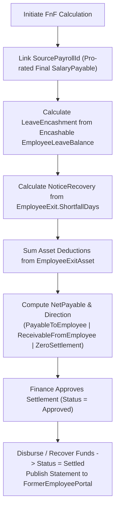
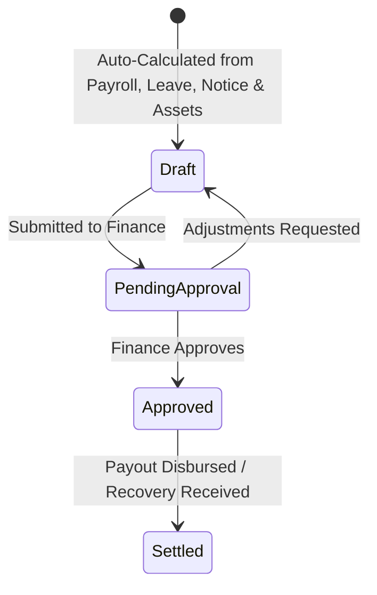

# FULL & FINAL SETTLEMENT MODULE (`FINAL-SETTLEMENT.md`)

## 1. Module Overview
The **Full & Final (FnF) Settlement Module** (`EmployeeFinalSettlement`) computes and reconciles the complete financial closure of a separating employee. It aggregates pro-rated final salary from `PayrollEntity` (`SourcePayrollId`), leave encashment (`LeaveEncashment`), approved expense reimbursements (`Reimbursements`), and bonuses (`BonusesAndIncentives`), then subtracts unserved notice period buyouts (`NoticeRecovery`), asset damage/unreturned recoveries (`EmployeeExitAsset.DeductionAmount`), and other dues (`OutstandingDues`) to determine `NetPayable` and settlement `Direction`.

---

## 2. Real-World Business Scenario
1. **Gathering Inputs for Rahul Sharma's Exit (`LWD: 2026-06-15`)**:
   - **Pro-rated June Salary (`SalaryPayable`)**: Linked via `SourcePayrollId` (`15` days worked in June = `₹50,000`).
   - **Leave Encashment (`LeaveEncashment`)**: Rahul has `12.0` days of encashable Earned Leave (`EL`). Using `BasicPay = ₹50,000` and `FIXED_30_DAYS` divisor, encashment = $12 \times \frac{50,000}{30} = ₹20,000$.
   - **Notice Shortfall Recovery (`NoticeRecovery`)**: Rahul had `10` unserved shortfall days (`ShortfallDays = 10`) = $10 \times \frac{1,00,000}{30} = ₹33,333.33$.
   - **Asset Damage Recovery (`OutstandingDues`)**: IT logged a `₹2,500` screen damage deduction on his returned laptop (`EmployeeExitAsset`).
2. **Net Settlement Calculation**:
   - Total Credits = $50,000 + 20,000 = ₹70,000$.
   - Total Debits = $33,333.33 + 2,500 = ₹35,833.33$.
   - **`NetPayable`** = $70,000 - 35,833.33 = \mathbf{₹34,166.67}$ (`Direction = PayableToEmployee`).
3. **Approval & Payout**:
   - Finance approves the settlement (`Status = Approved`), records payment reference (`Paid`), and publishes the FnF Statement to Rahul's Former Employee Portal.

---

## 3. Actors
| Actor | Capabilities |
|---|---|
| **Finance / Payroll Admin** | Calculates `EmployeeFinalSettlement`, links `SourcePayrollId`, adds manual adjustments, approves payout/recovery, and marks settlement `Settled`. |
| **HR Admin** | Verifies leave encashment days and notice recovery days feeding into FnF. |
| **Exiting / Former Employee** | Views detailed FnF breakdown and downloads signed settlement statement from `/former-employee`. |

---

## 4. Frontend Implementation
| File | Responsibility | Calls | Used By |
|---|---|---|---|
| `src/app/modules/offboarding/components/FinalSettlementTab.tsx` | Interactive worksheet displaying earnings (`SalaryPayable`, `LeaveEncashment`, `Reimbursements`, `BonusesAndIncentives`) vs deductions (`NoticeRecovery`, `OutstandingDues`, `Deductions`) and `NetPayable`. | `GET /api/employee-exit/{id}/settlement`, `POST /api/employee-exit/{id}/settlement/calculate`, `POST /api/employee-exit/{id}/settlement/approve` | Finance / HR Admin |
| `src/app/modules/offboarding/pages/FormerEmployeePortalPage.tsx` | Read-only view of approved FnF statement and payout status for alumni. | `GET /api/public/former-employee/summary` | Former Employee |

---

## 5. Backend Implementation
| Backend File | Responsibility | Dependencies |
|---|---|---|
| `Controllers/EmployeeExitController.cs` | Exposes FnF calculation, adjustment, approval, and payment confirmation endpoints. | `IEmployeeExitService` |
| `Services/EmployeeExitService.cs` | Pulls `PayrollEntity` (`SourcePayrollId`), encashable `EmployeeLeaveBalance`, `ShortfallDays`, and `EmployeeExitAsset` deductions to compute `EmployeeFinalSettlement`. | `IMongoRepository<EmployeeFinalSettlement>`, `IMongoRepository<PayrollEntity>`, `IMongoRepository<EmployeeLeaveBalance>`, `IMongoRepository<EmployeeExitAsset>` |

---

## 6. API Documentation
| Method | URL | Purpose | Auth / Permission | Request / Response | Side Effects |
|---|---|---|---|---|---|
| `GET` | `/api/employee-exit/{exitId}/settlement` | Retrieves current `EmployeeFinalSettlement` record for an exit case. | JWT (`offboarding:read`) | `EmployeeFinalSettlementDto` | None |
| `POST` | `/api/employee-exit/{exitId}/settlement/calculate` | Computes or recomputes FnF components from payroll, leave, notice, and asset records. | JWT (`payroll:create`) | `CalculateSettlementRequestDto` -> `EmployeeFinalSettlementDto` | Creates/updates `EmployeeFinalSettlement` |
| `POST` | `/api/employee-exit/{exitId}/settlement/approve` | Locks and approves the final settlement sheet. | JWT (`payroll:approve`) | `ApproveSettlementDto` | Unblocks `EmployeeExit` final completion |

---

## 7. Database Model
### `EmployeeFinalSettlement` (`CMS-Backend-Core/Codeji.CMS.Repository/Entities/EmployeeFinalSettlement.cs`)
- `Id` (`string`, PK)
- `CompanyId` (`string`, FK)
- `ExitId` (`string`, FK -> `EmployeeExit.Id`)
- `EmployeeId` (`string`, FK)
- `SourcePayrollId` (`string`, FK -> `PayrollEntity.Id`)
- `SalaryPayable` (`double`)
- `LeaveEncashment` (`double`)
- `Reimbursements` (`double`)
- `BonusesAndIncentives` (`double`)
- `Deductions` (`double`)
- `NoticeRecovery` (`double`)
- `OutstandingDues` (`double`)
- `NetPayable` (`double`)
- `Direction` (`SettlementDirection`: `PayableToEmployee` | `ReceivableFromEmployee` | `ZeroSettlement`)
- `Status` (`string`: `"Draft"` | `"PendingApproval"` | `"Approved"` | `"Settled"`)

---

## 8. Business Rules
- **Net Payable & Direction Formula**:
  $$\text{TotalEarnings} = \text{SalaryPayable} + \text{LeaveEncashment} + \text{Reimbursements} + \text{BonusesAndIncentives}$$
  $$\text{TotalRecoveries} = \text{Deductions} + \text{NoticeRecovery} + \text{OutstandingDues}$$
  $$\text{NetPayable} = \text{TotalEarnings} - \text{TotalRecoveries}$$
  - If $\text{NetPayable} > 0 \rightarrow \text{Direction} = \text{PayableToEmployee}$
  - If $\text{NetPayable} < 0 \rightarrow \text{Direction} = \text{ReceivableFromEmployee}$
  - If $\text{NetPayable} == 0 \rightarrow \text{Direction} = \text{ZeroSettlement}$
- **Payroll Linkage Rule**: `SalaryPayable` is anchored to `SourcePayrollId` (`PayrollEntity`) to prevent double payment between regular monthly payroll and FnF settlement.

---

## 9. Complete Workflow

---

## 10. State Machine

---

## 11. Permissions
- `offboarding:read` — View settlement breakdown.
- `payroll:create` / `payroll:approve` — Calculate and approve `EmployeeFinalSettlement`.

---

## 12. Dependencies
- **Upstream**: `PAYROLL` (`PayrollEntity`), `LEAVE` (`EmployeeLeaveBalance`), `NOTICE-PERIOD` (`ShortfallDays`), `ASSET-MANAGEMENT` (`EmployeeExitAsset`).
- **Downstream**: `OFFBOARDING` (completion gate & Former Employee Portal display).

---

## 13. Cross-Module Events
- Approving `EmployeeFinalSettlement` transitions `EmployeeLifecycle.PayrollStatus` to `FinalSettlementCompleted` (`4`).

---

## 14. Failure Scenarios
- **Negative Settlement (`ReceivableFromEmployee`)**: When `NoticeRecovery + OutstandingDues > TotalEarnings`, `Direction` is flagged as `ReceivableFromEmployee`, requiring employee payment clearance before relieving letters are unlocked.

---

## 15. Edge Cases
- **Zero Settlement (`NetPayable == 0`)**: Automatically marked ready for closure without requiring bank disbursement reference.

---

## 16. Current Strengths
- Direct foreign-key traceability (`SourcePayrollId`) between monthly payroll runs and final settlement prevents double-counting of final month wages.

---

## 17. Current Gaps
- Statutory Gratuity calculation ($15 / 26 \times \text{Last Drawn Basic} \times \text{Years of Service}$ for $\ge 5$ years tenure) is entered via `BonusesAndIncentives` rather than auto-computed by a dedicated gratuity rule.

---

## 18. Recommended Improvements
- Add an automated Gratuity eligibility and formula calculator when `DateOfExit - DateOfJoining >= 5 years`.

---

## 19. Future Scope
- Payment gateway link inside the Former Employee Portal for employees with `Direction == ReceivableFromEmployee` to pay notice buyout/asset recovery online.
