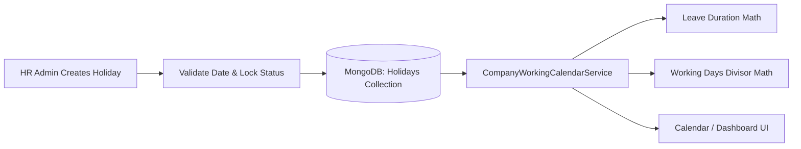

# HOLIDAYS MODULE (`HOLIDAY.md`)

## 1. Module Overview
The **Holidays Module** manages national, cultural, regional, and company-declared holidays (`Holidays`). It feeds directly into `CompanyWorkingCalendarService` to compute true net working days in a calendar month, prevent invalid leave/WFH bookings on non-working days, and supply holiday calendar feeds to frontend views.

---

## 2. Real-World Business Scenario
1. **Annual Calendar Declaration**: At the start of 2026, HR Admin uploads the company holiday list (`POST /api/holidays/batch`). This includes Republic Day (`2026-01-26`, National), Holi (`2026-03-25`, Cultural), and Independence Day (`2026-08-15`, National).
2. **Leave Application Interception**: When Rahul Sharma requests leave from `2026-08-14` to `2026-08-17`, `LeaveManagementService` calls `CompanyWorkingCalendarService.GetWorkingDaysBetween(startDate, endDate)`. Because `2026-08-15` is a declared holiday and `2026-08-16` is Sunday, net leave days applied is calculated as `2` days instead of `4`.
3. **Payroll Working Days Computation**: When `AutoPayrollServices` computes working days for August under divisor policy `WORKING_DAYS`, `Holidays` are deducted from calendar days alongside weekly offs.

---

## 3. Actors
| Actor | Capabilities |
|---|---|
| **HR Admin / Company Admin** | Adds, edits, or deletes holiday entries (`Holidays`), categorizes types, specifies applicable locations/departments. |
| **Employee** | Views upcoming holidays in self-service calendar and dashboard widgets. |

---

## 4. Frontend Implementation
| File | Responsibility | Calls | Used By |
|---|---|---|---|
| `src/app/modules/calendar/pages/HolidayCalendarPage.tsx` | Visual calendar highlighting all declared holidays with category chips. | `GET /api/holidays` | Employee / HR |
| `src/app/modules/settings/pages/HolidayManagementPage.tsx` | CRUD table for HR to add, edit, or remove holidays for the active year. | `POST /api/holidays`, `PUT /api/holidays/{id}`, `DELETE /api/holidays/{id}` | HR Admin |

---

## 5. Backend Implementation
| Backend File | Responsibility | Dependencies |
|---|---|---|
| `Controllers/HolidaysController.cs` | Exposes REST endpoints for holiday listings, creations, updates, and removals. | `IHolidaysService` |
| `Services/HolidaysService.cs` | Validates holiday dates, prevents duplicates, enforces tenant boundaries, and manages holiday caches. | `IMongoRepository<Holidays>` |
| `Services/CompanyWorkingCalendarService.cs` | Consumes `Holidays` collection to determine if a date is a non-working business day. | `IMongoRepository<Holidays>`, `IMongoRepository<WeeklyOffSetting>` |

---

## 6. API Documentation
| Method | URL | Purpose | Auth / Permission | Request / Response | Side Effects |
|---|---|---|---|---|---|
| `GET` | `/api/holidays` | Lists all holidays for the tenant in a given year. | JWT (`calendar:read`) | `List<HolidaysDto>` | None |
| `POST` | `/api/holidays` | Creates a new declared holiday. | JWT (`settings:update`) | `CreateHolidayDto` -> `HolidaysDto` | Invalidates working calendar cache |
| `PUT` | `/api/holidays/{id}` | Modifies holiday details (name, date, category). | JWT (`settings:update`) | `UpdateHolidayDto` | Invalidates working calendar cache |
| `DELETE` | `/api/holidays/{id}` | Soft-deletes a declared holiday (`IsDeleted = true`). | JWT (`settings:update`) | None | Updates working calendar cache |

---

## 7. Database Model
### `Holidays` (`CMS-Backend-Core/Codeji.CMS.Repository/Entities/Holidays.cs`)
- `Id` (`string`, PK)
- `CompanyId` (`string`, FK)
- `Name` (`string`, e.g., `"Republic Day"`)
- `Date` (`DateTime`)
- `Description` (`string`)
- `Type` (`string`, `"National"` / `"Cultural"` / `"Optional"` / `"Gazetted"`)
- `IsRestricted` (`bool`, indicates optional/floating holiday)
- `IsDeleted` (`bool`, soft delete)
- `CreatedBy` (`string`)
- `CreatedDate` (`DateTime`)

---

## 8. Business Rules
- **Unique Date Rule**: A tenant cannot have two non-restricted holidays defined for the exact same calendar date.
- **Lock Protection Rule**: Holidays cannot be added, edited, or removed for a past month where `AttendanceMonthLock.IsLocked == true`.
- **Working Calendar Integration**: Every active holiday entry on a weekday automatically decrements the count of billable/payable working days for that month when using `WORKING_DAYS` payroll divisor policy.

---

## 9. Complete Workflow

---

## 10. State Machine
`Holidays` entities represent immutable date declarations (`Active` $\leftrightarrow$ `SoftDeleted`).

---

## 11. Permissions
- `calendar:read` — View holiday schedules.
- `settings:update` — Create, update, or remove declared holidays.

---

## 12. Dependencies
- **Upstream**: `COMPANY-SETTINGS`.
- **Downstream**: `CALENDAR` (`CompanyWorkingCalendarService`), `LEAVE` (duration calculation), `PAYROLL` (`AutoPayrollServices` divisor calculation).

---

## 13. Cross-Module Events
- Modifying a holiday recalculates pending leave request durations and updates `CompanyWorkingCalendarService` working day matrices.

---

## 14. Failure Scenarios
- **Duplicate Holiday Entry**: Service returns `409 Conflict` if the date is already claimed.

---

## 15. Edge Cases
- **Holiday Falling on a Weekly Off (e.g., Sunday)**: `CompanyWorkingCalendarService` deduplicates the date so it is not double-subtracted from monthly working days.

---

## 16. Current Strengths
- High reuse across Leave, Attendance, Calendar, and Payroll engines via unified `CompanyWorkingCalendarService`.

---

## 17. Current Gaps
- Location-specific holiday calendars (e.g., US office vs India office) currently share a single tenant holiday table unless partitioned by custom tags.

---

## 18. Recommended Improvements
- Add `BranchId` or `LocationId` foreign key to `Holidays` for multi-location enterprises.

---

## 19. Future Scope
- Support for optional/floating holiday allowance booking workflows.
