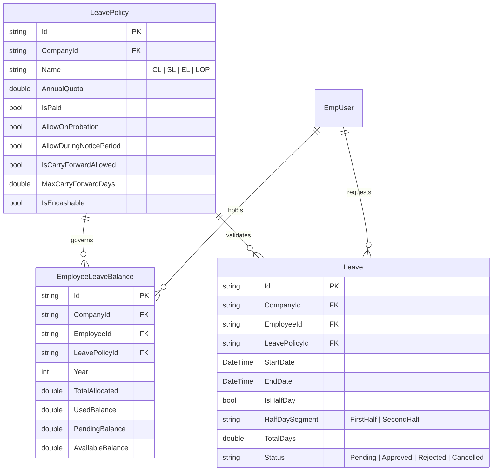
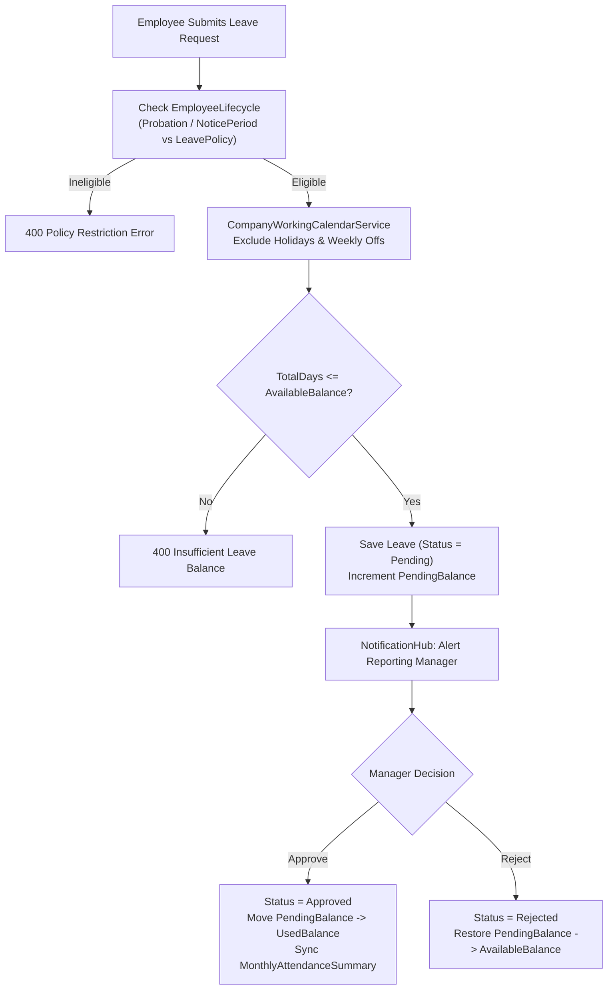
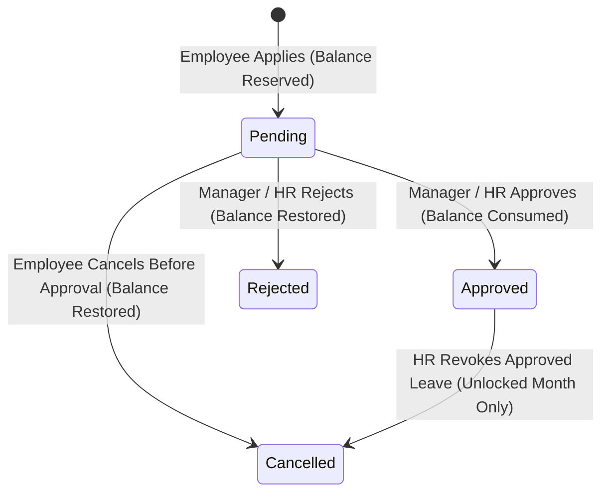

# LEAVE MANAGEMENT MODULE (`LEAVE.md`)

## 1. Module Overview
The **Leave Management Module** handles configurable leave policies (`LeavePolicy`), automated monthly/annual leave accrual (`LeaveAccrualHostedService`), employee leave balances (`EmployeeLeaveBalance`), leave request submission with half-day segment support, working-day intersection calculations (`CompanyWorkingCalendarService`), manager/HR approvals, and leave encashment integration with Final Settlement (`EmployeeFinalSettlement`).

---

## 2. Real-World Business Scenario
1. **Accrual**: On the 1st of every month, `LeaveAccrualHostedService` credits `1.5` days of Earned Leave (`EL`) and `1.0` day of Casual Leave (`CL`) into Rahul Sharma's `EmployeeLeaveBalance` for `CompanyId`.
2. **Application**: Rahul applies for 3 days of `CL` (`2026-04-20` to `2026-04-22`). `LeaveManagementService` checks:
   - Is Rahul eligible (`LeavePolicy.AllowOnProbation`, `AllowDuringNoticePeriod`)?
   - Are any of those dates weekly offs or holidays via `CompanyWorkingCalendarService`?
   - Does Rahul have sufficient `AvailableBalance` in `EmployeeLeaveBalance`?
3. **Approval & Attendance Sync**: Reporting Manager approves the leave (`POST /api/leave/{id}/approve`). `EmployeeLeaveBalance` deducts `3.0` days (`UsedBalance += 3.0`), `NotificationService` alerts Rahul, and `MonthlyAttendanceSummary` treats those 3 dates as paid leave (`L`) rather than unpaid absence (`UnpaidDays`).

---

## 3. Actors
| Actor | Capabilities |
|---|---|
| **Employee** | Views `EmployeeLeaveBalance`, applies for full-day or half-day leave, cancels pending leave requests. |
| **Reporting Manager / HR** | Reviews team leave calendar, approves or rejects leave requests with remarks. |
| **HR Admin** | Creates and updates `LeavePolicy` rules (quota, carry-forward, probation/notice eligibility, encashment). |
| **Background Worker (`LeaveAccrualHostedService`)** | Runs scheduled accrual credits and year-end carry-forward calculations. |

---

## 4. Frontend Implementation
| File | Responsibility | Calls | Used By |
|---|---|---|---|
| `src/app/modules/leave/pages/LeaveDashboard.tsx` | Displays leave balance cards (`Total`, `Used`, `Pending`, `Available`) and application history. | `GET /api/leave/balances`, `GET /api/leave/my-leaves` | Employee |
| `src/app/modules/leave/components/ApplyLeaveModal.tsx` | Form for selecting leave type, start/end dates, half-day option, and reason. | `POST /api/leave/apply` | Employee |
| `src/app/modules/leave/pages/LeaveApprovalsPage.tsx` | Manager/HR queue to approve or reject team leave applications. | `GET /api/leave/pending`, `POST /api/leave/{id}/approve`, `POST /api/leave/{id}/reject` | Manager / HR |
| `src/app/modules/settings/pages/LeavePolicySettings.tsx` | Configures tenant `LeavePolicy` parameters. | `GET /api/leave/policies`, `POST /api/leave/policies` | HR Admin |

---

## 5. Backend Implementation
| Backend File | Responsibility | Dependencies |
|---|---|---|
| `Controllers/LeaveManagementController.cs` | Exposes endpoints for leave policies, balances, leave application, approval, rejection, and cancellation. | `ILeaveManagementService` |
| `Services/LeaveManagementService.cs` | Validates eligibility (`EmployeeLifecycle`, `LeavePolicy`), computes net leave days via `CompanyWorkingCalendarService`, updates `EmployeeLeaveBalance`, and triggers notifications. | `IMongoRepository<Leave>`, `IMongoRepository<LeavePolicy>`, `IMongoRepository<EmployeeLeaveBalance>`, `ICompanyWorkingCalendarService` |
| `Services/HostedServices/LeaveAccrualHostedService.cs` | Background worker that executes periodic leave accrual credits into `EmployeeLeaveBalance`. | `IMongoRepository<LeavePolicy>`, `IMongoRepository<EmployeeLeaveBalance>` |

---

## 6. API Documentation
| Method | URL | Purpose | Auth / Permission | Request / Response | Side Effects |
|---|---|---|---|---|---|
| `GET` | `/api/leave/balances` | Returns current leave balances by leave type for the employee. | JWT (`leave:read`) | `List<EmployeeLeaveBalanceDto>` | None |
| `POST` | `/api/leave/apply` | Submits a new leave request (`Pending`). | JWT (`leave:create`) | `ApplyLeaveDto` -> `LeaveDto` | Reserves `PendingBalance`, notifies manager |
| `POST` | `/api/leave/{id}/approve` | Approves a pending leave request. | JWT (`leave:approve`) | `ApproveLeaveDto` | Moves `PendingBalance -> UsedBalance`, notifies employee |
| `POST` | `/api/leave/{id}/reject` | Rejects a pending leave request. | JWT (`leave:approve`) | `RejectLeaveDto` (`Reason`) | Releases `PendingBalance`, notifies employee |
| `POST` | `/api/leave/policies` | Creates or updates a company `LeavePolicy`. | JWT (`settings:update`) | `LeavePolicyDto` | Persists `LeavePolicy` |

---

## 7. Database Model

---

## 8. Business Rules
- **Lifecycle Eligibility Rule**:
  - If `EmployeeLifecycle.EmploymentStatus == Probation` and `!LeavePolicy.AllowOnProbation`, the leave request is rejected.
  - If `EmployeeLifecycle.EmploymentStatus == NoticePeriod` and `!LeavePolicy.AllowDuringNoticePeriod`, the leave request is rejected.
- **Working Calendar Intersection Rule**: Holidays (`Holidays`) and weekly offs (`WeeklyOffSetting`) inside `[StartDate, EndDate]` are excluded from `TotalDays` unless the policy configures sandwich rules.
- **Overlap Rule**: An employee cannot apply for a leave on dates that already have an `Approved` or `Pending` leave or overlapping full-day WFH request.
- **Balance Rule**: For paid leave policies (`IsPaid == true`), `TotalDays` cannot exceed `AvailableBalance` (`TotalAllocated - UsedBalance - PendingBalance`).

---

## 9. Complete Workflow

---

## 10. State Machine

---

## 11. Permissions
- `leave:read` — View balances and leave history.
- `leave:create` — Apply for leave or cancel own pending leave.
- `leave:approve` — Approve or reject employee leave requests.

---

## 12. Dependencies
- **Upstream**: `EMPLOYEE` (`EmployeeLifecycle`), `CALENDAR` (`CompanyWorkingCalendarService`), `HOLIDAY` (`Holidays`).
- **Downstream**: `ATTENDANCE` (`MonthlyAttendanceSummary` paid/unpaid day accounting), `FINAL-SETTLEMENT` (`LeaveEncashment` for `IsEncashable` balances).

---

## 13. Cross-Module Events
- **Leave Approval**: Updates `AvailabilityStatus = OnLeave` during active leave dates and marks days as paid leave in `MonthlyAttendanceSummary`.
- **Exit Initiation**: Encashable `AvailableBalance` is queried during `EmployeeFinalSettlement` calculation.

---

## 14. Failure Scenarios
- **Retroactive Leave on Locked Attendance Month**: Rejected if `AttendanceMonthLock.IsLocked == true` for the target month.

---

## 15. Edge Cases
- **Half-Day Leave (`IsHalfDay = true`)**: Deducts `0.5` days from `EmployeeLeaveBalance` and adjusts `EffectiveOfficeScheduleService` for the remaining half-day shift.

---

## 16. Current Strengths
- Automated background accrual (`LeaveAccrualHostedService`) combined with strict `Probation` and `NoticePeriod` policy enforcement.

---

## 17. Current Gaps
- Multi-level sequential approval chains (e.g., L1 Reporting Manager $\rightarrow$ L2 Department Head for leaves $> 5$ days) currently execute as single-step approval.

---

## 18. Recommended Improvements
- Add configurable multi-stage approval thresholds based on `TotalDays`.

---

## 19. Future Scope
- Automated year-end leave encashment batch job feeding directly into December/March `AutoPayrollServices`.
