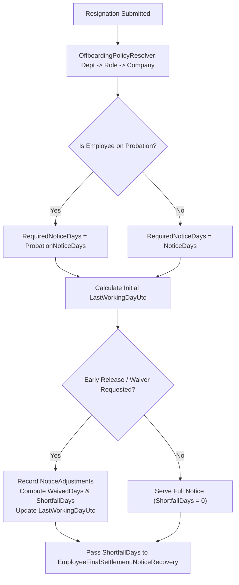
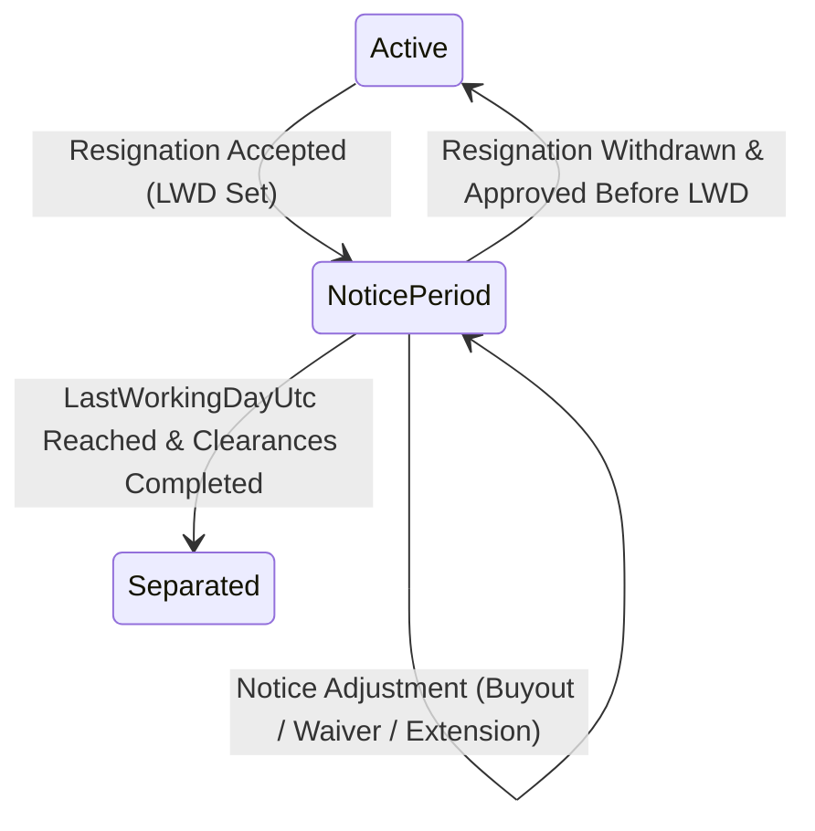

# NOTICE PERIOD MANAGEMENT MODULE (`NOTICE-PERIOD.md`)

## 1. Module Overview
The **Notice Period Management Module** governs the transition phase between resignation/termination initiation and an employee's `LastWorkingDayUtc` (`LWD`). It resolves notice duration via `OffboardingPolicyResolver` (`NoticeDays` vs `ProbationNoticeDays`), manages notice buyouts, waivers, and shortfall calculations (`NoticeAdjustments`), enforces leave restrictions during notice (`AllowDuringNoticePeriod`), and feeds `NoticeRecovery` or buyout credits directly into `EmployeeFinalSettlement`.

---

## 2. Real-World Business Scenario
1. **Resignation & Notice Snapshot**:
   - Rahul Sharma (confirmed Engineering employee) submits his resignation on `2026-05-01`.
   - `OffboardingPolicyResolver` resolves the Engineering department `EmployeeExitPolicy`, snapping `NoticeDays = 60` into `EmployeeExit.PolicySnapshot`.
   - Expected `LastWorkingDayUtc` is calculated as `2026-06-30` (`60` calendar days).
   - `EmployeeLifecycle` transitions `EmploymentStatus` to `NoticePeriod` (`4`) and `OffboardingStatus` to `NoticePeriod` (`2`).
2. **Notice Buyout / Shortfall Adjustment**:
   - Rahul requests an early release on `2026-06-15` (`15` days early).
   - Reporting Manager and HR approve a 5-day waiver (`WaivedDays = 5`) and a 10-day buyout (`ShortfallDays = 10`, `BuyoutApplicable = true`).
   - `EmployeeFinalSettlement` automatically computes `NoticeRecovery` for the `10` unserved shortfall days using the active payroll divisor policy.

---

## 3. Actors
| Actor | Capabilities |
|---|---|
| **Employee** | Submits resignation, views calculated `LastWorkingDayUtc`, requests early release / notice buyout. |
| **Reporting Manager** | Reviews proposed `LastWorkingDayUtc`, approves or rejects early release and handover schedule. |
| **HR Admin** | Configures `EmployeeExitPolicy` (`NoticeDays`, `ProbationNoticeDays`, `BuyoutAllowed`), records `NoticeAdjustments` (waiver vs recovery). |

---

## 4. Frontend Implementation
| File | Responsibility | Calls | Used By |
|---|---|---|---|
| `src/app/modules/offboarding/pages/MyResignationPage.tsx` | Displays required `NoticeDays`, calculated `LastWorkingDayUtc`, served days counter, and early release request form. | `POST /api/employee-exit/initiate`, `GET /api/employee-exit/my-exit` | Employee |
| `src/app/modules/offboarding/components/NoticeAdjustmentModal.tsx` | HR/Manager interface to modify `LastWorkingDayUtc`, grant `WaivedDays`, or apply `ShortfallDays` recovery. | `PUT /api/employee-exit/{id}/notice-adjustment` | HR / Manager |

---

## 5. Backend Implementation
| Backend File | Responsibility | Dependencies |
|---|---|---|
| `Services/OffboardingPolicyResolver.cs` | Resolves exact `NoticeDays` vs `ProbationNoticeDays` using 3-tier precedence (Department -> Role -> Company) and creates immutable `EmployeeExitPolicySnapshot`. | `IMongoRepository<EmployeeExitPolicy>` |
| `Services/EmployeeExitService.cs` | Computes initial `LastWorkingDayUtc`, processes `NoticeAdjustments` (waiver, buyout, extension), and updates `EmployeeExitAttendanceCutoff`. | `IMongoRepository<EmployeeExit>`, `IMongoRepository<EmployeeExitAttendanceCutoff>` |
| `Services/LeaveManagementService.cs` | Restricts leave applications during notice period based on `LeavePolicy.AllowDuringNoticePeriod`. | `IMongoRepository<LeavePolicy>` |

---

## 6. API Documentation
| Method | URL | Purpose | Auth / Permission | Request / Response | Side Effects |
|---|---|---|---|---|---|
| `POST` | `/api/employee-exit/initiate` | Initiates resignation/exit and calculates `LastWorkingDayUtc` from resolved policy. | JWT (`offboarding:create`) | `InitiateExitDto` -> `EmployeeExitDto` | Sets `EmploymentStatus = NoticePeriod`, snapshots policy |
| `PUT` | `/api/employee-exit/{id}/notice-adjustment` | Records notice waiver, buyout, or LWD extension (`NoticeAdjustments`). | JWT (`offboarding:update`) | `NoticeAdjustmentDto` | Updates `LastWorkingDayUtc`, syncs `EmployeeExitAttendanceCutoff` |

---

## 7. Database Model
### Embedded in `EmployeeExit` (`CMS-Backend-Core/Codeji.CMS.Repository/Entities/EmployeeExit.cs`)
- `PolicySnapshot` (`EmployeeExitPolicySnapshot`):
  - `NoticeDays` (`int`)
  - `ProbationNoticeDays` (`int`)
  - `BuyoutAllowed` (`bool`)
  - `WaiverAllowed` (`bool`)
- `RequiredNoticeDays` (`int`)
- `ServedNoticeDays` (`int`)
- `ShortfallDays` (`int`)
- `WaivedDays` (`int`)
- `LastWorkingDayUtc` (`DateTime`)
- `NoticeAdjustments` (`List<NoticeAdjustmentEntry>`)

---

## 8. Business Rules
- **Probation vs Confirmed Rule**:
  - If `EmployeeLifecycle.EmploymentStatus == Probation`, `RequiredNoticeDays = PolicySnapshot.ProbationNoticeDays`.
  - Otherwise, `RequiredNoticeDays = PolicySnapshot.NoticeDays`.
- **Shortfall Math Rule**:
  $$\text{ShortfallDays} = \max(0, \text{RequiredNoticeDays} - \text{ServedNoticeDays} - \text{WaivedDays})$$
- **Leave Restriction Rule**: While in `NoticePeriod`, any leave type where `LeavePolicy.AllowDuringNoticePeriod == false` is automatically blocked.
- **Policy Immutability Rule**: Once `EmployeeExit` is created, `PolicySnapshot` is frozen on the document so subsequent edits to `EmployeeExitPolicy` do not alter an in-flight employee's notice terms.

---

## 9. Complete Workflow

---

## 10. State Machine

---

## 11. Permissions
- `offboarding:create` — Submit resignation.
- `offboarding:update` — Approve early release, buyout, or notice waiver.

---

## 12. Dependencies
- **Upstream**: `PROBATION` (`EmploymentStatus`), `POLICY` (`EmployeeExitPolicy`, `OffboardingPolicyResolver`).
- **Downstream**: `LEAVE` (`AllowDuringNoticePeriod`), `ATTENDANCE` (`EmployeeExitAttendanceCutoff`), `FINAL-SETTLEMENT` (`NoticeRecovery`).

---

## 13. Cross-Module Events
- **LWD Change**: Automatically updates `EmployeeExitAttendanceCutoff.LastWorkingDayUtc` so attendance blocking aligns with the revised date.

---

## 14. Failure Scenarios
- **Buyout Requested When `BuyoutAllowed == false`**: Rejected by `EmployeeExitService` unless HR explicitly overrides with `WaiverAllowed`.

---

## 15. Edge Cases
- **Resignation Withdrawal**: If an employee withdraws their resignation before `LastWorkingDayUtc` and HR approves, `EmployeeLifecycle` reverts from `NoticePeriod` (`4`) back to `Active` (`3`) or `Probation` (`2`).

---

## 16. Current Strengths
- Immutable `EmployeeExitPolicySnapshot` guarantees contractual fairness and auditability even if company policies change mid-notice.

---

## 17. Current Gaps
- Automated extension of `LastWorkingDayUtc` when an employee takes unpaid leave during notice is currently handled via manual HR `NoticeAdjustments` rather than an automatic day-for-day shift.

---

## 18. Recommended Improvements
- Add an optional `ExtendLwdOnLeaveDuringNotice` boolean flag to `EmployeeExitPolicy`.

---

## 19. Future Scope
- Interactive notice buyout cost estimator on the employee self-service resignation form.
