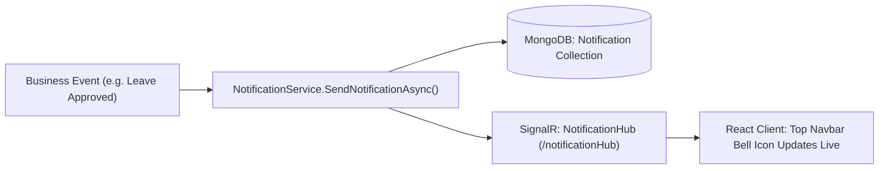

# NOTIFICATIONS & REAL-TIME MESSAGING MODULE (`NOTIFICATIONS.md`)

## 1. Module Overview
The **Notifications & Real-Time Messaging Module** powers push alerts, in-app notifications (`NotificationService`), bi-directional real-time communication via ASP.NET Core SignalR hubs (`NotificationHub` mounted at `/notificationHub` and `ChatHub` mounted at `/chatHub`), and resilient background email/dispatch processing (`EmployeeExitOutboxProcessor`, `AttendanceReminderHostedService`).

---

## 2. Real-World Business Scenario
1. **Real-Time Leave Approval Alert**:
   - When Rahul's manager approves his leave application (`POST /api/leave/{id}/approve`), `LeaveManagementService` invokes `INotificationService.SendNotificationAsync(userId, title, message)`.
   - `NotificationService` persists the notification in MongoDB (`Notification` collection) and invokes `IHubContext<NotificationHub>.Clients.User(userId).SendAsync("ReceiveNotification", payload)`.
   - Rahul's browser receives the WebSocket message instantly and updates the top navigation bell badge without requiring a page refresh.
2. **Reliable Post-Exit Magic Link Delivery**:
   - When Rahul's exit is completed, direct email sending could fail if the SMTP server is down.
   - Instead, `EmployeeExitService` enqueues an `EmployeeExitOutbox` document inside the same database transaction.
   - `EmployeeExitOutboxProcessor` picks up the record, delivers the magic link email, and marks `IsProcessed = true`.

---

## 3. Actors
| Actor | Capabilities |
|---|---|
| **All Employees / Managers / Admins** | Receive in-app bell notifications, mark notifications as read, connect to SignalR hubs. |
| **System Background Workers** | `AttendanceReminderHostedService` and `EmployeeExitOutboxProcessor` push periodic and event-driven notifications. |

---

## 4. Frontend Implementation
| File | Responsibility | Calls | Used By |
|---|---|---|---|
| `src/app/modules/notifications/components/NotificationBell.tsx` | Top navbar badge displaying unread count and popover dropdown with recent notifications. | `GET /api/notifications`, `PUT /api/notifications/{id}/read` | All Users |
| `src/server/signalr.ts` / SignalR client connection | Establishes WebSocket / Server-Sent Events connection to `/notificationHub` with JWT token. | WS `/notificationHub` | Entire App |
| `src/app/modules/chat/ChatWidget.tsx` | Real-time colleague chat widget connected to `/chatHub`. | WS `/chatHub`, `GET /api/chat/messages` | All Users |

---

## 5. Backend Implementation
| Backend File | Responsibility | Dependencies |
|---|---|---|
| `Hubs/NotificationHub.cs` | SignalR hub mapping authenticated `userId` to connection IDs and broadcasting user notifications. | `[Authorize]`, SignalR core |
| `Hubs/ChatHub.cs` | SignalR hub enabling 1-on-1 and group messaging between colleagues. | `[Authorize]`, SignalR core |
| `Controllers/NotificationController.cs` | Endpoints to fetch user notification history, unread counts, and mark items as read. | `INotificationService` |
| `Services/NotificationService.cs` | Handles database persistence of notifications and real-time delivery via `IHubContext<NotificationHub>`. | `IMongoRepository<Notification>`, `IHubContext<NotificationHub>` |
| `Services/HostedServices/EmployeeExitOutboxProcessor.cs` | Background processor ensuring asynchronous exit notification guarantees. | `IMongoRepository<EmployeeExitOutbox>` |

---

## 6. API Documentation
| Method | URL | Purpose | Auth / Permission | Request / Response | Side Effects |
|---|---|---|---|---|---|
| `GET` | `/api/notifications` | Retrieves paginated notification history for current user. | JWT | `List<NotificationDto>` | None |
| `GET` | `/api/notifications/unread-count` | Returns count of unread notifications for navbar badge. | JWT | `{ UnreadCount: int }` | None |
| `PUT` | `/api/notifications/{id}/read` | Marks a specific notification as read (`IsRead = true`). | JWT | None | Updates notification entity |
| `PUT` | `/api/notifications/mark-all-read` | Marks all active notifications for user as read. | JWT | None | Bulk updates `IsRead = true` |
| `WS` | `/notificationHub` | SignalR WebSocket connection endpoint. | JWT (`access_token` query/header) | Bi-directional events (`ReceiveNotification`) | Registers active connection |

---

## 7. Database Model
### `Notification` (`CMS-Backend-Core/Codeji.CMS.Repository/Entities/Notification.cs`)
- `Id` (`string`, PK)
- `CompanyId` (`string`, FK)
- `UserId` (`string`, FK -> `EmpUser.Id`)
- `Title` (`string`)
- `Message` (`string`)
- `Category` (`string`, `"Leave"` | `"Attendance"` | `"Payroll"` | `"Offboarding"` | `"System"`)
- `ActionUrl` (`string`)
- `IsRead` (`bool`)
- `CreatedDate` (`DateTime`)

---

## 8. Business Rules
- **Tenant Isolation**: Users only receive notifications belonging strictly to their `CompanyId` and assigned `UserId`.
- **SignalR Connection Authentication**: The SignalR client must pass the JWT token either in the `Authorization: Bearer` header or in the `access_token` query parameter during WebSocket handshake.

---

## 9. Complete Workflow

---

## 10. State Machine
`Notification`: `Unread` (`IsRead = false`) $\rightarrow$ `Read` (`IsRead = true`).

---

## 11. Permissions
- Any authenticated user can read and manage their own notifications.

---

## 12. Dependencies
- **Upstream**: All operational modules (`LEAVE`, `ATTENDANCE`, `PAYROLL`, `OFFBOARDING`).
- **Downstream**: Frontend notification widgets and sound alerts.

---

## 13. Cross-Module Events
- Used everywhere across Codeji CMS to inform actors of workflow approvals, exceptions, and lifecycle transitions.

---

## 14. Failure Scenarios
- **Client Offline / WebSocket Disconnected**: The notification is still saved to MongoDB; the unread badge and list appear upon the user's next login or page load.

---

## 15. Edge Cases
- **Simultaneous Multiple Browser Tabs**: SignalR delivers to all connection IDs mapped to the user ID; marking read on one tab emits an update event to close badges on other tabs.

---

## 16. Current Strengths
- Native real-time WebSocket communication combined with durable database storage and outbox reliability.

---

## 17. Current Gaps
- Browser Web Push / Service Worker notifications (when the browser tab is closed) are not yet enabled; notifications require an active browser session.

---

## 18. Recommended Improvements
- Add VAPID-based Web Push Notifications for background mobile/desktop browser delivery.

---

## 19. Future Scope
- WhatsApp Business / Slack notification webhook dispatchers for critical leave and attendance alerts.
