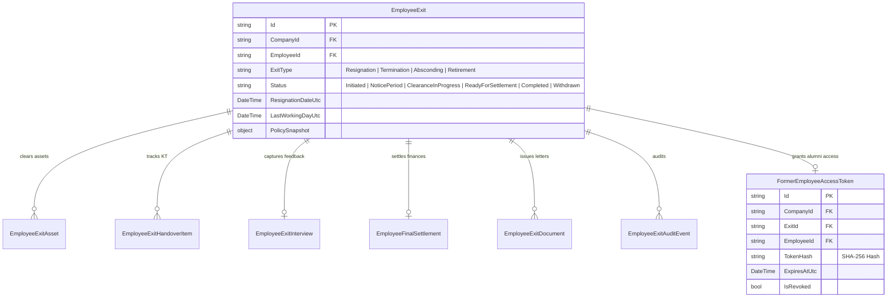
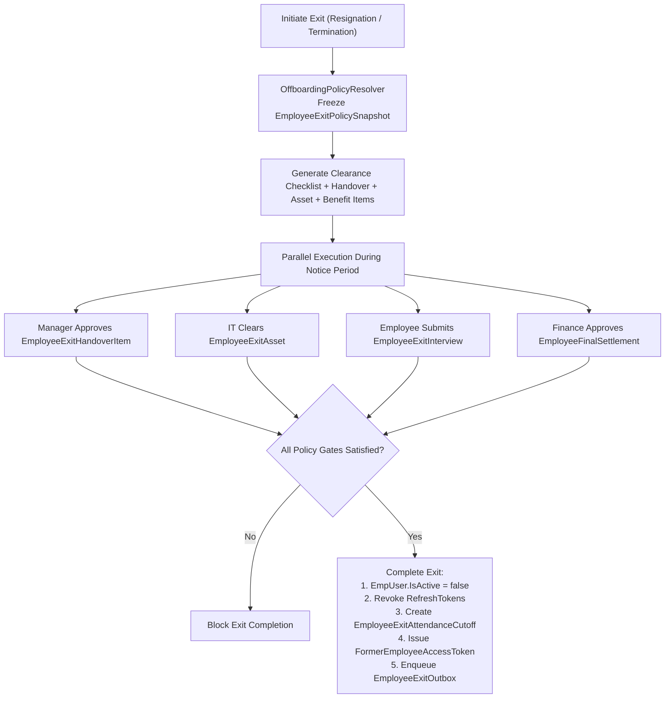
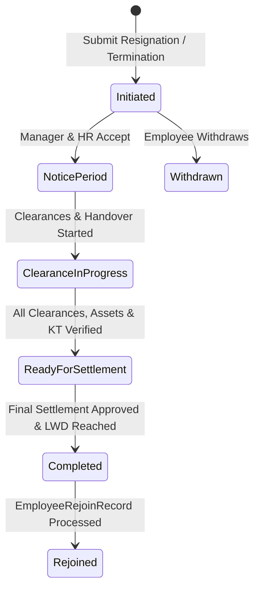

# OFFBOARDING, CLEARANCE & FORMER EMPLOYEE PORTAL MODULE (`OFFBOARDING.md`)

## 1. Module Overview
The **Offboarding, Clearance & Former Employee Portal Module** is one of the most comprehensive multi-stage engines in **Codeji CMS / HRMS**. It governs employee resignation/termination (`EmployeeExit`), dynamic policy resolution (`OffboardingPolicyResolver`), multi-department clearance checklists (`EmployeeExitClearanceTemplate` across IT, Finance, Admin, Reporting Manager, HR), knowledge transfer (`EmployeeExitHandoverItem`), exit interviews (`EmployeeExitInterview`), reliable event outbox processing (`EmployeeExitOutboxProcessor`), account deactivation & attendance cutoff (`EmployeeExitAttendanceCutoff`), and token-based post-exit self-service (`FormerEmployeeAccessToken` & `PublicFormerEmployeePortalController`).

---

## 2. Real-World Business Scenario
1. **Initiation & Policy Snapshot**:
   - Rahul Sharma submits his resignation on `2026-05-01`. `OffboardingPolicyResolver` matches his Engineering department policy (`NoticeDays = 60`, `RequireExitInterview = true`, `RequireHandover = true`, `RequireAssetClearance = true`, `FormerEmployeePortalDays = 90`) and embeds an immutable `EmployeeExitPolicySnapshot` inside `EmployeeExit`.
2. **Parallel Multi-Department Clearances**:
   - `EmployeeExitService` instantiates department clearance tasks from `EmployeeExitClearanceTemplate`:
     - **Reporting Manager**: Approves `EmployeeExitHandoverItem` list (code repositories, documentation transferred to colleague).
     - **IT Admin**: Revokes VPN/GitHub access and clears assigned laptop in `EmployeeExitAsset`.
     - **Finance**: Verifies zero travel advance dues and prepares `EmployeeFinalSettlement`.
     - **HR**: Conducts `EmployeeExitInterview` and generates `EmployeeExitDocument` (Relieving Letter & Experience Certificate).
3. **Final Completion & Outbox Execution**:
   - On `LastWorkingDayUtc` (`2026-06-30`), once all clearance gates pass, HR clicks **Complete Exit** (`POST /api/employee-exit/{id}/complete`).
   - `EmployeeExitService` sets `EmpUser.IsActive = false`, revokes all active `RefreshToken` sessions, writes `EmployeeExitAttendanceCutoff`, transitions `EmployeeLifecycle` (`EmploymentStatus = Separated`, `AccountStatus = Deactivated`, `FormerPortalStatus = Enabled`, `AlumniStatus = Eligible`), and writes an `EmployeeExitOutbox` event.
4. **Former Employee Portal Access**:
   - `EmployeeExitOutboxProcessor` dispatches an email containing a magic link with a SHA-256 hashed `FormerEmployeeAccessToken` (`ExpiresAtUtc = LWD + 90 days`).
   - Rahul accesses `/former-employee` via `PublicFormerEmployeePortalController` (`[AllowAnonymous]`) to download his Relieving Letter, Final Settlement statement, and last 6 salary slips without needing active internal credentials.

---

## 3. Actors
| Actor | Capabilities |
|---|---|
| **Employee** | Initiates resignation, tracks clearance progress, submits `EmployeeExitHandoverItem` tasks, completes `EmployeeExitInterview`. |
| **Reporting Manager** | Approves resignation & LWD, verifies handover completion. |
| **IT / Asset / Finance Admins** | Complete department-specific clearance items, log asset returns (`EmployeeExitAsset`), and record financial recoveries. |
| **HR Admin** | Orchestrates entire `EmployeeExit`, overrides/waives policies, issues exit letters (`EmployeeExitDocument`), completes exit, or processes rejoin (`EmployeeRejoinRecord`). |
| **Former Employee (Alumni)** | Uses `FormerEmployeeAccessToken` on `/former-employee` to download tax/exit documents and view settlement status. |

---

## 4. Frontend Implementation
| File | Responsibility | Calls | Used By |
|---|---|---|---|
| `src/app/modules/offboarding/pages/OffboardingDashboard.tsx` | HR command center listing all active `EmployeeExit` cases by stage (`Initiated`, `NoticePeriod`, `ClearanceInProgress`, `ReadyForSettlement`, `Completed`). | `GET /api/employee-exit` | HR Admin |
| `src/app/modules/offboarding/pages/ExitCaseDetailPage.tsx` | Multi-tab workspace covering Clearances, Handover, Assets, Benefits, Exit Interview, Documents, and Final Settlement. | `GET /api/employee-exit/{id}`, `POST /api/employee-exit/{id}/complete` | HR / Department Clearers |
| `src/app/modules/formerEmployeePortal/FormerEmployeePortalExperience.tsx` | Responsive alumni self-service hub (`/former-employee`) with desktop sticky pill nav and mobile bottom bar. | `GET /api/public/former-employee/*` | Separated Employee |
| `src/app/modules/formerEmployeePortal/components/AlumniAuthView.tsx` | Two-column passwordless sign-in with auto-advancing 6-digit OTP, paste support, 30s resend throttle, 5m expiry. | `POST /api/public/former-employee/request-otp`, `POST /api/public/former-employee/verify-otp` | Separated Employee |
| `src/app/modules/formerEmployeePortal/components/AlumniDocumentPreviewModal.tsx` | Accessible modal viewer for inline PDF/image rendering with zoom and fullscreen; immune to popup blockers. | Local blob stream rendering | Separated Employee |
| `src/app/modules/formerEmployeePortal/components/AlumniDocumentVault.tsx` | Searchable document vault with category filter chips (`Letters`, `Financial`, `Tax`) and format badges (PDF, DOCX, XLSX). | `GET /api/public/former-employee/documents` | Separated Employee |
| `src/app/modules/formerEmployeePortal/components/AlumniRequestDesk.tsx` | Service desk with status tabs, copyable reference IDs, request submission modal, and direct `evidenceId` download links. | `POST /api/public/former-employee/requests`, `GET /api/public/former-employee/requests` | Separated Employee |
| `src/app/modules/formerEmployeePortal/components/AlumniCredentialCard.tsx` | Official digital alumni credential card with dynamic company branding, tenure calculation, and "Copy Service Summary". | Rendered from exit demographic snapshot | Separated Employee |
| `src/app/modules/formerEmployeePortal/components/AlumniJourneyStepper.tsx` | 5-stage offboarding milestone tracker (Notice, Clearances, FnF Settlement, Letters, Alumni Record). | Case status progression | Separated Employee |
| `src/app/modules/formerEmployeePortal/components/AlumniHelpCenter.tsx` | Searchable post-employment FAQ accordion (FnF settlement timeline, PF transfer, Form 16, portal access). | Self-service guidance | Separated Employee |

---

## 5. Backend Implementation
| Backend File | Responsibility | Dependencies |
|---|---|---|
| `Controllers/EmployeeExitController.cs` | Full lifecycle endpoints for initiating, approving, clearing, settling, and completing employee exits. | `IEmployeeExitService`, `IOffboardingPolicyResolver` |
| `Controllers/PublicFormerEmployeePortalController.cs` | Rate-limited `[AllowAnonymous]` controller managing OTP issuance, OTP verification, document retrieval, and request submission. | `IFormerEmployeePortalService` |
| `Services/OffboardingPolicyResolver.cs` | Resolves `EmployeeExitPolicy` using 3-tier specificity (`Department -> Role -> Company`) and constructs `EmployeeExitPolicySnapshot`. | `IMongoRepository<EmployeeExitPolicy>` |
| `Services/EmployeeExitService.cs` | Enforces all clearance gates, manages handover/interview/document items, updates `EmployeeLifecycle`, deactivates `EmpUser`, and writes `EmployeeExitOutbox`. | `IMongoRepository<EmployeeExit>`, `IMongoRepository<EmployeeExitAuditEvent>`, `IEmployeeLifecycleService` |
| `Services/HostedServices/EmployeeExitOutboxProcessor.cs` | Background `HostedService` polling `EmployeeExitOutbox` to dispatch reliable asynchronous notifications and alumni portal access links. | `IMongoRepository<EmployeeExitOutbox>`, `INotificationService` |

---

## 6. API Documentation
| Method | URL | Purpose | Auth / Permission | Request / Response | Side Effects |
|---|---|---|---|---|---|
| `POST` | `/api/employee-exit/initiate` | Initiates voluntary resignation or involuntary termination. | JWT (`offboarding:create`) | `InitiateExitDto` -> `EmployeeExitDto` | Snapshots policy, creates clearance checklist, updates `EmployeeLifecycle` |
| `PUT` | `/api/employee-exit/{id}/clearance` | Updates department clearance item status (`Approved` / `Pending` / `Blocked`). | JWT (`offboarding:update`) | `UpdateClearanceItemDto` | Appends `EmployeeExitAuditEvent` |
| `POST` | `/api/employee-exit/{id}/exit-interview` | Submits exit interview responses (`EmployeeExitInterview`). | JWT (`offboarding:create`) | `SubmitExitInterviewDto` | Satisfies `RequireExitInterview` gate |
| `POST` | `/api/employee-exit/{id}/complete` | Finalizes separation after all clearance and FnF gates pass. | JWT (`offboarding:approve`) | None | Sets `EmpUser.IsActive = false`, revokes `RefreshToken`, creates `FormerEmployeeAccessToken` |
| `POST` | `/api/public/former-employee/request-otp` | Sends a 6-digit OTP to the verified post-exit email address. | Anonymous (Rate-limited) | `{ Email }` -> `{ Success, ThrottledSeconds }` | Dispatches OTP notification via outbox |
| `POST` | `/api/public/former-employee/verify-otp` | Verifies 6-digit OTP and returns a session token. | Anonymous (Rate-limited) | `{ Email, Otp }` -> `{ SessionToken, ExpiresAt }` | Initializes rate-limited alumni session |
| `GET` | `/api/public/former-employee/summary` | Returns exit documents, FnF summary, and payslips for separated employee. | `X-Former-Employee-Session` | `FormerEmployeeSummaryDto` | Tracks `LastAccessedAtUtc` on token |
| `POST` | `/api/public/former-employee/requests` | Submits a post-exit service request to HR. | `X-Former-Employee-Session` | `CreateAlumniRequestDto` | Appends request to `EmployeeExit.FormerEmployeeRequests` |
| `GET` | `/api/public/former-employee/documents/{id}/download` | Securely streams verified exit letters or FnF statements. | `X-Former-Employee-Session` | Streams file binary | Updates `SeenByFormerEmployeeAtUtc` audit flag |

---

## 7. Database Model


---

## 8. Business Rules
- **Policy Precedence Rule (`OffboardingPolicyResolver`)**:
  1. Active policy matching exact `DepartmentId` (`!string.IsNullOrEmpty(DepartmentId)`)
  2. Active policy matching exact `RoleId` (`!string.IsNullOrEmpty(RoleId)`)
  3. Default Company policy (`DepartmentId == null && RoleId == null`)
- **Completion Readiness Gate**: `POST /api/employee-exit/{id}/complete` is blocked unless:
  - All department clearance items are `Cleared`
  - If `PolicySnapshot.RequireHandover == true`: all `EmployeeExitHandoverItem` tasks are `Completed`
  - If `PolicySnapshot.RequireAssetClearance == true`: all `EmployeeExitAsset` items are `Returned` or `RecoveredInSettlement`
  - If `PolicySnapshot.RequireExitInterview == true`: `EmployeeExitInterview` is `Submitted`
  - `EmployeeFinalSettlement` is `Approved` or `Settled`
- **Security Cut-Off Rule**: Completing an exit immediately sets `EmpUser.IsActive = false` (blocking standard JWT requests at `CompanyIdMiddleware`), revokes all active `RefreshToken` records, and inserts `EmployeeExitAttendanceCutoff`.

---

## 9. Complete Workflow


### 9.1 Former Employee Portal (Alumni Experience) Architecture
Governed by [`FORMER_EMPLOYEE_PORTAL_SPRINT_PLAN.md`](file:///D:/CMS/FORMER_EMPLOYEE_PORTAL_SPRINT_PLAN.md), the former employee self-service interface provides separated staff with secure, zero-trust access to post-exit records without requiring an active internal Active Directory / JWT account.

```text
[Alumni User]
     │
     ├── 1. Magic Token URL (Initial Invite)
     └── 2. Personal Email + 6-Digit OTP (Subsequent Access)
             │
             ▼
[PublicFormerEmployeePortalController.cs] (Rate-Limited, Strict Tenant Isolation)
             │
             ▼ (X-Former-Employee-Session)
[FormerEmployeePortalExperience.tsx]
   ├── AlumniAuthView: 6-digit auto-advancing OTP, 30s resend throttle, 5m expiration
   ├── AlumniDocumentVault: Category filters, format badges, and live search
   ├── AlumniDocumentPreviewModal: Inline modal PDF/image viewer immune to browser popup blockers
   ├── AlumniRequestDesk: Post-exit service requests, status tabs, copyable IDs, evidence downloads
   ├── AlumniCredentialCard: Dynamic company branding, career tenure calculation, Copy Summary
   ├── AlumniJourneyStepper: 5-stage offboarding milestone visualization
   └── AlumniHelpCenter: Post-employment FAQ accordion (FnF timeline, PF transfer, Form 16)
```

---

## 10. State Machine


---

## 11. Permissions
- `offboarding:read` / `offboarding:create` — Initiate and view exit status.
- `offboarding:update` — Clear department items, handover, assets, and benefits.
- `offboarding:approve` — Finalize and complete employee separation.

---

## 12. Dependencies
- **Upstream**: `EMPLOYEE` (`EmployeeLifecycle`), `POLICY` (`EmployeeExitPolicy`), `NOTICE-PERIOD`.
- **Downstream**: `ASSET-MANAGEMENT` (`EmployeeExitAsset`), `FINAL-SETTLEMENT` (`EmployeeFinalSettlement`), `ATTENDANCE` (`EmployeeExitAttendanceCutoff`), `DOCUMENTS` (`EmployeeExitDocument`).

---

## 13. Cross-Module Events
- **Exit Completion**: Triggers `EmployeeExitOutbox` $\rightarrow$ `EmployeeExitOutboxProcessor` $\rightarrow$ emails `FormerEmployeeAccessToken` link and revokes active sessions.

---

## 14. Failure Scenarios
- **Expired / Revoked Alumni Token**: `PublicFormerEmployeePortalController` returns `401 Unauthorized` if `DateTime.UtcNow > ExpiresAtUtc` or `IsRevoked == true`.

---

## 15. Edge Cases
- **Boomerang Employee Rejoin (`EmployeeRejoinRecord`)**: Allows a `Separated` employee to be re-onboarded under the same historical profile while preserving prior `EmployeeExit` history.

---

## 16. Current Strengths
- Enterprise-grade separation of Active JWT access (`EmpUser.IsActive = false`) from scoped, time-bound Alumni Portal access (`FormerEmployeeAccessToken` SHA-256 hash).
- Transactional outbox pattern (`EmployeeExitOutboxProcessor`) guarantees post-exit notifications are never lost.

---

## 17. Current Gaps
- External SSO/Active Directory / GitHub SCIM revocation is currently tracked as an IT clearance checklist item rather than an automated outbound webhook call.

---

## 18. Recommended Improvements
- Add outbound webhook handlers inside `EmployeeExitOutboxProcessor` to automatically deprovision Slack, GitHub, and Google Workspace accounts on exit completion.

---

## 19. Future Scope
- Alumni network job referral board inside the Former Employee Portal.
