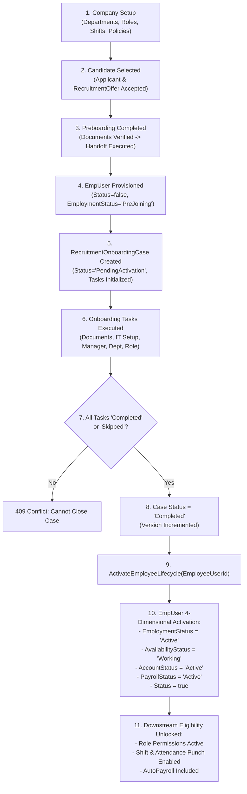
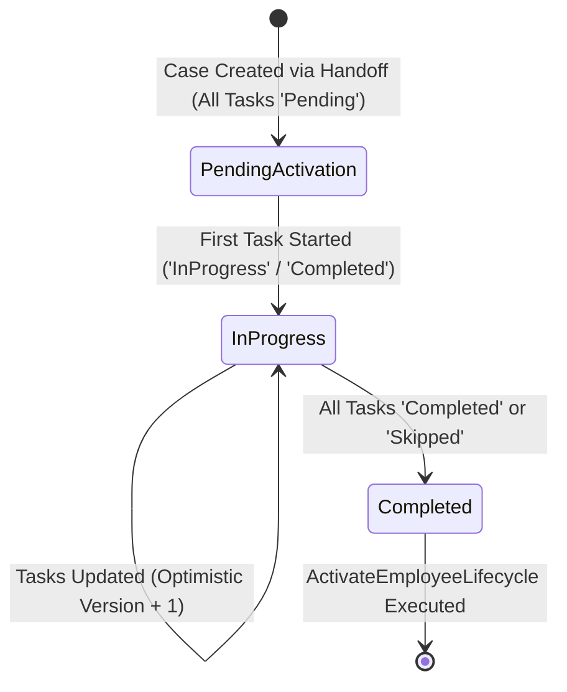

# Module Documentation — Employee Onboarding & Activation (`ONBOARDING`)

> **Document Status**: Complete & Authoritative (Special Deep-Dive Specification)  
> **Source-of-Truth**: Verified from Repository Implementation  
> **Primary Controller**: `RecruitmentOnboardingController.cs`  
> **Primary Service**: `RecruitmentOnboardingService.cs` (187 lines)  
> **Primary Entity**: `RecruitmentOnboardingCase.cs`  
> **Primary UI**: `RecruitmentOnboardingQueueCard.tsx`, `RecruitmentLifecycleDrawer.tsx`  
> **Last Verified**: September 2026

---

## 1. Module Overview

- **What the module is**: The structured Day-1 and Week-1 integration engine that manages newly hired employee task checklists (IT asset setup, email provisioning, security badge issuance, policy orientation) and executes **Automated Employee Lifecycle Activation** upon completion.
- **Why HR organizations need it**: Transitioning a new joiner into a productive employee requires coordinated action across IT, Facilities, Department Managers, and HR. Prematurely activating an employee in payroll or attendance before they have actually joined and completed mandatory onboarding causes payroll leakage and security exposure.
- **What business problem it solves**: Guarantees that an employee's account, working availability, shift schedule, and payroll inclusion are activated atomically and auditable only after all required onboarding tasks are completed or explicitly skipped.
- **Who uses it**: **HR Managers**, **HR Executives**, **IT Administrators**, and **Company Administrators**.
- **Where it fits in the HR lifecycle**: Stage 3 (Joining & Activation)—the critical gateway transforming a `PreJoining` record into an `Active` employee.

---

## 2. Real-World Business Scenario

```text
New Joiner: Siddharth Nair (Employee ID: CJ-2026-0089)
Department: Engineering
Reporting Manager: Vikram Malhotra
Onboarding Case ID: ONB-2026-441
```
1. On November 1, 2026, Siddharth arrives for Day-1 orientation. His `EmpUser` record currently has `EmploymentStatus = "PreJoining"` and `Status = false`.
2. HR Manager Priya opens the `RecruitmentOnboardingQueueCard` and selects Siddharth's onboarding case (`ONB-2026-441`), which is in `PendingActivation` status.
3. Priya and the IT team complete the onboarding task checklist:
   - `DOC_SIGN`: Employment Contract & NDA Signed -> Marked `Completed`.
   - `IT_PROVISION`: MacBook Pro & Corporate Email Issued -> Marked `Completed`.
   - `BADGE_ISSUE`: Biometric Access Card Assigned -> Marked `Completed`.
   - `ORIENTATION`: HR Policy & POSH Training -> Marked `Completed`.
4. Priya sets the case status to `Completed` and clicks **Save & Activate**.
5. `RecruitmentOnboardingService.Update` validates that zero tasks remain `Pending` or `InProgress`, increments the case `Version`, and invokes `ActivateEmployeeLifecycle`.
6. `ActivateEmployeeLifecycle` atomically mutates Siddharth's `EmpUser` document:
   - `EmploymentStatus`: `"PreJoining"` $\longrightarrow$ `"Active"`
   - `Lifecycle.AvailabilityStatus`: `"NotApplicable"` $\longrightarrow$ `"Working"`
   - `Lifecycle.AccountStatus`: `"Locked"` $\longrightarrow$ `"Active"`
   - `Lifecycle.PayrollStatus`: `"Hold"` $\longrightarrow$ `"Active"`
   - `EmpUser.Status`: `false` $\longrightarrow$ `true`
   - Appends 4 audit entries to `EmpUser.Lifecycle.History` with `ReasonCode = "RECRUITMENT_ONBOARDING_COMPLETED"`.

---

## 3. Supported Actors

| Actor | Capabilities in Module | Server Enforcement |
|---|---|---|
| **HR Manager / Executive** | Views onboarding queue, updates task statuses (`Pending`, `InProgress`, `Completed`, `Skipped`), closes onboarding cases, triggers `RetryActivation`. | Enforced via `[ModulePermission(Applications, Edit)]`. |
| **Company Administrator** | Full operational and retry control over all onboarding cases. | Admin bypass in `RoleServices`. |

---

## 4. Frontend Implementation

| File | Responsibility | Calls | Used By |
|---|---|---|---|
| `src/app/modules/recruitment/applications/components/RecruitmentOnboardingQueueCard.tsx` | Displays paginated onboarding queue with progress bars (`CompletionPercent`), pending task counts, and `FirstBlockingTaskTitle`. | `recruitmentServices.ts` | `Applications.tsx` |
| `src/app/modules/recruitment/applications/components/RecruitmentLifecycleDrawer.tsx` | Interactive drawer where HR toggles task statuses, passes idempotency keys, and executes employee activation. | `recruitmentServices.ts` | `Applications.tsx` |

---

## 5. Backend Implementation

| Backend File | Responsibility | Dependencies |
|---|---|---|
| `Codeji.CMS.API/Controllers/RecruitmentOnboardingController.cs` | Exposes REST endpoints `Get`, `GetQueue`, `Update`, and `RetryActivation`. | `IRecruitmentOnboardingService`, `IHttpContextAccessor` |
| `Codeji.CMS.Services/Recruitments/RecruitmentOnboardingService.cs` | Enforces task transition rules, optimistic concurrency (`ExpectedVersion`), idempotency (`LastCommandIdempotencyKey`), and executes `ActivateEmployeeLifecycle`. | `IMongoDbRepository<RecruitmentOnboardingCase>`, `IMongoDbRepository<EmpUser>` |
| `Codeji.CMS.Repository/Entities/Recruitments/RecruitmentOnboardingCase.cs` | MongoDB document storing case status, linked `ApplicantId` and `EmployeeUserId`, version, and embedded `Tasks` list. | `BaseClass` |

---

## 6. API Documentation

| Method | URL | Purpose | Auth / Permission | Request DTO | Validation & Business Logic | Response |
|---|---|---|---|---|---|---|
| `GET` | `/api/RecruitmentOnboarding/Get/{applicantId}` | Fetches onboarding case for a specific applicant. | `[ModulePermission(Applications, View)]` | Route `applicantId` | Scoped by `CompanyId` and `!x.IsDeleted`. | `Result<RecruitmentOnboardingCase>` |
| `GET` | `/api/RecruitmentOnboarding/GetQueue` | Paginated list of onboarding cases with progress metrics. | `[ModulePermission(Applications, View)]` | Query `status`, `pageNo`, `pageSize` | Computes `CompletionPercent`, `RequiredPendingTasks`, and `FirstBlockingTaskCode`. | `Result<RecruitmentOnboardingQueueItem>` |
| `PUT` | `/api/RecruitmentOnboarding/Update` | Updates task statuses, transitions case state, and activates employee when `Completed`. | `[ModulePermission(Applications, Edit)]` | `RecruitmentOnboardingUpdateCommand` | Validates task codes, checks `ExpectedVersion`, verifies all tasks are `Completed`/`Skipped` before closing, runs `ActivateEmployeeLifecycle`. | `Result<string>` |
| `POST` | `/api/RecruitmentOnboarding/RetryActivation/{caseId}` | Retries employee lifecycle activation if a prior concurrency conflict occurred on `EmpUser`. | `[ModulePermission(Applications, Edit)]` | Route `caseId` | Requires `onboarding.Status == "Completed"`; re-runs `ActivateEmployeeLifecycle`. | `Result<string>` |

---

## 7. Database Model

### Entity: `RecruitmentOnboardingCase` (`Codeji.CMS.Repository.Entities.Recruitments.RecruitmentOnboardingCase`)
- **Primary Key**: `CaseId`
- **Foreign Keys**: `CompanyId`, `ApplicantId`, `EmployeeUserId`.
- **Important Fields**:
  - `Status`: `"PendingActivation"`, `"InProgress"`, `"Completed"`.
  - `Version`: Integer optimistic concurrency counter.
  - `LastCommandIdempotencyKey`: String preventing duplicate command replay.
  - `Tasks`: `List<RecruitmentOnboardingTaskItem>`:
    - `Code`: Task identifier (e.g., `IT_SETUP`, `DOC_VERIFY`).
    - `Title`: Human-readable task name.
    - `Status`: `"Pending"`, `"InProgress"`, `"Completed"`, `"Skipped"`.

---

## 8. Business Rules (Verified from `RecruitmentOnboardingService.cs`)

1. **Completion Gate Rule (`Line 109`)**:
   `if (status == RecruitmentOnboardingStatus.Completed && onboarding.Tasks.Any(x => x.Status is not ("Completed" or "Skipped")))`
   $\longrightarrow$ Rejects with `409 Conflict` (`RecruitmentErrorCodes.InvalidTransition`): `"All onboarding tasks must be completed or skipped before closing the case."`
2. **PendingActivation Purity Rule (`Line 111`)**:
   `if (status == RecruitmentOnboardingStatus.PendingActivation && onboarding.Tasks.Any(x => x.Status is not "Pending"))`
   $\longrightarrow$ Rejects with `409 Conflict`: `"PendingActivation cannot contain started or completed tasks."`
3. **Unknown Task Code Protection (`Line 103`)**:
   Rejects any task code in the update payload that does not exist in the case's configured task template (`"Unknown onboarding task code"`).
4. **Idempotency & Replay Safety (`Line 91`)**:
   If `onboarding.LastCommandIdempotencyKey == command.IdempotencyKey`, the service skips re-mutating the onboarding document, re-runs `ActivateEmployeeLifecycle` idempotently, and returns `200 OK`.
5. **Optimistic Concurrency Rule (`Line 98`)**:
   If `command.ExpectedVersion != onboarding.Version`, rejects with `409 Conflict` (`"Onboarding case was changed by another user"`).

---

## 9. Complete End-to-End Trace: Candidate to Active Employee



---

## 10. State Machine



---

## 11. Permissions

| Action | Admin | HR Manager | HR Executive | Employee |
|---|:---:|:---:|:---:|:---:|
| View Onboarding Queue | Yes | Yes | Yes | No |
| Update Task Statuses | Yes | Yes | Yes | No |
| Complete Case & Activate Employee | Yes | Yes | Yes | No |
| Retry Employee Activation | Yes | Yes | Yes | No |

---

## 12. Dependencies

- **Depends On**: `Preboarding` (`RecruitmentHandoffService`), `CoreEmployee` (`EmpUser`).
- **Used By**: `CoreEmployee`, `Attendance`, `LeaveManagement`, `PayRoll`.
- **Reads From**: `RecruitmentOnboardingCase`, `EmpUser`.
- **Writes To**: `RecruitmentOnboardingCase`, `EmpUser` (including `EmpUser.Lifecycle.History`).

---

## 13. Cross-Module Events

- **Automatic Lifecycle Promotion**: Completing the onboarding case directly transitions `EmpUser` across 4 lifecycle dimensions (`EmploymentStatus`, `AvailabilityStatus`, `AccountStatus`, `PayrollStatus`), immediately enabling login access (`CompanyIdMiddleware`), daily attendance tracking, and monthly payroll inclusion (`EmploymentPeriod.IsPayrollIncludedForMonth`).

---

## 14. Failure Scenarios & Recovery (`RetryActivation`)

- **Partial Failure / Concurrency Split**: Because `RecruitmentOnboardingCase` and `EmpUser` reside in two distinct MongoDB collections, it is theoretically possible for the `RecruitmentOnboardingCase` update to succeed while the `EmpUser` update fails due to a concurrent edit on `EmpUser.Lifecycle.Version`.
- **Built-in Recovery Mechanism**:
  - If `employees.Update` fails (`Line 178`), `RecruitmentOnboardingService` returns:
    `"Onboarding case updated; employee lifecycle activation is pending and must be retried."`
  - HR can then invoke `POST /api/RecruitmentOnboarding/RetryActivation/{caseId}` (or replay the same `IdempotencyKey`), which safely completes the `EmpUser` activation.

---

## 15. Edge Cases

- **Already Active Employee**: If `ActivateEmployeeLifecycle` is called for an employee whose 4 lifecycle dimensions and `Status` are already active (`Line 149`), it short-circuits cleanly and returns `"Onboarding case and employee lifecycle are already active."` without appending duplicate history entries.

---

## 16. Current Strengths

- **Exemplary Concurrency & Idempotency Design**: Uses explicit `IdempotencyKey`, `ExpectedVersion` optimistic locking, and a dedicated `RetryActivation` recovery endpoint.
- **Deterministic Multi-Dimension Activation**: Automatically writes audit history (`RECRUITMENT_ONBOARDING_COMPLETED`) across all changed lifecycle dimensions.

---

## 17. Current Gaps

- Onboarding task templates are initialized with standard tasks rather than dynamically branching by department or job role in the UI editor.

---

## 18. Recommended Improvements

- **Medium**: Allow administrators to author department-specific onboarding task templates in `RecruitmentSettings.tsx`.

---

## 19. Future Scope

- New-hire self-service onboarding portal where the employee can check off orientation items and watch compliance training modules directly.
