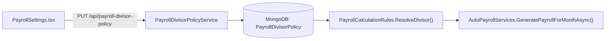

# PAYROLL SETTINGS & DIVISOR POLICY MODULE (`PAYROLL-SETTINGS.md`)

## 1. Module Overview
The **Payroll Settings & Divisor Policy Module** controls how the payroll engine calculates daily compensation rates, loss-of-pay deductions, pro-rata joining/exit adjustments, and payroll period locks (`PayrollDivisorPolicy`, `PayrollDivisorPolicyService`). It supports three industry-standard calculation methodologies: **Fixed 30 Days (`FIXED_30_DAYS`)**, **Actual Working Days (`WORKING_DAYS`)**, and **Actual Calendar Days (`CALENDAR_DAYS`)**.

---

## 2. Real-World Business Scenario
1. **Policy Selection**: Example Pvt Ltd switches its compensation policy from `CALENDAR_DAYS` to `FIXED_30_DAYS` via `PayrollSettings.tsx`.
2. **Impact on Payroll Calculation**:
   - In February 2026 (28 calendar days, 20 working days), under `FIXED_30_DAYS`, `PayrollCalculationRules.ResolveDivisor` returns `30.0`.
   - When an employee has `1.0` unpaid leave day on a ₹90,000 monthly gross salary, the LOP deduction is $\frac{90,000}{30} = ₹3,000$ consistently every month, regardless of whether the month has 28, 30, or 31 days.

---

## 3. Actors
| Actor | Capabilities |
|---|---|
| **Payroll Admin / HR Admin** | Configures `PayrollDivisorPolicy`, sets pay cycle cutoffs, and toggles statutory deduction defaults. |
| **Finance Director** | Audits active payroll calculation policy and approves policy updates. |

---

## 4. Frontend Implementation
| File | Responsibility | Calls | Used By |
|---|---|---|---|
| `src/app/modules/settings/pages/PayrollSettings.tsx` | Configuration panel for selecting `DivisorMode` (`FIXED_30_DAYS`, `WORKING_DAYS`, `CALENDAR_DAYS`) and statutory thresholds. | `GET /api/payroll-divisor-policy`, `PUT /api/payroll-divisor-policy` | Payroll Admin |

---

## 5. Backend Implementation
| Backend File | Responsibility | Dependencies |
|---|---|---|
| `Controllers/PayrollDivisorPolicyController.cs` | Exposes REST endpoints for querying and updating the tenant's active `PayrollDivisorPolicy`. | `IPayrollDivisorPolicyService` |
| `Services/PayrollDivisorPolicyService.cs` | Manages persistence of `PayrollDivisorPolicy` and integrates with `PayrollCalculationRules.ResolveDivisor`. | `IMongoRepository<PayrollDivisorPolicy>`, `ICompanyWorkingCalendarService` |

---

## 6. API Documentation
| Method | URL | Purpose | Auth / Permission | Request / Response | Side Effects |
|---|---|---|---|---|---|
| `GET` | `/api/payroll-divisor-policy` | Retrieves active payroll divisor configuration for the company. | JWT (`settings:read`) | `PayrollDivisorPolicyDto` | None |
| `PUT` | `/api/payroll-divisor-policy` | Updates the divisor calculation mode (`FIXED_30_DAYS`, `WORKING_DAYS`, `CALENDAR_DAYS`). | JWT (`settings:update`) | `UpdatePayrollDivisorPolicyDto` | Updates `PayrollDivisorPolicy` |

---

## 7. Database Model
### `PayrollDivisorPolicy` (`CMS-Backend-Core/Codeji.CMS.Repository/Entities/PayrollDivisorPolicy.cs`)
- `Id` (`string`, PK)
- `CompanyId` (`string`, FK)
- `DivisorType` (`string`, `"FIXED_30_DAYS"` | `"WORKING_DAYS"` | `"CALENDAR_DAYS"`)
- `IncludeHolidaysInWorkingDays` (`bool`)
- `IsActive` (`bool`)
- `UpdatedByUserId` (`string`)
- `UpdatedAtUtc` (`DateTime`)

---

## 8. Business Rules
- **Divisor Resolution Rule (`PayrollCalculationRules.ResolveDivisor`)**:
  - `"FIXED_30_DAYS"` $\rightarrow$ Always returns `30`.
  - `"WORKING_DAYS"` $\rightarrow$ Returns `eligibleWorkingDays` from `CompanyWorkingCalendarService`.
  - `"CALENDAR_DAYS"` (Default) $\rightarrow$ Returns `DateTime.DaysInMonth(year, month)`.
- **Closed Period Protection**: Changes to `PayrollDivisorPolicy` apply only to open/unprocessed payroll months and never retroactively mutate closed `PayrollEntity` records.

---

## 9. Complete Workflow

---

## 10. State Machine
Singleton tenant configuration (`Active` versioned per update).

---

## 11. Permissions
- `settings:read` / `settings:update` — View and modify payroll divisor rules.

---

## 12. Dependencies
- **Upstream**: `CALENDAR` (`CompanyWorkingCalendarService` for `WORKING_DAYS` mode).
- **Downstream**: `PAYROLL` (`AutoPayrollServices`), `FINAL-SETTLEMENT` (leave encashment & notice recovery daily rate).

---

## 13. Cross-Module Events
- Policy updates immediately govern the next `AutoPayrollServices` and `EmployeeFinalSettlement` calculation runs.

---

## 14. Failure Scenarios
- **Zero Eligible Working Days**: If `WORKING_DAYS` returns `<= 0` due to misconfiguration, `ResolveDivisor` falls back to `DateTime.DaysInMonth` to prevent division-by-zero exceptions.

---

## 15. Edge Cases
- **February Calculation**: Under `FIXED_30_DAYS`, 1 day LOP in February deducts $\frac{1}{30}$ of monthly gross rather than $\frac{1}{28}$.

---

## 16. Current Strengths
- Eliminates hard-coded divisor numbers in payroll math through an explicit, tenant-configurable rule engine.

---

## 17. Current Gaps
- Department-specific divisor overrides (e.g., factory floor on `WORKING_DAYS` vs corporate office on `FIXED_30_DAYS`) currently share one company-wide policy.

---

## 18. Recommended Improvements
- Extend `PayrollDivisorPolicy` to support department/grade scoping similar to `OffboardingPolicyResolver`.

---

## 19. Future Scope
- Simulation preview tool showing monthly payout variance across all 3 divisor modes before committing a policy change.
