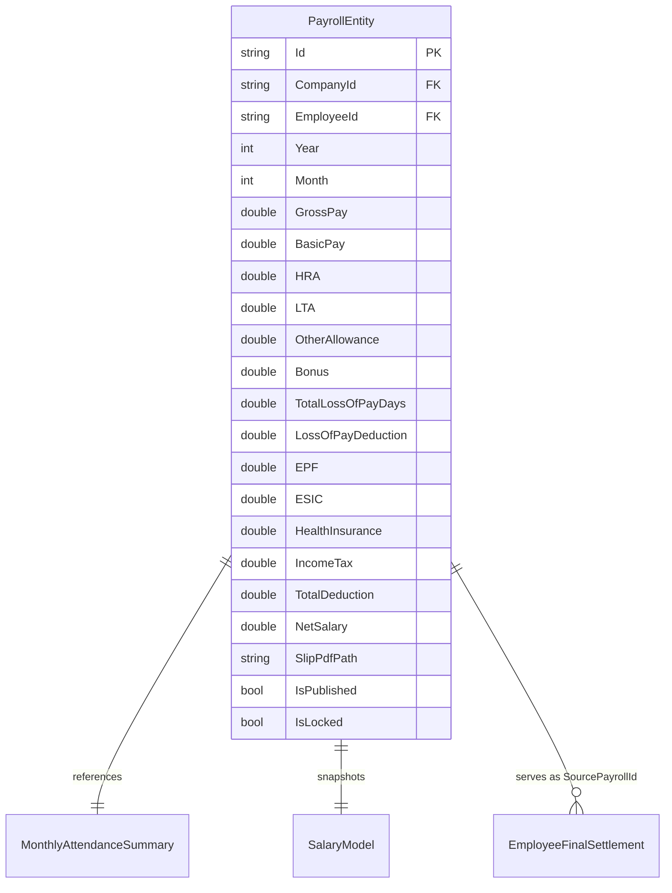
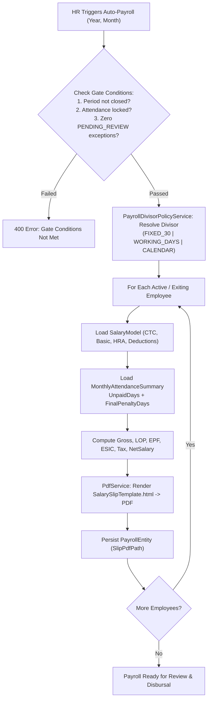
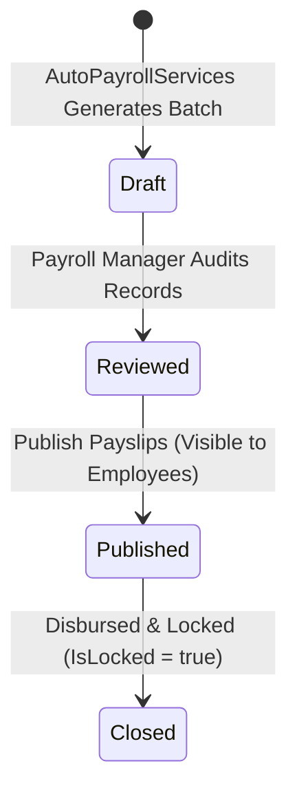

# PAYROLL PROCESSING MODULE (`PAYROLL.md`)

## 1. Module Overview
The **Payroll Processing Module** is the core financial compensation engine of **Codeji CMS / HRMS**. Implemented in `AutoPayrollServices` and `PayRollServices`, it orchestrates automated monthly payroll calculation, salary slip generation (`SalarySlipTemplate.html`, `PdfService`), statutory compliance (EPF, ESIC, Tax, Health Insurance), loss-of-pay (`TotalLossOfPayDays`) deductions from locked attendance summaries, and direct handover into Final Settlement (`SourcePayrollId`).

---

## 2. Real-World Business Scenario
1. **Pre-requisite Verification**:
   - For April 2026, HR confirms all `AttendancePayrollException` items are resolved (`APPROVED` or `WAIVED`) and `AttendanceMonthLock.ValidateAndLock()` has locked the month.
   - `AutoPayrollServices.GeneratePayrollForMonthAsync` verifies `PayrollPeriodRules.IsClosedPeriod` is false and `MonthlyAttendanceSummary.IsApproved && IsLocked == true`.
2. **Deterministic Calculation**:
   - Rahul Sharma's `SalaryModel` has `CTC = ₹12,00,000 / year` (`GrossPay = ₹1,00,000 / month`, `BasicPay = ₹50,000`, `HRA = ₹25,000`, `LTA = ₹10,000`, `OtherAllowance = ₹15,000`).
   - `PayrollCalculationRules.ResolveDivisor` applies policy `FIXED_30_DAYS` ($\text{Divisor} = 30$). Daily rate = $\frac{1,00,000}{30} = ₹3,333.33$.
   - Rahul's `MonthlyAttendanceSummary` has `UnpaidDays = 1.0` and approved `FinalPenaltyDays = 0.5` $\rightarrow \text{TotalLossOfPayDays} = 1.5$ days.
   - Loss of Pay Deduction = $1.5 \times 3,333.33 = ₹5,000.00$.
   - Statutory Deductions: `EPF = ₹1,800`, `ESIC = ₹0` (exceeds wage ceiling), `HealthInsurance = ₹1,500`, `IncomeTax = ₹8,200`.
   - `TotalDeduction` = $5,000 + 1,800 + 1,500 + 8,200 = ₹16,500$.
   - **`NetSalary`** = $1,00,000 - 16,500 = \mathbf{₹83,500}$.
3. **Salary Slip Generation & Disbursal**:
   - `AutoPayrollServices` populates `PayrollEntity`, compiles HTML via `Templates/SalarySlipTemplate.html`, converts it to PDF via `PdfService`, and writes the file to `/fs/salary-slips/{id}.pdf`.
   - Rahul receives a salary credit notification and downloads the PDF via `GET /api/payroll/{id}/download-slip`.

---

## 3. Actors
| Actor | Capabilities |
|---|---|
| **Payroll Manager / HR Admin** | Triggers automated payroll batch generation, reviews payroll variance, approves payroll runs, and publishes salary slips. |
| **Finance / Accounts** | Downloads bank disbursement sheets and payroll expense journals. |
| **Employee** | Views monthly salary breakdown and downloads signed PDF salary slips. |

---

## 4. Frontend Implementation
| File | Responsibility | Calls | Used By |
|---|---|---|---|
| `src/app/modules/payroll/pages/PayrollDashboard.tsx` | Monthly payroll summary, gross payout, deductions breakdown, and generation trigger button. | `GET /api/autopayroll/summary`, `POST /api/autopayroll/generate` | Payroll Admin |
| `src/app/modules/payroll/components/PayrollApprovalTable.tsx` | Detailed employee-by-employee compensation review table with LOP and net pay. | `GET /api/autopayroll/records` | Payroll Admin |
| `src/app/modules/payrollsettings/PayrollSettings.tsx` | Company-wide payroll configuration: salary templates, statutory limits, and divisor policies. | `GET /api/payroll/divisor-policy`, `PUT /api/payroll/divisor-policy` | Payroll Admin |
| `src/app/modules/payrollsettings/components/AttendanceLockBlockingModal.tsx` | Hard verification gate preventing payroll generation if monthly attendance summaries remain unlocked. | `GET /api/attendance/month-lock-status` | Payroll Admin |
| `src/app/modules/payroll/components/RecordPayrollPaymentModal.tsx` | Batch payment recording and bank disbursement tracking with audit history. | `POST /api/payroll/payments/batch` | Accounts / HR |
| `src/app/modules/payroll/pages/MySalarySlipsPage.tsx` | Employee self-service page listing monthly payslips with download action. | `GET /api/payroll/my-slips`, `GET /api/payroll/{id}/download-slip` | Employee |

---

## 5. Backend Implementation
| Backend File | Responsibility | Dependencies |
|---|---|---|
| `Controllers/AutoPayrollController.cs` | API endpoints to trigger batch payroll, fetch payroll run summaries, and publish payslips. | `IAutoPayrollServices` |
| `Controllers/PayRollController.cs` | Endpoints for single-employee payroll queries, manual adjustments, and payslip PDF downloads. | `IPayRollServices` |
| `Controllers/PayrollPaymentBatchController.cs` | Manages salary disbursement batches, payment confirmation, and banking audit trail. | `IPayrollPaymentBatchService` |
| `Services/AutoPayrollServices.cs` | Batch engine that verifies `PayrollPeriodRules`, queries locked attendance, resolves salary models, computes net salary, and calls `PdfService`. | `IMongoRepository<PayrollEntity>`, `IMongoRepository<MonthlyAttendanceSummary>`, `ISalaryService`, `IPdfService`, `IPayrollDivisorPolicyService` |
| `Services/PayRoll/PayrollCalculationRules.cs` | Pure calculation engine for daily rate derivation using `FIXED_30_DAYS`, `FIXED_26_DAYS`, `CALENDAR_DAYS`, or `WORKING_DAYS`. | `PayrollDivisorPolicy` |
| `Services/PdfService.cs` | Renders HTML template `SalarySlipTemplate.html` into PDF byte streams stored under `/fs/`. | `TemplateEngine`, file system storage |

---

## 6. API Documentation
| Method | URL | Purpose | Auth / Permission | Request / Response | Side Effects |
|---|---|---|---|---|---|
| `POST` | `/api/autopayroll/generate` | Generates batch payroll for specified month and year (blocked if attendance unlocked). | JWT (`payroll:create`) | `{ Year, Month }` -> `PayrollBatchResultDto` | Creates `PayrollEntity` records, renders payslip PDFs |
| `GET` | `/api/autopayroll/summary` | Retrieves aggregate payroll costs, deductions, and headcounts. | JWT (`payroll:read`) | `PayrollSummaryDto` | None |
| `GET` | `/api/payroll/divisor-policy` | Retrieves active company salary proration divisor policy. | JWT (`payroll:read`) | `PayrollDivisorPolicyDto` | None |
| `PUT` | `/api/payroll/divisor-policy` | Updates company salary proration divisor (`FIXED_30`, `FIXED_26`, `CALENDAR`, `WORKING_DAYS`). | JWT (`payroll:update`) | `PayrollDivisorPolicyDto` | Affects subsequent daily salary rate calculations |
| `POST` | `/api/autopayroll/publish` | Publishes approved payroll to employees, enabling payslip downloads. | JWT (`payroll:approve`) | `{ Year, Month }` | Updates `IsPublished = true`, sends SignalR notifications |
| `GET` | `/api/payroll/{id}/download-slip` | Streams employee payslip PDF file. | JWT (`payroll:read`) | Streams `application/pdf` | None |

---

## 7. Database Model

---

## 8. Business Rules
- **Pre-Execution Gate**:
  - `PayrollPeriodRules.IsClosedPeriod`: Cannot rerun or overwrite a payroll period that is permanently closed.
  - `MonthlyAttendanceSummary.IsApproved && IsLocked`: Attendance must be locked before payroll can run.
  - Zero `PENDING_REVIEW` exceptions in `AttendancePayrollException`.
- **Loss of Pay (LOP) Rule**:
  $$\text{TotalLossOfPayDays} = \text{UnpaidDays} + \text{FinalPenaltyDays}$$
  $$\text{PerDayRate} = \frac{\text{GrossPay}}{\text{ResolvedDivisor}}$$
  $$\text{LossOfPayDeduction} = \text{TotalLossOfPayDays} \times \text{PerDayRate}$$
- **Statutory Rules**:
  - EPF: Standard 12% of Basic Pay capped at statutory threshold unless employee opted out.
  - ESIC: Applicable only if Gross Pay is below ESIC statutory wage limit.
- **Net Salary Formula**:
  $$\text{NetSalary} = \text{GrossPay} - \text{TotalDeduction}$$

---

## 9. Complete Workflow

---

## 10. State Machine

---

## 11. Permissions
- `payroll:read` — View payroll summaries and personal payslips.
- `payroll:create` — Trigger batch payroll generation.
- `payroll:approve` — Publish and lock monthly payroll batches.

---

## 12. Dependencies
- **Upstream**: `ATTENDANCE` (`MonthlyAttendanceSummary`, `AttendanceMonthLock`), `SALARY` (`SalaryModel`), `PAYROLL-SETTINGS` (`PayrollDivisorPolicyService`).
- **Downstream**: `FINAL-SETTLEMENT` (`SourcePayrollId`), `DOCUMENTS` (PDF storage under `/fs/`).

---

## 13. Cross-Module Events
- **Payroll Publication**: Dispatches real-time payslip availability alerts via `NotificationHub`.
- **Exit Settlement**: Generates pro-rated final month payroll record linked to `EmployeeFinalSettlement`.

---

## 14. Failure Scenarios
- **Attendance Not Locked**: Generation aborts with explicit error preventing corrupted LOP calculation.
- **PDF Generation Failure**: Caught and logged; batch execution flags individual payslip rendering error without rolling back entire payroll run.

---

## 15. Edge Cases
- **Mid-Month Joining / Exit**: Salary calculation scales pro-rated gross pay based on active calendar days in that month.

---

## 16. Current Strengths
- Unyielding attendance-to-payroll safety gates prevent unverified attendance from causing payroll errors.
- Native server-side PDF payslip compilation with HTML templating.

---

## 17. Current Gaps
- Direct banking portal API integration (e.g., ICICI/HDFC corporate banking direct debit API) is not yet wired; payroll produces exportable bank payout sheets.

---

## 18. Recommended Improvements
- Add automated banking payment file format exports (NACH / NEFT batch format).

---

## 19. Future Scope
- Automated direct-tax TDS return filing integration and flexible employee tax declaration proofs portal.
