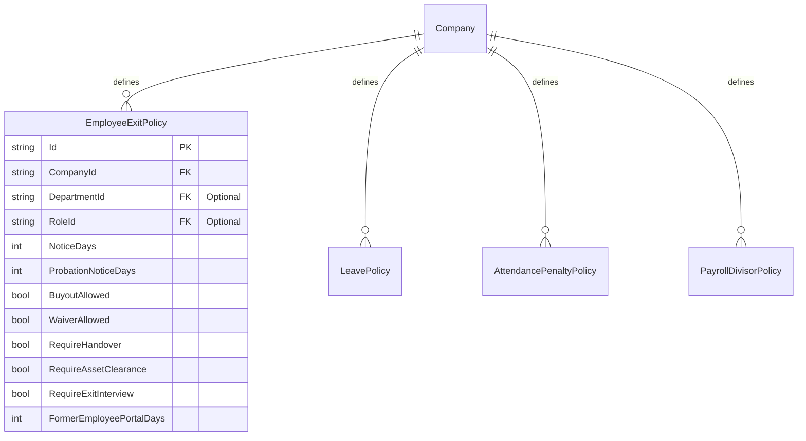
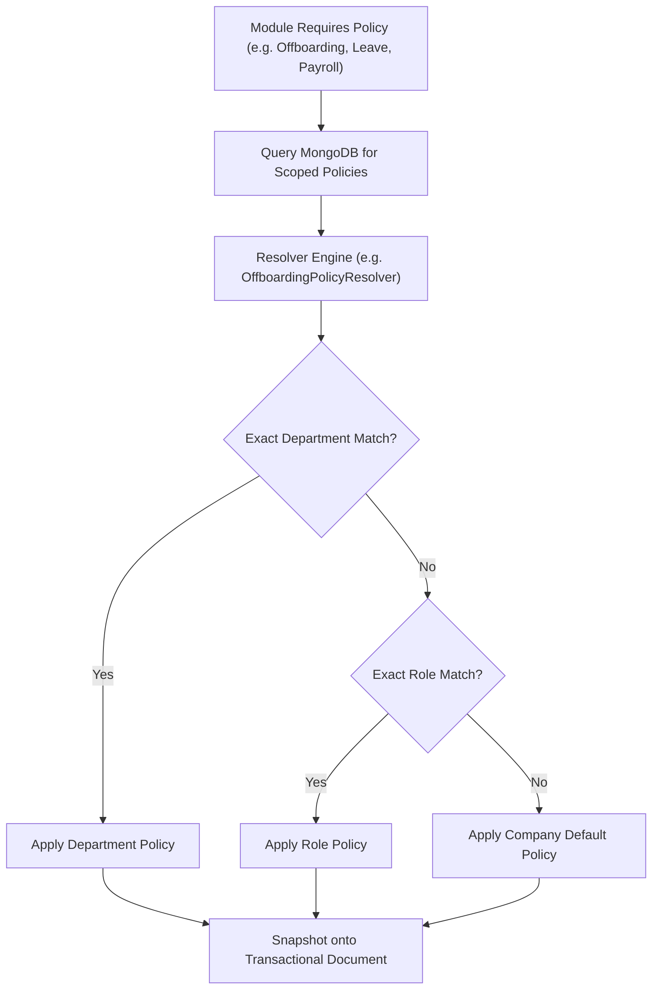

# POLICY & CONFIGURATION GOVERNANCE MODULE (`POLICY.md`)

## 1. Module Overview
The **Policy & Configuration Governance Module** serves as the central administrative brain of **Codeji CMS / HRMS**. Rather than hardcoding organizational rules, it provides configurable, scoped policy entities across the entire employee lifecycle: `EmployeeLifecyclePolicy`, `EmployeeExitPolicy`, `LeavePolicy`, `AttendancePenaltyPolicy`, and `PayrollDivisorPolicy`.

---

## 2. Real-World Business Scenario
1. **Departmental Policy Specialization**:
   - Company default `EmployeeExitPolicy` mandates `NoticeDays = 30`.
   - The Engineering department requires `NoticeDays = 60` and mandatory code handover (`RequireHandover = true`).
   - HR Admin defines an Engineering-scoped `EmployeeExitPolicy` (`DepartmentId = "dept_eng"`).
2. **Dynamic Resolution**:
   - When an Engineering employee resigns, `OffboardingPolicyResolver` resolves the Engineering policy. When a Sales employee resigns, it falls back to the Company default policy.

---

## 3. Actors
| Actor | Capabilities |
|---|---|
| **Super Admin / HR Admin** | Defines and updates policies at Company, Department, and Role scopes. |
| **Audit Officer** | Inspects policy versioning and audit trails. |

---

## 4. Frontend Implementation
| File | Responsibility | Calls | Used By |
|---|---|---|---|
| `src/app/modules/settings/pages/LifecyclePolicySettings.tsx` | Manages `EmployeeLifecyclePolicy` (probation days, onboarding requirements). | `GET /api/employee-lifecycle/policy`, `PUT /api/employee-lifecycle/policy` | HR Admin |
| `src/app/modules/settings/pages/ExitPolicySettingsPage.tsx` | Scoped matrix for `EmployeeExitPolicy` (notice days, buyouts, waivers, clearance gates). | `GET /api/employee-exit-policies`, `POST /api/employee-exit-policies` | HR Admin |
| `src/app/modules/settings/pages/LeavePolicySettings.tsx` | CRUD for `LeavePolicy` rules (accruals, carry-forwards, probation/notice restrictions). | `GET /api/leave/policies`, `POST /api/leave/policies` | HR Admin |
| `src/app/modules/settings/pages/PayrollSettings.tsx` | Divisor and calculation rules (`PayrollDivisorPolicy`). | `GET /api/payroll-divisor-policy`, `PUT /api/payroll-divisor-policy` | HR Admin |

---

## 5. Backend Implementation
| Backend File | Responsibility | Dependencies |
|---|---|---|
| `Services/OffboardingPolicyResolver.cs` | Implements 3-tier precedence resolution (`Department -> Role -> Company`) for exit policies. | `IMongoRepository<EmployeeExitPolicy>` |
| `Services/AttendancePenaltyService.cs` | Reads `AttendancePenaltyPolicy.CombinedLhdEdMonthlyLimit` to trigger payroll exceptions. | `IMongoRepository<AttendancePenaltyPolicy>` |
| `Services/PayrollDivisorPolicyService.cs` | Resolves active `PayrollDivisorPolicy` for monthly payroll and FnF calculations. | `IMongoRepository<PayrollDivisorPolicy>` |

---

## 6. API Documentation
| Method | URL | Purpose | Auth / Permission | Request / Response | Side Effects |
|---|---|---|---|---|---|
| `GET` | `/api/employee-exit-policies` | Retrieves all scoped exit policies for the tenant. | JWT (`settings:read`) | `List<EmployeeExitPolicyDto>` | None |
| `POST` | `/api/employee-exit-policies` | Creates a department- or role-specific exit policy. | JWT (`settings:update`) | `CreateExitPolicyDto` -> `EmployeeExitPolicyDto` | Persists policy |
| `PUT` | `/api/employee-exit-policies/{id}` | Updates policy parameters. | JWT (`settings:update`) | `UpdateExitPolicyDto` | Increments `Version` |

---

## 7. Database Model

---

## 8. Business Rules
- **Hierarchical Scoping Precedence**:
  1. Policy with matching `DepartmentId`
  2. Policy with matching `RoleId`
  3. Default Company policy (`DepartmentId == null && RoleId == null`)
- **Immutability of In-Flight Instances**: When a workflow commences (e.g., exit or leave application), active policy parameters are snapshotted onto the instance entity so future policy revisions do not retroactively invalidate in-flight processes.

---

## 9. Complete Workflow

---

## 10. State Machine
Policies exist as `Draft` $\rightarrow$ `Active` $\rightarrow$ `Superseded`.

---

## 11. Permissions
- `settings:read` — View policy parameters.
- `settings:update` — Create or modify organization policies.

---

## 12. Dependencies
- **Upstream**: `COMPANY-SETTINGS`, `ROLE-PERMISSION`.
- **Downstream**: `EMPLOYEE`, `ONBOARDING`, `PROBATION`, `LEAVE`, `ATTENDANCE`, `PAYROLL`, `OFFBOARDING`.

---

## 13. Cross-Module Events
- Updating a policy updates governance logic for all newly initiated workflow instances.

---

## 14. Failure Scenarios
- **Missing Scoped Policy**: System falls back safely to tenant default policy, ensuring workflows never crash.

---

## 15. Edge Cases
- **Simultaneous Department and Role Match**: Department-level policy takes precedence over Role-level policy.

---

## 16. Current Strengths
- Complete snapshotting architecture guarantees legal/contractual immutability for past transactions.

---

## 17. Current Gaps
- Policy effective date scheduling (e.g., defining a policy today that automatically activates next quarter) is not yet built; changes take effect upon save.

---

## 18. Recommended Improvements
- Add `EffectiveFrom` and `EffectiveTo` date ranges on all policy documents.

---

## 19. Future Scope
- Visual policy simulation sandbox to model financial and operational impacts of policy changes before publishing.
